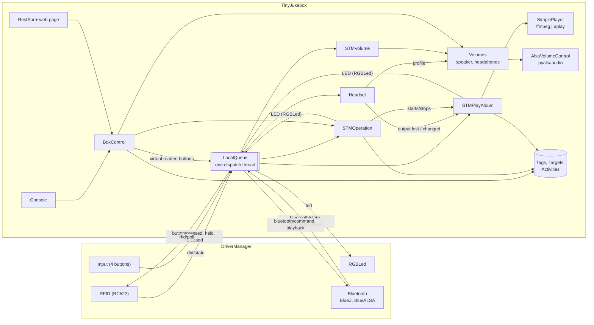
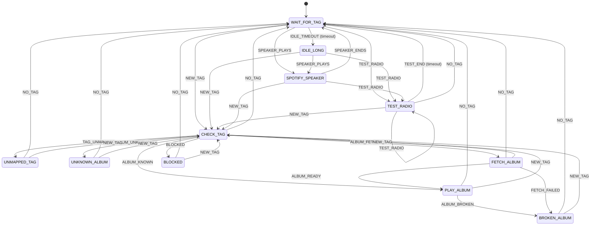
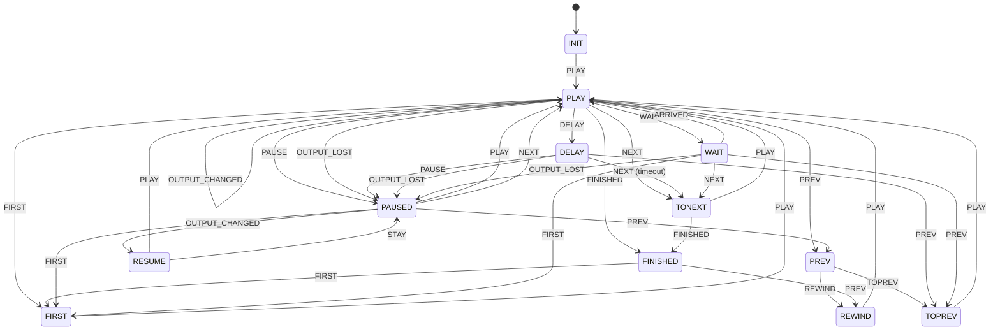
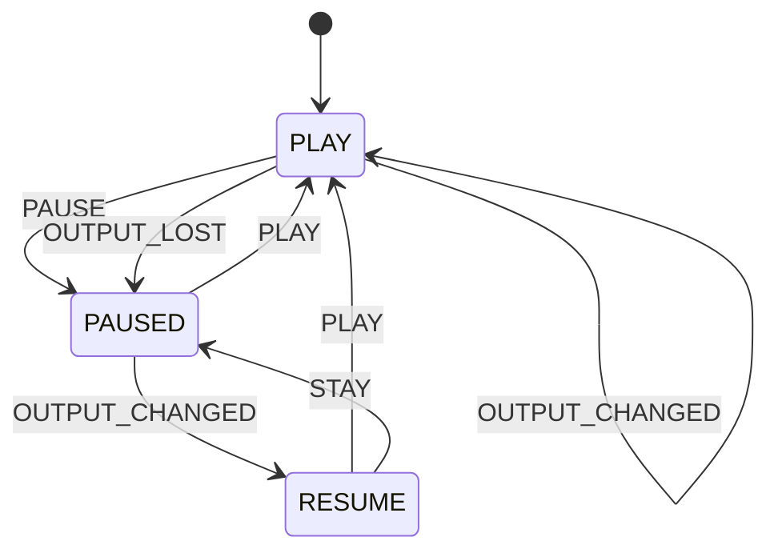
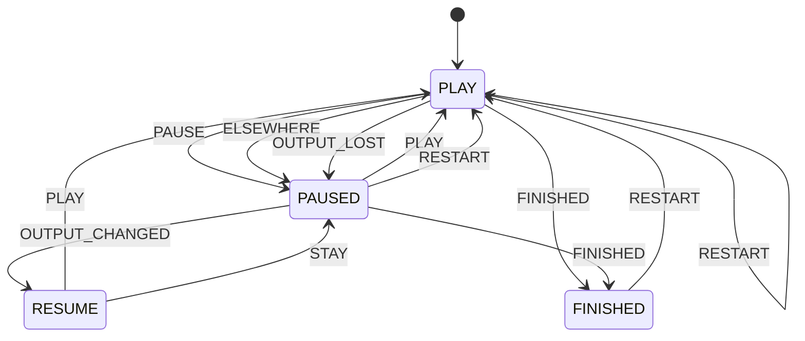

# Architecture

How Tiny Jukebox is built: components, state machines, player, data model, messages and threads. Related documents:

- [drivers.md](drivers.md): device drivers and the Bluetooth stack
- [rfid-reader.md](rfid-reader.md): the program that reads the RFID reader
- [rest-api.md](rest-api.md): web server, security, endpoints, events
- [configuration.md](configuration.md): command line and config file
- [development.md](development.md): repository layout, tests, quality checks
- [library.md](library.md): the library, the synchronization of a box with it, slots and health check

## 1. Overview

Tiny Jukebox runs as one process. Drivers, state machines and `BoxControl` exchange messages over an in-process queue
(`LocalQueue`). `tinyjukebox.messages` defines all topics and payload types. With `--no-hardware` no driver is loaded:
tags and buttons come from the web page, and a virtual headset replaces the Bluetooth driver.

| Component | Module | Task |
| --- | --- | --- |
| `TinyJukebox` | `tinyjukebox.py` | builds everything, command line, signals |
| `DriverManager` and drivers | `devices/` | hardware: RFID reader, buttons, LED, Bluetooth ([drivers.md](drivers.md)) |
| `STMOperation` | `stm/stmoperation.py` | what the tag on the box means |
| `STMPlayAlbum`, `PlayRadio`, `PlaySpotify` | `stm/stmplayalbum.py`, `stm/playradio.py`, `stm/playspotify.py` | one album, radio station or entry of Spotify that is playing |
| `STMVolume`, `Volumes` | `stm/stmvolume.py`, `volumemanager.py` | volume buttons, limits, mixers |
| `SimplePlayer`, `RadioPlayer` | `albumplayer/` | audio pipeline `ffmpeg \| aplay` |
| `SpotifyPlayer` | `albumplayer/spotifyplayer.py` | one entry of Spotify with Soloist (section 4.1) |
| `SpotifyAccount`, `SpotifyEngine` | `spotify/` | key, player and login of Spotify; the one Soloist of the box with its sound (section 4.1) |
| `Headset` | `headset.py` | output, volume profile and pause follow the Bluetooth headset |
| `RGBLed` | `rgbled.py` | LED patterns, overlay with expiry |
| `Tags`, `Targets`, `Activities` | `data/` | JSON files |
| `CatalogControl`, `BoxControl` | `control.py` | every operation of console and REST API; the catalog operations are shared with the library |
| `BoxSync` | `sync/box.py` | records every change of the data for the library and puts what the library delivers into it ([library.md](library.md)); does nothing on a box without a library |
| `Slots`, `Health` | `slots.py` | which version runs, health check of a new version; does nothing on a box without slots |
| `CLI`, `RestApi` | `cli.py`, `web/` | text and HTTP front ends of `BoxControl` |

`TinyJukebox.__init__` wires the parts:

- `LocalQueue` (via `AbstractMicroservice`)
- with `--hardware` and a section `drivers` the `DriverManager` on the same queue; without hardware the
  `VirtualHeadset`
- the data collections, `RGBLed` and `AudioOutput` (speaker or headset)
- `Volumes` with one `VolumeManager` each for speaker (ALSA or virtual mixer) and headset
- `BoxSync`, `Slots` and `Health`
- `SpotifyAccount` and `SpotifyEngine`
- the state machines, `Headset`, `BoxControl`, `CLI` and, if enabled, `RestApi`

**Start** (`AbstractMicroservice.start` → `TinyJukebox._start`): connect the queue → console → `Headset` (subscribes
before the Bluetooth driver reports its state) → start the drivers (before the first message to the LED) → LED
magenta → `STMVolume` → watch of the mixer → LED green (with the alarm pattern on top if the library is too old for
the box) → `STMOperation` (requests the RFID state) → `BoxSync` (the synchronization) → `BoxControl.backups` (the
backups by a schedule) → `SpotifyAccount` (the daily look at the age of the player of Spotify) → `Health` (the health
check of a new version) → virtual headset → web server.

**Stop** in reverse order: `Health` → web server → virtual headset → `BoxControl.backups` → `SpotifyEngine` (ends
Soloist for good) → `SpotifyAccount` → `BoxSync` → `STMOperation` → watch of the mixer → `STMVolume` → `Headset` →
LED red (`RGBLed.stop`: also instead of an overlay; nothing changes the LED afterwards) → `wait_until_delivered()`
(the LED must still receive the last message) → stop the drivers → disconnect the queue. A command of the page that
asked for a restart gets its answer first. Every step is taken, also when one before failed – e.g. an album that
cannot save its position on a card that has become read-only; the first error is raised afterwards.

## 2. State machines

All machines are built on tantamount. `stm/base.py` works around two defects of tantamount 0.3.2:

- The flag `ignore_undefined_events` is stored under a wrong name. Without the correction an unexpected event (e.g.
  a button while the album has finished) raises a `KeyError` in the worker thread.
- An exception in `on_entry`/`on_exit` ends the worker thread of `asyncoperate`. After that the machine ignores all
  events and `stop()` blocks. `SafeMachine` logs the exception and carries on.

`SafeMachine.call_soon(function)` calls a function in the worker after the events queued before it – e.g. the switch
to the speaker once the playback has handled the loss of the headset (section 5).

Events from outside (drivers, web page, player) are queued with `asyncoperate` and processed in the worker thread of
the machine. `wait_until_idle()` waits until the queue is empty (for tests). The diagrams below are generated with
`stm.base.mermaid_notation`; the transitions to `END` (on `stop()` from every state) are left out.

### 2.1 STMOperation – the tag on the box

| State | LED | On entry |
| --- | --- | --- |
| `WAIT_FOR_TAG` | green | – |
| `IDLE_LONG` | green, blinking | after `IDLE_BLINK_AFTER` (10 min) in `WAIT_FOR_TAG`: shows that the box is still switched on. Left like `WAIT_FOR_TAG`; every return to `WAIT_FOR_TAG` restarts the time |
| `CHECK_TAG` | – | create an unknown UID as a new, unlinked tag; check the target |
| `UNMAPPED_TAG` | yellow | – |
| `UNKNOWN_ALBUM` | yellow/red alternating | – |
| `PLAY_ALBUM` | aqua | album: fetch the activity (create it anew if the album changed), create and start `STMPlayAlbum`; station: start `PlayRadio`; entry of Spotify: fetch the activity, start `PlaySpotify`; on failure → `BROKEN_ALBUM` |
| `BROKEN_ALBUM` | red, blinking | – |
| `TEST_RADIO` | as `PlayRadio` | test the stream of a station or an entry of Spotify (saved or not); if a tag has been placed meanwhile → `TEST_END` at once |
| `SPOTIFY_SPEAKER` | blue, white/blue while paused | only with the speaker switched on: the Spotify app plays on the box while no tag is on it (section 2.5) |
| `FETCH_ALBUM` | green, aqua, blue, aqua in turn | only with a library: files of the album are missing on the box. Asks `AlbumFiles` for the album, the track that is due first; `ALBUM_READY` when that track arrived, `FETCH_FAILED` if the album cannot be fetched (→ `BROKEN_ALBUM`) |
| `BLOCKED` | the alarm pattern as an overlay: red, white, magenta, yellow | the library is too old for the box ([library.md](library.md), section 4.15): nothing plays |
| `END` | magenta | – |

- The RFID handler only remembers the current UID and queues `NEW_TAG`/`NO_TAG`.
- Until the first RFID message arrives, a thread of its own requests the current state from the RFID driver every
  `poll_interval` seconds (default 5) with `RFID_POLL`.
- `recheck_tag()` evaluates the placed tag again, e.g. after it has been linked on the web page – of the box or,
  through the synchronization, of the library.
- An unknown UID is looked up in the library first (`BoxSync.lookup`, at most 3 s) before it is created as a new,
  unlinked tag.
- **Radio test** (`test_radio()`; web page tab "Radio", console `test_radio`): it never bypasses a tag. It is
  reachable only while no tag is on the box (`WAIT_FOR_TAG`, `IDLE_LONG`, `SPOTIFY_SPEAKER`); `test_radio()` refuses
  while a UID is remembered (under the lock of the RFID handler, i.e. in the same order as `NEW_TAG`); `TEST_RADIO`
  checks again on entry; a placed tag ends it (`NEW_TAG`); after `RADIO_TEST_DURATION` (60 s) it ends by itself.
  `TEST_END` leads back to `WAIT_FOR_TAG`: a tag that has been placed meanwhile has queued `NEW_TAG` behind it, which
  checks it – going to `CHECK_TAG` instead would start its album twice.

### 2.2 STMPlayAlbum – an album that is playing

- `INIT` creates the player and sets it to the saved position. A finished album or an invalid track number (the
  playlist changed) starts from the beginning.
- `PLAY` (LED blue) plays and saves the position every `update-schedule` seconds (`PeriodicTask`) and on exit.
- End of a track: `DELAY` (pause `pause-between-tracks`, then timeout `NEXT`), or `NEXT` at once if the pause is 0.
- `PREV`: within the first `rewind-max-time` seconds to the previous track, otherwise to the start of the current
  one.
- **"prev" held** (`BUTTON_HELD` with `PREV`, after the `hold_timeout` of the button driver): `cmd_restart_album`,
  i.e. `FIRST`. The press before it has already triggered `PREV`. If "next" is pressed at the same time, it is the
  gesture for pairing a headset and the album keeps playing: `BothButtons` records from `BUTTON_PRESSED` and
  `BUTTON_RELEASED` when "next" and "prev" were pressed. A "next" that has not been released counts if it was
  pressed after "prev" or at most `BOTH_BUTTONS_WINDOW` (2 s) before it – for the buttons of the box as for a press
  without release (web page, headset buttons).
- `FINISHED` (LED blue, blinking) saves `album-finished`. `NEXT` is ignored there; `PREV` plays the last track again
  from its beginning (`REWIND`), restart (`FIRST`) plays the album from its first track.
- **`PAUSED`** (LED white/blue alternating) saves the position; nothing plays, the tag stays on the box. `PLAY` and
  `NEXT` continue at the same position (only the next `NEXT` skips), `PREV` jumps at once as during playback.
  `PAUSE` in `DELAY` selects the next track so that the pause ends there. `PAUSE`/`PLAY` in the wrong state (also in
  `FINISHED`) are undefined events and are ignored.
- **Headset lost** (`cmd_output_lost`, event `OUTPUT_LOST`): from `PLAY`, `DELAY` and `WAIT` to `PAUSED`. The
  reason is kept in `OutputPause` (`stm/base.py`). It is set by the action of the transition (tantamount calls it
  between `on_exit` and `on_entry`), not by `on_entry` – so it survives when `RESUME` returns to `PAUSED`. The same
  action rewinds the track by `OUTPUT_REWIND` (1 s): the end was still in the buffers – not in `WAIT`, where nothing
  played, and not in `DELAY`, where it selects the next track as `PAUSE` does. If playback was already paused,
  `OUTPUT_LOST` is undefined in `PAUSED` – the reason stays "user".
- **Card and tools:** a position that cannot be saved (card full or read-only) is logged once; the album plays on. A
  track that cannot be started after the start of the album (ffmpeg or aplay gone, no process left) pauses it, and
  `PLAY` tries again; at the start the error goes to `STMOperation`, which shows the album as broken. `stop()` ends
  the machine and its threads also when `END` raised.
- **Headset available** (`cmd_output_changed`, event `OUTPUT_CHANGED`): in `PLAY` the machine leaves and enters
  `PLAY` (the player pauses, rewinds 1 s, plays – now on the new output). In `PAUSED`, `RESUME` decides: continue
  only if the pause was caused by losing the headset and is at most `RESUME_WINDOW` (10 min) old, otherwise `STAY`.
- The machine publishes the playback status (`PlaybackStatus`) on `PLAYBACK` with every change; the Bluetooth driver
  reports it to the headset.
- **`WAIT`** (LED green, aqua, blue, aqua in turn): the file of the track that is due has not arrived from the
  library yet. `PLAY` sends on to `WAIT` on entry; `ARRIVED` – a file of the album arrived – leads back. `NEXT`,
  `PREV` and `FIRST` select another track, which pulls that one forward in the download. The player holds a
  placeholder for a track without a file (`AAlbumPlayer.current_track_ready`).

### 2.3 PlayRadio – a radio station that is playing

- `PLAY` creates a new `RadioPlayer` on entry and ends it on exit. There is no position, so a pause ends the stream.
- The buttons play, "next" and "prev" all trigger `PLAY`; while playing that is undefined and has no effect.
- LED: green, aqua, blue flowing (`WAITING`) while connecting – until aplay's buffer is full and the sound is heard
  (`RadioState.PLAYING`) –, blue while playing, aqua while waiting to connect again, white/blue while paused.
- `get_info()` returns `target_type: "radio"` and the `state` of the `RadioPlayer`, or `paused`.
- `PlayRadio` is a state machine because ending a stream takes up to a few seconds: commands are queued and executed
  in the worker, no handler blocks.
- `STMOperation` creates `STMPlayAlbum` (`album_factory`) or `PlayRadio` (`radio_factory`) in `PLAY_ALBUM`, depending
  on the target type. Without `radio_factory` a station tag ends in `BROKEN_ALBUM`.

### 2.4 STMVolume – volume buttons

`INIT → IDLE`; `IDLE → VOLUME_UP/VOLUME_DOWN → IDLE` for one button press (step `volume-step`);
`IDLE → VOLUME_UP_HELD/VOLUME_DOWN_HELD → IDLE` for every `BUTTON_HELD` of a button that is kept pressed (step
`volume-step-hold`; the button drivers repeat it with `hold_repeat`).

- Leaving `INIT` sets the start volume; `END` sets the volume to 0.
- The handlers only queue; the mixer is set in the worker.
- A step goes back to `IDLE` also when setting the volume fails: the exception is logged and reported as unexpected
  (during the probation of a version that ends the version, as everywhere), and the next press works. Only `IDLE`
  takes a button.
- The buttons change the active profile of `Volumes`: the speaker, or the headset while it is connected.

### 2.5 PlaySpotify – an entry of Spotify that is playing

- `PLAY` starts `SpotifyPlayer` the first time at the saved position (track, its address, seconds; from the
  beginning if the entry was finished), later it continues. LED aqua while the player connects and goes to the
  position, blue while it plays, red/black blinking when it cannot play (`ERROR`). The position is saved every
  `update-schedule` seconds and on exit, with the address of the track (`track-uri`).
- Buttons as with an album: play/pause; "next" plays the next track, in a pause it continues; "back" goes to the
  start of the track or the one before (Soloist decides); "back" held or "back" after the end: `RESTART`, the entry
  from the beginning.
- `ELSEWHERE`: music was started elsewhere with the account of the box; "play" takes the playback back (`activate`).
- `FINISHED` (LED blue, blinking) saves `album-finished` and notes "album finished" in the journal.
- Headset: `OUTPUT_LOST` pauses, `OUTPUT_CHANGED` in `PLAY` starts another `aplay` on the new output, in `PAUSED` it
  decides via `RESUME` as with an album. Both only queue: the change is decided in the worker after what was queued
  before it (`call_soon`, so a loss just before comes first), and the player starts the new `aplay` in its thread.
  The pause is silent at once – `SpotifyPlayer.pause` mutes the sound before it returns, also while the player is
  still on its way to the saved track – so when the worker calls the `then` of `cmd_output_lost`, nothing can reach
  the speaker any more.
- `start()` first asks whether Spotify can play (key, player, login): if not, it raises and the tag ends in
  `BROKEN_ALBUM`.
- A test (`activity` None) starts at the beginning, saves nothing and writes no journal.

**`SPOTIFY_SPEAKER` of `STMOperation`.** With the switch "Spotify speaker while no tag is on the box" on,
`SpotifyEngine` keeps Soloist running in `WAIT_FOR_TAG` and `IDLE_LONG`. When the Spotify app plays on the box, the
engine reports `SPEAKER_PLAYS`; the state hands the sound to `aplay` and passes the buttons of the box on (play/pause,
next, back). `get_album()` returns a playback object, so that the headset, the page and the console steer it like an
album. A tag or a test leaves the state (the phone's playback is paused); `SPEAKER_ENDS` comes when the phone's
playback has ended, was taken to another device or was paused for 10 minutes, and when "Connect" begins. `CHECK_TAG`
tells the engine for every tag – also an unknown one, and on a box that is out of service (`BLOCKED`) – whether it
plays an entry of Spotify: only then Soloist keeps running.

The buttons, the headset and the page only queue: the engine runs `soloist ctl` and ends `aplay` in a thread of its
own, one command after the other (section 4.1). A lost headset mutes the sound at once, in the handler; the phone's
playback is paused in that thread, after the commands queued before, and only then the speaker becomes the output.
After the loss the box stays silent until the headset is back or the state is entered again.

## 3. Volume

**`Volumes`** (`volumemanager.py`) holds one `VolumeManager` each for speaker and headset. Buttons, web page and
console change the active one.

- The headset's manager sets the volume through `BluetoothVolumeControl`: a message to the Bluetooth driver, sent
  only while the headset is connected.
- Start value and maximum can be changed at run time (`set_limits`, checked by `check_limits`:
  0 ≤ start value ≤ maximum ≤ 100). `VolumeLimits` (`data/volumelimits.py`) stores them in `volume.json`; on start
  these values override the config.
- A lowered maximum lowers the current volume at once. `reset()` sets the start value (on every connect of the
  headset).

**`AlsaVolumeControl`** sets the control `mixer-control` of the default sound card with pyalsaaudio
(`alsaaudio.Mixer(control).setvolume(percent)`).

- The scale is the one of `amixer sset <control> N%`: both compute `rint(range · N · 0.01) + min` over the raw range
  of the control (pyalsaaudio 0.11, `alsamixer_getphysvolume`; alsa-utils, `convert_prange1`). `amixer` differs only
  where a percentage > 0 would map to raw value 0 (it sets 1) – with 5 % steps that matters only for controls with
  fewer than 20 levels. `setvolume(0)` does not mute, like `amixer … 0%`.
- The module is imported on first use, so tests and `--no-hardware` run without ALSA.
- A lock serializes the calls (state machines, REST API, console) because the thread safety of pyalsaaudio is not
  documented. On `ALSAAudioError` the mixer is created anew once; only then is the error logged.

**Changes from outside:** `AlsaVolumeControl.watch(callback)` starts the thread `AlsaVolumeControl.watch`.

- It polls a `Mixer` of its own (ALSA delivers events to the handle that is polled) with `select.poll` on
  `polldescriptors()` (timeout 0.5 s so it can be stopped) and acknowledges with `handleevents()`. Descriptors that
  BlueALSA reports as `-1` (unused) are skipped.
- It reads the volume (mean of the channels) with a further mixer that is opened for each event, never with the
  watched handle: a control can disappear while it is watched (headset disconnects), and `getvolume()` on a handle
  whose control was removed aborts the process inside alsa-lib.
- The value goes to `VolumeManager.mixer_changed`, which adopts values set outside the box software (alsamixer; for the
  headset its own buttons – the Bluetooth driver watches the BlueALSA mixer the same way and reports the volume in
  `BluetoothState`). Above `max-volume` it sets the mixer back to the maximum.
- The notifications of its own changes arrive too, often only after the next button press. Values that the
  `VolumeManager` set itself within the last second are therefore ignored (`OWN_CHANGE_WINDOW`); otherwise the volume
  would jump back briefly when a button is pressed quickly.
- On `ALSAAudioError` the thread reopens the mixer after 5 s.
- `TinyJukebox` starts the watch only with hardware, after `STMVolume`, and stops it before. Through the server-sent
  events the web page sees a change from outside at once.

## 4. Player

`PlayerInterface` describes what `STMPlayAlbum` needs. `AAlbumPlayer` implements the album logic on top of `ATrack`;
the subclasses only provide `_create_track`.

- **`SimplePlayer`:** one `AudioPipeline` per playback, made of `ffmpeg` (decodes to PCM from the start position) and
  `aplay`. A monitor thread waits for the end. A thread of its own reads the stderr of ffmpeg continuously (the last
  ten lines go to the log): for damaged files ffmpeg reports every frame, and a full pipe would stall playback.
  `stop()` ends the output first (sound off at once) and kills processes that ignore SIGTERM. With `--no-audio` a
  real-time ffmpeg null sink replaces `aplay`. The hook `on_play` reports the start of ffmpeg to the latency
  measurement (section 11).
- **Start time of the sound:** `aplay` starts only when its ALSA buffer is filled; `albumplayer/buffer-time` sets
  it (`--buffer-time`, default otherwise mostly 500 ms; on the box 2000 ms, which bridges gaps of the WLAN in radio
  streams). `-probesize`/`-analyzeduration` for ffmpeg are not set:
  measured on the PC with 40 files of up to 13 MB from the albums of the box, ffmpeg delivers the first data after
  about 33 ms with and without them, because MP3 is recognized from the first frames.
- **`RadioPlayer`** (`albumplayer/radioplayer.py`): plays a stream in a thread of its own, also with `AudioPipeline`
  (ffmpeg with `-reconnect` and `-rw_timeout` 15 s instead of `-ss`).
  - `resolve_stream_url` loads m3u/pls playlists (timeout 10 s, at most 64 KB) and takes the first http(s) entry;
    HLS (`#EXT-X-`) is left to ffmpeg.
  - If the stream ends or fails, the thread waits `RETRY_DELAYS` (1, 2, 5, 10, 30 s; the last one repeats) and
    reconnects. After 60 s of stable playback the sequence starts over.
  - States: `connecting`, `playing`, `retrying`, `stopped`. Next to the state, `error` says why the stream failed
    last (`None` while it plays).
  - `stop()` sets a flag under the lock before it ends the pipeline. A thread that is still loading a playlist
    starts no stream afterwards, and no state callbacks (LED) arrive after `stop()`.
- **`AudioOutput`** (`simpleplayer.py`) tells the players where to play: speaker (default device) or headset
  (`aplay -D bluealsa:DEV=<address>,PROFILE=a2dp,VOL=<n>+`). The players ask at every start of a playback, so a
  change takes effect with the next pipeline; the running one is restarted by the state machine (`OUTPUT_CHANGED`).
  `VOL` sets the current headset volume when the device is opened: BlueALSA remembers the volume of the last time,
  and the command to the mixer may arrive only after the first sound.
- **Output lost:** if `aplay` ends with an error while the output is the headset, the track does not count as played
  to the end. `SimpleTrack` reports `_output_lost` (the position stays), `AAlbumPlayer` calls the hook that
  `STMPlayAlbum` sets with `set_output_lost_hook` – the machine pauses instead of skipping track after track. The
  driver's message ("no longer connected") leads to the same event; whichever comes first pauses. On the speaker an
  error is logged and the next track starts. The radio player retries as for any stream failure and pauses when the
  driver reports the loss of the headset.
- **`DummyPlayer`:** a track "plays" for its length (timer of the `Clock`). In tests a `ManualClock` drives the time,
  so playback tests run without waiting.
- **Position:** `ATrack` computes the position from start time and clock. Stopping keeps the position; the next
  `play()` continues there.
- **Play IDs:** every `play()` gets a new ID. The end of a playback is reported with its ID and discarded if it has
  been stopped or restarted meanwhile. `AAlbumPlayer._on_track_end` additionally checks track index, ID and playback
  status. A track that ends exactly when "next" is pressed or playback is paused therefore cannot trigger a second
  skip.

### 4.1 Spotify

Entries of Spotify are played with Spotify Soloist, the headless player of Spotify. Nothing of it is tried on a box
yet; what the trial checks is in [roadmap.md](roadmap.md).

**`SpotifyAccount`** (`spotify/account.py`) keeps everything in the folder `spotify` next to `json` and `sync`
(`/srv/tinyjukebox/spotify`): the Soloist API key (mode 600), the switch of the speaker, the program (`bin/soloist`,
the build before as `soloist.previous`), the data directory with the login and the cache. The folder is not
synchronized and not part of a backup.

- **The player** is fetched from Spotify's address (`soloist-builds.spotifycdn.com`, one archive per processor) when
  the key is entered; Spotify does not allow passing it on, so it is in no slot and no release. Every build stops
  working 90 days after it was built, and Spotify publishes new ones several times a day. The box keeps its build
  while it has more than 30 days left: once a day it looks at its age, and only then it asks Spotify with
  `If-Modified-Since` (answered `304` while nothing changed). A download is checked against its `ETag` when that is
  the MD5 of the archive (32 hex digits); otherwise it is trusted because it comes from Spotify's address over
  HTTPS, and – in any case – the new build replaces the old one only if `soloist --version` runs, which also names
  the time of the build. The archive (at most 128 MB) is unpacked as a stream, the program in pieces of 1 MB: it is
  refused if the program unpacks to more than 512 MB, the rest (other files, headers, which `tarfile` keeps in
  memory) to more than 16 MB, or if more than 100 files come before the program – a decompression bomb would fill the
  memory or the card. Exit code 10 (expired) and "Update now" ask at once.
- **"Connect"** runs `soloist --pair` for five minutes: the box is chosen in the Spotify app, which connects it to its
  account. Soloist announces itself only if it gets UDP port 5353, which `avahi-daemon` holds on the box: avahi is
  stopped for those minutes (`sudo -n systemctl`, allowed by the rule `/etc/sudoers.d/tinyjukebox-avahi` that the
  installer writes, [box.md](box.md), section 7; only with hardware).
  "Disconnect" deletes the data directory. Before either the account calls `before_connect`, afterwards
  `after_connect` (with any result): the engine ends its Soloist and starts none in between.

**`SpotifyEngine`** (`spotify/engine.py`) owns the one Soloist of the box with its sound – one at a time, because
they share the data directory. It runs while an entry plays because of a tag or a test (`open`/`close`), and with
the speaker switched on while no tag is on the box (`idle`); a tag that plays no Spotify ends it (`taken(False)`).
When Soloist is ended, its cache is emptied: Soloist does not keep to `--cache-size`, and the cache shares the card
with the albums.

- **While "Connect" runs** no Soloist runs and none is started: `open` raises `Busy`, and the playback waits (below);
  `idle` does nothing, what the phone played on the box has ended (`SPEAKER_ENDS`). Afterwards the speaker starts
  again if no tag is on the box. After the box has stopped (`stop`), none is started any more.
- **The commands of the speaker** – the buttons, the headset, the page – return at once: they are queued and run in
  a thread of its own (`Spotify.commands`; it ends after 5 s without a command), one after the other, together with
  the start of the speaker's Soloist. `soloist ctl` takes a moment and may hang up to 10 s; the dispatch thread
  never waits for it. A lost headset mutes the sound at once (a lock of its own, never held while anything waits);
  the pause of the phone's playback follows in that thread, then the `then` of `cmd_output_lost`. A headset that
  comes makes the box heard only if none was lost since.
- **`Soloist`** (`spotify/soloist.py`): `soloist -n <name> -k <key> -D data -C cache -z 100 -i 100 -w 127.0.0.1:0
  -d tinyjukebox`. Commands are single calls of `soloist ctl` (it finds the port in the data directory); the events
  come from `soloist ctl trace`, one JSON object per line. Once a Soloist is stopped it runs no command and passes no
  event on – the next one, or `soloist --pair`, may have the data directory already. An exit is reported only for
  the Soloist that runs, not for one that was replaced.
- **Sound** (`spotify/sound.py`): Soloist plays only into PipeWire or PulseAudio. The engine starts `pipewire` and
  `wireplumber` with a setup of their own (runtime and config folders in `spotify/sound`): no sound card, no
  Bluetooth, one sink `tinyjukebox` (`libpipewire-module-pipe-tunnel`) that writes 16 bit stereo, 44.1 kHz into a
  named pipe. `PipeReader` reads the pipe and hands the sound to `aplay` on the device of `AudioOutput`, so speaker,
  headset and `--no-audio` work as for every other sound. It drops the sound while muted (skipping, paused), starts
  no `aplay` while muted, and notes when the last sound that was not silent came. If `aplay` fails on the headset,
  it mutes itself and reports it – it never goes on to the speaker by itself; an `aplay` that the box ended itself is
  no failure.
- **Ending a process** (`aplay`, PipeWire, WirePlumber, Soloist): SIGTERM, SIGKILL after 2 s (Soloist 5 s), and if
  it has not ended after as long again, it is left behind and logged – every wait is bounded. An `aplay` that hangs
  in its driver never empties its pipe, so its input is unbuffered and closed only after the signals; closing it
  first would wait for the pipe forever. The reader ends `aplay` before it waits for its own thread, which may wait in
  a write.

**`SpotifyPlayer`** (`albumplayer/spotifyplayer.py`) plays one entry in a thread of its own; the commands of the box
and the events of Soloist are queued. `pause` mutes the sound at once, in the thread of the caller; the sound comes
back only with `play` or `restart`. `output_changed` is queued as well: the new `aplay` is started in the thread of
the player.

- **Start:** shuffle, repeat off, volume 100, `play <uri>`. Soloist always starts at the first track, so for a saved
  position the player skips silently: as many times `next` as the saved place says, then it compares the address of
  the track. If it differs (the playlist was changed), it looks for it in the queue (`queue 80 --json`: what came
  before and up to 80 tracks ahead); if it is not there, the entry starts from the beginning. Then `seek` and sound.
- **The place of the track** follows from the queue: the track that starts is the next one or the one before. The
  journal gets a line per track that was left (place, address, title, seconds, played to its end); the tracks passed
  while skipping are none.
- **The end:** a track that Spotify added (`source: autoplay`) or nothing playing any more after the last track: the
  player pauses and reports `FINISHED`.
- **The phone has no influence:** an event within 3 seconds after a command of the box is its answer; anything else
  came from the Spotify app and is undone – a pause (`play`), another track (back to the position of the box),
  shuffle, repeat, the volume. `device_changed` with `is_active: false` (music started elsewhere with the account):
  state `elsewhere`, the machine pauses.
- **No sound** while playing for 15 seconds (open report no. 5 of Soloist: it may stand still while it says
  "playing"): the track is started again at its position.
- **Soloist ends:** started again after 1, 2, 5, 10, 30 s (the last one repeats), LED aqua – in a loop, never a
  recursion, for as long as it takes (a tag left on a box without the internet for hours); the position stays where
  the sound stopped. If it ends in a pause (or while the box is paused, also on its way to the saved track), it is
  started again only with "play" – the box never plays by itself. Exit code 10: the account fetches a new build, the
  player reports `ERROR` (`expired`). No login (`auth_state`): the account is "not connected" any more.
- **While "Connect" runs** (`Busy`, or the engine ended Soloist for it): the player waits in `RETRYING` and tries
  every second; that counts as no failure – the delays after real failures do not grow because of it.

## 5. Headset logic

`Headset` (`headset.py`) is the part of the box software that reacts to the headset; Bluetooth itself is in the driver
([drivers.md](drivers.md), section 5). It acts on the difference between two `BluetoothState` messages:

| Change | Reaction (in the dispatch thread: queue and publish only) |
| --- | --- |
| connected | `Volumes`: profile headset, `reset()` to the start value (→ `BLUETOOTH_COMMAND`); `AudioOutput.use_headset`; running playback: `cmd_output_changed()` |
| no longer connected (also: unpaired) | profile speaker; running playback: `cmd_output_lost(then=…)` – `AudioOutput.use_speaker` only once the playback has handled the loss (`call_soon` in its worker), at the latest after `SPEAKER_AFTER_LOSS` (3 s); without playback at once |
| `volume` differs, still connected | `VolumeManager.mixer_changed` of the headset: adopt, set back if above the maximum; the notification of tinyjukebox's own change is ignored |
| `pairing` starts / ends | LED overlay |

- The comparison is with the previous state, not with the value in the `VolumeManager`: the volume that the headset
  brings along from the last time is already in the first state after connecting and does not count as a change.
- BlueALSA may report the volume of the last time only after the box has set its start value. A louder volume
  reported within `CONNECT_SETTLE` (3 s) after the connect is set back to the volume of the box, once – unless the
  volume has been changed on the box meanwhile (buttons, web page). A quieter one is taken over.
- Until the speaker takes over, a track that starts (a queued `NEXT`, a `Play.on_entry` that runs) uses the headset
  output that is gone and fails there, instead of sounding for a moment at the volume of the speaker. A reconnect
  within the 3 s voids the switch.
- `Headset` keeps track of which buttons are held, from `BUTTON_HELD`, `BUTTON_RELEASED` and `BUTTON_PRESSED`. When
  "next" and "prev" are both held, it starts the search for a headset. A new press also ends the hold of a button
  (in case a `BUTTON_RELEASED` is missing). The drivers need no change for this.
- A virtual headset (`BluetoothState.virtual`) leaves the output on the default device.

Rules that the design guarantees:

| Rule | How |
| --- | --- |
| The box never becomes loud unexpectedly | Losing the headset pauses; the pause is queued before `AudioOutput` switches to the speaker; a failing headset output pauses; the device is opened with the current headset volume |
| The speaker is silent while the headset plays | Only the output device changes (`aplay -D …`). The Audio Amp SHIM switches its amplifier on only while the I2S clock runs |
| Hearing protection | The headset has its own start value (applied on every connect) and maximum; the same `VolumeManager` logic enforces the maximum for commands of the box and for changes made with the headset's buttons |

## 6. Data model

Three JSON files, each with a backup `<file>_` (previous content). On a box that works with a library they are
generated on every start from what the library delivered and the own changes that it has not confirmed
([library.md](library.md), section 4.2); their format is the same:

| File | Key | Content |
| --- | --- | --- |
| `tags.json` | UID | `{"tag": {"uid", "name"}, "target": {"type": "album" \| "radio" \| "spotify", "id"}, "created"}`; `id: -1` = not linked |
| `targets.json` | target ID | album: `{"target-id", "target-type": "album", "album-folder", "playlist", "created", "title", "cover"}`, folder relative to `albums-folder`, `title` missing in entries made before 0.11.0; station: `{"target-id", "target-type": "radio", "name", "url", "created", "cover"}`; `cover` (only for an album or a station that has one) is the name of an image in the images folder; entry of Spotify: `{"target-id", "target-type": "spotify", "name", "uri", "created", "cover"}`, `uri` is `spotify:<kind>:<id>`, `cover` an image `spotify-<random>` in the images folder (schema: `oneOf`) |
| `activity.json` | UID | `{"tag-uid", "target-id", "track-id", "track-time", "album-finished", "target-type"}`; an entry of Spotify (`target-type: spotify`) also has `track-uri`, the address of its track |

- **Tag UIDs** are the complete UID (4 or 7 bytes) in hex with colons, e.g. `04:1A:2B:3C:4D:5E:6F`.
- **`JsonData`** validates against the schema on load. If the file is missing, empty or invalid, the backup is loaded
  and written back. Unchanged data is not written.
- **Writes survive a power cut** (the box is switched off by cutting the power): the new file is written as `.tmp`
  and brought to the card with `fsync`; only then does the old file become the backup, and the new one is put in
  place with `os.replace`. The regular file is always complete or missing (then the backup is used).
- **`volume.json`** (`VolumeLimits`): `{"speaker": {"default-volume", "max-volume"}, "headphones": {…}}` – only the
  profiles changed at run time. If the file is missing, the config applies (the file is created empty).
- **`Tags`/`Targets`/`Activities`** hold the objects in memory and write on every change. If the activities file is
  missing or unusable, it is rebuilt from the tags (all albums from the beginning).
- **Target IDs** (albums, stations and entries of Spotify share them) count up and are never reused, not even after the
  album with the highest ID was deleted. Otherwise a new album would inherit everything that still refers to the old ID
  (e.g. the cover cached by the browser, a stored position). The highest ID ever assigned is stored in
  `targets-last-id.json` (`{"last-id": 12}`, written with `fsync` before `targets.json`). If it is missing or unusable,
  new IDs follow the highest existing one.
- **Activities** are created when an album is played for the first time. If an activity belongs to another album
  than the tag, it is reset. Stations have no activity.
- **Playlist:** m3u with one file per line. Comments (`#EXTM3U`, `#EXTINF`), empty lines and the playlist itself are
  skipped; UTF-8 with BOM and cp1252 are read.
- **Sanity checks** verify time stamps, folders, playlist and MP3 files (with `os.path`, not `glob` – brackets in
  names are not patterns; `.MP3` counts) and the references between the files.

## 7. Messages

`tinyjukebox/messages.py` defines all topics as constants, together with the types of their payloads. Drivers, state
machines and `BoxControl` import the module alike; it has no dependency on hardware.

| Constant | Topic | Payload | Sender → receiver |
| --- | --- | --- | --- |
| `RFID_STATE` | `rfid/state` | `RfidState(uid, error, timestamp)` | rfid driver, virtual reader (`BoxControl.place_tag`/`remove_placed_tag`) → `STMOperation` |
| `RFID_POLL` | `rfid/poll` | `None` | `STMOperation` → rfid driver: publish the current state in any case |
| `BUTTON_PRESSED` | `button/pressed` | `Button` | input driver, Bluetooth driver and virtual headset (headset buttons), buttons of the web page (`press`) → `STMVolume` (`VOLUME_UP`/`DOWN`), `STMPlayAlbum`, `PlayRadio` and `PlaySpotify` (`NEXT`/`PREV`/`PLAY`/`PAUSE`), `STMOperation` in `SPOTIFY_SPEAKER` (passes them on to `SpotifyEngine`), `Headset` |
| `BUTTON_HELD` | `button/held` | `Button` | input driver after `hold_timeout` (repeated with `hold_repeat`), web page (`hold`) → `STMVolume` (`VOLUME_UP`/`DOWN`: small step), `STMPlayAlbum` and `PlaySpotify` (`PREV`: from the beginning), `Headset` (`NEXT` and `PREV`: pair) |
| `BUTTON_RELEASED` | `button/released` | `Button` | input driver, web page (`release`) → `STMPlayAlbum`, `PlaySpotify`, `Headset` |
| `LED` | `led` | `LedPattern(colors, delays)` | `RGBLed` → rgbled driver |
| `PLAYBACK` | `playback` | `PlaybackStatus` (`playing`, `paused`, `stopped`) | `STMPlayAlbum`, `PlayRadio`, `PlaySpotify` → Bluetooth driver; `TinyJukebox` (the library hears of the position; proof for the health check) |
| `JOURNAL` | `journal` | `JournalEvent(event, fields)`: `tag`, `track`, `broken`, `control`, `end` | `STMOperation`, `STMPlayAlbum`, `PlaySpotify` → `TinyJukebox`, which writes the journal of the box |
| `BLUETOOTH_STATE` | `bluetooth/state` | `BluetoothState(device, connected, battery, volume, pairing, pairing_result, virtual)` | Bluetooth driver, virtual headset → `Headset` |
| `BLUETOOTH_COMMAND` | `bluetooth/command` | `BluetoothCommand(action, volume)` with `BluetoothAction` `pair`, `unpair`, `volume` | `Headset`, `BluetoothVolumeControl` → Bluetooth driver, virtual headset |

Types:

- `Button` (`volume-up`, `volume-down`, `next`, `prev`, plus `play` and `pause`, which only the headset has) is a
  `StrEnum`. Its values are the names in the config (`button`) and in the REST API.
- `BluetoothState` describes the paired headset (`BluetoothDevice(address, name)` or `None`). `connected` means that
  it can play.
- `RfidState` is a frozen dataclass. `present` is `uid is not None`; `timestamp` is excluded from comparison.
- `LedPattern` holds one or more colors (`RGB` = three booleans) and a duration per color.
  `LedPattern.static(Color | rgb)` and `LedPattern.blink(a, b, delay_a, delay_b)` create it; invalid patterns (no
  color, missing or non-positive duration) raise `ValueError`. The named colors (`Color`, value is the RGB tuple)
  are defined here as well.

Rules:

- **Payloads are immutable.** The `LocalQueue` passes the payload on unchanged; all handlers of a topic receive the
  same object, not a copy. Payloads are therefore enums, `bool`, `None` or frozen dataclasses with tuples.
- **Topics are constants, not configuration.** Messages never leave the process. Constants and types remove the need
  to keep the section `tinyjukebox` and the driver entries consistent, the encoding to `bytes` and text comparisons in
  the handlers; typos show up on import or in mypy. The config only says which button an input driver is (`button`).
- **Unexpected payloads** are ignored with a warning in the log, never raised.

**LED:** `RGBLed.get_state()` describes the shown pattern for the web page as `{"color": "GREEN"}`,
`{"color_a", "color_b", "delay"}` or, for a sequence of more than two colors (`set_sequence`),
`{"colors", "delay"}`. `show_overlay(color[, color_b, interval], duration)` shows a pattern on top of the one of the
state machines (search: blue, blinking fast; result: 2 s white or 3 s red blinking); `show_overlay_sequence` does
the same with a sequence and without an end (the alarm pattern of `BLOCKED`). The machines keep setting their
patterns; the last of them is published as soon as the overlay expires (`threading.Timer`) or ends with
`clear_overlay()`.

## 8. BoxControl and console

`BoxControl` (`control.py`) contains all operations: status, tags (create, name, link, delete), albums (add, delete,
regenerate the playlist, title, cover), radio stations, activities, sanity checks, player (including pause), volume
with start value and maximum, Bluetooth headset (info, pair, unpair, virtual headset), virtual RFID reader and
virtual buttons, the library of the box (address, name, state of the synchronization) and the version of the box
software (the commands of `tinyjukebox-slot`). The operations on tags, albums and stations are in
`CatalogControl`, which the library uses as well (`LibraryControl` in `library/service.py`).

- Errors are `ApiError` subclasses with a text for the user.
- Console (`cli.py`) and REST API (`web/server.py`) are front ends of `BoxControl` and therefore behave the same:
  `remove_tag` asks back first, and linking the tag that is on the box starts the album
  at once.
- Virtual reader and virtual buttons publish the same messages as the drivers; they work with and without hardware.

The console commands are listed in [operations.md](operations.md), the HTTP endpoints in [rest-api.md](rest-api.md).

## 9. Framework (`tinyjukebox/core`)

### 9.1 AbstractMicroservice

`TinyJukebox`, `DriverManager` and all drivers inherit from `AbstractMicroservice` (template method pattern: the base
class controls the flow, the subclass provides `_start`, `_stop`, `_get_schema`, `_get_description`).

- **Construction:** the own section (`tinyjukebox`, `drivers` or `driver`) becomes `_config`. Without a logger passed
  in, the service creates it from the section `logger` (`create_logger`) and attaches a console handler; otherwise it
  takes a child logger. Without a pubsub client passed in, it creates a `LocalQueue` that it owns (connect on start,
  disconnect on stop) and registers `pubsub_stats` and `show_config`. Only `TinyJukebox` does that; `DriverManager` and
  drivers are given queue and logger.
- **`start()`** (under `_startstop_lock`): connect the queue if needed → start the console → `_start()` → set
  `_is_started`.
- **A failed start cleans up like `stop()`** (errors during cleanup are only logged) and re-raises. `_stop()` must
  therefore cope with a half-finished start. Otherwise the non-daemon threads of tantamount would keep the process
  alive, and systemd would never restart the box.
- **`stop()`** (likewise): set `_stop_service` → stop the console → `_stop()` → disconnect the own queue → set
  `_is_stopped` – the last two also when `_stop()` raised; otherwise `run()` would wait forever.
- `run()` starts and waits for the stop with a 0.25 s timeout so that `Ctrl-C` reaches the main thread.
  `asyncstart`/`asyncstop` each start a new `LoggerThread`; the service can be started and stopped repeatedly.
- **Command line:** `_argument_parser()` creates the `ArgumentParser` (`-c`, `-q`/`-v` as a mutually exclusive
  group, `--no_gui`, `--version`); `TinyJukebox` adds `--hardware`, `--webserver`, `--audio` and `--data` (everything
  below one folder, without a config file of its own: one of `-c` and `--data` is needed,
  [configuration.md](configuration.md), section 1). `TinyJukebox.standalone()` reads and validates the config
  (`_read_config`; with `--data` the one built for the folder), maps SIGTERM and SIGHUP to `KeyboardInterrupt`,
  creates the service and calls `run()`. A stop by signal is therefore a regular stop: LED red, position saved.
- **Console commands** are collected per instance in `_ui_commands` and handed to the `UI` on start; later commands
  go directly to the running UI. `TinyJukebox` takes over the commands of the `DriverManager` into its own console
  (duplicate names such as `debug_threads` are skipped).

### 9.2 LocalQueue

`PubSubClient` (`core/pubsub/base.py`) manages the mapping topic → list of handlers. Subscriptions are independent
of the connection state.

- **Dispatch:** `_dispatch(topic, payload)` counts the message and calls all matching handlers: the exact topic
  entry and wildcard subscriptions (`topic_matches`). A handler that matches several times is called once.
  Exceptions are logged and end nothing.
- **Payload:** any Python object (`Payload = object`), passed on unchanged and without encoding.
- **`LocalQueue`:** `publish` puts `(topic, payload, time.monotonic())` into a `queue.Queue` and returns at once –
  from any thread, also from a handler. One worker thread ("LocalQueue") delivers the messages in the order of
  publication, across all topics. `disconnect()` enqueues `None` as end marker and joins the worker, unless it is
  called from a handler; afterwards the queue can be connected again. Messages that have not been delivered yet are
  discarded: whoever needs them delivered calls `wait_until_delivered()` first, as the stop of the box does for the
  LED.
- `wait_until_delivered()` (`Queue.join`) waits until everything is delivered; from a handler it returns at once.
  Used when the box stops and in tests.
- `published_at()` returns, inside a handler, the time at which the message being delivered was published
  (otherwise `None`) – the start point of the latency measurements.

Two locks with separate tasks:

| Lock | Protects | Held … |
| --- | --- | --- |
| `_lock_client` | serialization of `connect`/`disconnect`/`subscribe`/`unsubscribe` | during the action, but not while `disconnect` joins the worker |
| `_handlers_lock` | the handler registry | only briefly, never while a handler runs |

The dispatch thread never waits for `_lock_client`. A handler may therefore call `subscribe`/`unsubscribe`, also
while another thread executes `disconnect()`.

### 9.3 Configuration, logging, console

- `ConfigLoader` is a subclass of `(C)SafeLoader` whose bool resolver recognizes only `true`/`false` (YAML 1.2). The
  global resolvers of PyYAML are left alone.
- `read_config`: load the file (`FileNotFoundError` if missing) → `lowercase_keys`. `validate_config` returns `None`
  or the first error message with its path (`… (at 'drivers/1')`).
- `mask_entries` replaces, for `show_config`, all values whose key hints at credentials (`_DEFAULT_MASK_PATTERNS`,
  e.g. `password`, `user`).
- **Schema:** `core.schema.microservice.get_schema(sub_schema, definitions)` combines the service sections (all
  required) with `logger` (required). `TinyJukebox.get_schema()` adds `drivers` as an optional section. The sections
  have `additionalProperties: false`; the top level does not, additional sections are ignored. `dump_schema` writes
  `docs/config_schema.json` only on changes.
- **Logging:** `create_logger` sets the level of the named logger and attaches, **once per process**, a file handler
  (name `tinyjukebox-file`; with `log-rotation` a `RotatingFileHandler`) to the root logger. Format:
  `%(asctime)s - %(name)s - %(levelname)s - %(message)s`. `add_stdout_handler` attaches, likewise idempotent, a
  console handler (`tinyjukebox-stdout`, message only): default WARNING, `-v` INFO, `-q` none. Under systemd this
  output goes to the journal. All components log through child loggers of the service logger (`get_child`), e.g.
  `TinyJukebox.DriverManager…` or `TinyJukebox.latency`. Two more handlers sit at the service logger of the box: the
  `LogBuffer` of the web page and the `Collector` of central diagnostics, which keeps WARNING and up and every record
  marked with `extra=diagnostic(code, …)`, redacted, for the library ([library.md](library.md), section 4.22).
- **Console:** `UI` is a `cmd.Cmd` running in a daemon thread ("UI"). Commands are instance attributes
  (`do_<name>`); `get_names()` is overridden so that `help` finds them. When the user leaves the loop (`exit`,
  `Ctrl-D`), the UI stops the service in a thread of its own unless it is already stopping. The end of an input that
  is no terminal (e.g. `< /dev/null`) ends only the console. When the service stops, it ends the console: `input()`
  cannot be interrupted, the daemon thread waits for the next line and does not execute it.

## 10. Concurrency

| Thread | Task |
| --- | --- |
| main thread | `run()`, waits for the stop; SIGINT/SIGTERM/SIGHUP → regular `stop()` |
| `LocalQueue` | dispatch: calls all handlers – of the drivers and of the state machines |
| GPIO callback thread (rpi-lgpio) | edge callbacks of `input`; publishes directly |
| `rfid` | RFID driver: starts `rfid-reader` (subprocess), reads its lines and publishes |
| `rgbled.<name>.blink` | blink pattern of the LED |
| `input.<name>.hold` | `threading.Timer` for `BUTTON_HELD` |
| `bluetooth` | asyncio loop of the Bluetooth driver: D-Bus, search, reconnect; blocking mixer calls run in its thread pool |
| `AvrcpInput` | reads the headset buttons from the input device (only with `avrcp: input`) |
| `RGBLed.overlay`, `VirtualHeadset.search`, `Headset.speaker` | `threading.Timer`: expiry of an LED overlay, search time of the virtual headset, the switch to the speaker at the latest `SPEAKER_AFTER_LOSS` (3 s) after the headset was lost (section 5) |
| `UI` | console (without `--no_gui`) |
| worker per state machine | `asyncoperate` queue of `STMOperation`, `STMPlayAlbum`, `PlayRadio`, `PlaySpotify`, `STMVolume` (tantamount) |
| tantamount scheduler | timeouts: `DELAY → NEXT` of `STMPlayAlbum`; `IDLE_TIMEOUT` (`WAIT_FOR_TAG → IDLE_LONG`) and `TEST_END` (the end of a radio test) of `STMOperation` |
| `STMOperation.polling` | request of the RFID state until the first message |
| `STMPlayAlbum.update`, `PlaySpotify.update` | save the position (`PeriodicTask`) |
| `AlsaVolumeControl.watch` | waits for changes of the mixer control (also from outside), only with hardware; a second one for the headset while it is connected |
| `SimpleTrack.monitor` | waits for the end of the pipeline; `ffmpeg` and `aplay` are subprocesses |
| `AudioPipeline.decoder_errors` | reads the error output of ffmpeg, ends with ffmpeg |
| `AudioPipeline.output_errors` | only for a station: reads the error output of `aplay`, so that a break of the sound is noticed at once; ends with `aplay` |
| `RadioPlayer`, `RadioPlayer.startup` | one station: connects, plays and connects again (section 4); `threading.Timer`: 30 s after the start of a connection, the log line of what the start took (central diagnostics, [library.md](library.md), section 4.22) |
| `RestApi` + one per connection | HTTP server (`ThreadingMixIn`); an event stream occupies its connection thread |
| `Link.sync`, `Link.events` | only with a library: the passes of the synchronization; the open connection on which the library announces changes |
| `AlbumFiles.fetch-<id>` | download of an album, one per album |
| `Health.timer`, `Health.updater` | only with slots: the stages of the health check; `tinyjukebox-slot update --auto` |
| `backups` | the backups by a schedule (`BoxControl.backups`): waits for the next one that is due; makes none while the box works with a library |
| `SpotifyPlayer` | one entry of Spotify: the commands of the box and the events of Soloist, one after the other (section 4.1) |
| `Spotify.commands` | the commands of the Spotify speaker (buttons, headset, page) and the start of its Soloist; ends after 5 s without a command |
| `Soloist.trace`, `Soloist.watch`, `Spotify.pipe` | the events of Soloist (`soloist ctl trace`); the wait for its end; the reader of the pipe of PipeWire, which writes to `aplay` |
| `Spotify.connect`, `Spotify.fetch`, `Spotify.check` | "Connect" (`soloist --pair`); the download of a build; the daily look at its age |

Rules:

- **Handlers do not block.** There is one dispatch thread; a blocking handler would hold up all drivers and state
  machines. The RFID, button and volume handlers of the machines only queue an event (`STMVolume` sets the volume
  in the worker, not in the handler). `rgbled` only sets pins; `RGBLed.show` joins the old blink thread, which only
  waits for an `Event` and ends at once. The handler of `RFID_POLL` only publishes the remembered state. `Headset`
  only queues events and publishes; the Bluetooth driver passes commands on to its asyncio loop; `PlayRadio` ends a
  stream in the worker of its machine. No handler runs `soloist ctl` or waits for `aplay`: `PlaySpotify` decides
  about another output in its worker and the player starts the new `aplay` in its thread; the buttons and the headset
  of the Spotify speaker are queued in the thread of `SpotifyEngine` (`Spotify.commands`).
- **`publish` never blocks** and is allowed from any thread: the GPIO callback, the thread of the RFID driver, timers
  and handlers.
- **Handlers receive objects** (section 7): check the type with `isinstance` or compare with the expected enum
  value; ignore other payloads with a warning. Never modify the payload – all handlers share the same object.
- **No locks across waiting times in the dispatch path.** The locks of the data collections (`Tags`, `Targets`,
  `Activities`, `JsonData`) protect only the collection and the writing of the file; readers in other threads take a
  copy (`all()`). `VolumeManager` serializes changes (buttons and web page at the same time). The `_rlock` of the
  player is held only while a track is started or stopped; the monitor thread waits for it at most until a stop has
  finished and then discards its outdated end (play IDs). Drivers hold no locks during `publish`, except the RFID
  driver (state and publication belong together: thread of the driver and handler of `RFID_POLL`). `SpotifyEngine`
  holds its lock while it starts Soloist; the dispatch thread never takes it – what of the speaker is heard has a
  lock of its own, which is never held while anything waits.
- **Synchronous delivery in tests:** `Headset`, `VirtualHeadset`, `VolumeManager` and the RFID driver publish under
  their lock and, in tests with a synchronously delivering pubsub, are called again while doing so. Their locks are
  therefore `RLock`. With the `LocalQueue` this does not happen.
- tantamount calls `on_entry`/`on_exit` under its operate lock; states are never entered concurrently. The stop of
  `STMPlayAlbum` (`PlayAlbum.on_exit`) waits for its worker – it runs in the worker of `STMOperation` or in the stop
  thread, never in the dispatch thread.
- All helper threads are daemons and are ended on stop (cancel hold timers; join blink, RFID and polling threads).
  `tests/conftest.py` checks after every test that no threads are left over.
- **Nothing after the stop:** a timer or an edge callback may run while its owner stops. The stop of `input` waits for
  a hold event that runs right now, and an edge after it starts no timer; `rgbled` shows no pattern after its stop
  (its pins are released); `RGBLed.stop` makes later overlays and patterns void; `Headset.stop` voids a pending
  switch to the speaker and the volume commands of the headset. So no timer reads a released pin or publishes after
  the queue has been disconnected.
- **`LocalQueue`:** a handler may disconnect and connect again. Every connection has its own queue and worker; the
  worker of the old one ends after the handler, delivers nothing more, and `wait_until_delivered()` from that handler
  returns at once.

## 11. Latency measurement

`ReactionTimer` (`latency.py`) measures a reaction chain and writes one INFO line per step to the logger
`<service>.latency`: `begin(start)` starts a measurement (an open one is discarded), `step()` logs an intermediate
step, `end()` the last one. Steps without an open measurement are ignored – e.g. the start of the next track, which
is no reaction to a tag.

The start point is `LocalQueue.published_at()` of the triggering message. Because the drivers publish directly from
the GPIO callback, or after reading a line of `rfid-reader`, this corresponds to the edge or to the end of the read.

| Chain | Steps (lines) | Measured in |
| --- | --- | --- |
| `tag` | `NEW_TAG` → `ffmpeg started` | `STMOperation._rfid_handler`, hook `on_play` of the `SimplePlayer` |
| `volume button` | `handler` → `volume set` | `STMVolume._button_handler`, states `VOLUME_UP`/`VOLUME_DOWN` |

The chain `tag` starts when the driver has read the line of `rfid-reader` and published the state (`published_at()`
of the message). Before that lie up to 0.2 s sampling interval of the reader, and for a tag that takes the place of
another one an additional 100 ms for the second look, as for a tag taken off. Evaluation on the box:
[operations.md](operations.md), section 8.
