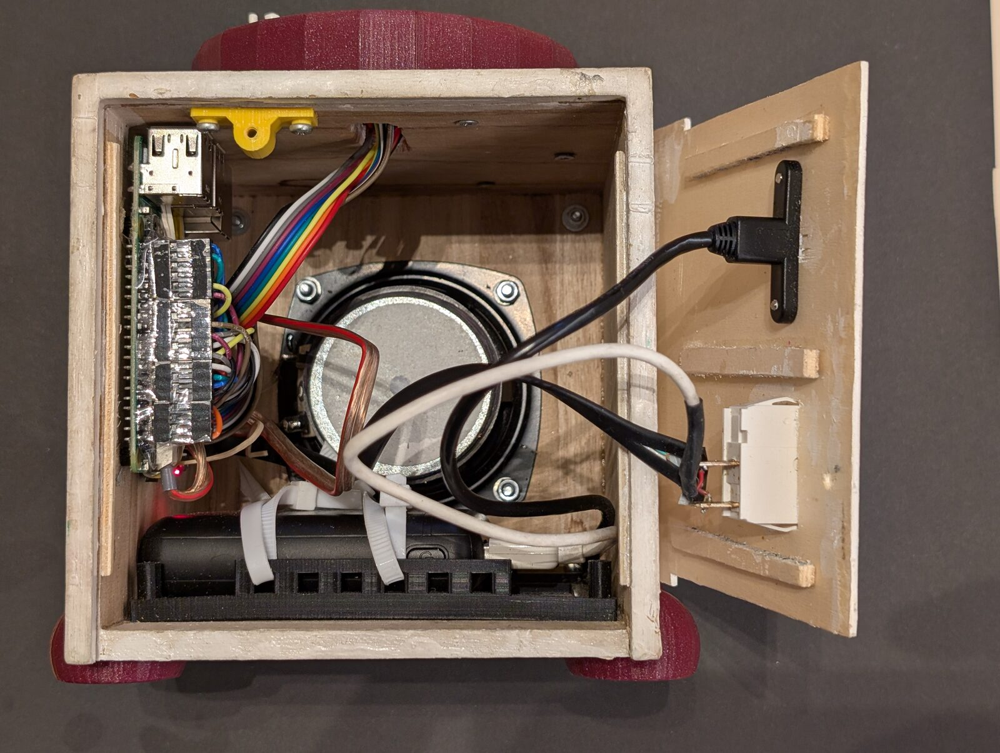
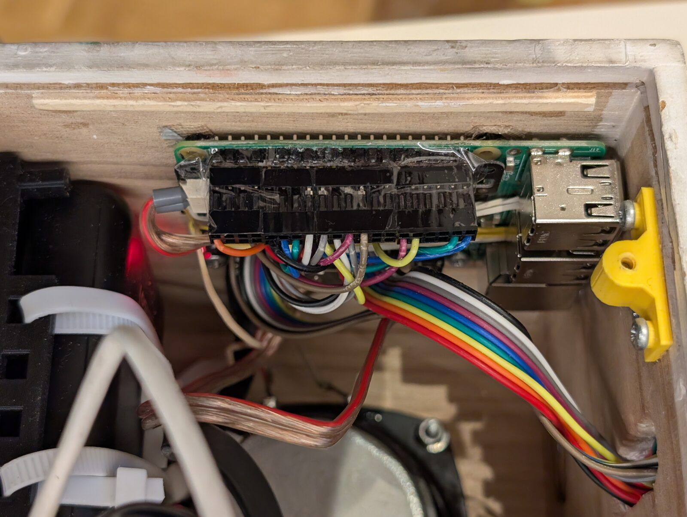

# The box

Hardware and system setup of the Tiny Jukebox box as it runs today. The installer produces exactly this setup, by
itself with one line or run by the Ansible playbook, which adds what only the developer needs
([deployment.md](deployment.md), sections 3 and 5); day-to-day administration is in [operations.md](operations.md). The box holds its
software in slots and updates itself from the library ([library.md](library.md), section 6); what differs on a box
set up without slots (`tinyjukebox_slots: false`) is said where it applies.

## 1. Hardware

| Part | Type |
| --- | --- |
| Computer | Raspberry Pi 3 Model B Rev 1.2, 1 GB RAM (WLAN 2.4 GHz only, Bluetooth 4.1) |
| SD card | 32 GB is sufficient (system about 3 GB, albums 8.5 GB) |
| Amplifier | Pimoroni Audio Amp SHIM (MAX98357A, I2S, mono, 3 W) with speaker |
| RFID reader | RC522 module on SPI0, 3.3 V |
| Controls | 4 buttons against GND, 1 RGB LED |
| Power | power bank; the box is switched off by cutting the power |
| Clock | none (no RTC): the time is correct only after the box has had WLAN |

Data sheets: [`docs/hardware/`](../hardware/README.md). The circuit and the printed parts:
[`hardware/`](../../hardware/README.md). The pins of the circuit are those of the table below.



The box open from the back: the Pi 3 with the Audio Amp SHIM, the speaker, the power bank in its frame; on the opened
back panel the switch and the USB socket for charging.

### Pins (BCM)

| Part | GPIO | Note |
| --- | --- | --- |
| RFID RC522 | SPI0, CS = 8 (CE0), RST = 26 | RST is driven high by `rfid-reader`; the IRQ pin is not used |
| Button volume up | 6 | not 18: GPIO 18, 19, 21 are the I2S pins |
| Button volume down | 24 | |
| Button next | 25 | |
| Button prev | 23 | |
| LED red / green / blue | 22 / 27 / 17 | red is inverted (on = low); green and blue on = high |
| Audio Amp SHIM (I2S) | 18, 19, 21 | BCLK, LRCLK, DOUT |

- Buttons use the internal pull-up; pressed = low.
- The Audio Amp SHIM has no enable pin on the Pi: it switches its amplifier on only while the I2S clock runs. It
  has no volume control; the volume is a software control (section 5).

## 2. Operating system

| | |
| --- | --- |
| System | Raspberry Pi OS Lite, Debian 13 "trixie", 64 bit |
| Python | 3.13: every slot brings its own; the system Python, with an environment made by `uv`, serves only the repository on a box of the playbook |
| Hostname | `tinyjukebox` (lower case: no trouble with mDNS and certificate) |
| User | `pi`; groups `gpio`, `audio`, `bluetooth`; SSH with key only (the playbook, or chosen in the Imager) |
| Locale, time | `en_GB.UTF-8`, `Europe/Vienna`, WLAN country `AT` |
| Partitions | default: `bootfs` and one root file system over the whole card; no separate data partition |

Who sets what:

| | Sets |
| --- | --- |
| Raspberry Pi Imager | the image, hostname, user, SSH key, WLAN with its country, time zone |
| Installer | packages, groups, sudoers rules, robustness, `config.txt`, sound, Bluetooth, the slots and the first version, the service ([deployment.md](deployment.md), section 5.1). It checks Debian 13 and aarch64 before it changes anything |
| Playbook | in addition: hostname, time zone and locale from its variables, further WLANs, SSH with key only, the git repository on the box with the tools to build, the config of the box, the users of the vault; it runs the installer and asserts Python ≥ 3.13 for the repository |

## 3. Firmware: `/boot/firmware/config.txt`

```ini
# BEGIN Tiny Jukebox
[all]
# rfid reader
dtparam=spi=on
# onboard audio off, Audio Amp SHIM
dtparam=audio=off
dtoverlay=hifiberry-dac
gpu_mem=16
disable_splash=1
boot_delay=0
# END Tiny Jukebox
```

- `dtparam=audio=on` and `dtoverlay=vc4-kms-v3d` of the default image are commented out. With the vc4 driver HDMI
  would add sound cards of its own; the box has no display.
- Bluetooth must not be disabled (no `dtoverlay=disable-bt`).
- No `gpio=25=op,dh` (found in installers for other Pimoroni audio boards): GPIO 25 is the "next" button.
- A change of `config.txt` reboots the box. The block replaces the one with the marker "(ansible)" that the playbook
  wrote before the installer existed, without a reboot.

## 4. Packages

| Purpose | Packages | By |
| --- | --- | --- |
| Playback | `ffmpeg`, `alsa-utils` | installer |
| Web page (certificate) | `openssl` | installer |
| The libraries a slot needs | `libasound2` (with `alsa-utils`), `liblgpio1` | installer |
| Slot scripts | `curl`, `jq`, `openssl`, `util-linux` (`flock`) | installer |
| Albums | `rsync` | installer |
| Name in the network | `avahi-daemon` | installer |
| Bluetooth | `bluez`, `bluez-alsa-utils`, `rfkill` | installer |
| Spotify (Soloist plays only into PipeWire or PulseAudio) | `pipewire`, `wireplumber`, `libatomic1` | installer |
| Build `lgpio` and `pyalsaaudio` (no wheels for Python 3.13 on arm64) and `rfid-reader` in the repository of the box | `swig`, `python3-dev`, `build-essential`, `liblgpio-dev`, `libasound2-dev` | playbook |
| Code, `uv` | `git`, `curl` | playbook |

- `uv` is installed with the script of astral.sh into `~pi/.local/bin`.
- Built from source on the box: bcm2835 and `rfid-reader` (section 7). A slot brings its own Python, its
  dependencies and its `rfid-reader` ready-made; of the system it needs only the libraries `libasound2` and
  `liblgpio1`, which the installer installs.
- Installed, Debian switches on the user services of `pipewire` and `wireplumber` for every user: in an SSH session of
  `pi` any program that looks for a sound server would start them with their own setup, which takes the sound card
  and Bluetooth. The installer masks them (`systemctl --global mask pipewire.socket pipewire.service
  wireplumber.service pipewire-pulse.socket pipewire-pulse.service`); the box starts its own instance for Spotify
  (section 5). A slot does not demand these packages: without them albums and stations play, and a Spotify tag ends
  as "cannot be played".
- Spotify Soloist itself is not a package: the box fetches it from Spotify ([architecture.md](architecture.md),
  section 4.1).
- Cutting card pictures out of a presentation needs LibreOffice and `poppler-utils`; that is better done on the PC than on the box.

## 5. Audio

`/etc/asound.conf` (template: [`deploy/config/asound.conf`](../../deploy/config/asound.conf)) routes the default
output through a software volume control `Softmaster` to the DAC:

```text
pcm.!default {
    type plug
    slave.pcm "softvoldevice"
}
ctl.!default {
    type hw
    card sndrpihifiberry
}
pcm.softvoldevice {
    type            softvol
    slave.pcm       "plughw:sndrpihifiberry"
    control.name    "Softmaster"
    control.card    sndrpihifiberry
}
```

- The card is addressed by its name, not by its number.
- The control `Softmaster` exists only after the device has been opened once, and the device only after the reboot
  for `config.txt`. `tinyjukebox-setup.service`, which the installer installs, runs before the service on every start
  and, while the control is missing, plays one second of silence (`aplay -q -d 1 -f cd /dev/zero`) and saves the
  state with `alsactl store`; then it does nothing any more.
- `tinyjukebox.yaml`: `mixer-control: Softmaster`, `default-volume: 50`, `max-volume: 82`, `volume-step: 5`.
- **Spotify:** while an entry plays (or the box is a Spotify speaker), the box runs `pipewire` and `wireplumber` as
  `pi` with a setup of its own in `/srv/tinyjukebox/spotify/sound`: no sound card, no Bluetooth, one sink that writes
  into a named pipe. The box reads the pipe and plays it with `aplay` like every other sound, so `Softmaster`, the
  limits and BlueALSA apply ([architecture.md](architecture.md), section 4.1).

## 6. File system layout

```text
/srv/tinyjukebox/                      owner pi
├── slots/           a/, b/, fallback/, next/: the versions of the box software (library.md, section 6.1)
├── current          link to the active slot
├── state/           which version runs and why; written by the slot scripts only
├── slot.conf        values of this box for the slot scripts
├── release.pub      public key that every slot archive is verified with
├── identity/        id and key of the box, address and certificate of the library (mode 700)
├── sync/            what the library delivered, own changes it has not confirmed, journal (library.md, section 4.2)
├── spotify/         key, player (bin/soloist), login (data/), cache and sound of Spotify - never synchronized, no backup
├── tinyjukebox/     git repository with the code (pushed from the PC), .venv/
├── config/          tinyjukebox.yaml
├── scripts/         backup_json.sh
├── cpp/             bcm2835-1.77/, RPi-MFRC522/ (sources for rfid-reader)
├── albums/          one folder per album: MP3 files and playlist.m3u
├── backups/         the backups that a box without a library makes by a schedule (operations.md, section 10.2)
├── json/            tags.json, targets.json, activity.json (+ backups *.json_), targets-last-id.json,
│                    volume.json, backups.json (the schedules of the backups), images/ (covers of albums,
│                    stations and entries of Spotify)
├── ssl/             tinyjukebox.crt, tinyjukebox.key, users.yaml
└── log/             tinyjukebox.log (rotated: 4 × 1 MB)

/usr/local/lib/tinyjukebox/         the slot scripts: tinyjukebox-slot, tinyjukebox-start, tinyjukebox-functions;
                                    tinyjukebox-setup (the setup after the reboot); rfid-reader, the launcher of the
                                    program of the active slot, with release.pub and rfid-reader.trusted (section 7)
/usr/local/bin/                     links: tinyjukebox-slot and tinyjukebox-start to the scripts, rfid-reader to the
                                    launcher; tinyjukebox, tinyjukebox-users, tinyjukebox-import-cards,
                                    tinyjukebox-migrate-01 and tinyjukebox-fill-library to /srv/tinyjukebox/current/bin
/var/lib/tinyjukebox-rfid/          rfid-reader as the launcher checked it (root only)
/run/tinyjukebox-rfid/              where the launcher checks a program (root only, in memory)
/usr/local/lib/libbcm2835.a
/etc/asound.conf
/etc/sudoers.d/tinyjukebox-rfid, tinyjukebox-restart, tinyjukebox-trigger, tinyjukebox-avahi
/etc/systemd/system/tinyjukebox.service, tinyjukebox-setup.service
/etc/systemd/user/pipewire*, wireplumber.service   masked (links to /dev/null)
/var/log/tinyjukebox-install.log    what the installer did
/etc/systemd/system/bluealsa.service.d/override.conf
/etc/systemd/journald.conf.d/tinyjukebox.conf
/etc/sysctl.d/90-tinyjukebox.conf
/etc/ssh/sshd_config.d/00-tinyjukebox.conf
```

- The software that runs is the one of the active slot. The repository `tinyjukebox/` (`cpp/`, `scripts/` and
  `config/tinyjukebox.yaml` too) exists on a box of the playbook only, which takes the config and the sources of
  `rfid-reader` from it ([deployment.md](deployment.md), section 1); a box of the installer has none of them – its
  `config/` is empty, and it runs with the config of its slot.
- A box without slots has no `slots/`, `current`, `state/`, `slot.conf` and `release.pub`, and no launcher. It runs
  the code of the repository: the commands in `/usr/local/bin` link to `tinyjukebox/.venv/bin`, `rfid-reader` is a
  file there, and every start with changed data adds a folder `json/backup/<time stamp>/`.
- `identity/` and `sync/` exist as soon as a box works with a library, with or without slots.

## 7. RFID reader

| Part | Source | Target |
| --- | --- | --- |
| bcm2835 1.77 | airspayce.com, SHA-256 pinned in the playbook | `/usr/local/lib/libbcm2835.a` |
| RPi-MFRC522 | GitHub `tgd1975/RPi-MFRC522`, tag `1.4.5-tgd.1` | `/srv/tinyjukebox/cpp/RPi-MFRC522` (sources only) |
| `rfid-reader` | `cpp/rfid-reader/` of this repository, built with the slot of a release | `bin/rfid-reader` of every slot; `/usr/local/bin/rfid-reader` is a link to the launcher, which starts the one of the active slot |
| launcher | `deploy/install/rfid-reader-launcher`, written by the installer with its paths | `/usr/local/lib/tinyjukebox/rfid-reader`, with `release.pub` and `rfid-reader.trusted` next to it – all of root |
| sudoers rule | `pi ALL=(root) NOPASSWD: /usr/local/bin/rfid-reader` | `/etc/sudoers.d/tinyjukebox-rfid` (mode 440, by the installer) |

The program and the reasons for its design: [rfid-reader.md](rfid-reader.md). bcm2835 and the fork are on the box
so that `rfid-reader` can be built and tried there; a box without slots installs that build as
`/usr/local/bin/rfid-reader`.

**The launcher.** `rfid-reader` runs as root, and everything in the slots belongs to `pi`. A rule for the program of
a slot would let `pi` – and everything that runs as `pi`: the application, `tinyjukebox-slot`, a version that went
wrong – put any program there and run it as root. The rule therefore allows the link to a launcher of root, a small
shell script. On every start of the reader it

1. copies `bin/rfid-reader` of the slot that `current` points to into `/run/tinyjukebox-rfid` – a folder of root, in
   memory; never through a link, and less than 8 MB. What it checks and starts is the copy, which `pi` cannot change;
2. starts the copy only if the box trusts it:
   - its SHA-256 is in `rfid-reader.trusted`, which the installer writes from the `rfid-reader` of every slot that is
     on the box when it runs – versions up to 0.44 have no signature, or
   - the slot brings `SHA256SUMS.sig` ([library.md](library.md), section 6.14), the signature of its `SHA256SUMS` by the
     key of the releases holds – checked with the copy of `release.pub` next to the launcher, because the one in
     `/srv/tinyjukebox` lies in a folder of `pi` – and `SHA256SUMS` names exactly this program;
3. puts it into `/var/lib/tinyjukebox-rfid` – written only when it is another program, because `/run` may be mounted
   `noexec` – and starts it there with the arguments of the driver.

Otherwise it ends with status 2, and the log says why: `RFID - rfid-reader: rfid-reader: not started - …`. The paths
are written into the launcher by the installer: `sudo` resets the environment, and no variable is trusted.

- **`current` points to another folder:** the launcher only ever starts a program that the release signed or the
  installer listed – an older one at most.
- **A version up to 0.44** reads tags only if it was on the box when the installer ran last. One installed later – by
  hand, from the archive of the library – reads none until the installer runs again; its start check fails, and the
  box goes back to the version before.
- **A program built on the box** and put into a slot is trusted when the installer runs again – the playbook runs it
  ([deployment.md](deployment.md), section 6).
- **Until the installer runs**, a box that updated itself to a version with the launcher still has the link of
  before to the program of the active slot: the launcher comes with the installer, not with a version
  (`SETUP_LEVEL` stays 1).

The user `pi` needs a password for `sudo`. Besides `rfid-reader` the box runs three things as root, each allowed by a
rule of its own in `/etc/sudoers.d/` for exactly these commands:

| Rule | Allows | For |
| --- | --- | --- |
| `tinyjukebox-restart` | `systemctl restart tinyjukebox` | the slot scripts after a switch ([library.md](library.md), section 6.7) |
| `tinyjukebox-trigger` | `rm -f` of the four trigger files and `tee` of `tinyjukebox-ergebnis.txt` on the boot partition | the start script ([library.md](library.md), section 6.9) |
| `tinyjukebox-avahi` | `systemctl stop` and `start` of `avahi-daemon.socket avahi-daemon.service` | "Connect" of Spotify ([architecture.md](architecture.md), section 4.1) |

## 8. Bluetooth

- `bluetooth.service` and `bluealsa.service` are enabled; `bluealsa-aplay.service` is disabled (the box is the
  sender).
- BlueALSA runs with `-S -p a2dp-source -p hfp-ag --a2dp-volume --a2dp-force-audio-cd` (override of
  `bluealsa.service`, variable `bluetooth_bluealsa_args`). Reasons per option: [drivers.md](drivers.md), section 5.1.
- The adapter must not be blocked by `rfkill` (on a fresh card it is): the installer runs `rfkill unblock bluetooth`;
  `systemd-rfkill` keeps the state over a reboot.
- `pi` needs the groups `bluetooth` (BlueZ over D-Bus) and `audio` (BlueALSA over D-Bus).

Without these services the box works without a headset; the driver logs `Bluetooth - not available` once and tries
again every 30 s.

## 9. Network and access

| | |
| --- | --- |
| WLAN | NetworkManager; the first network from the Raspberry Pi Imager, further ones from the vault of the playbook |
| Name | `tinyjukebox.local` via `avahi-daemon` |
| SSH | key only (`PasswordAuthentication no`, `KbdInteractiveAuthentication no`) – set by the playbook; the installer leaves SSH as the Imager set it |
| Web page | `https://tinyjukebox.local/` on port 443, self-signed certificate |
| Open ports | 22 and 443; no firewall |
| File shares | none: albums come through the web page or with `rsync` |

- The service runs as `pi` and gets `CAP_NET_BIND_SERVICE` for port 443.
- The certificate is created on the first start. That should happen with WLAN, otherwise its validity starts at a
  wrong time (no RTC).
- New versions reach the box through the library in the home network, which the box asks; nothing connects to the
  box for that ([library.md](library.md), section 4.14). A box without a library asks GitHub for the newest release
  itself ([library.md](library.md), section 6.16).

## 10. Service

[`deploy/slot/tinyjukebox.service`](../../deploy/slot/tinyjukebox.service), installed as
`/etc/systemd/system/tinyjukebox.service`:

| Setting | Reason |
| --- | --- |
| `User=pi`, `Type=simple`, `WorkingDirectory=/srv/tinyjukebox` | lgpio creates its `.lgd-nfy*` files in the working directory, which must be writable |
| `ExecStart=/usr/local/bin/tinyjukebox-start` | the start script selects the slot, starts `current/bin/tinyjukebox` (the application with `-c /srv/tinyjukebox/config/tinyjukebox.yaml` if that file exists, otherwise with the config of the slot, and `--no_gui`: no interactive console under systemd) as its child and watches a version that is on probation ([library.md](library.md), section 6.11) |
| `KillMode=mixed` | the stop signal goes to the start script only, which passes it on and waits; systemd ends what is left after that (a player, `rfid-reader`) |
| `After=sound.target bluetooth.service bluealsa.service` | order only; without the Bluetooth services the box runs without headset |
| no `network-online.target` | the box plays without WLAN, and the web server listens on `0.0.0.0` |
| `Restart=on-failure`, `RestartSec=2`, `RestartSteps=4`, `RestartMaxDelaySec=30` | first restart after 2 s, each further one later, at most every 30 s (needs systemd ≥ 254). A version that fails its health check makes the start script end with an error, and the restart starts the version before |
| `StartLimitIntervalSec=0` | never give up: nobody is there to start the box by hand |
| `AmbientCapabilities=CAP_NET_BIND_SERVICE` | port 443 without root |

The restart counter grows only through automatic restarts; `systemctl restart tinyjukebox` or a reboot reset it.

A box without slots has [`deploy/scripts/tinyjukebox.service`](../../deploy/scripts/tinyjukebox.service) instead. It
differs in three lines: `ExecStart` is the application itself (`tinyjukebox/.venv/bin/tinyjukebox -c … --no_gui`), there
is no `KillMode=mixed`, and `ExecStartPre=-… backup_json.sh` copies the JSON files to `json/backup/<time stamp>/`
before every start – only if they changed since the last copy, and with `-`, because a failed backup must not keep
the box from starting.

## 11. Robustness

The box is switched off by cutting the power. The setup is built around that:

| Measure | Where |
| --- | --- |
| tinyjukebox writes its JSON files atomically with `fsync` and keeps a backup of each | [architecture.md](architecture.md), section 6 |
| Journal in RAM (`Storage=volatile`) | `/etc/systemd/journald.conf.d/tinyjukebox.conf` |
| What is not written with `fsync` (the log file) is on the card after at most about 6 s, not 35 s (`vm.dirty_expire_centisecs = 500`, `vm.dirty_writeback_centisecs = 100`); the JSON files, the outbox and the journal for the library are written with `fsync` | `/etc/sysctl.d/90-tinyjukebox.conf` (installer) |
| Root file system with `noatime` | `/etc/fstab` |
| `log-level: INFO`, rotated log (4 × 1 MB) | `tinyjukebox.yaml` |
| A new version of the box software is tried on a start and left again within seconds if it fails; unpacking and switching survive a power cut | start script and `tinyjukebox-slot` ([library.md](library.md), sections 6.3 to 6.5) |
| The notes of the slot scripts in `state/` are written to a new file and renamed, those of a switch synced; an empty or damaged note counts as none. `config.txt` on the FAT partition is replaced the same way | slot scripts ([library.md](library.md), section 6.1), installer |
| A damaged or unknown entry, a damaged line of the journal or a damaged file costs that piece, not the start of the box | [library.md](library.md), sections 4.21 and 7 |
| If neither application slot can run, recovery mode installs a version instead of restarting an application again and again | start script ([library.md](library.md), section 6.10) |
| What a box needs to be rebuilt is in the library | [library.md](library.md), section 1 |
| Without slots: JSON backup before a start only if something changed | `backup_json.sh` – a box in a restart loop must not fill the card |
| No automatic updates of the operating system: `apt-daily.timer`, `apt-daily-upgrade.timer`, `man-db.timer` disabled | installer (`--disable`; the playbook passes `base_disabled_timers`) |
| Services that only slow the start down are disabled: `NetworkManager-wait-online`, `ModemManager`, `triggerhappy`, `keyboard-setup`, `console-setup` | installer (`--disable`; the playbook passes `base_disabled_services`) |

Consequences of the volatile journal: after a reboot the journal of the previous run is gone. The log file
`/srv/tinyjukebox/log/tinyjukebox.log` is the persistent record.

In the hardware, the connectors on the pins of the Pi are secured, so that they cannot work loose:



## 12. Decisions

| Question | Decision | Reason |
| --- | --- | --- |
| Computer | the Raspberry Pi 3 Model B stays | – |
| 32 or 64 bit | 64 bit | – |
| Processes | one systemd service | no broker and no further services; nothing between processes to keep consistent; systemd restarts it |
| RFID | C++ program `rfid-reader` | reliable presence detection ([rfid-reader.md](rfid-reader.md)) |
| Bluetooth audio | BlueZ + BlueALSA | works without a desktop session; the player keeps using `aplay` |
| File share (Samba) | none | albums come through the web page or `rsync`. If that proves insufficient, Samba returns as a role of its own ([roadmap.md](roadmap.md)) |
| Positions of the previous box | not carried over | every album started from the beginning on the new box |
| Updates of the operating system | by hand only (`apt full-upgrade`); neither installer nor playbook upgrades the system | no automatisms on a box that plays |
| Updates of the box software | the box fetches released versions from the library – without a library from GitHub –, tries a new one on its next start and goes back if it fails | no PC is needed, any number of boxes; never while the box plays ([library.md](library.md), section 6) |
| Repository on the box | the PC pushes `master` into a git repository on the box | the config and the sources of `rfid-reader` come from it; fixes can be made and tried on the box |
| System setup | the installer on a fresh image – one line, or run by the playbook | the setup is reproducible; the box is not a one-of-a-kind system; a box needs no PC |

## 13. Origin

Until October 2026 the box ran version 0.1 of the software on Raspbian 9 (32 bit, Python 3.5): four processes (mosquitto,
`rfid-2-mqtt`, tinyjukebox, `volumecontrol.py`) in `screen` sessions, talking over MQTT. What matters today:

- **The new box was set up on a new SD card**, not upgraded in place: the old system had a 43 MB boot partition and
  a 4 GB root partition, could not become 64 bit, and four release upgrades would not have produced a reproducible
  system. The old card was left unchanged and is the fallback: with it the box plays as before.
- **Carried over:** the albums, `tags.json` (unchanged, same UID format) and `albums.json` (converted to
  `targets.json` with `tinyjukebox-migrate-01`). Positions were not carried over.
- **Kept on purpose:** the read loop of the RFID reader, the pins, the volume levels (50 % / 82 %), the button
  behaviour (hold "prev" 1 s: album from the beginning; hold a volume button: 1 % every 0.2 s; "prev" within the
  first 10 s: previous track), no pause between tracks.
- `tinyjukebox/core` and `tinyjukebox/devices` descend from the former packages pelops-core and pelops-devices.
