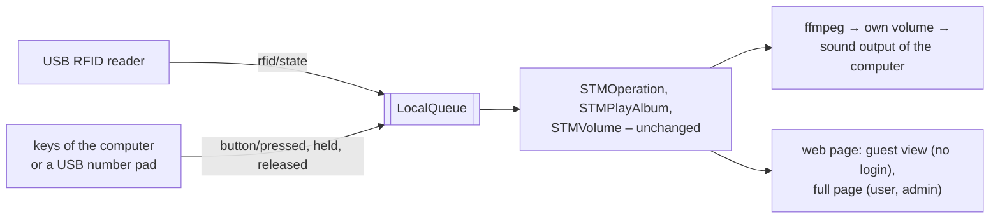

# Concept: the box on a computer, and a page for guests

Status: concept, nothing implemented. Written on 2026-10-16 against version 0.39.0; decisions D2 to D5 taken on
2026-10-16, D1 after the reader is tested (section 3). The plan is section 10.
Related today: the drivers ([drivers.md](../drivers.md)), the messages ([architecture.md](../architecture.md),
section 7), the roles and the page ([rest-api.md](../rest-api.md), sections 2 and 5), the box with one folder
([configuration.md](../configuration.md), section 1), the Docker image ([library.md](../library.md), section 3.9).

## 1. What it is

Two parts that go together, each useful alone:

- **The desktop box:** Tiny Jukebox on a computer – Linux first, Windows if it can be done (section 7). A USB RFID
  reader chooses what plays; keys of the computer change the volume, go to the next or previous track and pause. The
  program on the computer reads reader and keys itself, like the box reads its RC522 and its buttons. The web page is
  not an input.
- **The guest page:** a third kind of visitor of the page, next to `user` and `admin`. Without a login it shows only
  what is playing – reduced to the most needed. Anyone who opens the address of the box sees it. There is nothing to
  press on it.

Everything else stays as it is: tags, albums, stations, Spotify, saved positions, the library, and the full page for
`user` and `admin`, where tags are linked and albums uploaded. The desktop box is a box: it works alone (one folder,
`--data DIR`) or with a library, like the wooden box.



The new parts are two drivers that publish the messages the RC522 and the buttons publish today, and an own volume
in the sound path. The state machines do not change.

## 2. What the person at the computer notices

| Event | The wooden box | The desktop box |
| --- | --- | --- |
| A card is held to the reader | plays its album, station or entry of Spotify from the saved position | the same |
| Another card | ends the first, plays the other | the same |
| The card is taken away | ends the playback, keeps the position | with a keyboard reader the computer does not notice it: the music goes on (section 4.1) |
| The same card again | – (it lies on the box) | stops the music and keeps the position, once more: continues – or nothing happens (D1, open) |
| Key "stop" | – | like taking the card off the box |
| Keys volume, next, previous, pause | the buttons and the headset | the same, with the keys of section 5; "previous" held: album from the beginning |
| A card that is not linked, an unknown card | LED yellow; the unknown card is created as a new tag | the same; the LED is the dot next to the logo on the page |
| Album finished | LED blinks blue | the same on the page |
| Bluetooth headset | paired by the box, own volume and limit | the computer handles it; the desktop box plays on whatever the computer plays on |

## 3. Decisions

Taken on 2026-10-16:

| | Question | Decided |
| --- | --- | --- |
| D1 | The same card read a second time | open: decided after the reader is tested (step 2 of the plan) |
| D2 | Who sees the guest page | everyone in the home network, without a password, on every box – the wooden one too; `rest-api/guest: false` turns it off |
| D3 | Whose volume the keys change | the jukebox has a volume of its own; the volume of the computer stays as it is; the maximum set on the page holds for the jukebox |
| D4 | Which keys at first | the number block (below); a USB number pad can be given to the jukebox alone |
| D5 | Windows | a Windows program (Python and ffmpeg for Windows), not Docker – to be tried |

**D1 – the two ways.** A keyboard reader (most cheap USB readers are one) tells only "this card was read", never "the
card was taken away". Either a card read again while it plays stops the music and keeps the place, and read once
more it continues – as if it had been taken off the box and put back; or a card read again does nothing, and the
music stops only with the key "stop" or with another card. A reader that repeats the number while the card lies on
it, or a smart card reader (section 4.2), notices the card being taken away like the box: then the question does not
arise. The driver (section 4.1) can do both ways; the test of the reader decides which is the default.

**D4 – the keys at first:** `+` and `-` volume, `4` previous, `6` next, `5` pause/play, `0` stop. All of them can be
changed in the config. The media keys of the keyboard are possible too, but the computer reacts to them as well.

**D5 – why not Docker:** Docker on Windows sees neither the keys of the computer nor the USB reader, and has no sound
of its own (section 7.1); a Windows program for keys and reader would be needed anyway. What has to be built for
Windows is the reading of keys and reader and the sound output – not the whole player (section 7.2).

## 4. The reader

USB RFID readers come in two kinds. Which one is at hand is found out first (step 2 of the plan):

| | Keyboard reader (HID) | Smart card reader (PC/SC, e.g. ACR122U) |
| --- | --- | --- |
| How it reports a card | types the number of the card and Enter, like a keyboard | through the smart card service of the system (`pcscd` on Linux, built into Windows) |
| Notices that the card is taken away | no (some repeat the number while the card lies there: then yes, see below) | yes |
| The number | depends on the reader: decimal or hex, often only 4 of 7 bytes, sometimes in reverse order | the full UID, as the RC522 reads it |
| Frequency | 125 kHz (EM4100) or 13.56 MHz – a 125 kHz reader cannot read the cards of the box at all | 13.56 MHz, the cards of the box |
| Found out by | a text editor open, the card held to the reader: digits appear | `lsusb` names it; `pcsc_scan` shows the card |

**The same cards on the wooden box and the computer** work only with a reader of 13.56 MHz that gives the full UID: a
smart card reader always, a keyboard reader only if it types all bytes. Otherwise the card has another number on the
computer and is a tag of its own there – it works, but is linked separately (tags are global: with a library both
numbers are in its catalog). Tags are read only: nothing is written to a card.

### 4.1 Driver `hid-rfid` (keyboard reader)

- Reads the input device of the reader (Linux: `/dev/input/by-id/…-event-kbd`, chosen in the config, with
  `select.poll` and `struct` as `AvrcpInput` does; the reading is shared with the driver `keys` in a small module). It
  takes the device for itself (`EVIOCGRAB`): the digits do not appear in the window that has the focus.
- Collects characters until Enter; converts the number to the form of the box (`04:1A:2B:3C`) with `uid-format`:
  `hex`, `decimal` or `decimal-reversed`. Which one his reader needs is seen by holding a card of the box to it and
  comparing with the UID on the page.
- Publishes `RfidState(uid)`; with `again: stop` (D1) the same card again: `RfidState(None)`, once more
  `RfidState(uid)`; with `again: ignore` nothing. The key "stop"
  publishes `RfidState(None)` through the same driver, so that the next read plays again. `STMOperation` sees exactly
  what it sees from the RC522 – it needs no change.
- A reader that repeats the number while the card lies on it: within `repeat-window` (default 1.5 s) a repetition is
  not a new read; with `presence: true` the card counts as taken away when the repetitions stop – then the desktop box
  behaves exactly like the wooden one.
- The user of the program needs the group `input` (Linux). The device comes and goes with the USB plug; the driver
  looks for it again every 2 s.

### 4.2 Driver `pcsc-rfid` (smart card reader)

- `pyscard` on Linux and Windows alike: waits for a card (`SCardGetStatusChange`), reads the UID with the command
  `FF CA 00 00 00`, publishes `RfidState(uid)`; the card taken away: `RfidState(None)`.
- Built only if the reader at hand is one; the code is the same on both systems.

## 5. The keys

Driver `keys`, one per input device:

```yaml
-   name: keys
    type: keys
    active: true
    device: /dev/input/by-id/usb-XYZ_Keypad-event-kbd   # or "keyboard": every keyboard of the computer
    grab: true                  # only for a device of its own: its keys reach no other program
    map:
        KEY_KPPLUS: volume-up
        KEY_KPMINUS: volume-down
        KEY_KP4: prev
        KEY_KP6: next
        KEY_KP5: play-pause
        KEY_KP0: stop
    hold-timeout: {volume-up: 0.2, volume-down: 0.2, prev: 1}
```

- A key down: `BUTTON_PRESSED`; held: `BUTTON_HELD` after its `hold-timeout`, repeated for volume (as the `input`
  driver does); up: `BUTTON_RELEASED`. The repetition of the keyboard itself is ignored, the driver keeps its own
  timers – the same gestures as on the box.
- `play-pause` sends `PLAY` or `PAUSE` by the state of the playback, as the Bluetooth driver does with
  `play-pause-toggle`. `stop` goes to the reader driver (section 4.1).
- The keys are read from the device, not from a window: they work while another program has the focus, also with
  the page closed. Keys that are not in `map` are ignored and never logged.
- Without `grab` (the keyboard of the computer) the key also reaches the program that has the focus: the number block
  types a digit there. That is why D4 recommends a pad of its own.

## 6. Sound and volume

- **Output:** the default device of the computer. On Linux `aplay` without `-D` plays into PipeWire or PulseAudio
  like every program; on Windows section 7.2.
- **Own volume (D3):** a new `SoftwareVolumeControl` in place of `AlsaVolumeControl`. The volume is applied to the
  sound between decoder and output (a small pump in Python, as `PipeReader` does for Spotify), so a change is heard at
  once. `Volumes` has one profile, the speaker; start value and maximum are set on the page as today.
- No `rgbled` and no `bluetooth` driver. The LED exists as today without a driver and is shown on the page.
- **Spotify:** Soloist plays into a PipeWire of its own (architecture.md, section 4.1); next to the PipeWire of a
  Linux desktop that is to be tried. On Windows only if Spotify offers Soloist for Windows; otherwise the tab
  "Spotify" says that it is not available there.

## 7. Windows

### 7.1 Why not Docker

| Needed | Docker Desktop on Windows | A Windows program |
| --- | --- | --- |
| The keys of the computer | no: the container sees no keyboard | yes |
| The USB reader | only with `usbipd-win` into the Linux of Windows, and then it is gone for Windows | yes |
| Sound | only through the sound server of WSLg, mounted into the container – not tried | yes |
| Player, data, page | yes, unchanged | yes, unchanged |

The input has to be read by a Windows program in either case. Docker would save only the sound output, which is the
smallest part (section 7.2), and adds Docker Desktop and a second program.

### 7.2 What changes for a Windows program

| Part | Linux today | Windows |
| --- | --- | --- |
| Sound output | `aplay` | `ffplay -nodisp`, part of every ffmpeg for Windows; the pipeline stays `ffmpeg → volume → output` |
| Keys | input device (`keys`) | the same driver with a Windows reading: `RegisterHotKey` for the keys of `map` (they then reach no other program) – `ctypes`, no new package |
| Keyboard reader | input device with `EVIOCGRAB` | Raw Input tells the reader apart from the keyboard; a keyboard hook keeps its digits out of other windows |
| Smart card reader | `pyscard` | the same |
| Certificate of the page | `openssl` on the command line | the package `cryptography` (on Linux too: one way) |
| Stop by signal | SIGTERM, SIGHUP | SIGHUP does not exist: only where it exists |
| Install | `pip install tinyjukebox` | Python 3.13, `winget install ffmpeg`, `pip install tinyjukebox`; start with Windows: a shortcut in the startup folder |
| Tests | the workflow on Linux | in addition a job on `windows-latest` for the parts above |

Not on Windows: slots and the self-update (as on every box with one folder), the RC522, the Bluetooth driver.

### 7.3 Docker on Linux

Works – the reader and the pad passed in with `--device`, the sound through the socket of PipeWire/PulseAudio – but a
native install is simpler. It is described once the native way runs; it is not a step of its own.

## 8. The guest page

- **Address:** the address of the box without a login shows the guest view, with a button "Log in" in a corner. Logged
  in, the full page as today. With `rest-api/guest: false` the login page comes first (D2).
- **What it shows, large and nothing else:** the cover; what is playing – the name of the tag and what it is linked
  to: album with track *n* of *m*, its title and a bar of the position; station with its name and whether it plays;
  entry of Spotify with the title of its track; "paused", "waiting for a card", "card not linked"; the LED; the volume
  as a bar. Nothing to press. Suited to a tablet on the wall or the screen of the desktop box (full screen).
- **What it does not show:** UIDs, the lists of tags, albums and stations, statistics, the log – nothing but what
  plays now.
- **Interface:** `GET /api/now` (no login): a reduced status with only these fields, built from `GET /api/status`;
  `GET /api/now/events`: the same as server-sent events, at most 8 at a time, so that guests cannot use up the 32
  connections of the server; `GET /api/now/cover`: the cover of what plays. No other route changes its role.
- The texts in `web/web/texts/*.json`, German and English; the page checked with `scripts/pages/check.sh`.
- The library has no guest page: it plays nothing.

## 9. Starting the desktop box

```bash
tinyjukebox --data ~/tinyjukebox --desktop    # Linux; on Windows the same in a terminal or the startup shortcut
```

`--desktop` uses the built-in config of `--data` with the sound of the computer, the own volume, and the drivers of
`DIR/config.yaml` (reader and keys, sections 4 and 5) – without `--desktop`, `--data` stays the box without hardware
of today. A library is linked as for every box (`TINYJUKEBOX_LIBRARY` or on the page). The full page is at
`https://<computer>:8443/`, the guest view at the same address.

## 10. Plan

1. **The guest page** (section 8), on every box: independent of the rest and small. Tested on the PC with the box
   without hardware; on the wooden box after the next release.
2. **Find out the reader:** kind, frequency, number format, whether it repeats, whether it reads the cards of the
   box (section 4). Decides between `hid-rfid` and `pcsc-rfid` and the value of `uid-format`.
3. **The desktop box on Linux:** the drivers of reader and keys, the own volume, `--desktop`; tests with recorded
   events of input devices; tried with his reader and a pad on his PC.
4. **Windows:** the parts of section 7.2, the job on `windows-latest`; tried on a Windows computer.
5. **Documents:** a chapter "Tiny Jukebox on a computer" in the manuals (de, en); drivers.md, configuration.md,
   rest-api.md and architecture.md take over sections 4 to 9; this concept is deleted.

Each step is a version of its own.

## 11. To be tried

| Item | Expected | If not |
| --- | --- | --- |
| His reader held to a card of the box | digits appear (keyboard reader) or `pcsc_scan` shows the card | a 125 kHz reader: cards of its own (EM4100), they work as tags of the desktop box only |
| The number of a card against its UID on the page | the same with one of the `uid-format`s | the card is a tag of its own on the computer |
| The same card held to it for some seconds | one read, or repetitions | – (decides `presence`) |
| Soloist on a Linux desktop with its own PipeWire running | Spotify plays | Spotify on the desktop box needs another way |
| Soloist for Windows | a build exists | no Spotify on Windows |
