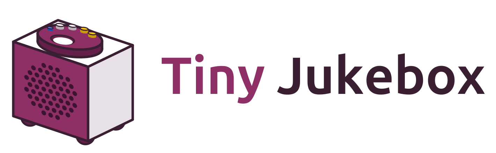
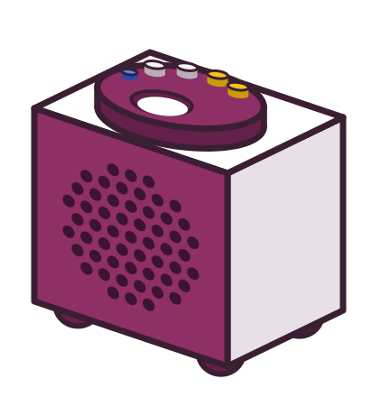

# Concept: the logo on the web page and in the package of the NAS

Status: proposal, not implemented. The logo is in [`docs/images/`](../../images/) and shown at the top of the README
(2026-10-16).

The logo shows the box seen from the front at an angle: the berry purple of the lid, panel and feet (`#8e2f66`), the
white case, the round window for the tag, the LED and the buttons along the rim of the lid. The wordmark is Ubuntu
Bold, turned into outlines. The SVG files are the source.

| File | What it is | Where |
| --- | --- | --- |
|  `logo.svg` | box and wordmark, for light backgrounds | README (done) |
|  `logo-dark.svg` | the same with light lettering | README in dark mode (done) |
|  `logo-mark.svg` | the box alone | proposed: top bar and login page of the web page, in place of the dot next to "Tiny Jukebox" |
|  `logo-icon.svg` | the lid from above: berry disc, white window, LED and buttons along the rim | proposed: favicon in place of the red dot (`src/tinyjukebox/web/web/favicon.svg`); the icons of the package for the NAS (`deploy/synology/package/ui/images/icon_*.png`) |

Both proposals change the software (`src/`, `deploy/`): they need a higher version and a section in `CHANGELOG.md`,
and they become a release.

Open: the dot next to "Tiny Jukebox" takes the colour of each box today ([CHANGELOG.md](../../../CHANGELOG.md),
"Every box has colors of its own"). With `logo-mark.svg` or `logo-icon.svg` in its place, does each box keep a
colour of its own there, and how?
