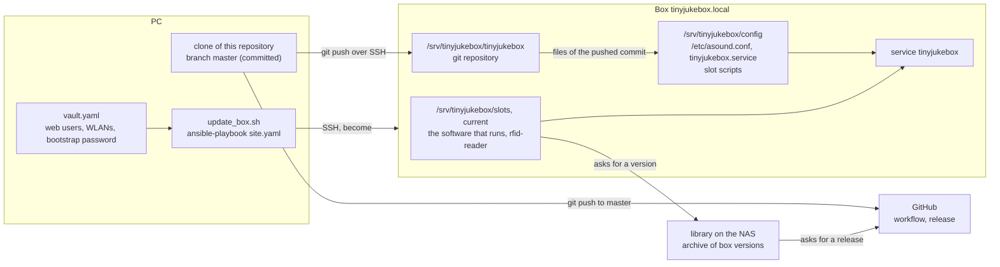

# Deployment

How software and setup reach the box: releases that the box installs by itself; the installer
[`deploy/install/install.sh`](../../deploy/install/install.sh), which sets up a fresh Raspberry Pi with one line; the
Ansible playbook in [`deploy/ansible/`](../../deploy/ansible/) with the script [`update_box.sh`](../../update_box.sh),
which runs the installer from the PC and adds what only the developer needs; and the workflow for changes made on the
box. The setup they produce is described in [box.md](box.md); slots, self-update and the library on the NAS in
[library.md](library.md).

## 1. Overview



Three ways lead to the box, and each brings something else:

| | Brings | How |
| --- | --- | --- |
| Release | the software that runs: the application with its Python and dependencies, `rfid-reader` | a push to `master` on GitHub that changes the software becomes a release; the library fetches it, and the box installs it into a slot and tries it on its next start; a box without a library fetches the release itself ([development.md](development.md), section 8; [library.md](library.md), sections 6 and 8) |
| Installer | the system: packages, `config.txt`, sound, Bluetooth, the sudoers rules; the slot scripts, their service unit and the public key of the releases; the first slot of a new box; the address of the library | one line on the box (section 5), from GitHub or from the page of a library; or the playbook runs it |
| Playbook | what only the developer needs: hostname, time zone, locale, further WLANs, SSH with key only, the git repository on the box, the tools to build `rfid-reader`, the config of the box, the users of the vault; and it runs the installer | `./update_box.sh` on the PC |

- **Installer and playbook do not update the software of a box with slots.** They install a version only on a box
  that has none yet, or from a slot archive they are given (`--archive`, `tinyjukebox_slot_archive`): the rescue
  path.
- **There is one description of how the system of a box is set up: the installer.** The playbook builds it from the
  clone as it is and runs it, so a change of the setup is tried from the PC before it is released, and the box of the
  developer is set up exactly like every other.
- **The box keeps a git repository,** without a remote, into which the playbook pushes `master` of the PC's clone.
  The config and `asound.conf` are taken from it, i.e. from the pushed commit, and `rfid-reader` can be built from
  it on the box. Only committed work reaches it; the working tree on the PC does not matter, and pushing to GitHub
  is not needed for it.
- **The slot scripts, their service unit and the public key come with the installer** – with the one of the clone
  on the PC, as it is, when the playbook runs.
- **The playbook can run any number of times.** What is already right stays unchanged.
- **Nothing on the box gets lost.** The playbook never overwrites uncommitted changes or commits made on the box
  (section 6).
- **A box without slots** (`tinyjukebox_slots: false`) runs the code of its repository: the playbook is then the only
  way to update it, and every run brings `master` of the PC to the box.

## 2. Files

| Path | Content |
| --- | --- |
| `update_box.sh` | runs the playbook from the root of the clone; warns about uncommitted changes and a branch other than `master`; asks for the vault password if the vault file is encrypted |
| `deploy/install/install.sh` | the installer of a box (section 5); `scripts/build_installer.sh` packs the files it brings along into it |
| `deploy/install/tinyjukebox-setup`, `tinyjukebox-setup.service` | what the installer does after the reboot it asks for: the volume control `Softmaster` |
| `deploy/install/test/` | `run.sh`: the installer and the start script on a stand-in for a box ([library.md](library.md), section 10) |
| `deploy/ansible/site.yaml` | the play: roles, then "service runs" and "web page answers on 443" |
| `deploy/ansible/inventory.yaml` | the host `tinyjukebox` (`tinyjukebox.local`, user `pi`, key `~/.ssh/raspi_ed25519`) |
| `deploy/ansible/ansible.cfg` | inventory, roles path, `interpreter_python`, SSH pipelining |
| `deploy/ansible/group_vars/all/main.yaml` | all variables (section 4) |
| `deploy/ansible/group_vars/all/vault.yaml` | secrets; not in git, only on the PC |
| `deploy/ansible/vault.example.yaml` | template for the vault file; one level up on purpose, so that Ansible does not load it |
| `deploy/ansible/roles/` | `base`, `tinyjukebox`, `install`, `rfid`, `migrate` |
| `deploy/config/tinyjukebox.yaml` | config of the box |
| `deploy/config/asound.conf` | `/etc/asound.conf` of the box, brought by the installer |
| `deploy/config/tinyjukebox-sim.yaml`, `library-sim.yaml` | configs for box and library on the PC (`start_sim.sh`, `start_library.sh`), not deployed |
| `deploy/slot/` | `tinyjukebox-slot`, `tinyjukebox-start`, `tinyjukebox-functions` and the systemd unit of a box with slots |
| `deploy/release.pub` | public key that a box verifies a slot archive with |
| `deploy/scripts/tinyjukebox.service` | the systemd unit of a box without slots |
| `deploy/scripts/backup_json.sh` | JSON backup before every start of the service, on a box without slots |
| `deploy/scripts/install_service.sh` | installs the unit by hand; not used by the playbook |
| `fetch_release.sh` | fetches the files of a release into `dist/`: the slot archive for `tinyjukebox_slot_archive`, the package of the library |
| `update_library.sh` | installs the package of a release on a NAS where the library is installed ([library.md](library.md), section 3.7) |
| `release.sh` | from the commits of a branch to the release in use ([development.md](development.md), section 8) |

Needed on the PC: `ansible` with the collections `ansible.posix` and `community.general`, `git`, `rsync` for the
albums, `gh` (logged in) for `fetch_release.sh`, and `curl` and `jq` for `update_library.sh`.

## 3. Roles

The roles run in this order. `rfid` takes its files from the code that `tinyjukebox` brings to the box.

| Role | Tag | What it does |
| --- | --- | --- |
| `base` | `base` | asserts Debian 13 / aarch64 / Python ≥ 3.13; installs the packages for building on the box (never upgrades); hostname, `/etc/hosts`, time zone, locale, WLAN country, further WLANs; SSH with key only (after checking that a key is in place) |
| `tinyjukebox` | `tinyjukebox` | folders below `/srv/tinyjukebox`; `uv`; git repository on the box and push of the version; `uv sync --locked --no-dev --extra box` (builds `lgpio`, `pyalsaaudio` and possibly `dbus-fast` – some minutes on the first run); `backup_json.sh`; empty JSON files if missing; config; users of the web page. Without slots also the links to the commands in `/usr/local/bin` and the service unit |
| `install` | `install` | builds the installer from the clone, copies it to the box and runs it with the answers from inventory and vault (`--yes --no-reboot --no-start --no-admin`, the user, the releases and their waiting time, the time limit of stage 1, the options of BlueALSA, the units to disable, the library with the bootstrap password, the token, `tinyjukebox_slot_archive` as `--archive`; `--no-slots` with `tinyjukebox_slots: false`). Reboots and waits for the box if the installer asks for it – the firmware settings changed. What the installer does: section 5 |
| `rfid` | `rfid` | downloads, checks, builds and installs bcm2835; clones the fork at its tag; builds `rfid-reader` in the repository of the box and, without slots, installs it |
| `migrate` | `migrate` (only on request) | albums, tags and images of the previous box (section 7) |

After the roles the play starts the service and waits until port 443 answers.

Details:

- **Code** (`roles/tinyjukebox/tasks/code.yaml`): `git init` on the box with `receive.denyCurrentBranch=updateInstead`,
  so that a push also updates the files. The author of commits made on the box is copied from the PC's git config.
  The push happens only if the box has no uncommitted changes and its commit is an ancestor of the version to deploy.
  The push is a connection of its own from the PC: if it fails, the playbook stops with a message that says why –
  e.g. that the name of the box did not answer in time (then the playbook is simply run again).
- **Config** (`config.yaml`): without `tinyjukebox_config_overrides` the file `deploy/config/tinyjukebox.yaml` is copied
  unchanged. With overrides the config is written anew (merged) and loses its comments; a list (`drivers`) is
  replaced as a whole. Every run writes the config of the box anew.
- **Users** (`users.yaml`): users of `tinyjukebox_web_users` that do not exist yet are added. Passwords and roles of
  existing users are never changed.
- **Handlers:** new code, a changed config, unit, `asound.conf` or `rfid-reader` restarts the service; a changed
  `config.txt` reboots.
- **Units that do not exist** on the system are skipped when disabling.
- **Slots** ([library.md](library.md), section 6): on by default (`tinyjukebox_slots: true`). The box runs the version
  of its active slot, started by `tinyjukebox-start`, and fetches later versions from the library by itself – a box
  without a library from the releases (`tinyjukebox_releases`, [library.md](library.md), section 6.16). The repository
  on the box stays, because `rfid` and the config take their files from it; the commands in `/usr/local/bin`,
  `rfid-reader` and the service unit then belong to the installer. A box without a slot gets its first version from
  the installer: from `tinyjukebox_slot_archive`, from its library, or – without a library – the release of the
  installer. `tinyjukebox_library_url` links the box with every run: a box that was unlinked on its page stays unlinked
  only if the address is taken out of the inventory as well. With `tinyjukebox_slots: false` the installer sets up the
  system only, and the playbook puts the box back to the code of its repository.

## 4. Variables

`deploy/ansible/group_vars/all/main.yaml`:

| Variable | Default | Meaning |
| --- | --- | --- |
| `tinyjukebox_version` | `master` | branch, tag or commit of the PC's clone that is pushed into `master` of the box |
| `tinyjukebox_config_overrides` | `{}` | values that differ from `deploy/config/tinyjukebox.yaml`, e.g. `{tinyjukebox: {volume: {default-volume: 45}}}` |
| `tinyjukebox_web_users` | from `vault_web_users` | `[{name, role: admin\|user, password}]` |
| `tinyjukebox_user`, `tinyjukebox_root` | `pi`, `/srv/tinyjukebox` | must match `tinyjukebox.service` and `tinyjukebox.yaml` |
| `tinyjukebox_slots` | `true` | the box holds its software in slots and updates itself (the installer, role `install`) |
| `tinyjukebox_slot_archive` | – | slot archive on the PC; needed while the box has no slot, later to install a version by the playbook |
| `tinyjukebox_library_url` | – | `https://host:port` of the library; empty: the box works for itself |
| `tinyjukebox_library_bootstrap` | from `vault_library_bootstrap` | the password a new box proves at its first contact with the library |
| `tinyjukebox_releases` | `https://api.github.com/repos/tgd1975/tinyjukebox` | where a box without a library finds its versions: the repository at the interface of the git server; empty: nowhere, versions come from files |
| `tinyjukebox_release_wait_days` | `3` | days a release waits before a box without a library installs it by itself |
| `tinyjukebox_releases_token` | from `vault_releases_token` | a token that may read the releases; only a private repository needs one: a fine-grained token of GitHub for this one repository with "Contents: Read-only" ([library.md](library.md), section 6.16). Without it the playbook removes the token from the box |
| `slots_stage1_limit` | `120` | seconds a new version may take to pass stage 1 of its health check (`slot.conf`); the level of the setup is the installer's |
| `rfid_mfrc522_version` | `1.4.5-tgd.1` | tag of the fork; fixed |
| `rfid_bcm2835_version`, `rfid_bcm2835_sha256` | `1.77`, … | fixed; the playbook never updates them by itself |
| `base_hostname`, `base_timezone`, `base_locale`, `base_wifi_country` | `tinyjukebox`, `Europe/Vienna`, `en_GB.UTF-8`, `AT` | |
| `base_wifi_networks` | from `vault_wifi_networks` | WLANs in addition to the one of the Imager: `[{ssid, psk}]` |
| `base_disabled_timers` | apt and man-db timers | no automatic updates; disabled by the installer (`--disable`) |
| `base_disabled_services` | 5 services | to measure first with `systemd-analyze blame`: `[]` |
| `bluetooth_bluealsa_args` | `-S -p a2dp-source -p hfp-ag --a2dp-volume --a2dp-force-audio-cd` | [drivers.md](drivers.md), section 5.1 |
| `migrate_albums_src`, `migrate_json_src` | – | folders on the PC, only for `--tags migrate` |

Secrets (`group_vars/all/vault.yaml`): `vault_web_users`, `vault_wifi_networks`, `vault_library_bootstrap`,
`vault_releases_token`. Without the file the playbook runs too; the web page then has no user.

## 5. Set up a new box

### 5.1 With the installer

Write "Raspberry Pi OS Lite (64-bit)" to the card with the Raspberry Pi Imager – it sets what the installer never
touches: hostname, user, WLAN and its country, time zone, SSH ("public-key authentication only" is offered there).
Start the Pi, log in over SSH and run one line:

```bash
curl -fsSL https://github.com/tgd1975/tinyjukebox/releases/latest/download/install.sh | sudo bash
```

It asks for the password of the user `admin` of the web page, sets up the system, installs the version of the
installer into a slot, prints the address of the page and restarts the box once for the firmware settings. On a Pi 3
it takes a few minutes, most of it the packages; nothing is compiled. The box then stands alone and updates itself
from the releases ([library.md](library.md), section 6.16); it can be linked to a library later, on its page.

**From a library:** the tab "Boxes" of the library shows the line for this library in the section "Add a box":

```bash
curl -fsSLk --pinnedpubkey 'sha256//…' https://nas:8866/install.sh | sudo bash -s -- --library https://nas:8866
```

The pin is the public key of the certificate of the library: `curl` accepts exactly this one. The installer asks for
the bootstrap password as well, and installs the version the library offers its boxes; the box registers at its first
start and appears in the tab "Boxes" by itself. What the library hands out for this without credentials:
[library.md](library.md), section 4.14.

What the installer expects and does:

- **Raspberry Pi OS Lite (64-bit), Debian 13 on aarch64**, with `/boot/firmware/config.txt`. On anything else it stops
  before it changes something and says what it found.
- **The hardware of [box.md](box.md), section 1.** It writes the firmware and sound settings for exactly this
  hardware. A box that is not wired yet can be installed: it starts, its page answers, and the log names what is
  missing.
- **Internet**, for the packages of the operating system – also when the line comes from a library.

| Step | Content |
| --- | --- |
| Check | Debian 13 on aarch64, `config.txt`, the user, 1 GB free; root rights |
| Packages | what a box needs to run ([box.md](box.md), section 4), with those for Spotify. Never an upgrade |
| Groups | `gpio`, `audio`, `bluetooth` for the user of the box |
| Root rights | the four sudoers rules of [box.md](box.md), section 7 |
| Robustness | no automatic updates and the services that slow the start down (`--disable`), journal in RAM, `noatime` |
| Firmware | the block in `config.txt` ([box.md](box.md), section 3) |
| Sound | `/etc/asound.conf`; the sound servers of PipeWire masked for every user; the volume control `Softmaster`, after the reboot by `tinyjukebox-setup.service` |
| Bluetooth | options of BlueALSA, services, `rfkill unblock`, no `bluealsa-aplay` |
| Folders | `/srv/tinyjukebox` with empty JSON files; `slots`, `state`, `identity`, `sync` |
| Slots | the slot scripts in `/usr/local/lib/tinyjukebox` with their links, the links to the commands of the active slot, `slot.conf`, `release.pub`, the service unit |
| Source | the library with its bootstrap password, or the releases with their waiting time and a token (`--token-file`, only for a private repository) |
| First version | from `--archive`, from the library, or the release of the installer – at once, as a person asked for it; it becomes the fallback version too |
| User | `admin` of the web page, with `tinyjukebox-users` of the version just installed |
| Start | a reboot if `config.txt` changed, otherwise the service is (re)started and the page has to answer |

- **All questions come first:** the password of `admin` (if the page has no user yet) and the bootstrap password (if
  the line came from a library and the box has no key for it). They are read from the terminal, not from the pipe.
  Without a terminal they are files: `--admin-password-file`, `--bootstrap-file`. No secret on the command line.
- **Running it again** changes nothing that is right already. It never touches the data – albums, tags, positions,
  users, the config of the box, the key of the box for its library – and never changes which version runs; it keeps
  a link to a library. It brings the system up to date to the state of its release: a version that needs a newer
  setup or slot script names the installer on the page of the box.
- **What it leaves alone:** what the Imager sets, SSH, compilers and the sources of `rfid-reader`, the config of the
  box (without `/srv/tinyjukebox/config/tinyjukebox.yaml` a box runs with the config of its slot).
- **The files it writes are its own:** a change made by hand is overwritten by the next run, as by the playbook.
- **One file per release:** `install.sh` has the slot scripts, the service unit, the public key, `asound.conf` and
  the setup after the reboot inside (`scripts/build_installer.sh`, about 50 kB). Its body is one function that is
  called in the last line: a download that breaks off runs nothing. `releases/latest/download/install.sh` always
  names the installer of the newest release; a withdrawn release withdraws its installer.
- **What it printed** is in `/var/log/tinyjukebox-install.log`, also what the setup after the reboot did – the journal
  of the box is gone after a reboot.
- **No uninstaller:** a Pi is freed by writing its card anew.

Options: `--user NAME` (default: the user who called `sudo`; it runs the service), `--version X.Y.Z`, `--archive FILE`,
`--library URL`, `--bootstrap-file FILE`, `--admin-password-file FILE`, `--no-admin`, `--token-file FILE`,
`--no-token`, `--releases URL`, `--wait-days N`, `--stage1-limit SECONDS`, `--bluealsa-args ARGS`, `--disable "UNITS"`,
`--no-slots`, `--no-start`, `--yes` (no question before the reboot), `--no-reboot` (exit status 10 when a reboot is
due), `--root DIR` (files below DIR only, no command of the system: the tests).

### 5.2 With the playbook

1. Write the card as in section 5.1: hostname `tinyjukebox`, user `pi`, SSH with key (`~/.ssh/raspi_ed25519.pub`),
   WLAN with country `AT`, time zone `Europe/Vienna`.
2. Start the box and check the connection. If the PC still knows the key of a previous card under `tinyjukebox.local`,
   SSH refuses – remove the old entry first:

   ```bash
   ssh-keygen -R tinyjukebox.local
   cd deploy/ansible && ansible tinyjukebox -m ping
   ```

3. Create the secrets:

   ```bash
   cd deploy/ansible
   cp vault.example.yaml group_vars/all/vault.yaml
   ansible-vault encrypt group_vars/all/vault.yaml
   ansible-vault edit group_vars/all/vault.yaml
   ```

4. Run the playbook, in the root of the clone:

   ```bash
   ./update_box.sh -e tinyjukebox_library_url=https://<nas>:8866
   ```

   The first run takes a while on the Pi 3 and reboots the box once. The installer brings the first version: the one
   the library offers, or – without a library – the release of the installer; with `-e
   tinyjukebox_slot_archive=$PWD/dist/tinyjukebox-box-<version>-aarch64-debian-trixie.tar.gz` (from
   `./fetch_release.sh`) the one of that archive. At the end the service runs and `https://tinyjukebox.local/`
   answers. Without `tinyjukebox_library_url` the box works for itself; the address can be entered later on its page
   (tab "System"). With it, the box registers with the bootstrap password of the vault at its first contact.
5. Bring the data. With a library the box receives tags, stations and their covers at once and every album when
   its tag is placed; nothing has to be copied. Without one: from the previous box (section 7), or start empty.
6. Go through the acceptance checklist (section 8).

The first start of the service should happen with WLAN: the box has no clock, and the certificate of the web page is
created then.

## 6. Update and change

```bash
./update_box.sh                    # everything: master of the clone into the repository of the box, all roles
./update_box.sh --tags install     # one role (base, tinyjukebox, install, rfid)
./update_box.sh --check --diff     # further options are passed on to ansible-playbook
```

The script asks for the sudo password of `pi` on the box (`--ask-become-pass`: the playbook works as root), unless
`ANSIBLE_BECOME_PASSWORD_FILE` names a file with it, and for the password of an encrypted vault.

| What | Where |
| --- | --- |
| the software: application, `rfid-reader` | a release: raise the version, add the section to `CHANGELOG.md`, push to `master` on GitHub ([development.md](development.md), section 8). The box installs it by itself; "Update now" in the tab "System" or `tinyjukebox-slot update --now` does it at once |
| a certain version, or a box that cannot reach the library | `./update_box.sh --tags install -e tinyjukebox_slot_archive=…`, or `tinyjukebox-slot update FILE` on the box ([library.md](library.md), section 6.8) |
| config | commit on `master` on the PC, then `./update_box.sh` |
| the system: packages, `asound.conf`, sudoers rules, slot scripts, service unit, public key of the releases | the installer: the line of section 5.1 again, or `./update_box.sh` (it builds the installer from the clone as it is) |
| the commit of the repository on the box, if not `master` | `-e tinyjukebox_version=…` (tag or commit that contains the commit of the box) |
| values of the config | `tinyjukebox_config_overrides`, or `deploy/config/tinyjukebox.yaml` |
| address of the library | `-e tinyjukebox_library_url=…`, or the tab "System" of the box |
| users of the web page | new ones from `vault.yaml`; set a password, add, remove: web page, tab "System"; change a role: `tinyjukebox-users` on the box |
| further WLANs | `vault_wifi_networks` |
| disabled services | `base_disabled_services` |
| operating system packages | by hand on the box: `sudo apt update && sudo apt full-upgrade` |

The playbook updates nothing of the system by itself: no `apt upgrade`; fork and bcm2835 stay at their pinned
versions. A box without slots gets code, unit and `rfid-reader` with every run of the playbook, from `master` of
the PC.

### Change directly on the box

The service runs the software of the active slot. A small fix is tried there, and kept in the repository of the
box, `/srv/tinyjukebox/tinyjukebox`, which is complete with its history:

```bash
tinyjukebox-slot mode manual           # no update replaces the slot meanwhile
nano /srv/tinyjukebox/current/python/lib/python3.13/site-packages/tinyjukebox/…     # change
sudo systemctl restart tinyjukebox     # try; 'tinyjukebox-slot status' shows the slot as "modified"
cd /srv/tinyjukebox/tinyjukebox
nano src/tinyjukebox/…                 # the same change in the repository
git commit -am "Fix: …"                # keep - the author is the same as on the PC
```

The fix reaches the box for good as a release, like every change; `tinyjukebox-slot mode automatic` lets the box
fetch it ([library.md](library.md), section 6.12). On a box without slots the service runs the code of the
repository: change it there, `sudo systemctl restart tinyjukebox` tries it (C++ reader:
`make … && sudo make install`, see [rfid-reader.md](rfid-reader.md)).

Back to the PC, prepared once with an entry in `~/.ssh/config` and a remote:

```text
Host tinyjukebox.local
    User pi
    IdentityFile ~/.ssh/raspi_ed25519
```

```bash
git remote add box tinyjukebox.local:/srv/tinyjukebox/tinyjukebox
git pull box master                 # fetches the commits of the box
```

How the playbook treats changes on the box:

| State of the box | PC has something new | PC has nothing new |
| --- | --- | --- |
| uncommitted changes, or commits the PC lacks | the playbook aborts with a message. Commit on the box, `git pull box master` on the PC, run again | runs through and leaves the changes as they are; the config of the box is written from the changed state |
| clean, commit known to the PC | pushes the new version | nothing to do |

Files that git does not know (notes, `.venv`, the built `rfid-reader`) always stay. The repository of the box has
no remote: a commit of the box reaches GitHub only through the PC.

## 7. Data of the previous box (0.1)

Done once for the current box. Needed again only if a box is rebuilt from the old card or its image.

```bash
./update_box.sh --tags migrate \
    -e migrate_albums_src=/path/to/old-card/albums \
    -e migrate_json_src=/path/to/old-card/json
```

The sources are folders on the PC: the album folders of the old card (or its image) and the folder with
`albums.json` and `tags.json`.

| Old box | New |
| --- | --- |
| `albums/` (folders with MP3 files and `playlist.m3u`), 8.5 GB | copied unchanged with `rsync` to `/srv/tinyjukebox/albums`; an interrupted run continues next time |
| `tags.json` | unchanged |
| `albums.json` (`folder` absolute, `id`, `playlist`) | `targets.json`: `album-folder` relative to `albums-folder`, `target-type: album`, `created` = date of the oldest tag of the album |
| `activity.json` | starts empty: every album starts from the beginning |
| `json/backup/` | not carried over |

- The conversion runs only while `tags.json` and `targets.json` of the box are empty. What has been linked on the new
  box is not overwritten.
- The tool behind it is `tinyjukebox-migrate-01 OLD-JSON-FOLDER /srv/tinyjukebox/json` (`src/tinyjukebox/tools/
  migrate_box01.py`). It validates the new files against the schemas, overwrites existing files only with `--force`
  and lists albums without a tag. If the albums of the old box were not below `/srv/tinyjukebox/albums`:
  `--old-albums-folder`.
- New target IDs continue after the highest existing one.
- Afterwards run the sanity check (web page, tab "System", "Check consistency"; or `POST /api/sanity-check`). An
  album without a playlist shows up there.

## 8. Acceptance checklist

For a newly set up box. Which items are still unverified on the current box: [roadmap.md](roadmap.md), section 1.

### Start and service

- [ ] Start: the LED turns magenta, then green.
- [ ] Reboot: the service starts by itself.
- [ ] Reboot without WLAN (router off or out of range): the box plays anyway, and not later than with WLAN.
- [ ] `sudo systemctl stop tinyjukebox`: LED red.
- [ ] `sudo kill -9 $(systemctl show -p MainPID --value tinyjukebox)`: the service restarts after about 2 s.
- [ ] Failed start: `sudo systemctl stop tinyjukebox`, occupy the port (`sudo python3 -m http.server 443`), then
      `sudo systemctl start tinyjukebox` – the service restarts again and again, the intervals grow to 30 s
      (`journalctl -u tinyjukebox -f`), and no new folder appears in `/srv/tinyjukebox/json/backup/`. End
      http.server – the next attempt succeeds.
- [ ] Cut the power while an album plays, switch on again: the box starts, the album continues at the saved
      position.

### Installer

- [ ] A fresh card with the line of section 5.1: the questions come first, the box restarts once, and its page answers
      afterwards with the user `admin`.
- [ ] The same line again: "Nothing changed", no restart.
- [ ] `ls /etc/sudoers.d/`: `tinyjukebox-avahi`, `tinyjukebox-restart`, `tinyjukebox-rfid`, `tinyjukebox-trigger`.
- [ ] `amixer sget Softmaster` after the restart; `/var/log/tinyjukebox-install.log` tells what happened.
- [ ] The line of a library (tab "Boxes", "Add a box"): the box appears in the tab "Boxes" without a click.

### Buttons, LED, volume

- [ ] Volume + / − (one short press each): the volume changes by one step (`amixer sget Softmaster`).
- [ ] Volume after start and at the maximum is as intended (50 % / 82 %); otherwise adjust `default-volume` and
      `max-volume`.
- [ ] Hold a volume button: the volume keeps changing in small steps (1 % every 0.2 s) and stops on release.
- [ ] Track next / prev. Hold "prev" for 1 s: the album starts from the beginning.
- [ ] 10 minutes without a tag: the LED blinks green.

### RFID

- [ ] The log shows `RFID - rfid-reader is ready` after start and no `RFID - … trying again`.
- [ ] Place a tag: the album starts. Remove it: playback stops. Change the tag: the new album starts.
- [ ] Existing tags are recognized (LED blue, not yellow); the log shows the UID as in `tags.json`, e.g.
      `04:1A:2B:3C:4D:5E:6F`. Also try the tag with the short UID (`DE:AD:BE:EF`).
- [ ] A tag stays on the box for a whole album: no dropouts, no `RfidState(uid=None` in between in the log.
- [ ] `sudo pkill rfid-reader` while an album plays: the album stops and continues after about 5 s.
- [ ] Unknown tag: LED yellow. Tag whose album is missing: yellow/red.

### Bluetooth headset

- [ ] Start: no `Bluetooth - not available` in the log.
- [ ] Pair: headset in pairing mode, hold "next" and "prev" for 5 s – the LED blinks blue fast, then 2 s white. The
      tab "Bluetooth" shows name, address and "connected".
- [ ] Place a tag: sound only in the headset; the speaker is silent and does not hiss.
- [ ] The volume buttons of the box change the headset, at most up to its maximum (75 %); the speaker keeps its
      volume.
- [ ] Volume buttons **on the headset**: the tab "Bluetooth" shows the new volume; above the maximum the box sets it
      back. If not: the headset has no Absolute Volume – the box then limits only the volume it sets itself.
- [ ] Play/pause, next, prev **on the headset** work. If not: `avrcp: input` and group `input` for `pi`; if the
      headset sends the same button for play and pause: `play-pause-toggle: true`.
- [ ] Battery level in the tab "Bluetooth". If not: add `--xapl-resp-name=iPhone` to `bluetooth_bluealsa_args`, or
      live without it.
- [ ] Switch the headset off while an album plays: pause, LED white/blue; the speaker stays silent. Switch it on
      within 10 min: playback continues in the headset, with the start value (40 %).
- [ ] In that pause press "next" on the box: playback continues on the speaker.
- [ ] Switch the headset off and on, and reboot the box: it stays paired (`bluetoothctl devices Paired`) and
      reconnects (after 15 s at the latest).
- [ ] A phone nearby that knows the headset does not interfere (multipoint). Otherwise disconnect the headset on the
      phone.

### Spotify

With the Soloist API key, the Spotify account of the box and a phone logged in to it; the whole trial is in
[roadmap.md](roadmap.md), section 1.

- [ ] Tab "Spotify", card "Account": key saved – card "Player": "Ready". "Connect", choose the box in the Spotify
      app: "Connected since …".
- [ ] A tag of an entry plays (LED aqua, then blue), on the speaker and in the headset; taken off and put on again it
      continues where it stopped.
- [ ] `systemctl --global is-enabled pipewire.socket wireplumber.service`: `masked`.

### Web page

- [ ] `https://tinyjukebox.local/`: login, status, buttons, place a tag in the tab "Tags", log.

### Library and self-update

For a box with a library and slots.

- [ ] Tab "System", section "Library": "connected", and "Not confirmed yet" goes back to 0. The tab "Boxes" of
      the library shows the box with its version and a last contact of now.
- [ ] Link a tag on the page of the library while it stands on the box: the album starts.
- [ ] Place a tag whose album is not on the box: the LED flows green, aqua, blue, and the album plays as soon as
      the first track arrived.
- [ ] Switch the WLAN off: the box plays what it has. A tag linked on the box meanwhile is in the library after
      the WLAN is back.
- [ ] `tinyjukebox-slot status`: the active slot with its version, "confirmed" after an album played because of a
      tag.
- [ ] A new release: the tab "Versions" of the library shows it, the box installs it and runs it after its next
      start (`tinyjukebox-slot status`, tab "System").
- [ ] "Back to the previous version" in the tab "System": the box restarts with the version before, and the version
      that was left is `manual` in the library.
- [ ] A version that fails (a slot archive built to crash, installed with `tinyjukebox-slot update FILE`): the version
      before runs again within seconds.

## 9. Design decisions

| Decision | Reason |
| --- | --- |
| The software comes as a release through the library, not with the playbook | a box updates itself, tries a new version and can go back, without a PC and for any number of boxes; the playbook stays for the system, the first installation and the rescue ([library.md](library.md), section 1) |
| A box with a library never asks GitHub; a box without one does | the library decides which version its boxes run, and a box that went ahead of it would not fit it any more. A box that stands alone has nobody else to ask ([library.md](library.md), section 6.16) |
| A full git repository on the box, pushed from the PC | config, `asound.conf` and the sources of `rfid-reader` are plain files of a commit; small fixes can be made, tried and committed where the hardware is |
| The playbook aborts instead of overwriting | changes made on the box must never get lost |
| `master` is pushed to the repository of the box, not a tag | every run brings the current state; a fixed version is possible with `tinyjukebox_version` |
| Config, unit and scripts stay in `deploy/config/` and `deploy/scripts/` instead of moving into the roles | they are plain files of the deployed commit; the tests check the config there |
| The playbook never upgrades packages | updates happen by hand only ([box.md](box.md), section 12) |
| Services are disabled without measuring first | the listed services are of no use for the box; set `base_disabled_services: []` to measure with `systemd-analyze blame` first |
| The vault file is not in git | secrets stay on the PC |
| The playbook is never run on the box itself | it pushes code from the PC's clone |
| The playbook runs the installer for what both do | one description of how a box is set up; a step cannot be added to one and forgotten in the other, and the box of the developer is set up like every other |
| The installer is a shell script on the box, one file per release | a fresh Raspberry Pi OS has `bash` and `curl`; one line can fetch one file, and installer and slot of a release always fit |
| The installer leaves hostname, user, WLAN, time zone and SSH alone | the Imager sets them; changing SSH could lock out the person who runs the line |
| The slot scripts change only when the installer runs | a defective version must not be able to replace its own updater |
