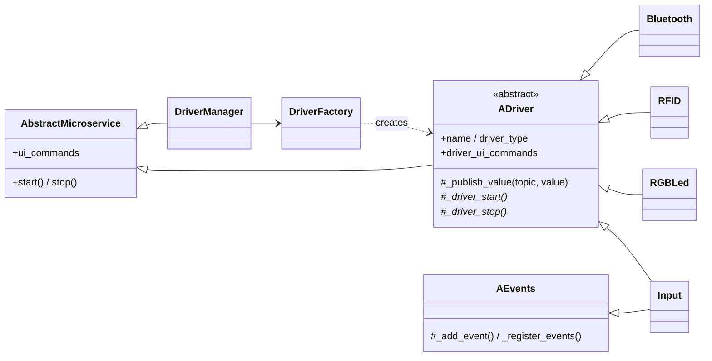
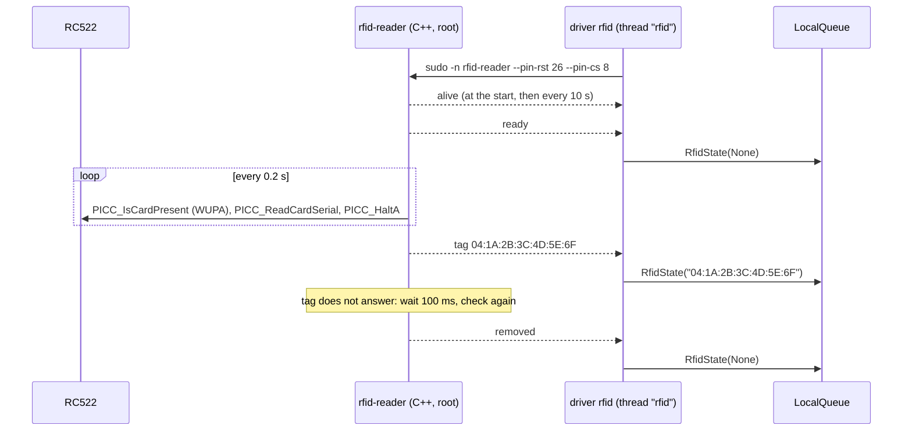

# Drivers

The device drivers of the box (`src/tinyjukebox/devices/`) and the Bluetooth stack. The C++ program that reads the RFID
reader has a document of its own: [rfid-reader.md](rfid-reader.md). The config keys of each driver are listed in
[configuration.md](configuration.md), section 6; the topics and payload types in
[architecture.md](architecture.md), section 7.

| Type | Hardware | Publishes | Receives |
| --- | --- | --- | --- |
| `input` | button against GND on a GPIO pin | `BUTTON_PRESSED`, `BUTTON_HELD`, `BUTTON_RELEASED` | – |
| `rgbled` | RGB LED on three GPIO pins | – | `LED` |
| `rfid` | RC522 on SPI0, read by `rfid-reader` | `RFID_STATE` | `RFID_POLL` |
| `bluetooth` | Bluetooth adapter via BlueZ and BlueALSA | `BLUETOOTH_STATE`, `BUTTON_PRESSED` | `BLUETOOTH_COMMAND`, `PLAYBACK` |

The box needs one `input` driver per button (`volume-up`, `volume-down`, `next`, `prev`) and one `rfid`, `rgbled`
and `bluetooth` driver each. A test checks this for `deploy/config/tinyjukebox.yaml`.

## 1. Framework

**`ADriver(config, pubsub_client, logger)`** is an `AbstractMicroservice` with the section `driver`. Pubsub client
and logger are mandatory; a driver has no console or command line of its own.

- `type` must match the class name (case-insensitive), otherwise `TypeError`.
- `name` (default: class name) is appended to the logger.
- There are no topic tables: every driver imports its topics and payload types from `tinyjukebox.messages`.
- `_start`/`_stop` call the abstract `_driver_start`/`_driver_stop`. `_publish_value(topic, value)` publishes the
  object and logs on INFO (`ADriver._publish_value - button/pressed: volume-up`).
- **Console commands:** drivers register them in `__init__` with `_add_ui_command`. `ADriver` remembers the general
  commands that are already registered when `ADriver.__init__` completes (`debug_threads`); `driver_ui_commands`
  returns only the others.

**`AEvents`** (mixin) collects `pin → (callback, bouncetime)` and registers `GPIO.add_event_detect(pin, BOTH)` on
start. The callback runs in the callback thread of rpi-lgpio and tells the edge apart with `GPIO.input`.

**Registry and `DriverFactory`:** `tinyjukebox.devices.drivers.DRIVERS` maps every type to its class name. By
convention the driver is in `tinyjukebox.devices.drivers.<type>` and its schema in `tinyjukebox.devices.schema.<type>`.
`get_driver_class` imports the module on demand: driver modules import their hardware libraries at module level, and
`tinyjukebox` stays importable on x86 and with `--no-hardware`. `create_drivers(config)`:

1. Every active entry gets a config of its own, `{**config, "driver": entry}`.
2. The driver is created with the shared queue and the logger of the `DriverManager`.
3. The id is the name in lower case without spaces; on collisions `_0`, `_1` … is appended.

`reload_driver` stops the driver, creates a new instance from `driver.config` and starts it. The console commands
of the driver (`<id>_…`) reach the new instance.

**`DriverManager`** is an `AbstractMicroservice` with the section `drivers`, created by `TinyJukebox` with its queue and
logger. It starts the drivers in config order and stops them in reverse order – only the running ones, and a driver
whose stop fails does not hold up the others (needed after a failed start). `ui_commands` contains the driver
commands with prefix `<id>_` and `list_drivers`, `start_driver`, `stop_driver`, `restart_driver`, `reload_driver`.

**State:** `ADriver.state()` says what a driver knows about its hardware right now: `name`, `type`, `running` and
what the driver adds with `_driver_state()`. `DriverManager.states()` collects it with the id of every driver;
`BoxControl.hardware_info()` sorts it into buttons, LEDs and readers for the card "Hardware" of the web page
(`GET /api/box/hardware`, [rest-api.md](rest-api.md)). `_driver_state()` is called by the threads of the web
server, also while the driver is stopped: it reads pins only while the driver runs, and a pin that cannot be read
becomes `null` instead of an error.

| Driver | `_driver_state()` |
| --- | --- |
| `input` | `button`, `pin`, `pressed` (the level of the pin, read at this moment), `hold_timeout`, `hold_repeat`, `last_event` and `last_event_at` (what was published last), `presses` |
| `rgbled` | `pins`, `colors` and `delays` of the pattern, `lit` (the three pins, read at this moment) |
| `rfid` | `pins`, `reader` (the process runs), `uid`, `error`, `changed_at` |

**Schema:** `schema/adriver.get_schema(driver_type, driver_specific_properties)` builds `{"driver": …}` with `name`,
`type` and the driver-specific properties. The latter are all required; `additionalProperties: false` everywhere.
Optional entries (`rfid.command`) are added to `properties` afterwards, without `required`. The allowed values of
`button` and `initial-color` come from `Button` and `Color`. `schema/drivermanager.get_schema()` checks every list
entry with `if type == … then <driver schema>` instead of `oneOf`: jsonschema then reports the key that is actually
wrong instead of "not valid under any of the given schemas". Unknown types are caught by the `enum` on `type`.

## 2. `input` – buttons

The pin is used with the internal pull-up; pressed means `low`. Edges are detected with 50 ms debouncing. `Input`
publishes directly from the GPIO callback. The payload of every message is the configured button (`Button`).

| Event | Message |
| --- | --- |
| button pressed | `BUTTON_PRESSED` |
| still pressed after `hold_timeout` seconds | `BUTTON_HELD` once; with `hold_repeat: true` again every `hold_timeout` seconds while the button stays pressed |
| button released | `BUTTON_RELEASED`; a pending `BUTTON_HELD` is dropped |

Before every `BUTTON_HELD` the driver checks the pin. If the button is no longer pressed (the release edge was lost,
e.g. within the debounce time), it publishes `BUTTON_RELEASED` instead.

Settings of the box and what the receivers make of them:

| Button | `hold_timeout` | `hold_repeat` | Held |
| --- | --- | --- | --- |
| volume up, volume down | 0.2 | `true` | one small step (`volume-step-hold`) every 0.2 s |
| prev | 1 | – | album from the beginning |
| next | 5 | – | together with "prev": pair a headset |

Pairing starts as soon as both "next" and "prev" have reported `BUTTON_HELD`, i.e. after the `hold_timeout` of
"next". A press always triggers its action at once (`BUTTON_PRESSED`); the hold gestures come on top. The buttons
therefore react without delay, and a running album jumps by at most one track or to the start of the track while the
pairing gesture is made.

Console: `<id>_gpio_state`.

## 3. `rgbled` – RGB LED

The driver receives a `LedPattern` on `LED`: one color, or colors alternating with a duration each. A blink pattern
starts with the first color, runs in a thread of its own and lasts until a new pattern arrives. The validation is in
the type itself (`LedPattern.__post_init__`).

Console (the commands create a `LedPattern` and call `show()` directly): `<id>_gpio_color RED`,
`<id>_gpio_rgb true false true`, `<id>_gpio_blink RED BLACK 0.5 [1.5]` (delays > 0), `<id>_gpio_state`.

## 4. `rfid` – RC522 reader

The Python process does not read the RC522. The C++ program `rfid-reader` (`cpp/rfid-reader/`) does; the driver
`rfid` starts it and reads its output.

The program itself – its read loop, the design decisions behind it, build and tests – is described in
[rfid-reader.md](rfid-reader.md). In short: it reports every change as one line on stdout (`ready`, `tag <UID>`,
`removed`), polls the reader every 0.2 s and reports a tag taken off – or another tag in place of the last one – only
after a second check 100 ms later. `alive` comes at its start and then every 10 s.

### 4.1 Driver `rfid` (`devices/drivers/rfid.py`)

- `pin_rst` and `pin_cs` must be two different pins and none of 9, 10, 11 (SPI0): the driver raises `ValueError`, the
  schema rejects 9–11 as well, and `rfid-reader` exits with code 2.
- The thread `rfid` starts `command` plus pins with `subprocess.Popen` (stderr into the same pipe) and reads the pipe
  itself: it waits for output at most 0.1 s at a time and splits the lines, so it never blocks and sees a stop at once.
  `tag …` must match `tag XX(:XX)*`. `alive` is neither logged nor published. Everything except `ready`, `tag`,
  `removed` and `alive` is logged as `RFID - rfid-reader: …` and not published – so messages of `sudo`, of the
  launcher and of bcm2835 reach the log too. A line is a WARNING once; the same line again is on DEBUG until
  `rfid-reader` reports `ready`, `removed` or a `tag` (the driver remembers up to `MAX_SAID`, 100, lines).
- It publishes an `RfidState` when the UID changes, with the error of that moment, and the first state after the
  start of the driver in any case. `RFID_POLL` publishes the current state in any case; tinyjukebox uses it after
  start. A `tag` after a `tag` is a tag replaced (`STMOperation` notes the end of the first one). An error that comes
  or goes while the UID stays is only in the state of the driver (`error`, `changed_at`): `STMOperation` takes every
  `None` for "no tag", and a tag placed on the web page must not end because rfid-reader starts again.

  | Field | Content |
  | --- | --- |
  | `uid` | the complete UID in hex, e.g. `04:1A:2B:3C:4D:5E:6F`; `None` without a tag (`present` is then false) |
  | `error` | `None`, or the reason why `rfid-reader` does not run (cannot be started, has ended, is stuck) |
  | `timestamp` | time at which the `RfidState` was created (UTC): when the driver publishes it – after a line of `rfid-reader`, after its end, or as the answer to `RFID_POLL` |

- State (`_uid`, `_error`) and publication are under one `RLock`.
- If the program ends or cannot be started, the driver sets the state `RfidState(None, error=reason)` – published only
  if a tag was there or nothing has been published since the start of the driver (above) –, logs
  `RFID - … - trying again every 5 s` (ERROR; the same reason afterwards only on DEBUG, until `rfid-reader` has
  reported something again) and tries again after `RESTART_INTERVAL` (5 s).
- **Watchdog:** once the program has written `alive`, the driver expects a line at least every three intervals
  (`ALIVE_INTERVAL` 10 s, the default of `rfid-reader`; three intervals are 30 s). A program that stays silent longer
  hangs (a stall in SPI, a stopped process): the driver ends it as on stop and starts it again as after a crash, with
  the reason `rfid-reader is stuck: no output for 30 s`. A program that never writes `alive` is never ended.
- The end of the program, on stop and by the watchdog: the thread closes its end of the pipe, sends `SIGTERM` (`sudo`
  passes it on) and `SIGKILL` after 2 s. `SIGKILL` reaches only `sudo`, not `rfid-reader` (root): one that is left
  behind ends by itself, because nobody reads its output any more. Stop waits for the thread at most about 4 s; a
  thread that takes longer is kept, and the next start waits for it before it starts another `rfid-reader` – two
  would disturb each other. Under systemd the control group of the service also ends all child processes.
- `healthy()` (stage 1 of the health check of a new version) is true only while `rfid-reader` runs. An exception in the
  thread – e.g. a publication after the queue was disconnected – ends `rfid-reader` and the thread; `healthy()` is
  false then.
- `command` defaults to `sudo -n /usr/local/bin/rfid-reader`: the service runs as `pi`, the program needs root. This
  requires the sudoers rule of the box ([box.md](box.md), section 7); `-n` keeps `sudo` from waiting for a password.
  On a box with slots the path is a link to the launcher of root, which starts the program of the active slot only if
  the box trusts it ([box.md](box.md), section 7), so the reader changes with the version. Until the installer of
  0.45 has run on the box, it is the link of before, to the program of the active slot.
- The driver has no console commands.

## 5. `bluetooth` – headset

The driver makes the box a Bluetooth sender for exactly one headset. How the rest of tinyjukebox reacts to the headset
is described in [architecture.md](architecture.md), section 5; the behaviour as the user sees it in the
[user manual](../user/en/manual.md), section 5.

### 5.1 Stack and system services

| Layer | Role |
| --- | --- |
| BlueZ (`bluetooth.service`) | pairing, connection, AVRCP; stores the pairing in `/var/lib/bluetooth` – tinyjukebox keeps no list of its own |
| BlueALSA (`bluealsa.service`, package `bluez-alsa-utils`) | ALSA device and mixer `bluealsa` for the headset |
| driver `bluetooth` | talks to BlueZ over D-Bus (`dbus-fast`), watches and sets the BlueALSA mixer |
| player | `aplay -D bluealsa:DEV=<address>,PROFILE=a2dp,VOL=<n>+` |

BlueALSA was chosen because it works without a desktop and without a PulseAudio/PipeWire user session, and because
the player already uses `aplay`: for the headset only the output device changes.

BlueALSA runs with `-S -p a2dp-source -p hfp-ag --a2dp-volume --a2dp-force-audio-cd`:

| Option | Reason |
| --- | --- |
| `-p a2dp-source` | the box is the sender. `bluealsa-aplay` (playback *from* a phone) is disabled |
| `-p hfp-ag` | only for the battery level: some headsets report it only over HFP. BlueALSA passes it on to BlueZ (`Battery1`). If a headset still reports none, `--xapl-resp-name=iPhone` may help; if HFP causes trouble, drop the option and live without the battery level |
| `--a2dp-volume` | the volume is set in the headset itself instead of scaling the signal. Only then does the box see, and limit, the volume buttons of the headset |
| `--a2dp-force-audio-cd` | the link runs at 44.1 kHz, as the box plays (`aplay -f cd`). Without it BlueALSA and many headsets agree on 48 kHz, and the first playback makes BlueALSA reconfigure the link (`SelectCodec`). A headset that has just connected may refuse that (`Couldn't select codec: SBC`); BlueALSA then drops the audio channel, and the box considers a connected headset disconnected |

Further constraints:

- Sound always goes over A2DP (stereo, codec SBC). The box selects the profile itself (`PROFILE=a2dp`), so a headset
  cannot switch to mono telephony.
- Classic Bluetooth only: BlueALSA cannot do LE Audio. A headset must not be set to prefer LE Audio.
- Limiting the headset's own volume buttons requires a headset with "Absolute Volume" (AVRCP 1.4+). Without it the
  headset adjusts internally and the box does not see it; the volume that the box sets itself stays limited anyway.
- On the Pi 3, WLAN and Bluetooth share one radio chip.

### 5.2 Parts

| Part | Task |
| --- | --- |
| `drivers/bluetooth.py` `Bluetooth` | `ADriver`: thread "bluetooth" with an asyncio loop; the handlers for `BLUETOOTH_COMMAND` and `PLAYBACK` only pass the message in with `call_soon_threadsafe` |
| `bluetooth/link.py` `HeadsetLink` | the logic: paired headset, search and pairing, reconnect, volume, buttons, `BluetoothState` |
| `bluetooth/bluez.py` `DbusBluez` | BlueZ on the system D-Bus (dbus-fast): object cache, calls, agent, media player |
| `bluetooth/avrcp_input.py` `AvrcpInput` | headset buttons as a Linux input device (only with `avrcp: input`) |
| `bluetooth/virtual.py` `VirtualHeadset` | stand-in without hardware |

### 5.3 DbusBluez

`DbusBluez` keeps the objects of BlueZ (`GetManagedObjects`) as a cache `path → interface → properties` and updates
it from the signals `PropertiesChanged`, `InterfacesAdded` and `InterfacesRemoved`; after every change it calls
`on_change`. `devices()` returns immutable `Device` objects. Messages are built and answered by hand (`Message`,
`add_message_handler`) instead of using the proxy and service classes of dbus-fast – their signatures are in
annotations that mypy would read as names.

- **On connect:** adapter `Powered` on, `Discoverable` off – the box is never visible, so a foreign phone cannot pair
  with it. `Pairable` stays on: without "bondable" the kernel pairs without bonding, and the headset would be
  forgotten after the first disconnect; pairing from outside is refused by the agent.
- **Agent** (`org.bluez.Agent1`, `NoInputNoOutput`): asks the `AgentPolicy` (the `HeadsetLink`). Pairing questions
  (`RequestPinCode` → `0000`, `RequestConfirmation`, `RequestAuthorization` …) are answered positively only for the
  headset that is being paired, `AuthorizeService` only for the paired one; everything else ends with
  `org.bluez.Error.Rejected`.
- **Media player** (with `avrcp: player`; `org.mpris.MediaPlayer2.Player` via `Media1.RegisterPlayer`): receives the
  AVRCP buttons as calls `Play`, `Pause`, `PlayPause`, `Stop`, `Next`, `Previous`. `set_playback_status()` tells
  BlueZ (and thereby the headset) with `PropertiesChanged` what the box is playing, so that the headset sends play or
  pause as appropriate. If the registration fails, the headset still plays; only its buttons have no effect.
- **BlueZ restarts** (`NameOwnerChanged`): everything is registered again – retried every 5 s until it succeeds (the
  adapter appears a little later).
- **`discovered`** of a device means: since `start_discovery()` BlueZ has reported a signal strength (`RSSI`) for it,
  i.e. it answers now, unlike a device that BlueZ only knows from earlier. The search uses
  `SetDiscoveryFilter(Transport=bredr)`, because headsets in pairing mode also advertise over LE.
- Errors of a call become `BluezError(name, text)`, missing answers `TimeoutError`.

### 5.4 HeadsetLink

`HeadsetLink` runs entirely in the asyncio loop (no lock needed).

- **State:** after every change in BlueZ the `BluetoothState` is computed anew and published only if it changed.
  `connected` requires, besides `Device1.Connected`, a `MediaTransport1` of the headset – only then can `aplay` play
  on it. If no headset is remembered, the paired one is taken over from BlueZ (after a restart, or paired with
  `bluetoothctl`).
- **Search** (`PAIR`): at most `SEARCH_TIME` (60 s). Candidates are discovered audio outputs (A2DP sink in the UUIDs
  or, before the services are known, device class audio/video); phones or keyboards in pairing mode are ignored.
  From the first candidate on the search runs for another `COLLECT_TIME` (3 s), then the strongest signal wins.
  After that: stop the search, `Pair` (without PIN, "Just Works"), `Trusted`, `Connect`.
- **Exactly one headset:** only after a successful pairing are all other paired devices removed (`RemoveDevice`),
  including devices paired by hand with `bluetoothctl`. If pairing fails, the previous headset stays paired.
- If `Connect` fails, the headset still counts as paired – reconnecting keeps trying.
- If the candidate is already paired (the same headset after a factory reset), its old pairing is removed and it is
  searched again. If that fails, it is no longer paired; the old pairing was worthless anyway.
- If BlueZ refuses to start the search (e.g. because it is calling the old headset), the search is retried every
  second until its time is up.
- **Reconnect:** `Connect` every `RECONNECT_INTERVAL` (15 s) as long as the paired headset cannot play; errors
  (switched off, out of range) only on DEBUG.
- **Volume:** while the headset is connected, an `AlsaVolumeControl` watches the mixer of BlueALSA in single device
  mode (`bluealsa:<address>`, control `A2DP`; if it is not there yet, retried every 0.5 s). Every change – also by
  the buttons of the headset – then appears in the `BluetoothState`. The command `VOLUME` is set in a worker thread
  and repeated up to ten times if the mixer is still missing shortly after connecting; the value requested last
  always wins.
- **Buttons:** `button_of()` translates the calls into `Button`. `PlayPause` – and with `play-pause-toggle` also
  `Play` and `Pause` – switch depending on the playback status.

**No Bluetooth:** if BlueZ is not reachable or the adapter is missing, `HeadsetLink.run` ends with an error. The
driver logs it once (`Bluetooth - not available: …`) and tries a new connection every 30 s; the box works without
headset meanwhile. Commands in that time are discarded with a warning; the driver remembers the last playback
status and passes it to every new connection. An error nobody expected (an answer of BlueZ in another form, a
refused authentication of D-Bus) is reported as unexpected and tried again the same way; `healthy()` is false while
the thread of the driver does not run. A pairing request shows the "failed" LED pattern at once only while the driver
has never reported a state (`Headset.pair`); after an outage that follows a working connection, `PAIR` is dropped with
the warning above and the LED shows nothing. On stop all tasks are cancelled, the mixer watch is ended, and agent and
player are unregistered; the stop waits at most `STOP_TIMEOUT` (10 s) for the thread – a call of the mixer that hangs
in alsa-lib does not hold up the stop of the box.

Console: `<id>_state` – the devices BlueZ knows, each with address, name, paired, connected, audio and battery.

### 5.5 AvrcpInput and VirtualHeadset

**`AvrcpInput`** looks every 2 s under `/sys/class/input` for a device whose name ends in `(AVRCP)` and reads its
`/dev/input/eventN` with `select.poll` and `struct` (no python-evdev). The device comes and goes with the
connection. This path is an alternative for headsets whose buttons do not arrive through the media player; the user
of the service then needs the group `input`.

**`VirtualHeadset`** is not a driver but behaves like one on the pubsub: `PAIR` pairs and connects after 2 s, it
adopts `VOLUME`, `switch()` connects or disconnects, `press()` publishes the button or – like a headset with
Absolute Volume – changes its own volume. `Headset` recognizes it by `BluetoothState.virtual` and leaves the output
on the default device. It exists only with `--no-hardware` (REST: `POST /api/bluetooth/virtual`, console:
`virtual_headset`, `virtual_headset_button`).
