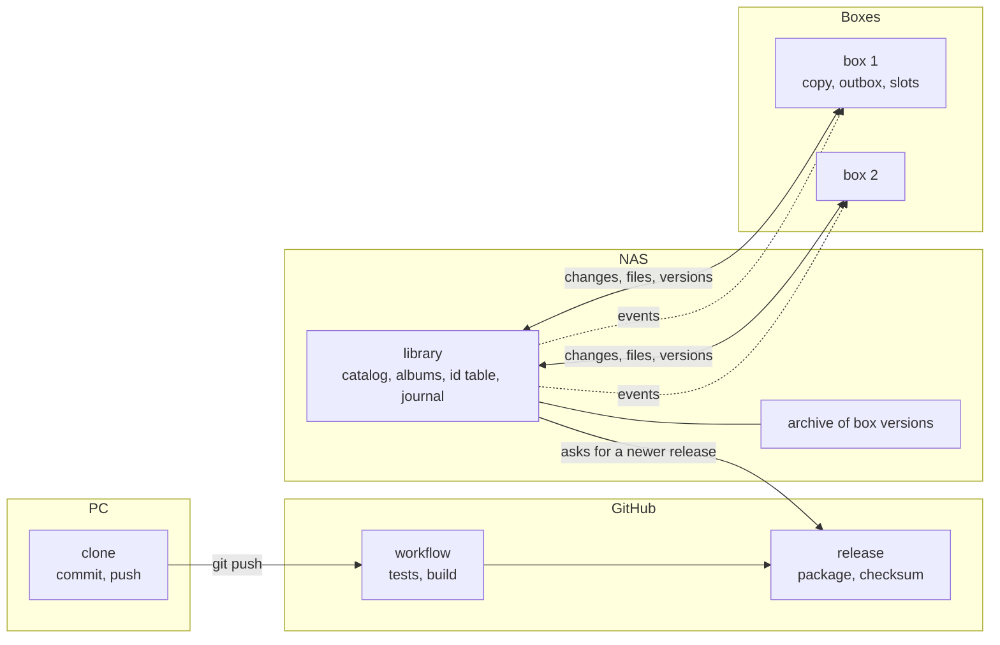
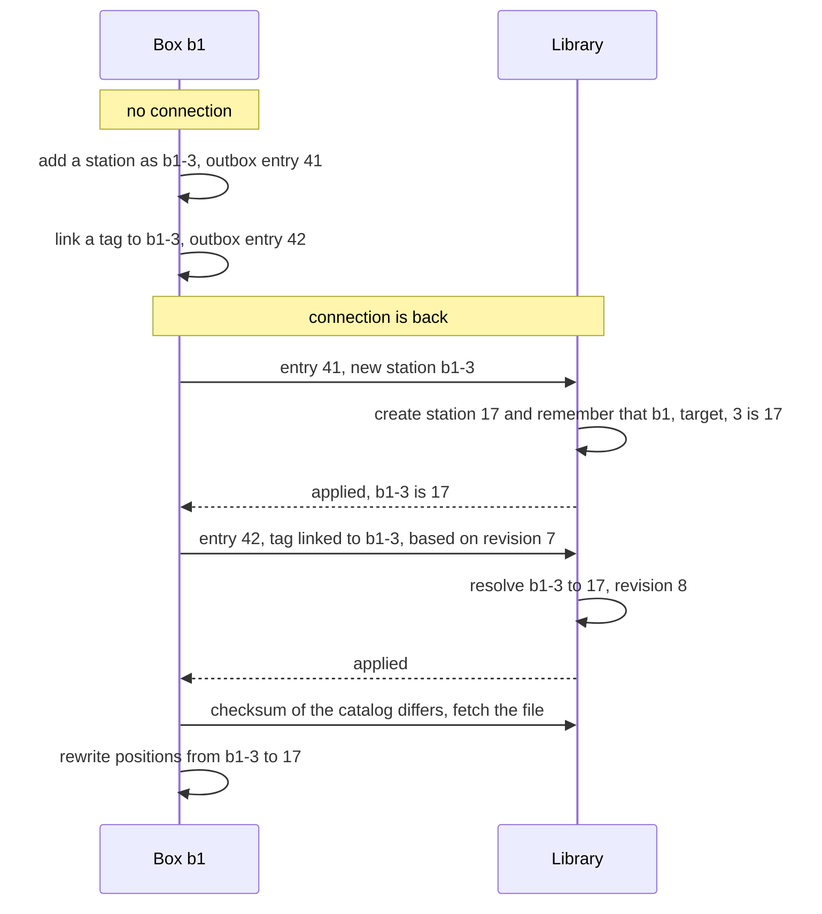
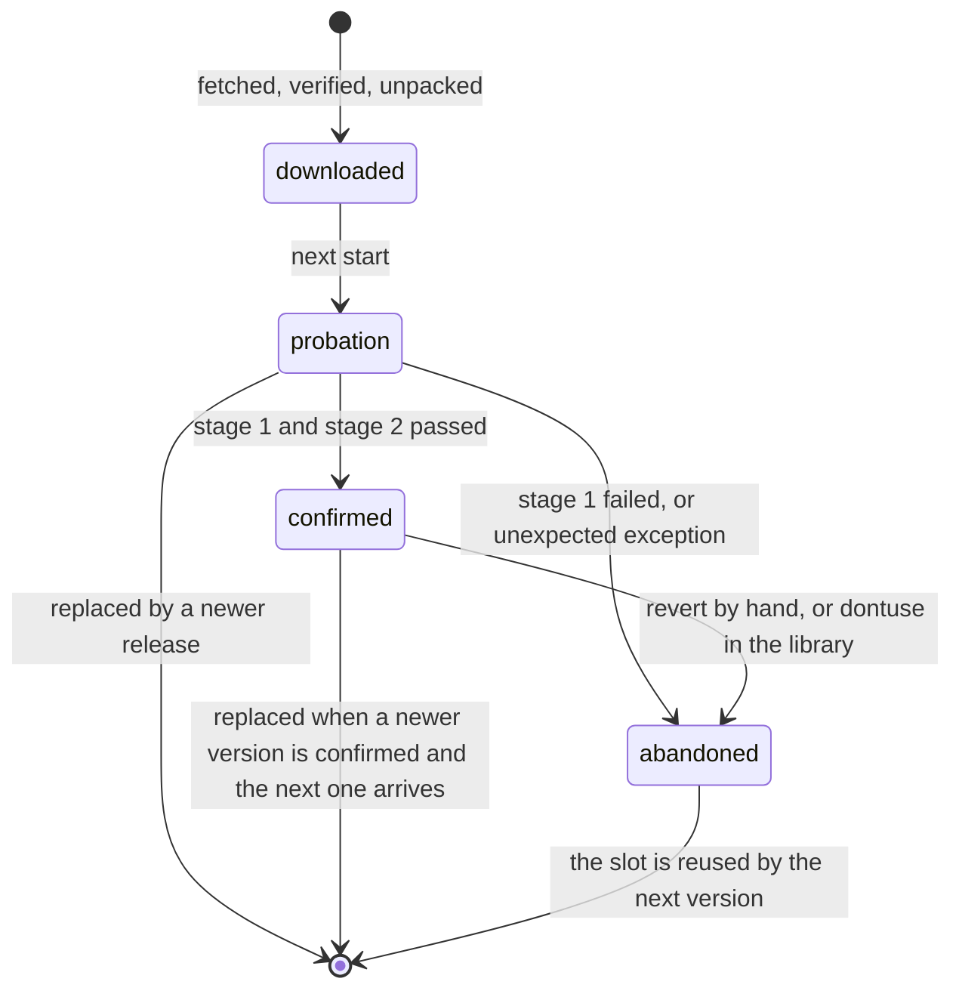
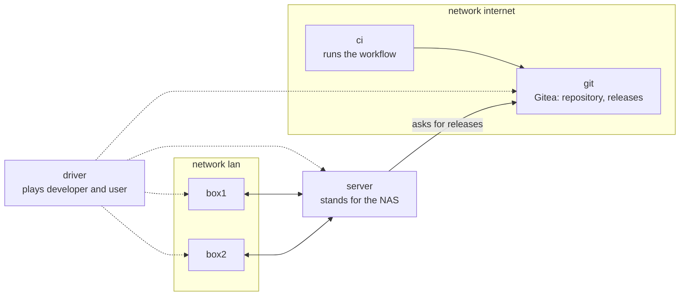

# Library, synchronization and self-update

The central library on the NAS, the boxes that synchronize with it and keep playing without it, the phone as a
reader of the library, the self-update of the boxes, the play statistics and the release pipeline: how they work,
and where the code is. Section 9 describes the test bed that proved the mechanics, and how to build it again.
Related documents:

- [architecture.md](architecture.md): the box itself (state machines, data model)
- [rest-api.md](rest-api.md): the endpoints of box and library
- [deployment.md](deployment.md): the installer of a box and the playbook
- [box.md](box.md): hardware, file layout, service
- [roadmap.md](roadmap.md): what is not verified yet

## 1. Goals and principles

| Topic | A box alone | With the library |
| --- | --- | --- |
| Tags, albums, stations | only on the SD card of the box | in the library on the NAS; every box holds a copy |
| New album | upload to the box | upload to the library or to a box; a box fetches what it lacks |
| Backup | by a schedule set on its page, into `backups-folder` (default `/srv/tinyjukebox/backups` on the SD card), and as a download from its page ([operations.md](operations.md), section 10) | everything a box needs to be rebuilt is in the library |
| Update of the box | with slots: the box fetches the newest release itself and can go back (section 6.16); without slots: `./update_box.sh` on the PC pushes `master` | the box fetches released versions from the library by itself and can go back |
| Number of boxes | one | any number: one catalog for all, positions per box |
| What was played | journal on the box, its last 1000 lines, counted on its page (section 7) | journal on the box, counted by the library, shown by library and box |

Principles the design follows:

1. **The box plays without network, and not later than a box alone.** It asks the library only for what it lacks.
2. **Nothing entered on a box gets lost silently.** Changes made without the library reach it later.
3. **The library is where changes meet.** In a conflict its value wins, and the conflict is logged.
4. **Order is never decided by the clock.** The Pi has no real-time clock; without WLAN its time is wrong.
5. **A defective version is not trusted** – neither its code nor the data it wrote.
6. **Every way back works with plain files and one shell command**, without network, web page or Python.
7. **The installer sets up the system of a box** – with one line, or run by the Ansible playbook – for the first
   installation and as the rescue path.
8. **Data is migrated forward only**, and only in the library ([development.md](development.md), section 8).

## 2. Overview



| Component | Runs on | Task |
| --- | --- | --- |
| Library (`tinyjukebox-library`) | NAS | catalog, albums, covers, id table, journal, archive of box versions; web page for managing; interface for the boxes |
| Box (`tinyjukebox`) | every box | plays; holds a copy of the catalog and its own unconfirmed changes; fetches the albums it lacks |
| `tinyjukebox-slot` and the start script | every box, outside the slots | which version runs: install, switch, go back |
| Pipeline | GitHub | tests, builds the package for the NAS and the slot for the boxes, publishes a release |
| Installer `install.sh` | every box, once and when the setup changes | operating system, start script, first installation, rescue |
| Ansible playbook | PC | what only the developer needs, and runs the installer |

| Data | In the library | On a box |
| --- | --- | --- |
| Catalog: tags, albums, stations | the merged state of all changes | a complete copy, plus own changes that are not confirmed yet |
| Audio files | all albums | the albums the box has needed so far |
| Positions | a copy per box | written by the box; per box, never shared between boxes |
| Settings of a box: volume limits (`volume.*`) and name; of a phone also `spotify-client`. Not the update mode: it travels in the status report (section 4.13) | a copy per box | written by the box; on the page of the library also the name, and for a phone the volume limits and `spotify-client` |
| Journal: what was played, changes of version | permanent | appended by the box and passed on |
| Versions of the box software | archive | three slots: `a`, `b`, `fallback` |
| State of every version: `use`, `manual`, `dontuse` | set here, by hand or because a box went back | a copy; a box changes a state by going back from a version |

### 2.1 The code

| Part | Where | Module or file |
| --- | --- | --- |
| Library | NAS or PC, console script `tinyjukebox-library` | `src/tinyjukebox/library/` |
| Synchronization of a box | in `tinyjukebox` | `src/tinyjukebox/sync/` |
| Version and health check of a box | in `tinyjukebox` | `src/tinyjukebox/slots.py` |
| Slot scripts | box, outside the slots | `deploy/slot/` |
| First filling | PC, console script `tinyjukebox-fill-library` | `src/tinyjukebox/tools/fill_library.py` |
| Package for the NAS | `build_package.sh` | `deploy/synology/` |
| Slot archive, pipeline | `scripts/`, `.github/workflows/ci.yml` | |

```text
src/tinyjukebox/
├── sync/
│   ├── __init__.py     INTERFACE (version of the interface), who makes a change (actor)
│   ├── client.py       HTTPS client that accepts exactly one certificate; resumable files, events
│   ├── handshake.py    proofs of the bootstrap password, key of a box
│   ├── manifest.py     files of an album with size and checksum
│   ├── util.py         files written in one step, checksums, clock
│   ├── data.py         BoxData: copy, outbox, working data, journal
│   ├── link.py         Link: one pass of the synchronization, handshake, events
│   ├── files.py        AlbumFiles (fetch on demand, send, space on the card), CardFiles
│   └── box.py          BoxSync: connects all of it with the data of the box
├── library/
│   ├── store.py        catalog with revisions, merge rules, id table, albums, versions
│   ├── journal.py      journal store (SQLite)
│   ├── diagnostics.py  what the library keeps of the logs of the boxes (SQLite, section 4.22)
│   ├── statistics.py   play statistics from the journal
│   ├── releases.py     query for releases, schedule, archive of box versions
│   ├── schema.py       schema of the config file
│   └── service.py      Library: web page, interface for the boxes, console script
├── diagnostics.py      Collector: what a box sends of its log (section 4.22)
├── backup.py           a backup: one archive of the data of a box or of the library (section 4.19)
├── backups.py          backups by a schedule, of the library and of a box without one (section 4.19)
├── restore.py          putting a backup back (section 4.12)
├── data_folder.py      library and box with one folder (section 3.9)
└── slots.py            Slots (the slot script as the application uses it), Health (health check)
```

A box and the library share `tinyjukebox.data`, the catalog operations of `CatalogControl` (`control.py`) and the web
server (`web/server.py`). Both are stdlib plus the dependencies of the package; the hardware libraries of a box are
the extra `box`.

## 3. The library on the NAS

The NAS is a Synology DS418j with DSM 7.4.1: a Realtek RTD1293, a 64-bit ARM processor (aarch64) whose name for
packages is `rtd1296`, and 1 GB of memory. Synology offers no Docker for it, and none is installed there by other
means. The library is therefore one Python process and is installed as a Synology package. It is never updated
automatically: a new package is installed by hand.

### 3.1 Application

The library is a program of its own with a script of its own, `tinyjukebox-library` – not a mode of `tinyjukebox`: a
server and a box are different things. It lives in the same repository and uses the parts both need. It can be run and
tested on the PC.

| | |
| --- | --- |
| Reused | `data/` (tags, targets, sanity check); the web page with the tabs "Tags", "Statistics", "Tag management", "Albums", "Radio", "Spotify", "Upload", "System" and "Log"; users and roles |
| Left out | drivers, state machines, player |
| New | the interface for the boxes (section 4.13), the id table (4.6), the journal store and the statistics of all boxes (7), the archive of box versions and the overview of the boxes (6.13) |

### 3.2 Package

A Synology package is a tar archive with a fixed structure, installed in the Package Center with "Manual Install".
`build_package.sh` in the root of the repository creates it from the folder `deploy/synology/`; the Synology toolkit is
not needed. **The library is never updated automatically:** a new package is installed by hand.

```text
tinyjukebox-library-<version>-<build>-<architecture>.spk
├── INFO                    name, version, architecture, minimum DSM version, port, description
├── package.tgz             tinyjukebox and its dependencies; slot and installer for the boxes, the app for phones
├── scripts/                start-stop-status, postinst, preupgrade, postupgrade, preuninst, …
├── conf/privilege          the package runs as a user of its own, not as root
├── conf/resource           shared folder, firewall port
├── WIZARD_UIFILES/         dialog during the installation: admin password, bootstrap password
└── PACKAGE_ICON.PNG, PACKAGE_ICON_256.PNG
```

- **User of its own:** DSM 7 runs a package without root. The port is therefore above 1024 (the box uses 443 with a
  capability of the service unit).
- **Version:** DSM wants the form `<version>-<build number>`, for example `0.8.0-0001`. The version is the one of
  Tiny Jukebox; the build number counts the packages of one version.
- **Shared folder:** DSM creates a shared folder `tinyjukebox` when the package is started for the first time, and the
  package creates `albums/`, `images/` and `json/` in it. The package reaches the folder through the link
  `/var/packages/tinyjukebox-library/shares/tinyjukebox`. Albums can also be put there with SMB or File Station, and
  Hyper Backup includes the folder.
- **Data across updates:** certificate, `users.yaml` and config live in the package's `var` folder, which an update
  keeps.
- **Entry in the DSM main menu:** opens the web page in a new browser tab. The page keeps its own login.

`./build_package.sh [BUILD [--slots DIR]]` creates `dist/tinyjukebox-library-<version>-<build>-rtd1296.spk` from the
folder `deploy/synology/`. Section 3.6 says how a package is written.

- `package.tgz` holds tinyjukebox and its dependencies in `lib/`, as ready-made files for Python 3.12 on aarch64
  (`uv pip install --target … --python-platform aarch64-manylinux_2_28`). Nothing is installed on the NAS; the start
  script sets `PYTHONPATH`.
- `slots/` holds the slot archive of the same version from `DIR` (default: `dist`), if there is one, the installer of
  a box of that version (`DIR/install.sh`, as `tinyjukebox-install-<version>.sh`) and the app for phones of that
  version (`DIR/tinyjukebox-app-<version>.apk`): the library hands them out (section 4.13).
- The installation dialog (`WIZARD_UIFILES/install_uifile`, and `install_uifile_ger` when DSM is German) asks for
  the password of the user `admin` and for the bootstrap password. `postinst` writes `var/library.yaml` and
  `var/ssl/users.yaml` on the first installation; an upgrade keeps both.
- The port is 8866, fixed when the package is built: `INFO` and the firewall file of DSM name it.
- For new box versions the library asks the repository of the releases. The config of the package names the token
  file `var/github-token`: without a token – set on the page of the library, or in that file – it does not ask, also
  not a public repository, for which an empty file is enough (section 8.2).

### 3.3 Python for the package

The library runs with the Python 3.12 of SynoCommunity (3.12.13 on the NAS); the Python of DSM itself is 3.8 and too
old.

- The package names `python312` as a package it depends on and uses it through
  `/var/packages/python312/target/bin/python3`, the path that does not depend on the volume.
- The package brings Tiny Jukebox and its dependencies as a folder `lib`, installed when the package is built from
  ready-made files for this Python and processor. Nothing is installed on the NAS, so the installation needs neither
  internet nor a compiler.
- Tiny Jukebox is developed with Python 3.13 and allows 3.11 or newer. The tests of the workflow also run with 3.12, the
  version of the NAS.
- The hardware libraries of a box – `pyalsaaudio`, `rpi-lgpio` and `dbus-fast` – are the extra `box` and not part of
  the package: their markers for aarch64 or Linux (`pyproject.toml`) would select them on the NAS too.

### 3.4 Restrictions

- DSM shows a warning for every package that does not come from Synology. A package cannot be signed by its author.
- A package is built for one platform. Another NAS needs another build.
- Login with the DSM users is left out: more work, and it would tie the page to DSM.
- The page has a self-signed certificate. The certificate of DSM can be used with a reverse proxy configured in
  DSM; the package does nothing for it.

### 3.5 First filling

The library starts empty. A command run on the PC fills it from what is at hand there: tags, albums with their files,
stations and their covers. It keeps the ids of the existing data, so that box and library agree from the start, and it
can be repeated: what is there already is skipped. The positions come from the box itself with its first
synchronization.

```bash
uv run tinyjukebox-fill-library https://nas:8866 --user admin \
    --json ~/tinyjukebox-sim/json --albums /path/to/albums --images /path/to/images
```

- Asks for the password and shows the fingerprint of the certificate of the library for confirmation
  (`--fingerprint` skips the question; the library logs its fingerprint at the start).
- Sends tags and targets under their ids; entries the library has already are skipped.
- Computes the manifest of every album, asks which files the library lacks and sends those; sends the covers of albums
  and stations.
- Can be repeated at any time.

### 3.6 Writing the package

What has to be known to write or change the package. It comes from the developer guide of Synology and from the way
SynoCommunity builds its packages. The files are in `deploy/synology/`, and `build_package.sh` packs them.

The file:

```text
tinyjukebox-library-<version>-<build>-<architecture>.spk     tar, not compressed
├── INFO                    lines of the form key="value"
├── package.tgz             tar with gzip; its content becomes the folder target on the NAS
├── scripts/                seven scripts, all required
├── conf/privilege          required
├── conf/resource
├── WIZARD_UIFILES/         the installation dialog
├── PACKAGE_ICON.PNG        64 x 64
└── PACKAGE_ICON_256.PNG    256 x 256
```

- The entries lie directly in the archive, as Synology's own tool packs them: no leading `./` and no entry for the
  folder itself. The same holds for `package.tgz`.
- Owner root; files 644, folders and scripts 755. DSM hands the unpacked files to the user of the package.
- The name of the file means nothing to DSM.
- `build_package.sh` replaces `@VERSION@` and `@PORT@` in the text files, writes the file `VERSION` into `package.tgz`,
  copies two of the menu icons as package icons and puts the checksum into `INFO`. Plain `tar` is enough.

`INFO`:

| Key | Here | Meaning |
| --- | --- | --- |
| `package` | `tinyjukebox-library` | identity; also the name of the folder `/var/packages/tinyjukebox-library` and of the user. A colon, a slash, `<`, `>`, `=` or a vertical bar is not allowed in it |
| `version` | `0.8.0-0001` | `<version>-<build number>`: numbers only, separated by `.`, `-` or `_`. A package with a higher one is installed as an upgrade |
| `os_min_ver` | `7.0-40000` | at least this value, or DSM 7 does not install the package |
| `arch` | `rtd1296` | the platform of the DS418j. `noarch` fits only a package without compiled files |
| `description`, `maintainer` | | required |
| `displayname`, `displayname_ger` | `Tiny Jukebox Library`, `Tiny Jukebox Bibliothek` | the name in the Package Center; a key with the language of DSM at its end (`_ger`) is taken when DSM is set to that language. The same for `description` |
| `install_dep_packages` | `python312` | packages that must be installed before. Several are separated by a colon; a version can follow, as in `python312>=3.12` |
| `dsmuidir` | `ui` | the folder in `package.tgz` with the menu entry |
| `dsmappname` | the id of the menu entry | what "Open" in the Package Center opens |
| `adminprotocol`, `adminport` | `https`, `8866` | the address of the page. DSM checks during the installation that the port is free (`checkport`, on by default) |
| `checksum` | | MD5 of `package.tgz` |

`conf/privilege` is `{"defaults": {"run-as": "package"}}`; DSM 7 accepts nothing else from a foreign package. DSM
creates a user and a group with the name of the package (other names: `username`, `groupname`), runs every script and
the process as this user and gives it the folders of the package.

`conf/resource` names what the package needs from DSM. Each key is a "worker":

| Worker | Declares | Behaviour |
| --- | --- | --- |
| `data-share` | the shared folder `tinyjukebox`, writable for the user of the package | DSM creates it when the package is started, not when it is installed, and on the volume of the package (tried: `/volume3/tinyjukebox`). A folder of that name that exists already is used. It is never removed. The package reaches it through the link `/var/packages/tinyjukebox-library/shares/tinyjukebox` |
| `port-config` | the file `tinyjukebox-library.sc` in `target`: a section name, `title` and `desc` in English, `port_forward`, `dst.ports="8866/tcp"` | DSM lists the port in its firewall as an application |

The scripts are run by `/bin/sh` as the user of the package. All seven must exist; one with nothing to do is `exit 0`.

| Script | Called | A result other than 0 |
| --- | --- | --- |
| `preinst` | before the files are unpacked | aborts the installation |
| `postinst` | after the files are in `target` | the package counts as damaged |
| `preupgrade`, `postupgrade` | before and after an upgrade, from the new package | aborts the upgrade; the package counts as damaged |
| `preuninst`, `postuninst` | before and after the removal; during an upgrade also from the old package | `preuninst` aborts the removal |
| `start-stop-status` | with `start`, `stop` and `status`; before the first two also with `prestart` and `prestop` | `status` answers 0 for running and 3 for not running |

`postupgrade` notes the upgrade in `var/package.log` and brings the installed config up to date where a key was
renamed: `cards-folder` of a config written before 0.29 becomes `images-folder`. The config itself is written only
once, by the first installation.

The order:

```text
installation   preinst, postinst, start
upgrade        stop (old), preupgrade (new), preuninst (old), postuninst (old),
               preinst (new), postinst (new), postupgrade (new), start (new)
removal        stop, preuninst, postuninst
```

- **Variables** that DSM sets for the scripts: `SYNOPKG_PKG_STATUS` (`INSTALL`, `UPGRADE`, `UNINSTALL`, `START`, `STOP`;
  empty while the NAS starts or shuts down), `SYNOPKG_PKGVER`, `SYNOPKG_OLD_PKGVER` (during an upgrade),
  `SYNOPKG_PKGDEST` (`target`), `SYNOPKG_PKGVAR` (`var`), `SYNOPKG_DSM_LANGUAGE` and `SYNOPKG_TEMP_LOGFILE`: what a
  script writes into that file, the Package Center shows to the user.
- **Paths:** the scripts use the fixed paths below, not their own location, because DSM unpacks a package into a
  temporary folder during the installation.
- **The process:** `start` starts it in the background and notes its number in `var/server.pid`; its output goes to
  `var/server.log`. `stop` ends the process with this number, `status` looks whether it lives. The packages of
  SynoCommunity do the same. Nothing restarts a process that crashes.

The folders on the NAS are links in `/var/packages/tinyjukebox-library/` and belong to the user of the package. They lie
on the volume of the package, here `/volume3`:

| Link | Lies in | Content | Removed |
| --- | --- | --- | --- |
| `target` | `@appstore/tinyjukebox-library` | the content of `package.tgz` | by every upgrade and by the removal |
| `var` | `@appdata/tinyjukebox-library` | data that stays; tried: an upgrade keeps it | never |
| `etc` | `@appconf/tinyjukebox-library` | config that stays | never |
| `tmp` | `@apptemp/tinyjukebox-library` | temporary files | by every upgrade and by the removal |
| `home` | `@apphome/tinyjukebox-library` | private folder of the user, mode 0700 | never |
| `shares/tinyjukebox` | `/volume3/tinyjukebox` | the shared folder | never |

- DSM puts folders named `@eaDir` into a shared folder. The library skips them.
- On the NAS, `/var/log/packages/tinyjukebox-library.log` holds what the scripts printed and `/var/log/synopkg.log` what
  the Package Center did.

The menu entry is the folder `ui` in `package.tgz`, which DSM links into its own web folders. Its file `config` declares
one entry of the type `url` with `title`, `desc`, `icon`, `protocol`, `port` and `url`; DSM takes the host name from the
address of DSM in the browser and opens the page in a new tab or window. `icon` is `images/icon_{0}.png`, and DSM
replaces `{0}` by 16, 24, 32, 48, 64, 72 or 256, so seven files are needed. They are made from
`docs/images/logo-icon.svg`. Without `allUsers` only administrators see the entry. `protocol` and `port` are not in the
guide; they are written as SynoCommunity writes them, and they work on the NAS.

- **The installation dialog:** `WIZARD_UIFILES/install_uifile` is a JSON file with steps and fields (`textfield`,
  `password`). Each field has a key, and its value reaches `preinst` and `postinst` as an environment variable of that
  name. The packages of SynoCommunity use this form. For DSM 7.2.2 and later the guide describes a second form with a
  compiled Vue component; it is not used.
- **A restart after a crash** is not set up. A package can bring a systemd unit in `conf/systemd/`, which DSM
  installs.

Sources:

| Topic | Source |
| --- | --- |
| The file and `INFO` | developer guide of Synology: [structure](https://help.synology.com/developer-guide/synology_package/introduction.html), [required keys](https://help.synology.com/developer-guide/synology_package/INFO_necessary_fields.html), [optional keys](https://help.synology.com/developer-guide/synology_package/INFO_optional_fields.html) |
| Scripts | developer guide: [scripts and their order](https://help.synology.com/developer-guide/synology_package/scripts.html), [variables](https://help.synology.com/developer-guide/synology_package/script_env_var.html), [messages](https://help.synology.com/developer-guide/synology_package/show_massage.html) |
| `conf` | developer guide: [privilege](https://help.synology.com/developer-guide/privilege/privilege_config.html), [shared folder](https://help.synology.com/developer-guide/resource_acquisition/data_share.html), [port](https://help.synology.com/developer-guide/integrate_dsm/ports.html), [systemd unit](https://help.synology.com/developer-guide/resource_acquisition/systemd_user_unit.html) |
| On the NAS | developer guide: [folders](https://help.synology.com/developer-guide/integrate_dsm/fhs.html), [menu entry](https://help.synology.com/developer-guide/integrate_dsm/config.html), [installation dialog](https://help.synology.com/developer-guide/synology_package/wizard/WIZARD_UIFILES_v2.html) |
| How SynoCommunity does it | its build files: [the package](https://github.com/SynoCommunity/spksrc/blob/master/mk/spksrc.spk.mk), [user, resources, menu entry](https://github.com/SynoCommunity/spksrc/blob/master/mk/spksrc.service.mk), [start and stop](https://github.com/SynoCommunity/spksrc/blob/master/mk/spksrc.service/start-stop-status) |

### 3.7 First installation on the NAS

The steps from an empty NAS to a filled library. `<nas>` is the name or address of the NAS, `var` the folder
`/var/packages/tinyjukebox-library/var`.

1. **Before.** The Python 3.12 of SynoCommunity is installed on the NAS. The vault of the playbook has the bootstrap
   password, `vault_library_bootstrap` – e.g. made with `openssl rand -hex 24`; `postinst` writes any password into the
   config as it was typed (with the YAML library of the package, checked by reading it back). No key is copied to the
   NAS: the library creates its certificate at its first start, and the key of a box when the box connects.
2. **Fetch the package** of the latest release on the PC:

   ```bash
   ./fetch_release.sh
   ```

   It puts the files of the release into `dist/` – the package and the slot archive with its description and
   signature – after it checked them against the checksums of the release and the archive against its signature;
   `./fetch_release.sh 0.15.0` fetches this version. `gh` must be logged in. The
   package of a release brings the slot of its version for the boxes. One built with `./build_package.sh` does
   so only if the slot archive lies in `dist`.
3. **Install it:** Package Center of DSM, "Manual Install", choose the file, confirm the warning about packages of
   third parties. The dialog asks for the password of the user `admin` of the page (at least 8 characters) and for
   the bootstrap password (at least 16, the one of the vault).

   DSM never removes `var`, not even when the package is removed. If `var/library.yaml` and `var/ssl/users.yaml` of
   an earlier installation are there, they stay and the answers of the dialog are not used. The data folder
   `var/data` stays as well: with it the library keeps its catalog and its boxes, and a bootstrap password of the
   dialog in a new `var/library.yaml` replaces the one before (section 4.14; not over data of a version before 0.45,
   which keeps its password once more – set it on the page then). To start from nothing, remove the
   package first, then delete both files and `var/data`, then install. A package that is installed over one that
   is still there is an upgrade: no dialog, and `postinst` writes neither file – without `var/library.yaml` the
   library does not start.
4. **Check:** the Package Center shows the package as running, and `https://<nas>:8866` opens the page (self-signed
   certificate; the library logs its fingerprint at the start, in `var/library.log`). Log in as `admin`. If the
   start failed, the reason is in `var/server.log`; what the scripts of the package printed is in
   `/var/log/packages/tinyjukebox-library.log`.
5. **Users:** the library has the user `admin` only. Library and boxes keep their own users; the others are added
   on the page, tab "System", section "Users".
6. **Fill it** (section 3.5) with the data of the box, from the PC:

   ```bash
   rsync -a pi@tinyjukebox.local:/srv/tinyjukebox/json/ ~/box-copy/json/
   rsync -a pi@tinyjukebox.local:/srv/tinyjukebox/albums/ ~/box-copy/albums/
   uv run tinyjukebox-fill-library https://<nas>:8866 --user admin \
       --json ~/box-copy/json --albums ~/box-copy/albums --images ~/box-copy/json/images
   ```

   The tabs "Albums", "Tags" and "Radio" then show what the box has, and the albums lie in the shared folder
   `tinyjukebox/albums`. Titles and covers of the albums can be set for all of them at once with
   `tinyjukebox-import-covers`, with the address of the library ([operations.md](operations.md), section 5).
7. **Token for new box versions:** without one the package asks for no release, also not in a public repository
   (section 8.2). For a public repository an empty file `var/github-token` is enough, owned by the user
   `tinyjukebox-library`; then stop and start the package. For a private one: on the page of GitHub create a
   fine-grained token for this one repository with "Contents: Read-only" (section 6.16) – neither `gh` nor the
   interface of GitHub can create one – and enter it on the page of the library, tab "Versions", section "Access
   to the releases". The library asks GitHub with it before it keeps it, and looks for a release at once. (Without
   the page: store it as `var/github-token`, owned by the user `tinyjukebox-library` and readable by nobody else,
   then stop and start the package.)

The boxes follow: a new box with the line of the section "Add a box" in the tab "Boxes"
([deployment.md](deployment.md), section 5.1); a box that is set up already gets the address of the library on its
page or from the playbook (section 4.2). A box that still runs the code of its repository gets its first slot from
the installer ([deployment.md](deployment.md), section 5).

**A newer package** is installed the same way, without the dialog: `var` and the shared folder stay as they are.
From the PC, `./update_library.sh <nas>` does it. `<nas>` is the name or address of the NAS, and DSM is then
`https://<nas>:5001`; another address of DSM is given in its place. The script takes the package of the newest
release (or of the version given after `<nas>`) from `dist/`, fetching it with `fetch_release.sh` if needed, logs in
to DSM as an administrator – it asks for user (or takes `DSM_USER`), password (or takes `DSM_PASSWORD`) and, with
two-factor login, the code, and stores none of them – and sends what the Package Center sends for "Manual Install":
the upload, then check and upgrade in one request (`SYNO.Core.Package.Installation`). It sends the password only to
the key of DSM that was accepted the first time it was shown, or to the one of `--pin`, or to a certificate signed by
the authority of `--cacert` (section 8.2). Synology does not document these requests; they are read from the Package
Center of DSM 7.4 (`/webman/modules/PkgManApp/PkgManApp.js` on the NAS). The script refuses a NAS without the
library: the first installation has the dialog.

### 3.8 The library on the PC

```bash
uv run tinyjukebox-users -f ~/tinyjukebox-library/ssl/users.yaml add admin --role admin   # once
./start_library.sh                                   # https://localhost:8866/
./start_sim.sh                                       # the box on the PC
```

On the page of the box, tab "System", enter `https://localhost:8866` and the bootstrap password of
`deploy/config/library-sim.yaml`, then restart the box. The box appears in the tab "Boxes" of the library. This
config names no repository of releases: the library on the PC fetches no versions for the boxes (section 8.2).

Config file of the library (`-c`), sections `logger` and `library`:

| Key | Meaning |
| --- | --- |
| `data-folder`, `albums-folder`, `images-folder` | see section 4.2 |
| `json-folder` | generated working files (default: `json` in the data folder) |
| `backups-folder` | the backups the library makes by itself, until another folder is set on its page (default: `backups` beside the albums folder; section 4.19) |
| `playlist-filename` | default `playlist.m3u` |
| `bootstrap-password` | taken over into `settings.json` at the first start, and whenever it names another password than at the start before; one set on the page stays until then (section 4.14) |
| `platform` | platform of the boxes whose versions are fetched, e.g. `aarch64-debian-trixie` |
| `slots-folder` | folder with the slot that the package brings along |
| `rest-api` | as for a box ([configuration.md](configuration.md), section 5) |
| `releases` | `repository`, `token-file`, `kind`, `api`, `quiet`, `busy`, `busy-for`, `back-after`, `keep-versions`, `keep-bytes`. Without `repository` the library never asks; which token it sends, and when it does not ask: section 8.2. A number of versions set on the page (tab "Versions") comes before `keep-versions` (default: 5; section 6.13) |
| `diagnostics` | `days` (default: 30) and `records-per-box` (default: 20,000): what the library keeps of the logs of the boxes (section 4.22) |

### 3.9 The library in Docker and with one folder

Elsewhere than on this NAS the library runs from the Docker image or from the package on PyPI, with everything below
one folder ([configuration.md](configuration.md), section 1):

```bash
docker run -d --name library --restart unless-stopped -p 8866:8866 \
    -v library:/data -v /path/to/albums:/data/albums ghcr.io/tgd1975/tinyjukebox
tinyjukebox-library --data ~/library                    # with pip install tinyjukebox
```

- **One image, two roles** (`ghcr.io/tgd1975/tinyjukebox`, tags `<version>` and `latest`, `linux/amd64` and
  `linux/arm64`): without a command, or with `library`, the library on port 8866; with `box` a box without hardware and
  without sound on port 8443 – tags, buttons and LED are on its page; with any other command that command, e.g.
  `tinyjukebox-users`. Library and box are one Python package with two commands; only `ffmpeg` is for the box alone.
- **Everything that must survive lies below `/data`:** one volume, and if wanted the albums as a folder of the host.
  The backups the library makes by itself go to `/data/backups` until another folder is set on its page – a mounted
  folder of the host, if they are to outlive the volume. A mounted folder must be writable for the user of the image
  (uid 1000).
- **The passwords:** the password of the user `admin` from `TINYJUKEBOX_ADMIN_PASSWORD`, otherwise generated and
  printed once on the error output (`docker logs library`), not into the log file; it counts at the first start
  only. The bootstrap password from `TINYJUKEBOX_BOOTSTRAP_PASSWORD`, otherwise set in the tab "Boxes"; it counts at
  the first start and whenever it is another one than at the start before (section 4.14). Instead of the password
  itself, `TINYJUKEBOX_ADMIN_PASSWORD_FILE` and `TINYJUKEBOX_BOOTSTRAP_PASSWORD_FILE` name a file that holds it: a
  variable stays in the environment of the container for its whole life, where `docker inspect` and every process in
  it see it.
- **The image brings the slot of its version and its installer,** as the package does: the library can hand a version
  to a box before it has asked the releases, and a box joins with the line of the tab "Boxes" – its address must be
  the one of the host, not the name of the container. Newer versions it fetches by itself, from the releases of the
  project. It brings no app for phones: `/app.apk` answers `404` until the library has fetched a release with its
  app.
- **Updating is pulling a newer image.** Nothing does that by itself, as on the NAS; the page shows that a newer
  version exists.
- **A box without hardware** for trying: `docker run -d --name box -p 8443:8443 -v box:/data
  ghcr.io/tgd1975/tinyjukebox box`. It does not update itself. After a backup was put back it ends with status 75 to
  be started again, and the entry point of the image starts it again, as `start_sim.sh` does; the library starts
  itself again.
- **Both together:** `deploy/docker/compose.yaml` starts a library and a box linked to it; the box reaches the library
  under the name of its service. The two passwords are the files `admin-password` and `bootstrap-password` next to it
  – secrets of compose, mounted below `/run/secrets` and named by the variables `…_FILE`, never in the environment of
  the containers. They must be readable for the user of the image (uid 1000) and are not in git. `.env` (from
  `example.env`) only names another version than the newest.
- **What is in the image** (`deploy/docker/Dockerfile`): the slim Debian image of Python 3.13 – pinned to its digest,
  dependabot proposes the next one –, `ffmpeg`, the wheel of the version with the versions of its dependencies from
  `uv.lock`, installed with their checksums, the slot and the installer of the version; not the extra `box`, no
  compiler, not the repository. It is built from the wheel of the release, not from the source tree: image and PyPI
  hold the same files (`scripts/build_image.sh`). A health check asks `GET /api/identity`.
- **No Docker for a real box:** GPIO, sound and Bluetooth would have to be passed into the container, and the slots
  already do what an image would be for.

## 4. Synchronization

### 4.1 Kinds of data

| Data | Written by | Compared with | Conflict possible |
| --- | --- | --- | --- |
| Catalog: `tags.json`, `targets.json` | the library and every box | checksum per file (towards the box), revision per entry (towards the library) | yes, section 4.5 |
| Positions | the box, per box | revision per entry | only with a deliberate change in the library |
| Settings of a box | the box | revision per entry | as for positions |
| Journal | the box, append only | running number per box | no |
| States of the versions (section 6.2) | the library; a box when it goes back from a version | revision per entry | yes: the library wins |

### 4.2 What is stored where

**A box without a library is not touched:** its json files stay the truth, and nothing is recorded. A box works with a
library as soon as `identity/library` exists – written by the installer (`--library`, also from the playbook) or entered
on the page (tab "System") – from its next start. From then on it stores two other things, and the json files it works
with are derived from them (folders `sync` and `identity` next to the folder of the json files, or `tinyjukebox/sync` in
the config):

```text
sync/
├── copy/tags.json, targets.json, images.json, box.json  as the library delivered them
├── outbox                 own changes that the library has not confirmed, one JSON line each
├── ids.json               provisional id -> final id, while the outbox still needs it
├── numbers.json           last numbers assigned: outbox, provisional targets, journal, start
├── journal                lines that the library has not confirmed yet
├── manifests/<id>.json    files of the albums that are or were on this box
├── played.json            albums in the order in which they were played last
├── attached               the box works with a library
└── fit                    whether box and library fit together
identity/
├── box-id                 internal id, generated on the first start
├── library                address of the library
├── bootstrap              bootstrap password, deleted after the handshake
├── key                    key of this box
└── library.crt            certificate of the library
```

- **The copy** holds the catalog and the positions and settings of this box exactly as the library delivered them.
- **The outbox** holds the changes made on this box – a tag linked, a position moved on – until the library has
  confirmed them. It survives restarts. A confirmed change leaves the outbox, because it is part of the copy then.
- **What the box works with is the copy with the outbox applied on top.** A change made on the box takes effect at once,
  with or without a connection – there is no special case for "offline".
- **The working files are generated.** Every version of the box software builds them from copy and outbox in its own
  format. This is what lets a box rebuild its JSON files after a fallback, also without a connection, and it means
  that the box needs no migration code. Formats are migrated in the library, forward only.

**The first start with a library** (`BoxSync._attach`): everything the box has becomes a change that the library has
not seen. Every target gets a provisional id, its old id with the id of the box in front (`b3f2a1c9-7`); tags and
positions follow. A tag that is linked to nothing that exists becomes unlinked. The library then recognizes an album
with the same tracks or a station with the same name and address and answers with its id; everything else it takes
over. From then on the json files of the box are generated from copy and outbox on every start.

**Library** (`data-folder`, `albums-folder`, `images-folder` of its config):

```text
data/
├── catalog/tags.json, targets.json, images.json  what every box receives whole
├── boxes/<box id>.json    key (hashed), positions, settings, answers, waiting changes, albums on their way
├── ids.json               id table: box/target/number -> final id, never emptied
├── manifests/<id>.json    files of every album
├── broken.json            broken files of the albums: found by the library, reported by boxes
├── versions.json          versions of the box software with their states
├── archive/               slot archives
├── releases.json          state of the query for releases
├── journal.sqlite         journal lines of the boxes, records of the library
├── diagnostics.sqlite     what the boxes delivered of their logs (section 4.22)
├── images-seen.json       size and time of change of every cover when its checksum was taken
├── backups.json           backups: folder, schedule, when the last one was made and how it went
├── settings.json          bootstrap password, tokens for scripts (hashed), token for the releases
└── json/                  what the library itself works with, generated on every start
albums/                    the albums; .tinyjukebox-staging/ holds albums that boxes are sending
images/                    the images folder: covers of the albums and of the radio stations
```

An entry of a catalog file, of the positions and of the settings has the same form:

```json
{"value": {…}, "rev": 3, "by": "library", "since": 2, "who": "web:anna", "when": "2026-10-06T10:00:00Z"}
```

- `value` is the entry in the format of the json files of a box ([architecture.md](architecture.md), section 6);
  `null` marks a deleted entry.
- `rev` rises with every change. `by` is the side that changed the entry last – `library` or the id of a box – and
  `since` the revision before its first change in a row; this is how two changes of one box in a row are no conflict.
- An album target also has `album`: `identity` (checksum over its tracks, for recognizing the same album),
  `checksum` (over all files and the order, for noticing a change), `files`, `size` and `lacks` (files the library
  itself lacks). As soon as the library has all files it adds `tracks` and `length`, the number of the tracks and
  their playing time in seconds: a box shows them also for an album that it has not fetched.
- `images.json` has no entries: `images` is the checksum and size of every cover in the images folder
  (`album-<8 characters>.jpg` of an album, `station-….jpg` of a radio station, `spotify-….jpg` of an entry of
  Spotify), or the mark of a removed one. The entry of an album, a station or an entry of Spotify names its cover
  (`cover`). Nothing else in the folder is listed or sent.

### 4.3 From the library to the box

- The box compares the checksum of each file of its copy with the checksum of the library: on start, on an event
  from the library (section 4.9), and when it meets an unknown tag.
- If a checksum differs, the box fetches the whole file. There are no partial updates: the files are small, and a
  whole file repairs every difference – a damaged file on the box as well as a library restored from a backup.
- Only the copy is replaced. The outbox stays on top, so a change made on the box is never lost by a download.
- The box receives the whole catalog, not only the tags it has seen. Only audio files are fetched on demand. This keeps
  the comparison simple (one checksum per file instead of a question per tag), lets the web page of the box show
  everything, and makes every tag whose album is on the box work without WLAN.
- An answered change leaves the outbox only after the copy was fetched, so that nothing disappears between the answer
  and the copy.

### 4.4 From the box to the library

Every entry of the outbox carries

- a **running number** of the box. If a confirmation gets lost and the box sends an entry again, the library
  recognizes it and answers as it did the first time;
- the **revision** of the entry it is based on. Every entry of the catalog, every position and every setting has a
  revision that the library raises with each change;
- **who made it** – a person on the web page or the console, or the software by itself – and the time, with a note
  whether the clock was synchronized.

| Revision in the library | Meaning | Result |
| --- | --- | --- |
| equal to the one the change is based on | normal case | the library applies the change and raises the revision |
| higher | someone else changed the entry in the meantime | catalog: conflict, section 4.5. Positions and settings: the library changed the entry on purpose (reset on its page, or data of a defective version discarded) and wins |
| lower | the library lost data, e.g. it was restored from a backup | the box wins |

**Several changes of one box in a row are no conflict.** A box without a connection may change the same entry twice;
the second change is then based on a revision that the first one has raised in the meantime. The library therefore
notes for every entry which box changed it last and since which revision. A change of the same box that is based on a
revision of this span is applied.

**A change is the whole entry,** for tags, targets, positions and settings alike. A position reaches
the library with a change of track, a pause or the end, not every few seconds.

**Changes** are recorded where they become visible: `Tags`, `Targets`, `Activities` and `VolumeLimits` tell
a listener which entry changed (`Mirror` in `data/common.py`), whoever changed it. `BoxSync` writes the whole entry
into the outbox; an earlier change of the same entry that is still there is replaced. Who made the change comes from
`tinyjukebox.sync.actor()`: `web:<user>` in a request of the page, `console` in a command of the console, otherwise
`software`. The other direction uses `sync()` of the collections, which updates the objects in place and does not
call the listener.

### 4.5 Conflicts

A conflict exists only if both sides changed the same entry since their last common state.

| Situation | Result |
| --- | --- |
| The box created something the library does not know | the library takes it over |
| The box changed an entry that the library has not touched since | the library takes it over |
| Both did the same | nothing to do |
| The box created an unknown tag by itself as "not linked", the library has it linked already | the state of the library stays; this was no deliberate change |
| Both changed the same entry differently | conflict |
| The box changed something the library deleted, or linked to something deleted | conflict |

**Rule: the value of the library wins.** The change of the box is dropped. Which change was the later one cannot be
told without a reliable clock, so the system only detects that both changed and does not guess.

**A deleted entry stays in the catalog as a mark** with its revision. This is how a late change to it is recognized
as a conflict instead of being taken for a new entry. The working files of a box leave the marks out.

| Level | When |
| --- | --- |
| WARNING | a conflict: both sides changed the same entry, the library won. An expected case, solved by the rule |
| ERROR | the library rejects a change as invalid: it violates the schema, refers to an id that cannot be resolved, or a file fails its checksum repeatedly. This should not happen |

- **Content of the log entry:** box, entry, what the box wanted, what the library has, who made the change (web user
  or console) and when – with a note whether the clock of the box was synchronized. This is enough to repeat the
  dropped change by hand.
- **Where:** the library logs the conflict and reports it to the box in its answer; the box writes it to its own
  log. The library also keeps it in the journal (section 7), because a log file rotates (4 × 1 MB) and a conflict
  may drop out before anyone reads it.
- **Playback is not interrupted.** If the conflict concerns the tag that lies on the box, the value of the library
  applies from the next time the tag is placed.

The rules as `Store.apply()` checks them for a change of an existing entry, in this order:

| Case | Answer |
| --- | --- |
| the entry has this value already | `applied`, nothing changes |
| the box created a tag by itself and the library knows it | `applied`, the value of the library stays |
| based on the current revision, or all changes since were made by this box | `applied` |
| a position or setting that the library changed | `conflict` without a warning: the library changed it on purpose |
| anything else | `conflict`: WARNING with both values, record in the journal |

Further answers: `waiting` (the change depends on an album whose files have not all arrived; the box keeps it),
`rejected` (ERROR: the value violates its schema or refers to an id that does not exist), `discarded` (written with
a version that this box reported as defective).

- A change that is sent again gets the answer of the first time (`results` of the box, by running number).
- The first filling stores its entries with revision 0. A box that brings a change of the same entry along
  therefore wins as long as nobody changed the entry in the library.
- The library never deletes audio files because a box deleted an album: the entry becomes a mark, the folder stays
  and is offered as a new folder on the page.

### 4.6 Provisional ids

On a box alone a new album or station gets the highest id plus one (`Targets.add_target` in `data/targets.py`). If a
box and the library each created something that way while they cannot reach each other, both would assign the same
number to different things.

- **An entry created on a box gets a provisional id: the internal id of the box (section 4.7) and a running number**,
  e.g. `b1-3` – in this document `b1` stands for the internal id of a box. The schema allows strings already. Tags are
  not affected: their key is the UID.
- **The library resolves it.** It assigns the final id and remembers the resolution in the **id table**, keyed by
  the triple *box id, id type, id*. The same triple always gets the same answer, however often the box asks or
  sends the same change.
- **Entry and resolution are stored in one step.** The new entry itself carries a checksum of the triple it was
  created under. If the power fails between the catalog and the id table, the library finds the entry by this checksum
  and does not create it a second time. The provisional id itself appears nowhere in the catalog.
- **The id table is never emptied.** Latecomers with the provisional id – journal entries, changes that were in the
  outbox before the resolution – are resolved by the library itself.
- **The box asks until it is done.** For every provisional id that still occurs locally it asks the library for the
  final id, applies it and asks again until none is left. After a power cut the next start finds the remaining ones
  and continues.
- **What "applying" means on the box:** the catalog arrives with the final id by itself, with the next copy. The
  positions must be rewritten – otherwise the album starts from the beginning, because the box discards a position
  whose album differs from the album of the tag ([architecture.md](architecture.md), section 2.1). If the library
  gave the folder of the album another name and the album is playing, the box waits until it no longer plays.
- **A provisional number is never assigned twice**, otherwise the library would resolve a new entry to an old id.
  Three safeguards: the box remembers the last number it assigned (`sync/numbers.json`); the
  library tells the box the highest number it knows of it; and a box that is set up again gets a new internal id,
  and with it a new range of numbers (section 4.7).

A provisional id that is still visible anywhere on a box therefore means exactly: not settled with the library yet.



### 4.7 Identity of a box

- Every box has an **internal id** that is generated automatically and never changes. Nobody types it. It is the first
  part of the provisional ids and the key of the positions, settings and journal entries of the box in the library.
- Every box has a **name** for people, which can be edited at any time. The pages show the name; changing it changes
  nothing else.
- Positions belong to the internal id. A tag may move between boxes, the playback progress does not.
- The box generates its internal id itself on its first start, so that it can create entries before it has ever met the
  library. With its first contact it makes the handshake of section 4.14 and gets a key of its own. A box that is set
  up again, e.g. on a new SD card, is a new box with a new id; on the page of the library it can take over the positions
  and settings of an old one.

### 4.8 Albums and other files

A **manifest** defines an album: its files with size and checksum, and the playlist. Each side compares the manifest
with what it has; a missing file is copied from the side that has it. This is the same code in both directions, and
in the worst case one file of an album travels to the box and another one to the library.

**From the library to a box, on demand:**

1. A tag points to an album whose files the box lacks. The box fetches the manifest.
2. It downloads the files in the order of the playlist, beginning with the file that is to be played.
3. It starts playing as soon as that file is complete.
4. If the next track has not arrived yet, the player waits at the end of the track. "Next" on a missing track pulls
   this track forward in the download.

A file is stored under a temporary name and renamed only after its checksum has been verified, so a power cut in
the middle of a download leaves no half file. An album that is playing is never updated.

A download that broke off goes on where it stopped: the box asks for the rest (`Range: bytes=<size of the part>-`).
The library answers `206` with the rest; for a part that is complete already, `200` with `Content-Range` and nothing
in the body. What the box does with the answer:

| Answer | The box |
| --- | --- |
| `206` whose `Content-Range` begins at the size of the part | appends the rest |
| `200` whose `Content-Range` begins at the size of the part | appends what follows: nothing for a complete part; the rest from a library before 0.45, which answered every range with `200` |
| any other `200` | takes it for the whole file, which replaces the part |
| a `206` from another place | refuses it |

A box before 0.45 took every `200` for the whole file and fetched a broken-off file again from its start. The app
keeps the same rule ([app.md](app.md), section 6).

**The folder of an album** (`album-folder`) is a path below the albums folder, written as it is stored (`a/b`): not
absolute, no `..`, no backslash, no part that begins with `.` (the uploads and the albums on their way) or `@` (the
`@eaDir` of the NAS). The library answers a change of a box with any other one `rejected` (section 4.5) and the first
filling with `400`, and neither side reads, writes or deletes a file for an album whose folder breaks this rule –
what a box or the library delivers is never used as a path before it passed this (`sync.manifest.valid_folder`, and
`inside` for the real path).

**From a box to the library** – an album uploaded to a box, with or without a connection. The essential requirement
is that the whole album arrives:

1. **On the box:** the manifest is created only when the upload to the box has been finished (the existing step
   `POST /api/uploads/{id}/finish`).
2. **On the way:** every file is verified against its checksum. After an interruption the box asks what is missing
   and sends only that; no list of the progress is kept.
3. **In the library:** the files collect in a staging folder. Only when every file of the manifest is there and
   verified does the album move into the library, become visible to other boxes and get its final id.

Until then:

- The box does not delete the files – they are the only copy. An album with a provisional id is never a candidate
  for freeing space on the SD card.
- Both web pages show the state, e.g. "only on box 1, 7 of 12 files transferred".
- Changes that depend on the album wait in the library. A tag linked to the new album is applied only together with
  the complete album, so another box never sees a tag that points to half an album. The library stores a waiting
  change and answers "waiting"; the box keeps it in its outbox until it is applied, so it stays effective on the box.
- The question for the final id (section 4.6) doubles as the question for completeness: as long as the album is
  incomplete, the answer names the missing files.

**Duplicates:** it is assumed that no album exists twice. As a by-product the library recognizes an album whose
files are identical to an existing one (same checksums): it resolves the provisional id to the existing album, and
nothing is uploaded. Two different rips of the same record are not recognized.

- **The same album:** two albums are the same if their tracks are identical files; playlist and cover do not count. A
  station is the same if name and address are equal, an entry of Spotify if name and URI are – also one that a box
  has created.
- **An album whose files cannot be read** is an entry of the catalog without files, for which nothing is fetched.
- **An album deleted on a box:** the library keeps the files; it never deletes audio because a box said so
  (section 4.5).

**The covers** of albums, stations and entries of Spotify are files too, in the images folder, and are compared by
checksum: a box fetches all of them once, and afterwards only what has changed. The cover of an album is no file of the
album and not part of its manifest, so a box has the cover of an album whose files it never fetched.

- **Until 0.31 the cover of an album was a file of the album** (`cover.jpg`, `cover.png`). The library moves these
  stored covers into the images folder at its start (`Store._take_over_covers()`): the album names the image, and
  the file leaves its manifest in the same step. The album has a new checksum; a box takes the manifest over as any
  change of the files in the library, removes its own stored cover and fetches no track. No checksum of a track is
  computed for the move, and the tracks are not read again.
- **A box before 0.32** does not know that an album names a cover. The library sees the version of a box with every
  request and delivers the catalog to such a box as it knows it (`Store.catalog_file()`): no album names a cover,
  and `images.json` lists the covers of the stations only. A change of an album that such a box sends keeps the
  cover the album has. Such a box shows no cover of an album until it runs 0.32.
- **A library before 0.32** refuses the cover of an album that a newer box sends (422). The box notes that once and
  goes on with the pass; the cover stays on the box.

**In the code:** `AlbumFiles.ready(album, track)` says whether a track can be played. If not, `STMOperation` enters
`FETCH_ALBUM` and asks for the album; `STMPlayAlbum` waits in `WAIT` at a track whose file is missing. Files arrive
under a temporary name and are renamed after their checksum was verified. `make_room()` deletes the files of
the albums not played for the longest time when less than `keep-free` is free – only albums whose files the library
has completely.

### 4.9 Events

A box keeps a connection to the library open and receives server-sent events over it – the technique the web page
uses for the status already ([rest-api.md](rest-api.md), section 4).

| Event | The box then |
| --- | --- |
| catalog changed | compares the checksums and fetches what differs. If the change concerns the tag on the box, it evaluates the tag again (`recheck_tag()`): a tag linked on the page of the library plays at once |
| new version | fetches the slot in the background (section 6.3) |
| connected | the first event of every connection: the box runs one pass of the synchronization |

- A box that was switched off or without WLAN asks once on its next start and catches up.
- **An event carries no content.** It only says that something changed; the box then compares as on a start. The
  event "connected" closes the gap between the last comparison and the moment the box listens: a change made in
  between would otherwise reach the box only with the next event.

### 4.10 Versions of formats and of the interface

- Every file has a **format version**. Formats change in the library, forward only.
- **The interface between box and library is versioned – a must,** because the library and the boxes are updated
  independently of each other (section 8). The version is part of every path, e.g. `/api/sync/v2/…`. The number is
  raised only for a change that an older counterpart cannot cope with; something that is merely added does not raise it,
  so that a new number stays rare.
- **Version 2** (0.36.0) brought the entries of Spotify into the catalog: a box of version 1 would refuse a
  `targets.json` with one, so it fetches the new version first (section 4.15).
- The library serves one interface version, its own, and a box speaks one. For a box that speaks an older version the
  library keeps only what never changes (next point) and answers everything else with an error that says so (section
  4.15).
- **Five things never change,** whatever the version – otherwise a box could neither find out that it does not fit nor
  get out of it: the initial handshake, the way a box identifies itself with its key, the question "which interface
  versions do you serve", everything a box needs to fetch a new version (the list of versions with their states, the
  description of a slot and the slot itself, section 6.14), and the report of a box that cannot start (section 4.22).
- Every write of a box carries the **version of the box software** that made it.
- The interface of the web page (`/api/…`, [rest-api.md](rest-api.md)) is not affected: page and server always come from
  the same version.

What happens if box and library do not fit together is described in section 4.15.

### 4.11 Data of a defective version

If a version of the box software is found defective (section 6.5), the data it wrote is not trusted either:

- The box rebuilds its working files from the copy.
- What the software wrote by itself – positions, tags it created for unknown UIDs – is discarded as long as it waits
  in the outbox: on the box, and in the library, which answers such an entry `discarded`. Of what the library
  applied already, it sets back only the positions, to the state before this version wrote them; the journal lines
  of this box with this version are flagged as discarded (section 7).
- What a person entered with this version on the console or the web page is neither applied nor lost without a
  trace: it is logged as a WARNING with its full content, like a conflict.
- **Defective means that the health check failed** (section 6.5). A revert by hand and a version set to `dontuse`
  discard nothing.
- **Per box and version.** The box reports "version X is defective here", and the library discards what this box
  wrote with this version. The same version on another box is not affected.
- **What the library applied already stays, except the positions.** Only the outbox still holds entries that are
  "not applied"; a change that reached the catalog while the version ran – also a tag the software created – is a
  change like any other.
- To set a position back, the library keeps for every position the value it had before another version wrote it.

### 4.12 Library restored from a backup

A backup is put back on the page of the library or with `tinyjukebox-backup --restore` ([operations.md](operations.md),
section 10.3). The library stops, swaps its folders and starts again; in that time the boxes cannot reach it and
work alone, and in the moment between the confirmation and the stop they get `503`.

- The catalog heals by itself: the checksums differ, the boxes fetch the files.
- Positions and settings: the revision in the library is lower than the one the box is based on, so the box wins.
- What was created after the backup and is confirmed already exists nowhere else and is lost, unless it is still in
  an outbox.

### 4.13 Interface

The interface for the boxes. The first five never change and have no version in their path (section 4.10); `v2` is
the current interface version and follows `INTERFACE` in `sync/__init__.py`.

| Method and path | Purpose |
| --- | --- |
| `POST /api/sync/boxes` | the initial handshake with the bootstrap password, in two requests; the box receives its own key (section 4.14) |
| `GET /api/sync/interface` | which interface versions the library serves; the box names itself and the version it speaks |
| `GET /api/sync/versions` | versions in the archive with their state and the description of their slot (section 6.14) |
| `GET /api/sync/versions/{version}`, `…/signature` | a slot, resumable, and its signature |
| `PUT /api/sync/startup` | why the box cannot start: sent by its start script, also in recovery mode (section 4.22) |
| `GET /api/sync/v2/catalog` | checksum and format version of every catalog file |
| `GET /api/sync/v2/catalog/{file}` | one catalog file, whole |
| `GET /api/sync/v2/boxes/{box}/state` | positions and settings of the box, highest provisional numbers known |
| `POST /api/sync/v2/boxes/{box}/changes` | entries of the outbox in order; per entry: applied, conflict (with the value of the library), waiting for an album, or rejected |
| `GET /api/sync/v2/boxes/{box}/ids/{type}/{id}` | the final id of a provisional id, or the files that are still missing |
| `POST /api/sync/v2/boxes/{box}/journal` | journal lines; the answer says up to which number the library has them |
| `POST /api/sync/v2/boxes/{box}/diagnostics` | records of its log, in batches with the start of the box; the answer says how many were new (section 4.22) |
| `GET /api/sync/v2/boxes/{box}/statistics` | what the library counted from the journal of this box (section 7), for the page of the box |
| `PUT /api/sync/v2/boxes/{box}/status` | with every contact: running version, state of the slots, update mode; the switches of version since the last report; versions the box went back from; versions that are defective here (section 4.11); the data it left out (`degraded`, section 4.21) |
| `GET /api/sync/v2/albums/{id}/manifest` | files with size and checksum, playlist |
| `GET`, `PUT /api/sync/v2/albums/{id}/files/{file}` | one file: `GET` resumable (section 4.8), `PUT` always the whole file |
| `GET`, `PUT /api/sync/v2/images/{name}` | the cover of an album, a station or an entry of Spotify |
| `GET /api/sync/v2/events` | server-sent events (section 4.9) |

What a new box needs before it has anything to register with answers **without credentials** (section 4.14): the
files of the newest version in the state `use` that is offered to the boxes and has an installer
([deployment.md](deployment.md), section 5.1).

| Method and path | Purpose |
| --- | --- |
| `GET /install.sh` | the installer of a box of that version |
| `GET /api/sync/install` | the description of its slot (section 6.14) |
| `GET /api/sync/install/slot`, `…/signature` | the slot and its signature |
| `GET /app.apk` | the app for phones of that version ([app.md](app.md), section 8) |

A request for another interface version is answered with an error that names the versions the library serves.

### 4.14 Access and authentication

How a box reaches the library:

- The library is reached with HTTPS on the port of its web page, under `/api/sync/…`, inside the home network.
- **The box always opens the connection.** The library never connects to a box. A box therefore needs no fixed address
  and no open port for this, and the events (section 4.9) travel over a connection that the box keeps open.
- The address of the library is a value of the box (section 6.1): set by the installer, and editable on the web page of
  the box.
- Outside the home network the library cannot be reached, and the box works alone (principle 1). Access from the
  internet is not planned.

How a box proves who it is:

No part of the interface answers without credentials, except what a new box needs before it has anything to register
with: the installer, and the slot of the version offered for an installation with its signature and description
(`/install.sh`, `/api/sync/install…`, section 4.13) – and the app for phones of that version (`/app.apk`). They are
the files of a release, which are public, and the box verifies the slot by its signature. There are two kinds of
credentials: a **bootstrap password** for the first contact, and after that **keys of this one box**.

1. The bootstrap password is given to the installer – asked for, or from the vault of the playbook – which writes it to
   the box, into a file that only the service user can read; the library has the same password from its config or
   from its tab "Boxes" (below).
2. **Initial handshake.** The box contacts the library and both prove to each other that they know the bootstrap
   password. Nobody without the password gets an answer.
3. **Keys of the box.** At the end of the handshake the box has a key of its own, which no other box has, and it knows
   the certificate of the library. The library has stored the key of the box under its internal id.
4. From then on the box uses only its own key. The bootstrap password is not needed by this box any more.

- The key of a box is valid for the interface of the boxes and for the data of its own box only. It does not open the
  web page, and it does not reach the positions of another box.
- A box is removed on the page of the library; its key is invalid from then on, e.g. after an SD card was lost. The
  other boxes are not affected.
- **Where the library has the bootstrap password from:** its config names it (`bootstrap-password`) – on the NAS the
  installation dialog writes it into `var/library.yaml`, in Docker and with `--data` it comes from
  `TINYJUKEBOX_BOOTSTRAP_PASSWORD` or the file that `TINYJUKEBOX_BOOTSTRAP_PASSWORD_FILE` names. The library stores it
  in `settings.json` at its first start, and again whenever the config names another bootstrap password than at the
  start before: it then replaces the stored one. One set in the tab "Boxes" stays until the config names another
  one. Data of a version before 0.45 does not say which password came from the config: at the first start with 0.45
  the library keeps the one it has, and from then on a new one of the config counts.
- The bootstrap password can be changed in the vault and in the library at any time; boxes that are registered already
  keep working with their own keys.

How a box knows that it talks to the library:

The library has a self-signed certificate, like the web page of a box. A program that only pretends to be the library
could hand a box a catalog – and software, because a box installs the versions the library offers. The box therefore
checks the certificate:

- In the handshake the library proves that it knows the bootstrap password **and** which certificate is its own. A
  program in between would have to show another certificate, and the proof would fail.
- The box stores this certificate and accepts only this one from then on.
- The key of the library lies in the folder that survives updates of the package (section 3.2). If the library gets a
  new certificate nevertheless, the boxes refuse it and work alone. A box deleted its bootstrap password after its
  handshake; it repeats the handshake only when it is given address and bootstrap password again – on its page, tab
  "System", section "Library".

The handshake in detail:

- **The bootstrap password is generated, not made up:** a long random string in the vault file. The installer writes it
  to the box; the library gets it from its config, on the NAS from the installation dialog (above).
- **The password itself is never sent.** The handshake is two requests. With the first, box and library exchange a
  random number each. With the second, the box sends its proof and receives the proof of the library and its key. A
  proof is an HMAC-SHA256 with the password as key over the role (box or library), the internal id of the box, both
  random numbers and the fingerprint of the certificate – the one the box sees, the one the library presents. Both
  proofs cover the certificate; this is how the box checks it at the first contact. Without a valid proof the library
  answers with nothing but its random number.
- **The keys of the box** are a long random secret of its own, which the library creates at the end of the handshake
  and which the box sends with every later request inside the encrypted connection, and the certificate of the
  library. The library stores only the SHA-256 of the secret.
- **The box accepts exactly the stored certificate,** not a certificate authority and not a host name: the Python
  side compares the certificate of the connection, the shell script uses `curl --pinnedpubkey` with its public key.
- **They are stored where no new version of the box software overwrites them:** in the folder `identity/` outside the
  slots (section 6.1).
- **The box deletes the bootstrap password after a successful handshake.** The installer writes it again only to a box
  that has no key yet, so that a stolen SD card does not give the password away.
- **No click in the library.** A box that proves the bootstrap password is registered at once and then appears on the
  page of the library.
- **A phone proves a one-time password** in place of the bootstrap password: an admin shows it as a QR code on the page,
  and the app is registered as a device of the kind `app` ([app.md](app.md), section 5). The bootstrap password is never
  on a phone.
- Everything above works with what Python brings along; a pair of a private and a public key per box would need a
  cryptography library.

**Scripts on the PC** such as `check_release.sh` (section 8) use a token for scripts, which an admin creates on the page
of the library. It is kept in a file outside git, like the vault file of the playbook. They send it, and the password
of DSM, only to the public key they accepted the first time (`scripts/trust.sh`, section 8.2).

### 4.15 Box and library that do not fit together

Because the library is updated by hand and the boxes update themselves, a box may meet a library that does not serve the
interface version the box speaks. The two directions are treated differently, because only one of them can be repaired
by the box.

| | The library is too old for the box | The box is too old for the library |
| --- | --- | --- |
| How it comes about | a box was updated from a file; the library was replaced by an older one. Rare, because the library offers a box only versions whose interface it serves (section 8) | the library got a new interface with an update by hand – the normal course of such a change; or a box was away for a long time |
| The library | answers the question for its versions and shows the box on its page | **answers nothing but what updates the box:** the question for its versions, the list of versions, the description of a slot, the slot. Everything else is refused |
| The box | **stops working** and shows a pattern on the LED that is meant to be unpleasant | **works as if there were no library:** it plays what it has, and collects its changes and its journal |
| Who repairs it | a person; the box cannot | the box: it fetches the newest version, and the ordinary update takes its course (section 6.3) |

The box is too old for the library:

- **How both sides notice:** with every contact the box asks the library which interface versions it serves (`GET
  /api/sync/interface`) and names itself and its own version. The library shows a box that is too old on its page.
- **The update is the ordinary one.** The box fetches the newest version it may install (section 6.2), switches on its
  next start, and the version is on probation like any other. With the new version box and library fit again, and what
  the box collected in the meantime is delivered.
- **The next version reads what the old one left.** A version of the box software reads the outbox and the journal of
  every older version back to the fallback version.
- **A box in the update mode "manual"** does not update by itself here either. It stays too old and keeps working
  without the library until it is updated by hand; both pages say so.
- **A box whose slot script is too old** for the new slot cannot install it (section 6.14). It also keeps working
  without the library, and the page of the library says that the box needs its installer run again.
- No pattern on the LED: for the listener nothing is wrong.

The library is too old for the box:

- **What the box does:** it logs an ERROR, writes the state to `state/` and shows the pattern.
- **The LED pattern:** red, white, magenta, yellow in turn, jumping instead of flowing – with every step two of the
  three lights of the LED change. Only alarm colors, no color of normal operation. Not faster than three changes per
  second: the box stands in a child's room, and a pattern must not flash like a strobe.
- **Who can repair it:** a person. Either the library gets a package that serves the version of the box, or the box gets
  another version – with a revert, an update by hand or the fallback version (sections 6.6 to 6.10). The library shows
  which box speaks which version: "box Kinderzimmer speaks version 3 of the interface, this library version 2" – a
  library serves one version.

- **"Stops working" means** that the box plays nothing, also no album that is on the box already. A running playback
  ends; tags and buttons are ignored. The web page and the console of the box and `tinyjukebox-slot` keep working, so
  that the reason can be read there and the box can be given another version.
- **It is no defect of the version.** The box does not go back by itself, and no version becomes `manual` because of it:
  the version is fine, it only does not fit this library.
- **The state stays,** also after switching off and on and without a connection. It ends when a later contact shows that
  box and library fit again. The box repairs nothing; it only notices that it has been repaired.

### 4.16 Space on the SD card

The box keeps a configurable amount of space free on the SD card. When less is free, it deletes the files of albums by
itself: the album that has not been played for the longest time goes first, then the next one, until enough is free.

- Every file of the manifest of the album goes, the playlist too. The album stays in the catalog and is fetched again
  when its tag is placed (section 4.8).
- Never deleted: the album that is playing, and an album that exists only on this box – one whose upload to the library
  is not complete (section 4.8).
- "Not played for the longest time" follows the order of the journal, not the clock.
- An album that was removed in the library is removed from the box as well.
- By default 500 MB stay free (`keep-free`).

### 4.17 One pass of the synchronization

A pass (`Link._pass`) runs on start, on an event of the library, after a change, every `retry-seconds` while
something is pending, and otherwise at least every 60 seconds (`IDLE_SECONDS`):

1. ask which interface versions the library serves; handshake if the box has no key
2. check that box and library fit together (section 4.15) – if they do not, the pass ends here, for a box that is
   too old after it looked for versions; otherwise look for versions once after the connection came back and after
   the event "new version" (section 4.9), and drop what a defective version left in the outbox (section 4.11)
3. send the outbox in batches of 20; a new album gets its manifest only now
4. compare the checksums of the copy and fetch what differs
5. drop the answered entries from the outbox – only now, so nothing disappears between answer and copy
6. ask for the final id of every provisional id; send the files the library lacks; fetch and send the covers
7. deliver the journal and the records of the log (section 4.22); report the status

### 4.18 Broken files

Broken files are collected by the library, per album and file, from two sources:

- **The library itself** reads every track of an album (`Store._check()`, with mutagen as the album dialog does) as
  soon as it has all files of the album, and again when its files change. It does so once per state of the files –
  the checksum of the album – so a start reads nothing again. A track that is no valid mp3 file is noted.
- **A box** whose decoder logs errors while it plays a track (`AudioPipeline.decoder_errors`) writes the line
  `broken` into its journal when the track has ended – album, file, the end of what the decoder said – and goes on
  with the next track. ffmpeg plays on through the damaged parts of a file and ends without an error; what it logs
  is the only sign, and for a sound file it logs nothing (tried with 215 files of the box, from the start and from
  positions in the middle). The library notes the report with the box and the time when the line arrives
  (`Store.reported()`). An output that fails is no broken file and is not reported.

What is noted belongs to the file with its checksum: it is gone as soon as the file is replaced. The album list of
the page marks an album with broken files ("broken"). The album dialog names what boxes reported, and an admin
drops these reports there ("Discard reports") – for a failure that says nothing about the file. What the
library found itself is among the problems of the album, as on a box. Not noticed by either: a file that ends too
early at the border of a frame, as after a copy that was cut off.

### 4.19 Backups

What a backup holds, the ways to make one and how it is put back is the same for a box and the library and is
described in [operations.md](operations.md), section 10. This section is about what only the library does: it makes
backups by itself and keeps them in a folder (`tinyjukebox/backups.py`, which a box without a library uses as
well).

- **The data** of a backup is taken at one moment, under the lock of the store (`Store.backup_data()`): the files of the
  data folder without `settings.json`, `images-seen.json`, the generated `json/` and `archive/`; `versions.json` with
  the entry of every version saying that its files are to be fetched again; the journal as a copy made by SQLite. The
  covers and the albums are read afterwards, while the archive is written – an album that changes meanwhile is in the
  backup as it was read.
- **Two schedules** (`backups.json`): `plain` for the backups without the albums and `albums` for those with
  them. Each is on or off and says every how many days, weeks or months, at what time of day, how many backups of
  its kind are kept and into which folder they go. The one schedule that `backups.json` held until 0.33 becomes the
  schedule of its kind when the file is read (`_loaded()`).
- **The folders:** `backups-folder` of the config, by default `backups` beside the albums folder – on the NAS in
  the shared folder `tinyjukebox`, so that the backup of the NAS has it. An admin sets another folder for a schedule
  on the page or with `tinyjukebox-backup --library-folder` / `--library-folder-albums`: an absolute path that the
  library can create and write to. An empty one is the folder of the config again. Backups that lie in a folder
  that is no longer set stay there.
- **One thread** waits for the next time that is due – `every` days, weeks or months after the day of the last
  scheduled backup of that schedule, at the time set, never at once for a time that passed while the library did
  not run (`next_due()`). It looks at the clock at least once an hour. What is due at the same moment is made one
  after the other, the backup without the albums first; the second one is not put off for the time the first one
  took.
- **A backup** is written under a temporary name and gets its name when it is complete; one that fails leaves no
  file, and `backups.json` keeps when and why, per schedule. After a backup the oldest files of its kind beyond the
  number to keep are removed. Only files with the name of a backup of the library are listed, sent or removed
  (`tinyjukebox.backup.NAME`): other files in the folder are never touched, and a name from a request never becomes a
  path.
- **A backup asked for at once** ("Back up now", `POST /api/library/backups`) is made by the same thread and goes
  into the folder of its kind; a second one is refused while one is being made, and so is a change of a folder.
- **A box** has the same object (`BoxControl.backups`, `/api/backups`) with `kind="box"`: it lists and removes only
  backups of a box. It is `active` only while the box works without a library.
- **After the data was put back** the library is the library it was at the time of the backup
  (section 4.12 says what happens to later changes). The entries of the box versions have no files: the slot of the
  package is taken into the archive again at the start (`Library._own_slot()`), another version is fetched when a
  box asks for it.

Tests: `tests/unit/test_backup.py` (the archive, its end), `tests/sync/test_backup.py` (what a backup of the
library holds, that the data put back is the library again and a box goes on, the two schedules, their folders, a
box without a library, the command),
`tests/unit/test_web.py` and `tests/unit/test_cli.py` (a box).

### 4.20 Unlinking a box

A box leaves its library on its own page: tab "System", section "Library", "Unlink from the library", for admins.
The same on the console (`unlink_library YES`) and as a request (`DELETE /api/box/library`).

| | |
| --- | --- |
| Kept | everything on the card of the box: tags, the albums that are on the card, stations, positions, settings; the id of the box; its journal, shortened as on every box without a library |
| Removed | the address of the library, the key of the box and the certificate of the library, the copy of what the library delivered, the outbox |
| Lost | changes the library has not confirmed stay on the box and never reach the library; an album that is not completely on the card cannot be fetched any more |
| The library | is not asked. It keeps listing the box until an admin removes it there |

- **Unlinking never needs the library.** It may be switched off, or not exist any more.
- **The page asks first and says what is lost:** how many changes the library has not taken, and how many albums
  are not completely on the card (`outbox` and `absent` of `GET /api/box`). The admin decides: unlink now, or cancel
  and wait until the box has delivered and fetched.
- **It takes effect at once,** without a restart: nothing is recorded for a library any more, a new target gets a
  number again, the tag on the box is evaluated again, and the box looks for versions at the releases
  (section 6.16). From then on the json files of the box are the truth,
  as on a box that never had a library (section 4.2). They need no conversion: a box with a library writes them with
  every change.
- **A way out of a library that is too old** (section 4.15): a box that stopped working because of it plays again
  as soon as it is unlinked.
- **Linking again is a first contact:** address and bootstrap password, effective from the next start, and
  everything the box has is offered to the library, which recognizes the albums and stations it has already
  (section 4.2). The box keeps its id, so the library shows it as the box it was.
- A target that the library never confirmed keeps its provisional id (`b3f2a1c9-7`) on the unlinked box. Nothing
  depends on the form of an id there.

Tests: `tests/sync/test_unlink.py`.

### 4.21 Damaged and unknown data

A box is switched off by cutting its power ([box.md](box.md), section 11), and after a failed update it runs an older
version against data that a newer version wrote (section 6.5). Neither may keep the box from starting: **a damaged or
unknown piece of data costs that piece, not the box.** The box works with what it can read and says what it left out.

- **The json files of the box** (tags, targets, positions) are checked entry by entry, against their schema and by the
  class that loads them. An entry that is damaged, or of a kind this version does not know (e.g. a target type that came
  later), is **set aside**: the box works without it, keeps it in the file and writes it back unchanged with every
  write. An old version never deletes what a newer one wrote.
- A key that is set aside stays taken: a tag set aside is never created again as a new tag – placed on the box it
  is an unknown album, and the page refuses to create it – and the id of a target set aside is not given again.
- **A field this version does not know** is kept with its entry and written back, also in a change that goes to the
  library: changing the name of a station does not delete a field that a newer version added to it.
- With a library the json files are made from the copy on every start and every change (section 4.2), entry by entry
  in the same way: an entry the library no longer has is no longer kept either.
- **If neither a json file nor its backup can be read**, both are kept as `<file>.damaged-<time>` for a person to
  repair, and the box starts without the entries of that file. Nothing is overwritten. Without a library the backup
  of the box is the way back ([operations.md](operations.md), section 10); with a library the file comes back from
  the copy.
- **A file of the copy** that cannot be read counts as missing: its checksum differs from the one of the library,
  which delivers it again.
- **The outbox** keeps its complete lines. A damaged line – a change of this box – is lost; the box says so.
- **The journal** keeps its complete lines, and every lost line becomes a mark (section 7).
- **The box says what it left out:** a WARNING or ERROR in the log, the list "Data left out" in the tab "System" of
  its page, and the field `degraded` of its report to the library (section 4.13), which the tab "Boxes" of the
  library shows as a note.
- **Strict where it matters:** what the box uses is valid. Tolerance means leaving out what does not fit, never
  guessing a value.

What an old version guarantees is limited to this: it starts and plays the albums and stations it can read, and it
can update itself (section 6.10). It does not play a target type that came later, and it does not synchronize a field
it does not know beyond keeping it. A version before 0.40.0 cannot do even that: 0.30.0, for example, refuses a whole
`targets.json` with one `cover` field.

**Rule for a new format.** A change that an older version cannot read safely – not a new field, not a new kind of
entry, but e.g. a field whose meaning changes – is written in a form the older version understands until the new
version is confirmed on the box. Going back to the version before must never become a restart loop.

Tests: `tests/unit/test_tolerant_data.py`, `tests/unit/test_persistence.py`, `tests/sync/test_recovery.py`.

### 4.22 Central diagnostics

The log of a box lives on its card: a file that rotates, and the newest 5,000 lines in memory for its page. When a
box is down, or what mattered has rotated away, the library keeps what is needed to find the fault – without having
the box in front of you. It is a technical log, kept apart from the journal (section 7), and only admins see it.

**What a box sends.** `tinyjukebox.diagnostics.Collector`, a log handler of the application:

- every record from WARNING up, and every record that a component marks as a structured event
  (`extra=diagnostic(code, …)`), whatever its level – e.g. the start of a radio stream;
- per record: time, seconds since the start of the box, level, component (the logger below the application), a
  stable code – the code of a structured event, otherwise the text of the log call before its values – the message,
  safe parameters, exception class and traceback; per batch: the start of the box (`boot`) and its version;
- **redacted before it is kept**: passwords, keys, tokens and the `Authorization` header, certificate material, the
  query and the user of an address, tag UIDs, the addresses of Bluetooth devices and the ids of Spotify. A
  structured event can bring a text of its own instead of the message of the log file – the radio names the host of
  a station, never its address. Titles of albums can appear in a warning; INFO is not sent for that reason.
- **It never waits.** The handler puts the record into a bounded buffer (2,000 records) and returns; the
  synchronization sends the buffer in its own thread with every pass (section 4.17), an ERROR wakes it at once.
  Without a connection the records wait. When the buffer is full, the oldest INFO goes first, then WARNING, then
  ERROR; the box counts what it dropped, and the library notes it as a record of its own. A record that repeats is
  sent once with its count. A library before 0.41 does not know the request: the box keeps the records, bounded,
  and asks again after the next break of the connection.

**What the library keeps.** `diagnostics.sqlite` in the data folder, apart from the journal. A record is taken once
(box, start, number); a batch sent again changes nothing. Records older than 30 days go, and per box more than
20,000 – `diagnostics: {days, records-per-box}` in the config of the library. A backup holds a copy of the file as it
is at that moment, not a copy made by SQLite as of the journal (section 4.19).

**A box that cannot start** sends nothing of this: its application does not get as far as the synchronization.

- The application leaves why it ends with an error with the slot script (`tinyjukebox-slot _error TEXT`, its redacted
  traceback), the start script counts the failed starts in `state/failures` (the application ended with an error or
  hung), and before the next start it sends a short report: version, slot, number of failed starts and since when, the
  last error (`tinyjukebox-slot _report-startup`, at most some seconds). In recovery mode (section 6.10) the report also
  says why the box is there, with every attempt.
- The request belongs to what never changes (section 4.10): `PUT /api/sync/startup`, so also the old version in the
  fallback slot reaches the library with it. Each report replaces the one before: a restart loop does not fill the
  library.
- The tab "Boxes" shows such a box with "cannot start since …", the tab "Log" the report with the error. As soon as
  its application runs again and reports (section 4.13), the report becomes a record `startup.failed` of its
  history; stage 1 of the health check clears the count on the box.

**The page.** The tab "Log" of the library chooses whose log: the library's own, live as before, or that of a box,
with filters for level, component, version, code, time and text, the report of a box that cannot start at the top.
The shown records can be copied; "Save as file" saves up to 20,000 matching records as lines of JSON. The requests:
`GET /api/library/diagnostics` and `…/export` ([rest-api.md](rest-api.md)).

**The start of a radio stream** is measured per connection on a clock that does not jump: the playlist, the start of
ffmpeg and aplay, the first audio from ffmpeg (`-progress`), and when it is heard: aplay plays once its buffer is full
(`buffer-time`, 2000 ms on the box, aplay's own default 500 ms), so the stream is heard once ffmpeg has delivered that
much audio. Only from then on is the station "playing" and the LED blue; before, it flows green, aqua, blue. aplay says
when its buffer ran empty (`underrun`, also with `-q`, in the language of the box – `Unterlauf!!! (mindestens 2844,463
ms)` on a German one): such breaks are counted, those of the first 30 s apart. When the first 30 s are over, or the
connection ends before, the box logs `radio.startup` with all of it; a connection that ends logs `radio.retry` with the
part that failed – `playlist`, `start`, `connection`, `decoder`, `output` (sound card, headset) or `ended` – how long it
played and its breaks. What these numbers show on real stations decides how the start of the radio is made faster
([roadmap.md](roadmap.md), section 2).

**Never a command channel.** The records go from the box to the library only, and the library answers nothing but
how many it took. Playback never waits for any of it: a library that is offline or full costs records, not sound.

Tests: `tests/unit/test_diagnostics.py`, `tests/sync/test_diagnostics.py`, `tests/unit/test_radio.py`.

## 5. The box with a tag

| Situation | What the box does |
| --- | --- |
| Unknown tag | it looks into copy and outbox, then compares the catalog with the library. If the tag is still unknown or the library cannot be reached, it creates the tag as "not linked" (LED yellow) and reports the UID to the library, where it appears for linking |
| Tag of a station the box does not know | the station is only a name and a URL; it arrives with the catalog, and the box plays at once |
| Tag of an album whose files are missing | `STMOperation` enters `FETCH_ALBUM`; the box fetches and plays as in section 4.8 |
| Next track has not arrived | `STMPlayAlbum` waits in `WAIT` at the end of the track |
| Catalog changed while a tag lies on the box | `recheck_tag()`, the entry point that linking on the web page of the box uses, triggered by the event of the library |

**LED:** while the playback is halted until a file is there – before the first track and at the end of a track – the LED
shows a sequence of three colors: green, aqua, blue, aqua, green and so on, about 0.4 seconds each. The three are
neighbours, so only one of the three lights of the LED changes with every step and the colors seem to flow back and
forth instead of flickering; they are the colors of "waiting for a tag", "starting" and "playing", and none of the
colors that mean a problem (yellow, red).

Editing on the web page or the console of a box stays possible in full. Every change goes through the outbox.

**A new tag** reaches the catalog in three ways: a box reports the tag that was placed on it, an admin enters the
UID on the page, or a phone reads the tag on the page of the library (section 5.1). In all three the tag is not
linked at first, and the boxes receive it with their next pass.

### 5.1 The phone as reader

A phone that is logged in to the page of the library reads a tag with its NFC chip, and the library adds it to
its catalog. A new tag gets into the system without a box, and a tag can be looked up
without stopping a box that plays. It needs no hardware and no program besides the browser. Tried in a browser with
a stand-in for the reader of a phone, and a tag was read with a real phone ([roadmap.md](roadmap.md),
section 1).

**How a browser reads a tag.** The page uses Web NFC (`NDEFReader`), which the browser brings along:

- **Chrome on Android only.** Not on an iPhone, not in Firefox. On a PC the page offers the scan only where
  `NDEFReader` exists. On a phone the button is always there, and where `NDEFReader` is missing a tap says why:
  an iPhone, another browser than Chrome, a page without HTTPS, or Chrome that does not offer NFC to this page
  (with its version).
- **HTTPS only.** The self-signed certificate of the library is enough: once its warning is accepted by hand,
  Chrome offers `NDEFReader` to the page and asks for NFC (tried with Chrome 113 in an Android emulator).
- A scan starts with a tap. Chrome asks once whether this page may use NFC. If Chrome refuses
  (`NotAllowedError`), the page says below the button what to do, and the text stays: the page is blocked – by an
  answer to that question or for all pages – and is allowed again in the settings of Chrome for this page; or the
  question was only closed (`navigator.permissions` tells which), and the next tap asks again.
- It reads only while the page is visible and the phone is unlocked.
- Every touch gives one event with the UID of the tag (`serialNumber`, e.g. `04:1a:2b:3c:4d:5e:6f`). The page turns
  it into the form of `rfid-reader`, upper case: `04:1A:2B:3C:4D:5E:6F`.
- **No presence.** The browser reports the touch. It does not tell how long the tag stays or when it is taken off,
  as `rfid-reader` does on a box.
- A tag is reported only if Android can treat it as an NDEF tag, formatted or not. Tags with a UID of 7 bytes are
  the kind phones read; the tags of our box all have one, from two makers (UIDs that begin
  with `04` and with `1D`).
- **Tags are read only:** only the UID counts, and nothing is ever written to a tag.

**What a scan does.** It makes sure that the library knows the tag, and nothing more:

| The UID is | The library |
| --- | --- |
| unknown | creates the tag, not linked – the tag a box creates when an unknown tag is placed on it. Changed by `web:<user>` |
| known | changes nothing |

- In both cases the answer is the tag, and the phone shows it. The library keeps nothing about the scan: there is
  no "scanned tag", nothing that lasts and nothing that expires.
- Tags are global: one catalog for all boxes and all users. The new tag is in it like every other tag, and the
  boxes receive it with their next pass, which the event of the library starts at once.
- The request is `PUT /api/tags/{uid}` (`LibraryControl.scan_tag()`), on the library only: `201` if the tag was
  created, `200` if it was known ([rest-api.md](rest-api.md), section 3). It needs the role `user` only; naming
  and linking stay with `admin`. Because every user can create tags with it, it takes nothing but a
  UID in the form of the reader: 4, 7 or 10 bytes, two hex digits each, upper case, separated by colons.

**The page**, tab "Tag management" of the library on the phone (`web/web/app.js`):

- The card "Create a new tag" has the button "Scan tag", next to the fields that create a tag by hand. A
  user, who cannot create a tag by hand, sees the card with the button only. While it scans, the page says so:
  "Hold a tag to the back of the phone".
- After a touch the page shows the tag in that card: cover, name, UID and what it is linked to, or "not
  linked". The table of the tags above has the new tag at once.
- An admin finds at the tag what its row offers: name, album or station. For a user the
  tag stays not linked until an admin links it, on any device.
- The scan goes on; the next tag replaces the one shown. "Stop scanning" or another tab ends it.
- **No other page reacts to a scan.** No message, no change of tab, no list that loads again – neither on the pages
  of the library nor on the pages of the boxes. On another device the new tag is in "Tag management" the next time the
  tab is opened, exactly as a tag that a box reported.

| Left out | Reason |
| --- | --- |
| Presence of a tag | the browser does not report it, and adding a tag does not need it |
| Placing a tag on a box by a scan, also on the box on the PC (`--no-hardware`) | the purpose is to add a tag. On the box on the PC tags are clicked; the library never connects to a box (section 4.14) |
| The button on the page of a box | the library is where the tags of all boxes are managed |
| An iPhone as reader | its browsers have no Web NFC |
| An app for managing the library | the browser is enough; the app for listening: [app.md](app.md) |

Tests: `tests/sync/test_library_and_box.py` (an unknown tag is added and reaches a box, a known one stays as it is,
role `user`, UIDs that no reader reports) and `tests/unit/test_web.py` (a box does not have the request). The page
was tried by hand in Chromium on the PC with a stand-in for `NDEFReader`: admin and user, a new and a known tag,
name, link, a tag that cannot be read, a refused scan, another tab.

### 5.2 The app

A phone or tablet with the app for Android is a box of its own kind: a tag on the phone plays its album, and the
app shows the page of the library as well. It registers with a one-time password from the page and uses the interface
of the boxes with what section 4.14 allows a phone. Everything about it: [app.md](app.md).

## 6. Self-update of the box

The box fetches new versions in the background and behaves like a router with two firmware images: a new version
is tried on the next start and stays if it works; otherwise the previous one runs again and the problem is reported
to the library.

### 6.1 Slots

```text
/srv/tinyjukebox/
├── slots/
│   ├── a/                  VERSION, Python with tinyjukebox, rfid-reader, config, checksums (section 6.14)
│   ├── b/
│   ├── fallback/           the first version of the box; never replaced automatically (section 6.10)
│   └── next/               a version that is installed and waits for the next start (section 6.3)
├── current -> slots/b      the active slot, a relative link; the start script always starts current/…
├── identity/               internal id, own key, address and certificate of the library (section 4.14)
├── slot.conf               values of this box for the scripts: platform, level of the setup, time limit of stage 1,
│                           address of the releases and their waiting time (section 6.16)
└── state/
    ├── slots               per slot: version, state, since when, number of starts; the newest version this box has run
    ├── versions            states of the versions: copy of the library, and own changes not reported yet
    ├── versions.json       what can be installed: as the library listed it, or the newest release (section 6.16)
    ├── update              mode: automatic, manual or off
    ├── history.log         one line per switch: when, from, to, why, by whom
    ├── refused             archives this box refused; they are not fetched again by themselves while the key of the
    │                       releases stays the same (section 6.14)
    ├── skipped             a release an admin skipped on a box that asks (section 6.16)
    └── …                   notes of the scripts: a switch in progress, a problem, what is still to be reported
```

Everything is plain text; `ls -l` and `cat` show what runs and why. The link `current` is the only truth about
which slot runs; `state/slots` only describes the slots.

**Only the scripts write `state/`.** The application reads it with `tinyjukebox-slot status` and reports through
internal commands of the script: stage passed, reason of a failure, whether the library fits, what the library has
received. A lock makes `tinyjukebox-slot` and the start script take turns.

**A note in `state/` is replaced in one step:** the scripts write it to a new file and rename that, so a power cut
leaves the old note or the new one, never half of one. The notes a switch depends on (`trigger`, `switch`, the link
`current`) are on the card before the switch goes on. What the scripts read there they check first: a note that is
empty or damaged – left by a script before this rule – counts as no note. An empty `state/update` is the mode
"automatic", an empty note of a switch means that the switch is made from the start.

| Part | Where | Changed by |
| --- | --- | --- |
| Code with its own Python, config | in the slot | an update |
| What identifies this box: internal id, own key, address and certificate of the library | the folder `identity/`, outside the slots | the handshake (section 4.14) |
| Update mode | `state/update` | the admin |
| `rfid-reader` | in the slot. It runs as root: a rule of the installer allows a launcher of root, which starts the program of the active slot only if the release signed it or the installer listed it ([box.md](box.md), section 7) | an update |
| Start script and `tinyjukebox-slot` | outside the slots | the installer, or a deliberate step |
| Operating system packages, `/etc/asound.conf`, Bluetooth setup, service unit | system | the installer |
| Copy, outbox, journal, albums | `/srv/tinyjukebox` | the box |

- **A slot arrives built.** Building a virtual environment on the Pi 3 takes minutes, loads the CPU and may disturb
  playback. The pipeline builds the complete slot for aarch64; the box only downloads and unpacks.
- **Unpacking survives a power cut:** into a temporary folder first, then renamed to `slots/next` and entered in
  `state/slots`. A slot without a line there is never started.
- **`identity/` is not overwritten by a new version of the box software.** No update, revert or fallback touches it.
  The installer – also when the playbook runs it – writes only `identity/library`, `bootstrap` (to a box without a
  key) and `releases-token`, and removes the token with `--no-token`; never the id, the key or the certificate of the
  library. All three slots read it, the fallback version too: its files are plain text with fixed names, and their
  format changes only as carefully as the interface (section 4.10). Only the service user can read it.
- **A slot states what it needs from the system.** If a version needs a change that only the installer makes, the box
  does not install it and reports this.
- **A slot brings a list of the checksums of its files.** It shows whether a slot was changed by hand
  (section 6.12).

Not a real A/B system: that would mean two system partitions and a boot loader that switches, too much for a box.

### 6.2 Which version runs

Every version of the box software has one of three states. The states are the same for all boxes and are kept in the
library; every box holds a copy.

| State | A box in the mode "automatic" | A box that runs this version | Installing by hand |
| --- | --- | --- | --- |
| `use` | installs it, if it is newer than every version the box has run so far | keeps it | possible |
| `manual` | does not install it | keeps it | possible |
| `dontuse` | does not install it | leaves it at once | only after an explicit confirmation |

Who sets a state:

- A new release starts as `use`.
- **As soon as one box goes back from a version, the version is `manual` – for all boxes.** It makes no difference
  whether the health check sent the box back or a person did. The version is no longer rolled out by itself; boxes that
  run it keep it.
- **In the library every state can be set by hand,** on a page with all versions. Setting a version to `dontuse` is the
  revert for all boxes: every box that runs it leaves it.
- Who set a state, when and why is recorded and shown.

A box that cannot reach the library applies the change to its own copy of the states and reports it with its next
contact, in its status report and with the revision it is based on (section 4.13). If the library set the same version
differently in the meantime, the library wins (section 4.5).

What a box in the mode "automatic" does:

- There is a version in the state `use` that is newer than every version it has run so far: it fetches it and tries it
  on the next start (section 6.3). A box therefore never moves forward by itself to a version it has left before; such a
  version is installed by hand.
- The version it runs becomes `manual`: nothing.
- The version it runs becomes `dontuse`: it switches at once to the newest version in the state `use` – from its other
  slot if that slot holds it, otherwise from the library.

The **update mode** of a box says whether it installs anything by itself:

| Mode | The box |
| --- | --- |
| automatic | as described above |
| manual | installs nothing by itself and only shows that a version is available; the update is started by hand (section 6.7). It still leaves a version that is set to `dontuse` in the library, because that is the revert for all boxes |
| off | does not look for versions at all and asks nobody. It therefore does not learn of a version set to `dontuse` either: off is off. An update by hand stays possible |

A box without a library has the same three modes; what they mean for it is in section 6.16.

### 6.3 Life cycle of a version



- The diagram shows a version in a slot of one box. "Abandoned" means that the box went back from it; its state is
  `manual` or `dontuse` from then on (section 6.2).
- **A new version is installed to `slots/next`** and moved into its slot by the next start, before anything runs. Its
  slot is the one that does not hold the last confirmed version. This is how a version on probation is replaced,
  although its slot is the active one. The start script notes the move before it begins and completes it after a power
  cut.
- A newer release that arrives during the probation replaces the unconfirmed version, not the confirmed one.
- A newer release that arrives while a version still waits in `slots/next` replaces the waiting one: the box never
  starts the version in between.
- An automatic update never switches while the box runs; it waits for the next start.
- **A version that the box installed by itself is marked as such.** If it stops being `use` before the box has
  switched, the box drops it instead of switching.

### 6.4 Health check

| Stage | When | Passed if |
| --- | --- | --- |
| 1 | seconds after the start | the software runs; everything the config asks for runs (drivers, `rfid-reader`, web page); no unexpected exception |
| 2 | in use | a tag was recognized, an album was played because of it, and a configured time passed after that without an unexpected exception |

- **Unexpected exception** needs a boundary. A broken album, a dead station or a library that cannot be reached are
  expected errors and do not count. Counted is what arrives at the central places: the threads, the state machines,
  the dispatch of the messages, a request of the web page that fails with an internal error, the synchronization
  (section 6.15). A version whose page fails that way while it is on probation goes back as well.
- **Album and station separately:** an album that played confirms the version. A station that played is recorded
  separately; a stream that fails never condemns a version, because the cause is mostly the station or the internet.
- **Without RFID:** stage 1 checks the drivers that the config names, so a box without a reader has none to check
  for it. Stage 2 has the same proof on every box: an album that plays because of a tag – on a box without a reader
  a virtual one placed on its page. A playback that no tag started proves nothing.
- **No tag at all:** the version waits. It stays on probation however often the box is switched off and on without a tag
  – it is not known why that happened. The previous version stays in its slot, and the library shows since when and for
  how many starts a box has been on probation. Going back is then a decision by hand (section 6.6).
- **Start without a result:** a box that is switched off during stage 1, or an under-voltage, does not condemn a
  version: such a start is no failure; the library only shows it among the starts on probation. A version that hangs
  is caught by a time limit instead: stage 1 must pass within a fixed time while the box is on. The limit is a value
  of the box in `slot.conf`, and the start script enforces it (section 6.11). It measures the seconds since the boot
  (`/proc/uptime`), not the clock of the system: the Pi has no real-time clock, starts with the time it was switched
  off at, and its clock jumps forward by those hours as soon as it is set from the network – a few seconds after a
  new version has started.
- **Not detectable:** a silent speaker. The amplifier gives no feedback, so a version without sound stays
  "confirmed" – this is what the revert by hand is for.
- **After the confirmation** an unexpected exception no longer leads back; it is only reported to the library.
- **Not checked either:** whether the version can still fetch the next update; nothing tests that path. A library
  that does not serve the interface of the box is no fault of the version and is treated differently (section 4.15).

### 6.5 Falling back

- **At once, not on the start after next.** If the new version crashes or does not pass stage 1 in time, the start
  script starts the previous version after a few seconds; the listener notices a short pause at most.
- The box went back from the version, so the version becomes `manual` (section 6.2), and the box reports why: the
  reason of its last switch away from the version, e.g. "health check failed: stage 1 of the health check not passed
  within 120 s". The library logs it, keeps it with the state of the version (tab "Versions") and records the switch
  in its journal. On the box it is in `state/history.log` and in `tinyjukebox-slot status`; the log file of the
  application does not have it, because the start script ends the version.
- The switches are numbered by their line in `state/history.log`; box and library count which ones were reported.
  If the list is shorter than that count – a card set up again with the folder `sync` of before – both count anew.
- The data is treated as in section 4.11.
- If neither `a` nor `b` can be used – both are `dontuse`, or neither comes up – the box switches to the fallback slot,
  which starts recovery mode (section 6.10). If there is none, or if it holds the very version that failed, the box
  stays on the running version and reports that: a version that plays is better than a box that does not start.

### 6.6 Revert by hand

A revert takes effect **at once**: the box switches and restarts its software, also while something is playing.

| | On a box | In the library |
| --- | --- | --- |
| Applies to | this box | all boxes |
| How | "Back to the previous version" on the web page, `tinyjukebox-slot revert` in a shell – the console of the application has no revert –, or one of the ways of section 6.9 | set the version to `dontuse` on the page with the versions |
| State of the version afterwards | `manual` | `dontuse` |
| Other boxes | keep the version if they run it; no box installs it by itself any more | leave the version at once |

- **To the other slot or to a specific version.** `revert` and "Back to the previous version" switch to the other
  slot, whatever it holds, and need no library. That is not always the last working version: after a failed
  probation the start script went back by itself and left the failed version in its slot (`abandoned`, section 6.5),
  and a revert would start it again. So look first with `tinyjukebox-slot status`. A specific older version comes
  from the archive of the library, on a box without a library from its release (section 6.16). The versions in
  between do not come back by themselves, because the box only installs what is newer than everything it has run
  (section 6.2).
- **The next release is automatic again:** it starts as `use`, so a box in the mode "automatic" fetches it. A box in the
  mode "manual" only shows it.
- **No probation.** A person chose the version. The ordinary start check still applies: if the version does not pass
  stage 1 within its time limit, the box returns to the slot it came from and reports it.
- **A box that is switched off** starts in its old slot first – it must not wait for the WLAN – and follows as soon as
  it learns of the change.
- **Every revert is detected and stored, whatever the path.** On each start the start script compares where `current`
  points with what it noted last. If the link was changed without an entry – with `ln` in a shell, or on a mounted card
  – it writes the entry itself ("by hand, source unknown") and sets the newer version that was left to `manual`;
  otherwise the box would switch back on the next start. The box reports the revert to the library with its next
  contact, and the library stores and shows it per box.
- Only admins may revert. Every revert is written to the journal: who, when, from which version to which, and where it
  was triggered.

### 6.7 Update by hand

An update can be started on the box at any time – necessary because the automatic update can be switched off.

- The mode stays what it is. A box in the mode "manual" updates once and fetches nothing by itself afterwards.
- The health check applies as for an automatic update.
- A version in the state `manual` is installed by hand like any other. A version in the state `dontuse` is shown, but
  installed only after an explicit confirmation; the box logs this and reports it.
- On the web page of the box the functions are in the tab "System", for admins: running version, state of the
  slots, mode, "Look for a new version", "Update now", "Back to the previous version". The progress uses the
  existing status events.
- **"Update now" (`update --now`) restarts the service with a command.** `tinyjukebox-slot` runs the command that
  `slot.conf` names, `sudo systemctl restart tinyjukebox`, which a rule of the installer allows the service user
  without a password. The start script then selects the new slot. Called from the web page, the application answers
  first and lets the restart happen then, so the page receives its answer.
- **A change of the mode is reported to the library at once,** not with the next ordinary contact: the page of the
  library says which box updates by itself.

### 6.8 The command `tinyjukebox-slot`

One shell script, outside the slots. It works when the application does not start at all; it prints every step and
writes every switch to `history.log`. The automatic fallback, the web page and the shell all go through this script.

| Call | Effect |
| --- | --- |
| `tinyjukebox-slot status` | the slots with version and state, the active slot, mode, states of the versions, last switches; "modified" for a slot changed by hand |
| `tinyjukebox-slot check` | asks the library – a box without one the releases (section 6.16): installed and available versions with their states |
| `tinyjukebox-slot update [--now]` | the newest permitted version, for the slot that does not hold the last confirmed version – the active slot while its version is on probation (section 6.3); active from the next start, with `--now` at once |
| `tinyjukebox-slot update VERSION` | exactly this version; if it is older than the running one, this is a revert (section 6.6) |
| `tinyjukebox-slot update FILE` | installs from a file, without asking anybody. `FILE.sig` must lie next to it, its description (`.json`) should – otherwise the one inside the archive is used; `./fetch_release.sh` on the PC fetches all three into `dist/` |
| `tinyjukebox-slot revert` | switches to the other slot at once, whatever it holds (section 6.6), and restarts the service; the version that is left becomes `manual` if it is the newer one |
| `tinyjukebox-slot use a\|b` | switches to one slot |
| `tinyjukebox-slot fallback` | switches to the fallback slot; the versions in `a` and `b` become `manual` |
| `tinyjukebox-slot promote` | makes the running, confirmed version the fallback version |
| `tinyjukebox-slot mode automatic\|manual\|off` | sets the update mode |
| `tinyjukebox-slot skip VERSION` | a box without a library in the mode "manual": do not ask for this release any more (section 6.16) |
| `--root DIR` | works on a mounted card instead of the running system; no restart |
| `--yes` | answers the questions with yes: overwrite a slot changed by hand, install a version that is `dontuse` |
| `--by WHO` | who asks, for `history.log`; the web page names its user here |
| `status --json` | the same for the application, which reads `state/` only this way (section 6.1) |

- **Tools it needs on the box:** `bash`, `curl`, `jq`, `openssl`, `flock`. The installer installs them.
- **Not as root.** Everything below `/srv/tinyjukebox` belongs to the user of the service. Files the scripts wrote as
  root would belong to root from then on, and the service could not replace them any more: the scripts refuse to run
  as root – with `--root` on a mounted card they may. On the box: `sudo -u pi tinyjukebox-slot …`.
- **It talks to the library itself,** with the key and the certificate from `identity/`, and only through what never
  changes (section 4.10): the list of versions, a slot and its signature.
- **Without a library it talks to the git server itself** and gets the same three things from the newest release
  (section 6.16). Everything after the download is the same code.
- **Key and token go to `curl` through a pipe** (`-H @file`), never as arguments: those can be read by every user in
  the list of processes.
- **A request that stalls ends:** a download that is slower than 1 kB/s for a minute, a small request after two
  minutes at most. A slot of 14 MB over a slow WLAN still passes; a download that broke off continues with the next
  attempt. Otherwise a stalled request would hold the lock, and with it every command of the page and the next start.
- **Versions are `X.Y.Z`.** `sort -V` would put `0.21.0rc1` after `0.21.0`; the script ignores a version of any
  other form – in the list of the library, as the tag of a release, as an argument.

By hand, if even the command is missing:

```bash
sudo ln -sfn slots/a /srv/tinyjukebox/current
sudo systemctl restart tinyjukebox
```

### 6.9 Without network

The way back must also work without WLAN and without the library.

- **Keyboard and monitor:** log in, `tinyjukebox-slot revert`. The local console exists although the installer disables
  the HDMI graphics driver (`config.txt`, [box.md](box.md), section 3).
- **SD card in the PC:** change the link by hand, or run the script from the repository with `--root`. The link is
  relative, so it is right wherever the card is mounted. A change by hand is detected on the next start
  (section 6.6).
- **Trigger file on the boot partition.** The boot partition is FAT and readable on every computer.

  1. Create an empty file `tinyjukebox-revert` or `tinyjukebox-fallback` on the boot partition (`bootfs` on the PC,
     `/boot/firmware` on the box). `.txt` is accepted too, because Windows adds it without showing it.
  2. On the next start the start script finds the file before the service starts and goes back as `revert` or
     `fallback` would. `tinyjukebox-fallback` wins if both files exist.
  3. It writes the switch to `history.log`: why `revert` or `fallback`, by "file on the boot partition".
  4. It deletes the file and writes `tinyjukebox-ergebnis.txt` in its place: what happened – from which slot to
     which, and the version it switched to – or why nothing happened, e.g. "no other slot".

  A power cut in the middle must not cause a second revert, because `revert` refers to the running version. The
  script therefore notes the target in `state/` first, switches then, and deletes the file last. If it still finds
  the file on the next start, it only completes the noted switch.

  The boot partition is written only when a trigger file was found. FAT has no journal, and a damaged boot
  partition means a box that does not start; a status file updated on every start is left out on purpose.

### 6.10 Fallback slot and recovery mode

A third slot for the disaster case. **It starts no application: the box is in recovery mode.**

| Slot | Job | Starts the application |
| --- | --- | --- |
| `a`, `b` | normal operation, probation, going back to the last confirmed version | yes |
| `fallback` | recovery mode: fetch, verify and install a version for `a` or `b` | no |

- **Recovery mode is part of the start script** (section 6.11), which lives outside the slots: it reads neither the
  config file nor the catalog, the outbox or the journal, and it serves no page. An old version in the fallback slot
  could not read the data of today (section 4.21) – which is why it is not started.
- It asks for versions the way every update does, over what never changes in the interface (section 4.10): the library
  of the box, or the releases (section 6.16); the box identifies itself with the version in the fallback slot. From
  the versions in the state `use` it takes the newest one that it has not gone back from, has not refused, and that
  suits the box; a release does not wait until its `WAIT_DAYS` are over (section 6.16) – a box in recovery plays
  nothing. The version is installed, the service restarts, and it runs on probation like every new version. If it
  fails, the box comes back here; with a library it tries the next older one, without one only the newest release
  is offered (section 6.16), and the box waits for the next release.
- **If nothing can be installed**, the box stays in recovery mode: it plays nothing, says why in `state/problem`
  (`tinyjukebox-slot status`, `journalctl -u tinyjukebox`) and asks again every 10 minutes – without starting an
  application, so without a restart loop. The time is `RECOVERY_WAIT` of `tinyjukebox-functions`; a value in
  `slot.conf` lasts only until the next run of the installer, which writes the file anew. An administrator ends it
  with `tinyjukebox-slot update --now VERSION` or `FILE`, or with `tinyjukebox-slot use a|b`. Without `--now` the
  version only waits in `slots/next`, and in the mode "automatic" the next attempt of recovery mode may put the newest
  version in the state `use` in its place.
- With the update mode `manual` or `off` recovery mode installs nothing by itself and waits for the administrator.

- **The first version of a box is its fallback version.** When a version is installed on a box that has no version
  yet, its verified files are put into the fallback slot as well, before the version has started once. Nobody has to
  set it.
- A first version that does not work is no fallback either. That costs nothing: such a box is set up again with the
  playbook anyway. The start script does not leave a first version that fails for its own copy (section 6.5).
- After that it changes only on purpose: `tinyjukebox-slot promote` makes the running, confirmed version the fallback
  version. An update never touches it.
- A box that was set up before version 0.19.0 has an empty fallback slot. The installer fills it with the version the
  box runs, if that version is confirmed.
- It starts if neither `a` nor `b` can be used (section 6.5), if `current` points to nothing and neither `a` nor `b`
  holds a confirmed version (section 6.11), or by hand (`tinyjukebox-slot fallback`, trigger file).
- **What never changes** (section 4.10) is all recovery mode uses: identifying the box and fetching a version. The
  library keeps these requests open for a box of any interface version.
- **To be tested when the interface changes** (U13, section 9.5): the slot script must still be able to fetch a new
  version from the newest library.

Tests: `tests/sync/test_recovery_mode.py`.

### 6.11 Start script and updater

- **Outside the slots, small, pure shell.** The script changes only through the installer or a deliberate step, so it
  must stay small: download, verify the checksum, unpack, switch.
- **The script does the "how", the application the "when".** The application decides when to update – on the event
  of the library, on start, on a button – and calls the script. An update over the shell therefore also works when
  the application does not run, and a version with a defective updater cannot lock the box in.
- **It verifies the target before it starts.** A typing error by hand may leave `current` pointing nowhere; the box
  then starts the confirmed version – the newer one, if both `a` and `b` hold one – and logs this instead of not
  starting. Only a box without a confirmed version goes to the fallback slot, as in section 6.5.
- **The start script is what systemd starts** (`ExecStart` of the unit), and the application runs as its child. Only
  something that outlives the application can stop a version that hangs in stage 1 and send the box back at once. In
  order, on every start: complete an interrupted switch, look for a trigger file, detect a link changed by hand, move
  a version from `slots/next` into its slot, verify the target, start the application and watch it – or, in the
  fallback slot, run recovery mode (section 6.10).
- **How the box falls back:** the start script notes the failure and the new target and ends with an error; systemd
  starts it again (`Restart=on-failure`), and it starts the previous version. An application that ends because it was
  stopped or asked for a restart is no failure.
- **No `backup_json.sh`:** the unit of a box with slots does not run it, and `json/backup/` is not written any more.
  With a library the library is the backup; a box without one makes its own backups ([operations.md](operations.md),
  section 10).
- **It uses `sudo` for the trigger file** (section 6.9), because the boot partition belongs to root: a rule of the
  installer allows exactly the removal of the trigger files and the writing of the result. Without it the file would
  stay, and every start would obey it again.

### 6.12 Changes made on the box

A box with slots still holds its git repository, because the other roles of the playbook take their files from it,
and the playbook never overwrites a fix made there ([deployment.md](deployment.md), section 6). The software that
runs comes from the slot:

- The update mode "manual" stops automatic updates while someone works on the box.
- A slot changed by hand is recognized by the list of checksums. `status` shows "modified". In a shell `update`
  asks before it overwrites such a slot; from the web page it does not ask, because the page gives every command
  `--yes`. An update by itself never overwrites it.
- A fix is brought to GitHub and comes around as a release, like every change. A box that is still in the mode "manual"
  does not get it by itself.

### 6.13 What the library does

- **Archive of box versions.** The package brings the slot of its own version; newer versions for the boxes come from
  the releases (section 8). With every version the library keeps its installer (`install.sh` of the release, from
  0.38.0 on): the line of the section "Add a box" in the tab "Boxes" installs the newest version in the state `use`
  that has one. The library keeps older ones or fetches them again from the releases when a box needs
  them. Two limits can be set, the number of versions and the disk space; the one reached first applies. The number
  is set on the page, tab "Versions" (five, as long as nothing is set; `keep-versions` of the config is the value
  before that), and counts at once; the disk space is `keep-bytes` of the config. Never deleted: versions that run on
  a box or lie in one of its slots, the fallback version among them, the version of the library itself and the newest
  version in the state `use` – they count for the limits all the same. Of the others the versions in the state
  `dontuse` go first, then the oldest. The entry of a version and its state stay.
- **Overview of the boxes:** per box the name, the running version, the state of the slots (on probation: since when and
  for how many starts), update mode, fallback version, last contact, uploads in progress, and whether it deviates from
  the other boxes.
- **A page with all versions:** their states, which can be set by hand (section 6.2), which box runs which version
  and which one the library runs itself,
  and on which box a version is prepared: the box has fetched it and tries it on its next start (section 6.3). A
  release that is distributed and not active yet shows up there.
- A revert in the library concerns the version of the boxes, not the library itself.

### 6.14 The slot archive

What the library hands to a box, what a release contains for the boxes and what `tinyjukebox-slot update
FILE` takes is the same thing: one file per version and platform, and a small description that is read before anything
is downloaded.

```text
tinyjukebox-box-<version>-<platform>.tar.gz      the slot
tinyjukebox-box-<version>-<platform>.tar.gz.sig  its signature
tinyjukebox-box-<version>-<platform>.json        its description
```

| Field of the description | Meaning |
| --- | --- |
| `version`, `commit`, `built` | what it is |
| `platform` | processor and operating system it was built for, e.g. aarch64 and Debian trixie |
| `size`, `sha256` | of the archive |
| `interface` | version of the interface to the library that this version speaks (section 4.10) |
| `system` | what it needs from the system: level of the setup the installer made, version of the slot script |

The archive unpacks into one folder that needs nothing from the other slot:

```text
VERSION                 the version, one line
description.json        the description from above, without `size` and `sha256` of the archive
SHA256SUMS              checksum of every file: verified after unpacking, and the basis for "modified"
SHA256SUMS.sig          the signature of SHA256SUMS, which SHA256SUMS does not name: the box trusts bin/rfid-reader
                        by it (box.md, section 7). Versions up to 0.44 have none
python/                 the Python interpreter with tinyjukebox and all dependencies, built for the platform
config/tinyjukebox.yaml the config of this version; the values of this box come from outside the slot
bin/tinyjukebox         starts the application with paths relative to the slot
bin/tinyjukebox-users, bin/tinyjukebox-import-cards, bin/tinyjukebox-migrate-01, bin/tinyjukebox-fill-library
                        the other commands of tinyjukebox, with the Python of the slot
bin/rfid-reader         the program that reads the tags
bin/rfid-reader-licenses/
                        the licence texts of the libraries inside it: bcm2835 (GPL-3.0), RPi-MFRC522 (Unlicense)
```

- **Self-contained and movable.** The same archive must run from `slots/a` and from `slots/b`. It therefore contains its
  own Python and no virtual environment with fixed paths; everything is found relative to the slot.
- **Not in it:** the start script and `tinyjukebox-slot`, operating system packages, the values and the data of the box.
- **Signed.** The pipeline signs the archive with the private key of the releases, a secret of the environment
  `release`; the owner keeps copies (section 8.2). The box verifies the signature with `openssl` and a public key
  that the installer brought, before it unpacks anything. A slot is trusted because of its signature, not because
  the library handed it over. The key is an EC key (P-256), signed and verified with `openssl dgst -sha256`; an
  Ed25519 key does not work with this command.
- **Signed twice.** The same key signs `SHA256SUMS` inside the slot, before the slot is packed. The slot scripts do
  not need it – they verify the archive, and `sha256sum -c SHA256SUMS` checks only the files the list names, so the
  slot script of a box set up before accepts the extra file. It is for the launcher of `rfid-reader`, which runs as
  root and trusts the program of a slot by it, long after the archive is gone – or because the installer listed the
  program in `rfid-reader.trusted` ([box.md](box.md), section 7).
- **How a box installs it:** read the description and check state, platform, system and free space (five times the
  size of the archive); download the archive
  under a temporary name, continuing after an interruption; compare the checksum and verify the signature; unpack next
  to the slots; verify `SHA256SUMS`; rename the folder to `slots/next` and enter it in `state/slots`. The next start
  moves it into its slot (section 6.3).
- **An archive that fails its checksum or its signature is noted in `state/refused`** and reported. The box does not
  fetch it again by itself, otherwise it would download the same file on every start; by hand it can be tried again.
  What could not be checked is no reason to refuse: without a readable `release.pub` the box downloads nothing, and a
  signature that is no signature at all – an empty file, an error page – is fetched again with the next attempt,
  with the archive that is there already. The list is kept for one key (`state/refused.key`): a new `release.pub`
  from the installer clears it, and the box tries the archives again by itself.
- **Python in the slot:** a self-contained, relocatable build
  ([python-build-standalone](https://github.com/astral-sh/python-build-standalone)), reduced to what the box needs.
  The pipeline fetches a fixed version of it and verifies its checksum.
- **A release contains it twice:** inside the package for the NAS, and as a file of its own, so that a box can be
  updated from a file without the library.

### 6.15 The application and the scripts

The scripts in `deploy/slot/` were developed and proven in the test bed (section 9). The application uses them
through `tinyjukebox.slots`:

| Call | When |
| --- | --- |
| `tinyjukebox-slot status --json` | on start, for the report to the library, for the page |
| `_passed 1` | `stage1-seconds` after the start, if everything the config asks for runs and no unexpected exception arrived |
| `_passed 2` | `stage2-seconds` after an album started to play because of a tag |
| `_failure TEXT`, then exit status 70 | an unexpected exception while the version is on probation |
| `_error TEXT` | the application ends with an error, mostly because it cannot start: its redacted traceback, for the report to the library (section 4.22) |
| `update --auto` | when the connection to the library comes up and on its event "versions"; on a box without a library after the start and once a day (section 6.16) |
| `_fit`, `_reported`, `_discarded` | what the library was told |
| `check`, `update`, `revert`, `use`, `fallback`, `promote`, `mode`, `skip` | tab "System", and the banner of a box that asks |

- **Unexpected exceptions** arrive at `tinyjukebox.core.unexpected`: from `LoggerThread`, the dispatch of the messages,
  the worker of a state machine, a periodic task, a request of the web page and the synchronization.
- **Without slots** – the PC, a box set up without them – `Slots.available` is false and nothing of this happens.
  The box needs `tinyjukebox-slot` in its `PATH` and an active slot.
- **The slot archive** is built by `scripts/build_slot.sh` on the architecture it is for;
  `scripts/build_slot_aarch64.sh` runs it in an aarch64 container. It holds the self-contained Python,
  `tinyjukebox[box]` in the versions of `uv.lock`, `rfid-reader`, the config of the version and launchers in `bin/`. A
  box needs the libraries `libasound2` and `liblgpio1` for it, which the installer installs.
- **The key of the releases never enters the container.** In it runs code of others: packages of the operating
  system, the sources of the dependencies that are built there, what the cache brings back. The container builds the
  folder of the slot only (`build_slot.sh --unpacked`), with uv in a fixed version that is checked against the
  checksum of its release. Outside it, `build_slot.sh --pack` checks the folder against its `SHA256SUMS` – a file the
  list does not name stops it –, signs `SHA256SUMS`, packs the folder with GNU tar (sorted, owner root), writes the
  description with size and checksum and signs the archive.
- **For a slot nothing is compiled on a box or on the NAS.** The archive is built once per release, emulated on an
  x86 computer: about eight minutes from nothing. `build_slot.sh --cache DIR` keeps the installed dependencies (as
  long as `uv.lock` names the same ones) and `rfid-reader` (as long as its source and its libraries are the same);
  with both in the cache the container installs no compiler and the build takes under two minutes. The workflow keeps
  the cache between its runs; on the PC it is `~/.cache/tinyjukebox/slot`.
- **In the container uv unpacks archives the way it did before 0.13.0** (`UV_LEGACY_TAR_BACKEND=1`, set by
  `build_slot_aarch64.sh`). Since 0.13.0 uv unpacks with the system call `openat2`, and an emulator older than QEMU
  10.0.8 passes one of its flags on wrongly for an aarch64 program
  ([issue 3262 of QEMU](https://gitlab.com/qemu-project/qemu/-/issues/3262)): the kernel refuses the call, and uv
  cannot even unpack the Python it fetches for itself – `failed to inspect python/lib/libpython3.13.so: Invalid
  argument (os error 22)`, before anything is built. Docker Desktop brings such an emulator (QEMU 10.0.4 in October
  2026); the workflow installs a current one and does not need the switch, which does no harm there. What is in the
  slot is the same either way. When the switch can go: [roadmap.md](roadmap.md), section 3.
- **The service unit** (`deploy/slot/tinyjukebox.service`) starts the start script with `KillMode=mixed`: the stop
  signal goes to the start script only, which passes it on. The application ignores further stop signals once it
  stops; a second one used to interrupt the stop, and systemd then killed the service after 90 seconds.
- **The installer** sets a box up with slots, unless it is run with `--no-slots` – by the playbook with
  `tinyjukebox_slots: false` ([deployment.md](deployment.md), sections 3 and 5).

### 6.16 A box without a library: the releases

A box that is not linked to a library asks the git server for the newest release itself and installs it into a slot.
Everything after the download is what sections 6.3 to 6.5 describe: checksum, signature, `slots/next`, probation,
health check, falling back.

```text
box with a library:      library  ─► list of versions ─► slot
box without a library:   releases ─► newest release   ─► slot
```

**Which box asks the releases.** One on which no library is entered (`identity/library` is empty or missing) and
whose `slot.conf` names the address of the releases (`RELEASES`, e.g.
`https://api.github.com/repos/<owner>/<repository>`). The source follows from that; it is no setting.

- **As long as a box is linked to a library, it gets nothing from the releases** – not by itself, and not with "Look
  for a new version" or `tinyjukebox-slot update` either. This also holds while the library cannot be reached. The
  library offers a box only versions whose interface it serves; a box that went ahead by itself would come home with
  a version the library is too old for, and then it plays nothing (section 4.15). An update from a file stays
  possible.
- **The page says so:** the section "Version" names the source – the library with its address and that nothing comes
  from the releases while the link exists, or the releases with their address and waiting time. The link is shown
  and removed in the section "Library" (section 4.20). A box that is unlinked looks at the releases at once.

**What the box asks, and what it fetches:**

| Step | Request | Size |
| --- | --- | --- |
| Which version is the newest | `GET <releases>/releases/latest`: version, date, the text of the release, its files | a few kB |
| Can this box run it | the description `tinyjukebox-box-<version>-<platform>.json` of the release (section 6.14) | 330 bytes |
| The version itself | the archive and its signature, continuing after an interruption | about 14 MB |

- **The first two steps are "looking", the third is "downloading".** Looking writes `state/versions.json` in the
  shape of the list of the library, with this one version in the state `use`.
- **When:** the application lets the script look a minute after the start and then once a day (`sync/look-hours`).
  If the git server gives no answer – no WLAN yet, the clock not set – the script ends with status 69, and the
  application asks again ten minutes later; nothing is shown. An answer that is an error – no release, or a private
  repository and no token – is no reason to ask again before the next day.
- **Only the newest release** is asked for. A release that is replaced before the box installed it is never
  downloaded. A specific older one is fetched by its tag: `tinyjukebox-slot update VERSION`.
- **A release without a slot for the platform of the box** offers nothing. A version that needs a newer setup or
  slot script is not installed, and the page says that the installer of the box has to run again (section 6.14).
- **Trust is unchanged:** the checksum from the description and the signature against `release.pub`, both before
  anything is unpacked; an archive that fails is noted in `state/refused` and not fetched again by itself. The
  connection is HTTPS with the certificate authorities of the system.
- **What leaves the box:** the request. The git server sees the address of the household and that somebody asked
  for the release. No id of the box, no version, nothing of the journal is sent.

**The modes of a box without a library** (`state/update`, section 6.2):

| Mode | The box |
| --- | --- |
| automatic | looks, and installs a release that is newer than every version it has run – after the waiting time |
| manual – "ask" on the page | looks and asks: a banner at the top of every tab and the section "Version" show the release with "Install" and "Skip". It downloads nothing until a person says so |
| off | does not look, and contacts nobody because of versions. "Look for a new version", `tinyjukebox-slot update` and a file still work |

- **A release waits before a box installs it by itself:** `WAIT_DAYS` of `slot.conf`, three days by default, counted
  from the day it was published. A release that is followed by a correction within that time is never downloaded,
  and one that is withdrawn within that time never reaches a box. The boxes with a library get a release at once
  and try it first.
- **The page shows the waiting and ends it:** "Version 0.21.0 of 12/10/2026, 14 MB – installed by itself on
  15/10/2026 (it waits 3 days)" with the button "Install now". That is `tinyjukebox-slot update`: the same
  installation, at once; the version becomes active with the next start. `status --json` says what the page shows
  (`offer`: version, date, size, text of the release, the day it is due). No banner: nothing waits for an answer.
- **A box that asks:** the banner "Version 0.21.0 is available." is shown to admins only – only they can answer –
  on every tab, as long as the release waits for an answer; an admin who never opens the tab "System" learns of it
  that way. It is no popup and changes no tab. "What is new" leads to the section "Version" and shows the text of
  the release, which is the section of `CHANGELOG.md` for that version.
  - "Install" is `tinyjukebox-slot update`: the box downloads in the background, verifies and unpacks; the version
    becomes active with the next start, on probation like every new version. "Update now" stays for at once.
  - "Skip" is `tinyjukebox-slot skip VERSION` (`state/skipped`): the box asks again only for a release that is newer.
    A skipped release can still be installed by hand. Skipping is an answer to a question: a box in the mode
    "automatic" does not know it.
  - Releases in a row cost nothing: the box asks for the newest one only, and of the ones in between nothing was
    ever downloaded.
- **Withdrawing a release:** mark it as "pre-release" on GitHub, or delete the release; its tag stays (section 8.1).
  The git server then names the release before as the newest. No box without a library is offered the withdrawn
  one, and a box that has it in `slots/next` – installed by itself, not started yet – drops it. A box that runs it
  keeps it. A library that fetched it already keeps it in the state `use`: there it is set to `dontuse` (section 6.2).
- **A version this box went back from** is `manual` on this box, as with a library: the box never moves forward to
  it by itself. Nobody else learns of it.

**What such a box does not have:**

| With a library | Without |
| --- | --- |
| the states `use`, `manual`, `dontuse`, the same for all boxes | the newest release counts as `use`; `manual` only for versions this box went back from |
| `dontuse`: every box leaves a version at once | not available. A bad release is withdrawn and followed by a better one; a box that runs it goes back by hand or with the next release |
| a box that goes back warns the others | every box finds out for itself, with its own health check |
| older versions from the archive of the library | by their tag, as long as the release exists |

**Public repository, or a token.** Both work, for a box and for the library:

| | Without a token | With a token |
| --- | --- | --- |
| Repository | public | private, or public |
| The box | sends no credentials; GitHub allows 60 requests per hour and address | the file `identity/releases-token`, readable by the service user only, written by the installer (`--token-file`; the playbook from the vault, `vault_releases_token`) |
| The library | asks without credentials only where its config allows it; the package on the NAS needs a token or an empty token file (section 8.2) | set on its page, or its token file (section 8.2) |
| The files of a release | from their public address | through the interface of the git server |

**The rights of the token.** A token that may only read the releases of this one repository is enough, for a box
and for the library alike. On GitHub that is a fine-grained token (Settings → Developer settings → Personal access
tokens → Fine-grained tokens):

| Setting | Value |
| --- | --- |
| Repository access | "Only select repositories": this one repository |
| Repository permissions | "Contents: Read-only"; GitHub adds "Metadata: Read-only" by itself. Nothing else |

To select the repository is not enough: "Contents" has to be added to the permissions, without it GitHub refuses the
releases. A token counts as soon as it is created. Its rights can be changed later on the page of GitHub; the token
stays the same, so nothing changes in the vault, on the box or in the library. The token is sent to the git server
only, never to the storage service a download is redirected to.

What GitHub answers tells what is wrong with a token:

| Answer | The token |
| --- | --- |
| `401` | is not known: mistyped, withdrawn or expired |
| `404` | has no access to this repository |
| `403` | has access to the repository, but not the right "Contents: Read-only" |

To ask GitHub by hand; the `message` of the answer names the reason:

```bash
curl -i -H "Authorization: Bearer TOKEN" "https://api.github.com/repos/OWNER/REPOSITORY/releases?per_page=1"
```

**The first version** of a box without a library is fetched by the box as well: the installer calls `tinyjukebox-slot
update` with its own version on a box that has no slot and was given no archive ([deployment.md](deployment.md),
section 5).

The scripts lie outside the slots and change only through the installer: a box that was set up before version 0.21.0
gets all of this with the next run of the installer or the playbook. The page offers the mode "off" only if the slot
script of the box knows it (`script` of `status --json`).

Tests: `tests/sync/test_box_releases.py`, with a stand-in for the git server (`tests/sync/gitserver.py`).

## 7. Journal and play statistics

The statistics need the same events as the proof "a tag was recognized and played" (section 6.4) and the transfer
of the positions. The box therefore keeps one journal, a file that is only appended to. The positions themselves
stay data of their own (section 4.1); journal and positions are sent together.

| Event | Content |
| --- | --- |
| Tag placed | UID, album or station, output (`speaker` or `headphones`) |
| Track played | track number, seconds listened, played to the end or skipped; for an entry of Spotify also the address and the title of the track – its skipped tracks are counted by address |
| File that the decoder found damaged | album, file, what the decoder said |
| Pause, next, previous | time; caused by button, headset or web page |
| End | reason: `tag removed` (taken off), `tag replaced`, `album finished`, error |
| Start of the box | version, slot, on probation or confirmed |
| Still switched on | nothing else: a line every ten minutes while the box runs |
| Change of version, revert, update by hand | from, to, cause, by whom |
| Conflict, rejected change | as in the log (section 4.5) |

- Every entry carries the box, the start and a running number. The library takes each entry exactly once and never
  changes it; it can only flag it as discarded (section 4.11).
- **A line is on the card before the box goes on.** The number is saved first, then the line is appended and synced
  to the card. The box is switched off by cutting the power: at most the line that was being written is lost.
- **A lost line becomes a mark, `recovery_gap`.** The library takes the lines only without a gap, so a missing number
  would stop the journal of the box. On every start the box keeps every complete line of its journal and writes a
  line `recovery_gap` for each number whose line is missing: a damaged line (e.g. zeros left by a power cut), and a
  number that was saved but whose line never reached the card. If the library waits for numbers that the box no
  longer has – lost on both sides, or a library restored from a backup – the box writes marks for them too. A mark
  carries only its number, the start and the version: nothing is invented, and the statistics ignore it. The box
  reports the lost numbers (section 4.21).
- Switching the box off leaves no "end" event. The library recognizes this by the next start and closes the session
  with the last known position. How long the box ran is what the last line of a start says; the line "still
  switched on" is written for that, so that the hours after the last tag count too.
- The journal is transferred in batches together with the positions – on pause, change of track and taking off the
  tag. Without WLAN the box collects and delivers later.
- **Clock:** every entry also carries the time since the start and a note whether the clock was synchronized. The
  library corrects the times afterwards as soon as the box was online once in the same run. For a run entirely
  without WLAN the durations are right and only the time of day is unknown.
- **Store:** SQLite in the library (part of Python); the catalog stays JSON.

What can be read from it. The statistics have a tab "Statistics" on the page of the library and on the page of every
box. They are open to every user of the page; the journal behind them is for admins:

- per tag: how often and how long it was played, when last, how often to the end, which tracks are skipped. The
  table is sorted by the column that is clicked
- per day: listening time, between which hours, the output (`speaker`, `headphones`)
- stations: listening time per station
- operation, per version: starts, errors and fallbacks; the days it was installed – from its first start on a box to
  the first start of another version, for the version a box has now until today; the hours the box was switched on
  with it, and the hours of these in which something was listened to
- tags that are never placed

**One box or all boxes.** A box is the box of one child, so the statistics are those of one box wherever a sum would
say nothing:

- The page of a box shows what was played on this box, and nothing of any other box.
- The page of a library with one box shows the same. With several boxes it offers the choice "All boxes" or one of
  them (`GET /api/library/statistics?box=`). A box that was removed stays in the choice as long as the journal has
  lines of it.
- "All boxes" sums what is a property of the catalog or of the software: per tag (with the listening time on every
  box next to it), stations, skipped tracks, operation per version, and the tags that were placed on no box. A table
  of the boxes says how long each one played, how often a tag was placed and when last; a click on a box chooses it.
- The days are never summed: with "All boxes" the table has one row per day and box. Two children who listen on the
  same day are two rows, each with its own hours and its own output.

**Where a box gets its statistics.** The library keeps the journal; a box deletes what was confirmed. The page of a
box therefore asks the library when the tab is opened (`GET /api/box/statistics` on the box, which asks
`GET /api/sync/v2/boxes/{box}/statistics`); the key of a box is valid for its own statistics only. The same function
counts in both places (`library/statistics.py`); one box is counted by passing its lines only.

| The box | Its tab shows |
| --- | --- |
| works with a library that answers | what the library counted for it. Lines the box has not delivered yet are missing |
| cannot reach its library | a sentence that says so, no numbers |
| is newer than its library (the package of the library is installed by hand) | a sentence that the library has to be updated: the library answers 404 to a path it does not know |
| has no library | what its own journal says: the last 1000 lines, which the tab states |

**Without a connection to the library** the box keeps writing its journal to the SD card. Every line has
a running number, and the library confirms up to which number it has received the lines. With the next contact the box
sends everything after that number, in order and in batches, and deletes what was confirmed. Nothing is lost and nothing
is counted twice; the statistics only lag behind. The page of the library shows the last contact of every box, so that
missing days are read as "not delivered yet" and not as "nothing played". A box for which no library is configured keeps
only a limited journal, like the log file (`JOURNAL_LIMIT`, 1000 lines); it writes no line "still switched on", which
would fill that journal within a week. Its backup holds these lines (`json/journal.jsonl`,
[operations.md](operations.md), section 10): nobody else has them.

The journal is an exact listening record of a child. It stays on the NAS; nothing of it goes to GitHub, and the
error reports of a box end in the library too.

**Broken files.** The library collects per album which files are broken: from its own check of every track, and from
the journal lines `broken` of the boxes (section 4.18).

## 8. Release pipeline

```text
push ─► tests ─► build package, slot, installer, app, wheel; try the image ─► artifact
push to master ─► the same ─► tag vX.Y.Z and release: package for the NAS, signed slot for the boxes, installer,
                              app, wheel ─► image on ghcr.io, package on PyPI (public repository only)

library: newer release? ─► fetch the slot for the boxes ─► checksum ─► archive ─► event to the boxes
package for the NAS: created by a script, installed by hand
```

- **Build on every push,** so that a change that breaks the package or the slot is noticed at once. Only a push to
  `master` signs with the keys of the releases; every other branch signs with keys made for its run, which no box and
  no phone trusts – signing and checking are tried all the same, and no branch hands out a slot that a box would
  install.
- **Library and boxes in the tests:** `tests/sync` runs a library and boxes in one process over HTTPS (section 10), so
  the protocol is tested on every push.
- **A push to `master` is a release** if it changes the software and passes the checks of section 8.1: the workflow
  creates the tag `vX.Y.Z` from the version in `pyproject.toml` and the release. Nobody tags by hand, so tag and version
  cannot differ. A release holds the package for the NAS, the signed slot for the boxes (section 6.14), the installer
  of a box (`install.sh`), the app for phones, wheel and source archive, as separate files, and `SHA256SUMS`.

  | Form | For | Published |
  | --- | --- | --- |
  | slot archive, signed | the software of a box | file of the release |
  | package `.spk` | the library on the Synology NAS | file of the release |
  | installer `install.sh` | the system of a box and its first version ([deployment.md](deployment.md), section 5) | file of the release; the library keeps it with the slot |
  | app `tinyjukebox-app-<version>.apk`, signed | phones and tablets with Android ([app.md](app.md)) | file of the release; the library keeps it with the slot and hands it out at `/app.apk` |
  | wheel, source archive | the library and a box without hardware on a PC: `pip install tinyjukebox` | file of the release; PyPI |
  | `SHA256SUMS` | the checksums of the other files of the release; `fetch_release.sh` checks them | file of the release |
  | Docker image | the library; a box without hardware (section 3.9) | `ghcr.io/tgd1975/tinyjukebox`, tags `<version>` and `latest` |

  All are built from the same commit and carry the same version: the files by the job `build`, the image for both
  platforms by the job `publish`, from the wheel of that build (section 8.2). **The slot stays the only way
  software reaches a real box:** neither the image nor PyPI brings `rfid-reader`, the tested set of versions or the
  way back. `pip install tinyjukebox[box]` installs the hardware libraries and compiles them on a Pi, but is no way to
  run a real box.
- **The library on the NAS is not updated automatically.** A script in the repository creates the package; the same
  script runs on the PC and in the workflow. The package is installed by hand in the Package Center. The library only
  shows that a newer version of itself exists.
- **The library fetches the versions for the boxes.** GitHub cannot reach the home network, so the
  library asks GitHub for the newest release – with a token that may only read this repository, or without one where
  its config allows it (section 8.2), and with a conditional request, so that the answer "unchanged" costs nothing.
  It downloads the slot, verifies the checksum, puts it into its archive in the state `use` and tells the boxes. A
  box with a library never needs access to GitHub; a box without one asks GitHub itself (section 6.16).
- **A box version may be newer than the library.** The description of a slot names the version of the interface it
  speaks. If the installed library does not serve it yet, the version is shown as "needs a newer library" and is not
  offered to the boxes until the package has been updated.
- **The interval follows the activity.** Work on the software comes in bursts with long quiet periods:

  | Situation | Interval |
  | --- | --- |
  | quiet | 6 hours |
  | a new release was sighted, or a check was triggered by hand | 10 minutes, for the next 6 hours |
  | afterwards | longer step by step, until it is 6 hours again after two weeks |

  All four values can be configured. Every new sighting and every check by hand starts the schedule again.
- **A check can be triggered at once:** with a button on the page of the library, and with a script in the repository,
  `check_release.sh`, which asks the library to look now. Both fetch a version that is found and shorten the interval as
  in the table.
- **The workflow stays thin.** Building, checksums and the comparison of tag and version are scripts in the repository;
  the workflow only calls them. Only the step that creates the release depends on the platform.

| Way from GitHub into the home network | Assessment |
| --- | --- |
| The library on the NAS asks | chosen: no foreign service, no open port |
| Relay service that the NAS keeps a connection to | a real push, but a third party in the chain |
| Workflow runner in the home network | probably too heavy for the NAS; a box is switched off too often |
| Webhook through a forwarded port or a tunnel | opens the network for something that is not urgent |

### 8.1 Checks before a release

A commit on `master` can become a release that the boxes install by themselves. Nothing may become a release without
passing these checks. The job `publish`, which creates the release, runs none of them: it runs only after the job
`build`, which needs the jobs `test` and `app` and checks the version and the changelog itself (section 8.2). If one
of them fails, nothing is published.

| Check | How |
| --- | --- |
| All tests pass that can run on GitHub | the job `test` of the workflow. All tests of `tests/` run there; the hardware has no automated tests |
| The sync module of the app works with the library of the commit | the job `app`: the JVM tests of the sync module of the app ([app.md](app.md)) |
| `ruff check` and `ruff format --check` pass | steps of the job `test`, together with `mypy` |
| The version was bumped | `version` in `pyproject.toml` must be `X.Y.Z` and higher than the one of the last release; only tags `vX.Y.Z` count, because `sort -V` puts `0.21.0rc1` after `0.21.0` |
| The changelog was updated | `CHANGELOG.md` must have a section for exactly this version |

- **The checks guard the release, not the branch.** The branch `master` is not protected: a push to it stays
  possible, but it cannot become a release without passing the checks. On another branch a missing bump or section
  is a warning: the branch is built and tried without a release, and the version is raised before it goes to
  `master`.
- **A bump is required only when the software changes:** `src/`, `cpp/`, `deploy/`, `scripts/`, `app/`,
  `build_package.sh`, `pyproject.toml`, `uv.lock`. A push that changes only documentation, tests or hardware files
  needs neither a bump nor a changelog entry and leads to no release. Otherwise every corrected typing error in a
  document would make all boxes download and try a new version.
- **A tag `v*` is created only by the workflow** and never moved or deleted, because the boxes rely on a version always
  being the same software.
- **"Changed" and "higher" refer to the last release the commit descends from:** the newest tag `v*` that is reachable
  from it. One script decides this and prints whether the commit becomes a release; the workflow only reads its answer.
- **`CHANGELOG.md`** is English like the developer documentation and has one section per
  version with its date; a release takes its text from the section of its version.
- **`uv.lock` is covered already:** the workflow installs with `--locked` and fails if the lock file does not match the
  bumped version.

### 8.2 The workflow

A push runs the job `test` (Python 3.13 and 3.12) and the job `app` (the JVM tests of the sync module of the app
against a library of the commit). The job `build` follows on every push; it may only read:

1. `scripts/ci/release_needed.sh`: has the software changed since the last tag `vX.Y.Z` – `src`, `cpp`, `deploy`,
   `scripts`, `app`, `build_package.sh`, `pyproject.toml`, `uv.lock`? If so, the version in `pyproject.toml` must be
   higher and `CHANGELOG.md` must have a section for it; otherwise the job fails on `master`. On another branch that is
   a warning and no release, and the branch is built all the same.
2. `scripts/ci/build.sh`, in four steps, each with the one key it needs: `slot` builds the folder of the slot for
   aarch64 in a container, without any key (section 6.15); `sign` signs and packs it and checks both signatures – on
   `master` against `deploy/release.pub`, so a secret that does not fit the boxes stops here; `app` builds the signed
   app for phones (`scripts/build_app.sh`); `package` the installer, the package with this slot, installer and app,
   wheel and source archive, `SHA256SUMS`. Only `master` gets the keys of the releases; every other branch signs with
   keys made for its run.
3. `scripts/ci/test_image.sh`: the image for the runner from the wheel, loaded only for this test; a library and a
   box linked to it start, and the box registers.

The job `publish` runs on `master` only, if step 1 said so, after the job `build`, and runs no check of its own. It
publishes what the job `build` built and tried – its artifact; only the image is built anew. Only this job may write
(`contents`, `packages`, `id-token`):

4. `scripts/ci/release_github.sh` creates the tag and the release.
5. Then, only from a public repository – both publish the code: `scripts/ci/publish_image.sh` builds the image for
   both platforms from the wheel of the artifact – `arm64` emulated, like the slot – and pushes it to the registry
   of GitHub, `scripts/ci/publish_pypi.sh` uploads wheel and source archive to PyPI. The boxes depend on step 4
   only.

**Every step can be repeated.** If a later step fails, the job is run again: a release, an image or a file on PyPI that
is there already is skipped. A version on PyPI is final – it cannot be replaced, only withdrawn ("yanked") and
followed by the next one, as a tag is never moved. `gh release create` makes a draft, uploads the files and then
publishes it; a job cancelled in between leaves the draft. The next run publishes a draft of the same commit with all
its files, deletes any other one and creates the release anew, and uploads a file that a published release lacks.
`release_github.sh` never ends without a published release that holds every file.

**Every action is pinned** to a commit, with its version in a comment; dependabot proposes the next versions as pull
requests (`.github/dependabot.yml`), as it does for the base image of the Docker image. A pull request from a fork
gets no secret: the jobs `build` and `publish` run for a push only.

Set once, by hand:

- **The environment `release`** (Settings → Environments): deployment branches "Selected branches", only `master`;
  the secrets `SIGNING_KEY`, `APP_SIGNING_KEY` and `APP_SIGNING_PASSWORD` are secrets of this environment, not of the
  repository – a workflow changed on another branch cannot read them. The jobs `build` of `master` and `publish` run
  in it.
- **PyPI:** an account, and in it this repository with its workflow as the "trusted publisher" of the project
  `tinyjukebox` (Trusted Publishing: PyPI trusts the workflow, no password is stored; the job proves its identity with
  `id-token: write`), with the environment `release`. It can be set before the first upload; it does not reserve the
  name.
- **The registry of GitHub:** nothing. The workflow pushes with its own token (`packages: write`), and the image has the
  visibility of the repository it names (`org.opencontainers.image.source`).
- **Docker Hub:** not used.

`README.md` is the page of the project on PyPI, where relative links lead nowhere: the build makes them full addresses
of the repository (`hatch-fancy-pypi-readme`); the file in the repository stays as it is.

To make a release: raise the version, run `uv lock`, add the section to `CHANGELOG.md`, push to `master`. Nobody
tags by hand.

| Key | Where |
| --- | --- |
| private key of the releases | secret `SIGNING_KEY` of the environment `release`; copies on the PC in `~/.config/tinyjukebox/release.key` and in the vault of the playbook |
| public key | `deploy/release.pub`; the installer brings it and installs it as `/srv/tinyjukebox/release.pub`, and once more as `/usr/local/lib/tinyjukebox/release.pub` for the launcher of `rfid-reader` ([box.md](box.md), section 7) |
| key of the app for phones | secrets `APP_SIGNING_KEY` (the keystore, Base64) and `APP_SIGNING_PASSWORD` of the environment `release`, kept with copies like `SIGNING_KEY`. Made once: `keytool -genkeypair -keystore app.keystore -alias tinyjukebox -keyalg RSA -keysize 4096 -validity 36500`, then `base64 -w0 app.keystore`. Lost, no phone takes a new release as an update |

`scripts/check_release.sh URL [TOKEN-FILE]` asks the library to look for a release at once, with a token for scripts
that an admin creates in the tab "Boxes". It reads the token from `~/.config/tinyjukebox/library-token`, or from the
file given after `URL`.

**Scripts on the PC send a password or a token only to a key they know** (`scripts/trust.sh`): the library and DSM
have certificates of their own, which no authority signed. The first time, `check_release.sh`, `update_library.sh`
and `release.sh` show the certificate – subject, end, SHA-256 fingerprint and the public key – and ask; the key that
was accepted is kept in `~/.config/tinyjukebox/pins` and is the only one `curl` accepts from then on
(`--pinnedpubkey`). The fingerprint is compared with the one the browser shows, the key of the library also with the
pin of the line in its tab "Boxes". Without a terminal nothing is asked and nothing sent. For `check_release.sh` and
`update_library.sh`, `--pin sha256//…` gives the key, `--cacert FILE` an authority instead; `release.sh` takes only
the NAS. For all three the variable `TINYJUKEBOX_CACERT` names such an authority. A server that shows another key
later – a certificate renewed with a new key – is refused with the reason, until its line is removed from the file.

**The token for the releases.** The library asks for releases only if its config names a `repository`; without one
it never asks – the library on the PC (section 3.8) fetches no versions. Which token it sends:

| Config and page | The library |
| --- | --- |
| a token set on its page (tab "Versions") | asks with it; it comes before the token file |
| a token in the token file of the config (`token-file`) | asks with it |
| an empty token file | asks without credentials: enough for a public repository |
| a token file that is not there, and no token on the page | does not ask, also not a public repository; the page says that the token is missing |
| no token file in the config, and no token on the page | asks without credentials |

The package on the NAS always names `var/github-token`: it needs a token, or an empty file there, also for a public
repository. The config that Docker and `--data` make (section 3.9) names no token file, so they ask a public
repository without credentials. The token file is read when the library starts. A fine-grained token for this one
repository with "Contents: Read-only" is enough: the library reads the release and fetches the slot with it, and
GitHub refuses every write. How it is created, and what the answers of GitHub to a token mean: section 6.16.

## 9. Test bed

The test bed tests the interactions between developer, git server, library and box in a set-up of several Docker
containers: releases with built-in defects, power cuts at named places, two networks that are cut separately. It
proved the mechanics before Tiny Jukebox was changed, with a trivial application in place of Tiny Jukebox.

**The test bed is not kept.** It was a repository of its own and was removed in October 2026,
when the mechanics had moved into Tiny Jukebox. This section is its description: what it consists of, the scenarios it
runs, and what to do to build it again (section 9.8).

| What it tested | Tested today |
| --- | --- |
| Synchronization, files, access (S, F, A of section 9.5) | `tests/sync`, a library and boxes in one process (section 10) |
| Health check, reports, a revert, an update from the library (U1, R1) | `tests/sync/test_slots.py` with the real slot scripts on a folder |
| A version that crashes or hangs under systemd (U2, U14) | `deploy/install/test/run.sh`, by hand |
| A link that points to nothing (R7); a note of a switch that a power cut left empty, with a trigger file and with a version that waits in `slots/next`; a slot changed by hand and an update by itself (U10) | `tests/sync/test_slots.py`, `tests/sync/test_box_releases.py` |
| The slot scripts beyond that: power cuts while unpacking and switching, trigger files, a link changed by hand, the fallback slot, `--root` (U3 to U13, R2 to R11) | nothing – [roadmap.md](roadmap.md), section 3 |
| The release chain with a git server and a workflow (C) | the real chain: every release of Tiny Jukebox takes it |

**When to build it again:** before a change of the slot scripts in `deploy/slot/` that goes beyond a correction,
of what never changes in the interface (section 4.10), or of the way a box and the library treat a version that
does not fit – everything where a mistake leaves a box that cannot update itself any more.

### 9.1 Mechanics and payload

The test bed contains the real mechanics with a trivial payload:

- the slot switcher with download and installation (shell) – the scripts of `deploy/slot/`
- the synchronization: copy, outbox, revisions, id table (Python)
- the file transfer with a manifest (Python)
- the query for releases (Python)

The payload of the first test bed was a notes application without any logic, because Tiny Jukebox had none of the
mechanics yet. It carried them itself, about 3500 lines of Python with the standard library only, which then moved
into `tinyjukebox.sync` and `tinyjukebox.library`:

| In the test bed | Stands for |
| --- | --- |
| a note with id and text | tag, album entry, station |
| a counter per box | playback position |
| a package of a few files with a manifest | album |
| "a note was read" | a tag was recognized and played (stage 2 of the health check) |

A new test bed has no reason to copy the mechanics again. Its payload is Tiny Jukebox itself: `tinyjukebox --no-hardware
--no-audio` in a slot, where the virtual reader places a tag, and `tinyjukebox-library` from its package – as
`tests/sync/bed.py` runs them in one process. The scenarios below speak of notes, counters and packages; read them
with the table above.

### 9.2 What is left of it

| Part | Where |
| --- | --- |
| The slot scripts | `deploy/slot/`. They are the scripts of the test bed, with one correction made since (`slot_set` replaces `state/slots` in one step) |
| The breakpoints of the scripts (section 9.4) | still in the scripts: `breakpoint NAME` in `tinyjukebox-functions`, called at `unpacked`, `downloaded`, `slot-moving` and `trigger-switched`. Without the file `testbed/breakpoint` in `/srv/tinyjukebox` they do nothing |
| `--root` and `PLATFORM` in `slot.conf` | what lets the scripts run in a container and on a mounted volume |
| The scenario numbers | section 9.5; `tests/sync` names its tests after them |
| A defective version made from a real slot archive | `deploy/install/test/defective_slot.sh` (crash, hang) |
| The stand-in for a box with systemd | `deploy/install/test/` |

Gone with the repository: the notes application, the driver with its 63 scenarios (about 2300 lines of Python),
the Docker files (about 230 lines), the stand-ins for systemd and the Package Center, and the workflow for Gitea.

### 9.3 Containers



| Container | Image | Role |
| --- | --- | --- |
| `git` | `gitea/gitea` (1.27), SQLite, registration off, Actions on, its data in memory | a git server with releases and workflows; stands for GitHub |
| `ci` | Python 3.13 with `git`, `curl`, `jq`, `openssl`, and `act_runner` of Gitea | the runner. It registers with a fixed token and executes the workflow directly in its container (label `testbed:host`), without Docker and without internet |
| `server` | Python 3.12, as the NAS | stands for the NAS: the library, installed from its package |
| `box1`, `box2` | Debian trixie with `bash`, `curl`, `jq`, `openssl`, `util-linux`, `procps` – no Python | a box each: the slot scripts in `/usr/local/lib/tinyjukebox`; a volume `/card` as SD card with `srv/tinyjukebox` and `boot/firmware`, linked to `/srv` and `/boot/firmware` |
| `driver` | Python 3.13 with pytest, `git`, the Docker client | plays developer and user: pushes, publishes releases, changes notes here and there, disturbs, checks. It has the Docker socket, the repository and the volumes of the others mounted |

Networks: `internet` (git, ci) and `lan` (boxes); server and driver are in both. A box that is disconnected from
`lan` is "at the grandparents": internet yes, library no.

What stands for what:

| On the real system | In the test bed |
| --- | --- |
| systemd unit with `Restart=on-failure` | `box-init`, the first process of a box container: a loop that starts `tinyjukebox-start` and starts it again after a failure, not after a clean end. `box-service start\|stop\|restart\|status` stands for `systemctl` and is the `RESTART_COMMAND` of `slot.conf` |
| Package Center, "Manual Install" | the driver puts a package into a folder of the server volume and restarts the container; `server-init` unpacks the newest package and starts the library |
| installation dialog of the package | the driver writes the config of the library |
| Ansible playbook | a function of the driver: `slot.conf`, `identity/library`, `identity/bootstrap`, `release.pub`, the first version with `tinyjukebox-slot update FILE` |
| power cut | `docker kill` |
| SD card in the PC | the volume of a box as the driver sees it; `tinyjukebox-slot --root` works on it |
| "Stage 1 must pass in time" | `STAGE1_LIMIT=6` in `slot.conf`, so that a scenario takes seconds |

**The git container is disposable.** Every test run starts it empty; the driver creates user, token and repository
and pushes the code. A plain git server would not do: it knows neither releases nor a build.

- **The whole chain is real:** a push arrives, the workflow runs the checks and creates tag and release, the server
  finds the release.
- **Trying by hand:** Gitea has a web page on the PC. Push from a clone, look at a release, watch the boxes react.
- **Two ways to a release:** the many deliberately defective releases are uploaded by the driver through the
  interface of Gitea, which takes seconds. Only a few scenarios take the slower way through the workflow.
- **The rules for a release apply to the repository in the git container** (section 8.1): a push that changes its
  software needs a higher version and a section in its changelog.
- **A box container has no Python,** only the shell tools of section 6.8: the application runs with the Python of its
  slot, as on a real box. The server container has Python 3.12, as the NAS.
- **Everything a run writes lies in memory:** the volumes that stand for the SD cards and the NAS are tmpfs, and so
  is the data of Gitea. Docker Desktop keeps its disk in a file that never shrinks; a test bed that rewrites its
  state on disk for every scenario fills the PC.
- **Every scenario starts from the same saved state:** the library and two boxes that run a confirmed version and
  have a fallback version. The driver sets this up once, stops everything and saves each volume in a folder of the
  same volume as hard links; before a scenario it stops the containers, puts the saved state back – the slots and
  the archive as hard links, the rest as copies – removes all releases from the git server and starts everything.
  A second saved state has both boxes on the second version. A saved state carries a mark of the software it was
  made with and is made anew when the software changed.
- **Builds are kept.** The driver builds every slot and package once per version and set of faults, with the
  scripts of the repository, and reuses it; the self-contained Python of the slots is fetched once into the image.

### 9.4 Faults on demand

- **Defective releases.** Every release is built from the same code plus a built-in switch, a file next to the code
  that the build script writes (`build_slot.sh --fault NAME[=VALUE]`):

  | Switch | The version |
  | --- | --- |
  | `crash-on-start`, `hang-on-start` | ends at once with an error; never passes stage 1 |
  | `missing-component` | runs, but something the config asks for does not |
  | `never-reads` | never passes stage 2 |
  | `exception-on-read=SECONDS` | raises an unexpected exception that long after it played |
  | `bad-counter` | writes broken data |
  | `wrong-checksum` | its archive does not fit its description |
  | `system=2`, `interface=2` | needs a newer setup of the system; speaks the next interface version. The same switch builds a library that serves the next interface version |

  A second key signs the slot whose signature does not fit (C2).
- **Breakpoints.** Script and application stop at named places on request and say so in a file; the driver waits
  for the file and kills the container exactly there, which makes the power-cut cases repeatable. The scripts have
  theirs (section 9.2). The application needs them after it got the answer to its changes, after it sent a file
  and after it fetched one, the library after it stored a change (S6, F2).
- **Faults at run time.** A file names a fault and how often it happens, e.g. a file that arrives with a wrong
  checksum (F5).
- **Network.** The driver disconnects and connects the two networks separately, per container.
- **Clock.** Whether the clock of a box counts as synchronized is a switch, because all containers share the clock
  of the PC.
- **Library from a backup.** The driver saves the volume of the server and puts the older state back.

Only one module of the application knows that it runs in a test bed: it reads the switches and the folder with the
files of the driver, which an environment variable names. Without the variable nothing of it is active.

### 9.5 Scenarios

Update chain:

| No. | Scenario | Expected |
| --- | --- | --- |
| U1 | new release without a defect | the server fetches it; the box fetches the slot, switches on the next start, passes both stages; the old slot stays |
| U2 | release that crashes on start | the previous version runs again within seconds; the version is `manual` for all boxes; the server shows the report |
| U3 | release that never reads a note | the version stays on probation however often the box restarts; the confirmed slot stays; the server shows since when; a revert by hand works |
| U4 | unexpected exception during the probation | the box goes back and reports |
| U5 | newer release during the probation | replaces the unconfirmed version; the confirmed slot stays |
| U6 | mode "manual" | nothing happens by itself; `check` shows the release; `update` installs it; the mode stays |
| U7 | update from a file, without the server | installed and on probation |
| U8 | neither slot can be used | recovery mode in the fallback slot installs a version; without a fallback slot, the box stays on the running version and reports |
| U9 | container killed while a slot is unpacked | the incomplete slot is never started; the next attempt unpacks again |
| U10 | slot changed by hand | `status` shows "modified"; `update` asks before overwriting |
| U11 | release with a wrong checksum | rejected, ERROR |
| U12 | release that needs a newer system | not installed, reported |
| U13 | recovery mode against the newest server | fetches the newest version from it, although the fallback version speaks an old interface |
| U14 | release that hangs on start | stage 1 does not pass within the time limit; the previous version runs again. A box stopped during stage 1 is not counted |

Revert:

| No. | Scenario | Expected |
| --- | --- | --- |
| R1 | `revert` on a box while it plays | the other slot runs at once; the version becomes `manual` on the server; the other box keeps it if it runs it, and does not install it otherwise |
| R2 | version set to `dontuse` on the server | all boxes leave it at once; a stopped box follows after its next start |
| R3 | revert to a specific older version | fetched from the archive; the box does not install the versions in between by itself, but it does install the next release |
| R4 | link changed by hand | detected on the next start, entry "by hand, source unknown", version set to `manual`, reported |
| R5 | trigger file `tinyjukebox-revert`, `tinyjukebox-fallback`, also with `.txt` | executed once, file deleted, result file written |
| R6 | container killed between switching and deleting the trigger file | no second revert |
| R7 | link points to nothing | the confirmed version starts – the newer one of two –, without one the fallback slot (recovery mode); logged |
| R8 | next release after a revert | fetched by itself in the mode "automatic", only shown in the mode "manual" |
| R9 | version set back to `use` on the server | a box that has not run it yet fetches it and puts it on probation; a box that went back from it gets it only by hand |
| R10 | `--root` on a mounted volume | the same result as on the box, without a restart |
| R11 | `revert` on a box without connection | the version is `manual` on the box at once, and on the server after the next contact |

Synchronization:

| No. | Scenario | Expected |
| --- | --- | --- |
| S1 | note changed on the server | the box has it after the event, or after its next start |
| S2 | note changed on a box without connection | effective on the box at once; survives a restart and a new copy; reaches the server later |
| S3 | the same note changed on both sides | the value of the server everywhere; WARNING with both values in both logs and in the journal |
| S4 | the box changes a note that the server deleted | as S3 |
| S5 | both boxes create a note without connection | `b1-1` and `b2-1` become final ids; the counter is rewritten; no prefix is left |
| S6 | connection cut after the server stored a change | sending again creates no duplicate and returns the same id |
| S7 | a box falls back | working files rebuilt from the copy; writes of the defective version discarded; entries by hand logged, not applied |
| S8 | server restored from an older backup | catalog repaired by checksum; counters: the box wins |
| S9 | invalid change | rejected, ERROR |
| S10 | a box set up again takes over box 1 on the server | new internal id; gets the catalog and the counters and settings of box 1 |
| S11 | counter of box 1 | never appears on box 2 |
| S12 | name of a box changed | the pages show the new name; ids, counters and journal are unaffected |

Files:

| No. | Scenario | Expected |
| --- | --- | --- |
| F1 | package referenced but not on the box | fetched on demand; usable as soon as the first file is there |
| F2 | upload from a box, interrupted by network and by kill | continues; only the missing files are sent |
| F3 | incomplete package | invisible to the other box; no final id; the box keeps its files |
| F4 | note linked to a new package | applied by the server only with the complete package |
| F5 | file with a wrong checksum | discarded and requested again; repeatedly: ERROR |
| F6 | package with identical files exists on the server | resolved to the existing id; nothing uploaded |
| F7 | one file missing on each side | one file copied in each direction |

Release chain:

| No. | Scenario | Expected |
| --- | --- | --- |
| C1 | push with a failing check, without a higher version, or without a section in the changelog | no release |
| C2 | slot whose signature does not fit | the box does not install it and reports it |
| C3 | push that changes only documentation | needs no bump and creates no release |
| C4 | push with a new version that passes the checks | the workflow creates tag and release with package, signed slot and checksums; the server finds the release and fetches the slot |
| C5 | server cannot reach `git` | nothing changes; it catches up later |
| C6 | no new release | the answer "unchanged" causes no download |
| C7 | release sighted | the server asks every 10 minutes for 6 hours, then less and less often until the quiet interval is reached |
| C8 | check triggered on the page of the server and by the script | the release is found at once; the interval is shortened as in C7 |
| C9 | version for the boxes that speaks a newer interface than the server | shown as "needs a newer server"; not offered to the boxes |
| C10 | server replaced by a newer version by hand | the boxes keep working; the waiting version is offered |
| C11 | a box is updated from a file to a version whose interface the server does not serve | the box stops working and shows "does not fit"; it does not go back by itself, and no state of a version changes; the server shows which box speaks which version |
| C12 | after C11 the server is replaced by a version that serves the interface | the box works again after its next contact |
| C13 | the server no longer serves the interface of an old box | the server refuses everything but the update; the box works as without a server, fetches the newest version, switches on its next start and synchronizes again; what it collected in the meantime arrives |
| C14 | as C13, with the box in the update mode "manual" | the box stays too old and keeps working without the server; both sides show it; an update by hand resolves it |

Access:

| No. | Scenario | Expected |
| --- | --- | --- |
| A1 | a box with the bootstrap password contacts the server | the handshake succeeds without a click; the box has a key of its own and has stored the certificate; it no longer uses the bootstrap password |
| A4 | request without credentials, or handshake with a wrong bootstrap password | rejected; nothing is answered |
| A5 | bootstrap password changed on the server | boxes that are registered keep working; a new box needs the new password |
| A2 | the server presents another certificate | the box refuses the connection |
| A3 | a box is removed on the server | its key is rejected; the other box keeps working |

**Not in the test bed, on purpose.** These are tested in Tiny Jukebox (section 10):

- space on the SD card (section 4.16)
- the covers of albums and stations (section 4.8)
- the web pages of library and box, and the statistics (section 7); the test bed has the interface behind the pages
- the limits of the archive of box versions (section 6.13)
- a box whose slot script is too old for a slot (section 4.15); the script has the check, no scenario uses it

### 9.6 What Docker does not show

| Gap | Covered by |
| --- | --- |
| Real GitHub: workflow runner, token, request limit, files of a private repository | stage 2 (section 9.7) |
| DSM and the package | the package on the NAS |
| systemd on the box | a simple restart loop in the container; the real behaviour only on the box |
| FAT boot partition, a real power cut with an SD card | only on the box |
| Pi 3: speed | only on the box |
| The interface of Gitea is similar to the one of GitHub, not equal | the query for releases has one narrow place with two variants |

### 9.7 Stages

1. **Everything local in Docker.** One script builds the images, starts everything empty and runs all 63
   scenarios in the driver container with pytest, in about 10 minutes and without internet once the images are
   built. The same runs as a job of a workflow on the runner of GitHub.
2. **Real GitHub.** The workflow of the test bed repository builds real artifacts and releases, and the `server`
   container asks the real GitHub: a check of what Gitea cannot show. The boxes start with an older version built
   on the PC and signed with the same key; the library fetches the slot of the newest release, and a box installs
   it. Carried out once, on 2026-10-06; what it showed is part of sections 3 and 8.

Docker runs on the PC (Docker Desktop, x86-64). That the box is ARM does not matter for this logic.

### 9.8 Building it again

A repository of its own, private, next to the clone of Tiny Jukebox. What it holds, in the order in which it is built:

1. **The Docker files:** one `Dockerfile` with a target per role and a `compose.yaml` with the containers, networks
   and tmpfs volumes of section 9.3, and the three stand-ins `box-init`, `box-service` and `server-init`.
2. **The software under test, taken from the clone of Tiny Jukebox:** the slot scripts of `deploy/slot/` into the box
   image; slots built with `scripts/build_slot.sh` for the architecture of the PC (it builds for the machine it runs
   on; `--no-rfid-reader` leaves the reader out) and signed with a key of the test bed; the package of the library
   from `build_package.sh`, of which `server-init` uses only `package.tgz`. The config of a slot is one for a box
   without hardware and without sound.
3. **The switches of section 9.4 in Tiny Jukebox:** the breakpoints of the application and of the library, the faults
   at run time and the built-in switches of a defective build. They are the one change that Tiny Jukebox itself needs;
   the two versions with `crash` and `hang` can be made from a finished archive
   (`deploy/install/test/defective_slot.sh`).
4. **The driver:** a class per container (run a command in it, kill, start, connect and disconnect a network), the
   git server (create user, token, repository and the secret `SIGNING_KEY`; publish a release through its interface;
   wait for a run of the workflow), the developer (clone, bump, changelog, push), the builds, the saved states, and
   what a user does on a box and on the page of the library through their REST interfaces.
5. **The scenarios** of section 9.5, one test each, named after its number. The tests of `tests/sync` with the same
   numbers show what each one asks of the real application.
6. **The workflow for Gitea,** which calls the scripts of `scripts/ci/` like the one for GitHub. Two steps differ:
   the checkout is done with `git fetch` (the runner has no internet for an action), and the release is created
   through the interface of Gitea.
7. **Stage 2,** if the release chain is what changed: the repository on GitHub with the key of the releases as its
   secret `SIGNING_KEY`, and a token for the library that may only read it.

What it needs on the PC: Docker with Compose, at least 5 GB free on its disk, and internet for the first build of
the images. What it showed the first time, to be kept in mind:

- Gitea is similar to GitHub, not equal: the query for releases has two variants (`releases.kind`: `github`,
  `gitea`), which differ in the conditional request and in the download of a file of a private repository.
- A scenario waits for a state, never for a time.
- Without `BUILDX_NO_DEFAULT_ATTESTATIONS=1` every build gets a new image id, and all containers are created again.
- The git server starts empty with every run. A plain git server would not do; it knows neither releases nor a
  workflow.

## 10. Tests

`tests/sync/` runs a library and boxes in one process over HTTPS (`bed.py`), with the scenario numbers of
section 9.5:

| File | Content |
| --- | --- |
| `test_library_and_box.py` | first start with a library, synchronization, conflicts, albums on demand, space, access |
| `test_fill.py` | first filling, and a box with the same data afterwards |
| `test_slots.py` | health check and reports with the real slot scripts on a folder; the fallback version of the first installation, with small signed archives made by the test; the update chain with a real, signed slot archive built for the PC (skipped if it cannot be built) |
| `test_recovery.py` | a damaged journal: complete lines kept, lost numbers as `recovery_gap`, the library goes on past them and counts no listening |
| `test_diagnostics.py` | what a box logs reaches the library, only admins see it, an error at once; the report of a box that cannot start, from the start script, until the box runs again |
| `test_recovery_mode.py` | recovery mode in the fallback slot, with a stand-in for the git server: installs a version and restarts into it, never starts the application, waits without a restart loop, passes over versions the box went back from, waits with updates by hand |
| `test_unlink.py` | a box leaves its library: what it keeps, what is lost, linked again, the way out of a library that is too old, the request of the page |
| `test_statistics.py` | journal and statistics: of all boxes, of one box in the library, of a box on its own page with and without a library |
| `test_broken.py` | broken files: found by the library, reported by a box, dropped |
| `test_covers.py` | titles and covers of albums and covers of stations: imported with `tinyjukebox-import-covers`, synchronized between library and boxes; the stored covers of 0.31 moved into the images folder; a box and a library before 0.32; tracks and playing time of an album that a box has not fetched |
| `test_releases.py` | the token for the releases, set on the page of the library; a public repository asked without one; how many versions the archive keeps |
| `test_box_releases.py` | a box without a library and the releases, with a stand-in for the git server: looking, the waiting time, releases in a row, a withdrawn one, a wrong signature, an interrupted download, the modes, a token, the first version |
| `test_package.py` | the scripts of the package for the NAS, run as the Package Center runs them: installation with the answers of the dialog, start, login, stop |
| `test_install.py` | what the library hands out for a new box without credentials – installer, slot, signature of the newest usable version with an installer – and nothing else; the pin of the line; the installer fetched with a release and brought by the package |

Beside them: `tests/unit/test_installer.py` runs the installer with `--root` on a folder that stands for a fresh
Raspberry Pi OS (the files it writes, a second run, the block of the playbook, another system, library, token,
`--no-slots`); `tests/unit/test_data_folder.py` starts library and box with one folder (section 3.9).

The slot scripts themselves – installing, switching, power cuts – were proven in the test bed (section 9), which
is not kept; beyond what `test_slots.py` and the first check below run, they have no test now.

Checks outside pytest:

| Script | What it does |
| --- | --- |
| `deploy/install/test/run.sh SLOT-ARCHIVE` (by hand) | runs the installer of the clone on a stand-in for a box – a container with Debian trixie for aarch64 and systemd – with the real slot archive: packages, sudoers rules, firmware, the user `admin`, the box starts its slot under systemd and passes stage 1; a second run of the installer changes nothing; a version that crashes and one that hangs are left, and the version before runs again. Takes a while emulated – the installer installs the packages of a box; no real box is touched |
| `scripts/ci/test_image.sh` (in the workflow, on every push) | builds the image from the wheel of the build, starts a library and a box linked to it and waits until the box registers |
| `scripts/pages/check.sh [FOLDER]` | starts a library and a box without hardware on scratch data and drives both pages with headless Chromium: every tab, the version card and the LED sequence with given data, the address of the library entered on the page of the box, a tag placed in the browser, statistics, token, renaming a box. Screenshots and every text of each tab go to `FOLDER` |
