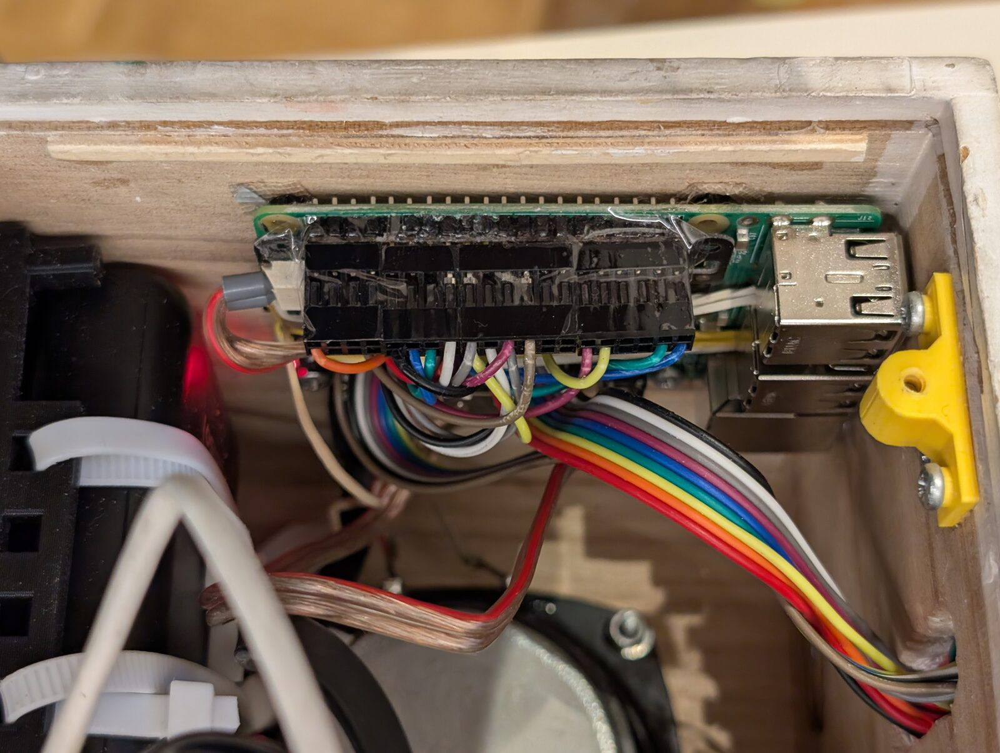

# Data sheets

Key data of the components in the box, with links to their data sheets and schematics (read on 2026-10-02). The
documents themselves belong to their makers and are not part of the repository. The circuit of the box itself is in
[`hardware/circuits/`](../../hardware/README.md); how the components are connected and configured is described in
[box.md](../developer/box.md).

## RFID reader RC522

| Content | Source |
| --- | --- |
| data sheet of the chip, NXP rev. 3.9 (2016-04-27) – the current revision | [nxp.com](https://www.nxp.com/docs/en/data-sheet/MFRC522.pdf) |
| characteristics of the common blue RC522 module (59.9 × 39.7 mm) with sample card and key fob | [SunFounder via DigiKey](https://mm.digikey.com/Volume0/opasdata/d220001/medias/docus/5531/4411_CN0090%20other%20related%20document%20(1).pdf) |

Key data:

- 13.56 MHz, ISO/IEC 14443 A; MIFARE Mini/1K/4K, Ultralight, DESFire EV1, Plus, NTAG
- Supply 2.5–3.3 V (on the Pi: **3.3 V, not 5 V**); current 13–26 mA while reading, 10–13 mA idle, < 80 µA in
  power-down
- SPI up to 10 Mbit/s, also I2C and UART – the module is hard-wired to SPI
- Reading distance about 2–5 cm, depending on antenna and tag
- Crystal 27.12 MHz (halved to 13.56 MHz)
- The IRQ does not signal the removal of a tag – therefore `rfid-reader` polls the reader every 0.2 s
- NRSTPD (reset) low resets the chip and switches the antenna off; after a reset all registers have their default
  values (`TxControlReg` = 0x80)

Connection in the box: SPI0 with CE0 (GPIO 8), RST on GPIO 26. The IRQ pin is not used.

## Audio Amp SHIM (Pimoroni PIM541)

| Content | Source |
| --- | --- |
| schematic of the SHIM (2022-03-10) | [Pimoroni](https://cdn.shopify.com/s/files/1/0174/1800/files/amp_shim_schematic.pdf?v=1646911731) |
| data sheet of the DAC/amplifier, rev. 13 (07/2019), copy of Pimoroni | [Pimoroni](https://cdn.shopify.com/s/files/1/0174/1800/files/MAX98357A-MAX98357B_cbc17da5-cbd8-4a52-9867-a495a77985a2.pdf?26825), original at [analog.com](https://www.analog.com/media/en/technical-documentation/data-sheets/MAX98357A-MAX98357B.pdf) |

Product page: [shop.pimoroni.com](https://shop.pimoroni.com/products/audio-amp-shim-3w-mono-amp), pinout:
[pinout.xyz](https://pinout.xyz/pinout/audio_amp_shim).



The Pi 3 with the Audio Amp SHIM in the box; the connectors on the pins are secured.

Key data:

- MAX98357A: I2S DAC and class D amplifier in one, mono, up to 3.2 W into 4 Ω at 5 V; 8–96 kHz, no MCLK needed
- Supply from the 5 V of the Pi; speaker on terminals (up to 0.75 mm²)
- Gain fixed at 9 dB (R2 not populated), no volume control in hardware
- Left and right channel are mixed (R1 = 620 kΩ on SD_MODE)
- Dimensions 63.3 × 15.2 × 5.4 mm, 2 × M2.5

**Pins used:** only GPIO 18 (PCM_CLK/BCLK), GPIO 19 (PCM_FS/LRCLK), GPIO 21 (PCM_DOUT), plus 3.3 V, 5 V and GND.

**No enable pin on the Pi.** SD_MODE (AMP_EN) is generated on the SHIM itself: a charge pump on LRCLK switches the
amplifier on only while the I2S clock runs. **GPIO 25 is not connected.** The `gpio=25=op,dh` of the Pirate Audio
installer is not needed for the SHIM – and must not be set, because GPIO 25 is the "next" button of the box.

Setup in `/boot/firmware/config.txt`:

```ini
dtoverlay=hifiberry-dac
dtparam=audio=off
```

`hifiberry-dac` has no hardware mixer – the volume is a software control (ALSA `softvol`, [box.md](../developer/box.md),
section 5).
