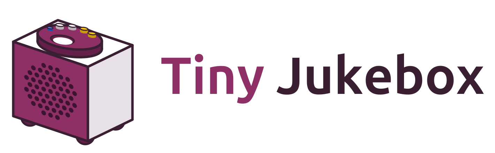
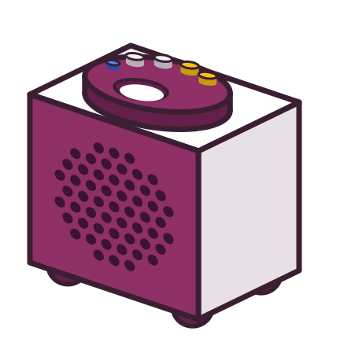
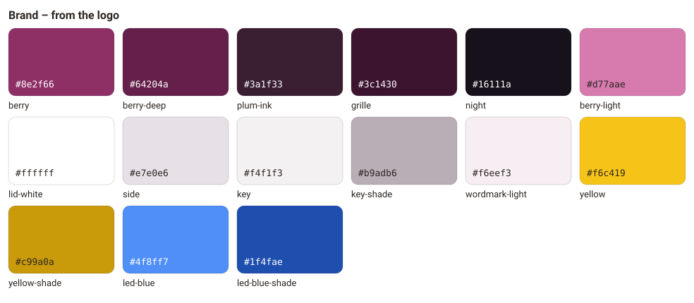
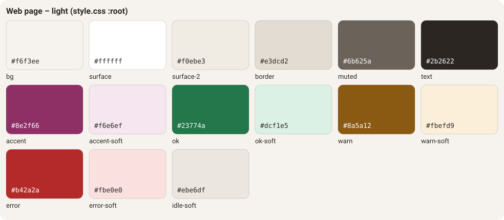
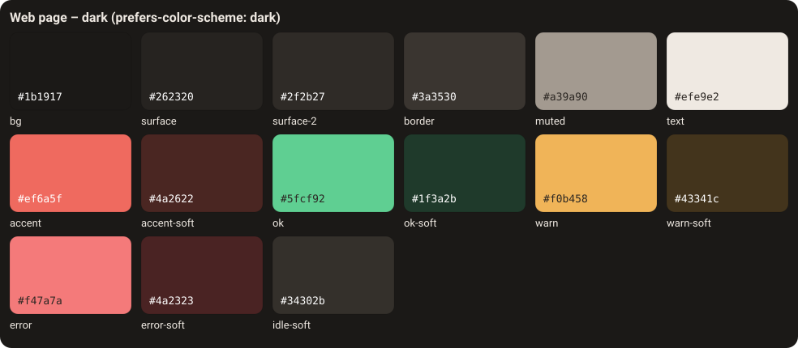

# Style guide

How Tiny Jukebox looks and reads: name, logo, colours, type, shapes, the light of the box, and the way the documents
are written. The guide describes what the repository does today and names the places where it does not agree with
itself and what was decided (section 9). Where it recommends something that is not yet a rule in the code, it says so.

The values here are copies. What counts is the source:

| What | Source |
| --- | --- |
| logo, colours of the brand | `docs/images/logo*.svg` |
| colours, type and shapes of the web page | `src/tinyjukebox/web/web/style.css` |
| texts of the web page | `src/tinyjukebox/web/web/texts/<language>.json` |
| colours of the app | `app/app/src/main/res/values/themes.xml`, `Jukebox.kt`, `MainActivity.kt` |
| colours of the LED | `src/tinyjukebox/messages.py` (`Color`), `rgbled.py` |
| colours of the documentation site | `docs/site/tinyjukebox.css`, `scripts/site/assemble.py` |

A change to one of these sources changes this guide in the same commit.

## 1. Name

| Where | Spelling |
| --- | --- |
| text, titles, the web page, the app | **Tiny Jukebox** – two words, both capitalised |
| repository, Python package, commands, paths | `tinyjukebox`, `tinyjukebox-library`, `tinyjukebox-backup` … |
| Android package | `io.github.tgd1975.tinyjukebox` |

Not: "TinyJukebox", "Tiny jukebox", "TJ". A box with a name is written `Box "antonia"`; the tab of the browser shows
`antonia · Tiny Jukebox`.

## 2. Logo

The logo is drawn from the photos of the box: the box seen from the front at an angle, the berry purple of its lid,
the round window for the tag, the LED and the buttons along the rim of the lid. The icon is the lid seen from above.

| File | Content | Use |
| --- | --- | --- |
| `docs/images/logo.svg` | box and wordmark, for light backgrounds | README, documents |
| `docs/images/logo-dark.svg` | the same for dark backgrounds | README in dark mode |
| `docs/images/logo-mark.svg` | the box alone | quick guides, square places |
| `docs/images/logo-icon.svg` | the lid from above, 64 × 64 | small sizes, source of icons |
| `src/tinyjukebox/web/web/favicon.svg` | the lid, in the colours of the logo | favicon |

 &nbsp;
 &nbsp;


In Markdown, the logo follows the colour scheme of the reader:

```html
<picture>
  <source media="(prefers-color-scheme: dark)" srcset="docs/images/logo-dark.svg">
  
</picture>
```

Rules:

- **The wordmark is outlines, not text.** It is not set again in a font; a new size is the SVG scaled.
- "Tiny" is berry (`#8e2f66`), "Jukebox" plum ink (`#3a1f33`); on dark backgrounds berry light (`#d77aae`) and
  `#f6eef3`.
- **The colours of the logo are not changed** – with one exception: on the web page of a box, the lid takes the colour
  of the box (`--accent`, section 3.3), its outline the same colour mixed with 45 % black. Window, LED and buttons
  keep their colours. On the page of the library the lid is berry with an outline of plum ink, in both themes.
- Not stretched, rotated, shaded or put on a photo where its outline gets lost.
- Recommended, not yet checked anywhere: the icon below 48 px, the box alone from 64 px, the whole logo from 200 px
  wide; free space around it at least the height of one button of the lid.

## 3. Colours

### 3.1 Brand



| Name | Hex | Where |
| --- | --- | --- |
| berry | `#8e2f66` | front of the box, lid; colour of the app (`colorPrimary`, `colorAccent`) |
| berry deep | `#64204a` | lid seen from the side, feet |
| plum ink | `#3a1f33` | every outline of the logo, "Jukebox"; status bar of the app |
| grille | `#3c1430` | the rings of the grille |
| night | `#16111a` | background of the app |
| berry light | `#d77aae` | "Tiny" on dark backgrounds |
| side, key, key shade | `#e7e0e6`, `#f4f1f3`, `#b9adb6` | side of the box, light buttons and their edge |
| yellow, yellow shade | `#f6c419`, `#c99a0a` | yellow buttons; expert mode of the app |
| LED blue, its shade | `#4f8ff7`, `#1f4fae` | the LED in the logo |

Contrast (WCAG 2): white on berry 7.6 : 1, plum ink on white 14.8 : 1, berry light on night 6.5 : 1, black on yellow
12.8 : 1 – all of them pass AA for text, the first two also AAA.

Berry is the accent of the project – on the web page of the library, in the app, in the icons. In the dark theme of
the web page it is berry light.

### 3.2 Web page

The page has a warm neutral ground and one accent, berry. Light follows `:root`, dark follows
`prefers-color-scheme: dark` unless the page is set to `data-theme="light"`.




| Token | Light | Dark | Use |
| --- | --- | --- | --- |
| `--bg` | `#f6f3ee` | `#1b1917` | page |
| `--surface` | `#ffffff` | `#262320` | cards, dialogs, inputs |
| `--surface-2` | `#f0ebe3` | `#2f2b27` | buttons, code, covers without a picture |
| `--border` | `#e3dcd2` | `#3a3530` | lines, hover of buttons |
| `--text` | `#2b2622` | `#efe9e2` | text |
| `--muted` | `#6b625a` | `#a8a095` | secondary text, inactive tabs |
| `--accent` | `#8e2f66` | `#d77aae` | primary button, active tab, links, focus, progress |
| `--accent-text` | `#ffffff` | `#1b1917` | text on `--accent` |
| `--accent-soft` | `#f6e6ef` | `#3d2233` | ground of the active tab, busy badge |
| `--ok` / `--ok-soft` | `#23774a` / `#dcf1e5` | `#5fcf92` / `#1f3a2b` | success |
| `--warn` / `--warn-soft` | `#8a5a12` / `#fbefd9` | `#f0b458` / `#43341c` | warnings, the list of problems |
| `--error` / `--error-soft` | `#b42a2a` / `#fbe0e0` | `#f47a7a` / `#4a2323` | errors, danger buttons, toasts |
| `--error-text` | `#ffffff` | `#1b1917` | text on `--error` |
| `--idle-soft` | `#ebe6df` | `#34302b` | ground of a badge without a state |
| `--backdrop` | `rgba(20, 15, 10, .45)` | the same | behind an open dialog |
| `--shadow` | two soft shadows | darker | cards, dialogs, the toast |

**Contrast:** every pair of text and ground that occurs on the page reaches WCAG AA, 4.5 : 1, in both themes – also
the bold text of tabs and badges, which is not large enough to count as large text, and a control under the mouse.
The lowest pairs today: light `--ok` on `--surface-2` 4.65 : 1 (the level in the log) and on `--ok-soft` 4.66 : 1;
dark `--muted` on `--warn-soft` 4.65 : 1 (a notice, a warning in the log). Hover does not put grey text on
`--border`, which would be 4.38 : 1: a tab under the mouse has `--surface-2` and `--text`, a tag card a frame in
`--border`. A new token, a changed value or a new pair is measured before it goes in.

A colour on the page is always a token. A hex value in `app.js` or in a rule of `style.css` is the exception and
needs a reason. Today there are two: the colours of the logo in `.brand-logo`, and the LED – `LED_COLORS` and the dark
ring around the dot of `.led`. An LED colour the page does not know shows as `--muted`.

### 3.3 The colour of a box

Every box has a colour of its own, on its login page and its whole page: buttons, tabs and the lid of the logo. Its
hue follows from the name of the box, or from its id while it has no name (`GET /api/identity` → `hue`). Lightness and
chroma are fixed, so the contrast of the text stays the same for every hue:

| | Light | Dark |
| --- | --- | --- |
| `--accent` | `oklch(.49 .15 <hue>)` | `oklch(.72 .13 <hue>)` |
| `--accent-soft` | `oklch(.95 .04 <hue>)` | `oklch(.33 .06 <hue>)` |

Over all hues (steps of 2°) the lowest contrast is: light, white on the accent 5.3 : 1, the accent on its soft ground
4.6 : 1; dark, text on the accent 6.6 : 1, the accent on its soft ground 4.7 : 1.

The library has no hue; it keeps berry, the accent of section 3.2. A renamed box gets a new colour.

### 3.4 The light of the box

The LED says what the box does. The meaning is fixed – the same on the box, in the web page and on the phone:

| Light | Meaning | `Color` |
| --- | --- | --- |
| red, then magenta | the box starts; magenta also for a moment when it stops | `RED`, `MAGENTA` |
| green | ready, no tag | `GREEN` |
| green, blinking | no tag for 10 minutes | `GREEN` / `BLACK` |
| aqua | the album is loaded, Spotify connects, a station waits to connect again | `AQUA` |
| green → aqua → blue | fetches the album, or the radio starts | `WAITING` |
| blue | playing | `BLUE` |
| blue, blinking | the album has ended | `BLUE` / `BLACK` |
| white / blue | pause | `WHITE` / `BLUE` |
| yellow | tag without an album or a station | `YELLOW` |
| yellow / red | the linked album or station does not exist any more | `YELLOW` / `RED` |
| red, blinking | album broken; Spotify cannot play on this box | `RED` / `BLACK` |
| blue, blinking quickly | searches for a headset (60 s at most) | `BLUE` / `BLACK` |
| white for 2 s | headset paired | `WHITE` |
| red, blinking quickly for 3 s | no headset found, pairing failed | `RED` / `BLACK` |
| red → white → magenta → yellow | out of service: the library is too old for the box | `ALARM` |

The user manuals (`docs/user/*/manual.md`, section 3) explain each of them; a new light goes into this table, the two
manuals and the app in the same commit.

The box knows only on/off per channel (`messages.py`). A screen draws the LED in the colours of the logo – the web
page (`LED_COLORS` in `app.js`) and the app (`Jukebox.kt`) the same:

| `Color` | Screen |
| --- | --- |
| `GREEN` | `#2fbf4f` |
| `BLUE` | `#4f8ff7` – the LED of the logo |
| `AQUA` | `#27c4c4` |
| `YELLOW` | `#f6c419` – the yellow buttons |
| `RED` | `#e0303a` |
| `WHITE` | `#f4f1f3` – the light buttons |
| `MAGENTA` | `#d77aae` – web page only (alarm); the app has no magenta |
| `BLACK` | `#222` on the web page (a dot that stays visible), `#000000` in the app |

Colours of the LED are for the LED. They do not stand for success or error on the page; that is what `--ok`,
`--warn` and `--error` are for.

### 3.5 The documentation site

The site of the documents ([development.md](../developer/development.md), section 10) is Material for MkDocs in the
colours of the brand. It follows the system's light or dark theme, with Material's switch in the header.

| What | Light | Dark |
| --- | --- | --- |
| header and tabs | plum ink `#3a1f33`, text white | the same |
| links, accent, the active entry of the menu | berry `#8e2f66` | berry light `#d77aae` |
| background | Material's white | night `#16111a` |
| logo in the header, favicon | `logo-mark.svg`, `logo-icon.svg` | the same |

Contrast (WCAG 2): white on plum ink 14.8 : 1, the tabs that are not chosen (white at 70 %) 8.0 : 1, berry on white
7.6 : 1, berry light on night 6.5 : 1. Type: the fonts of the system, as on the page (section 4) – Material loads no
fonts from Google.

## 4. Type

| What | Value |
| --- | --- |
| text | `system-ui, -apple-system, "Segoe UI", Roboto, sans-serif`, 15 px, line height 1.5 |
| code, log | `ui-monospace, "SF Mono", Menlo, monospace`, 0.85 em (log 0.78 rem) |
| `h1` | 1.6 rem, line height 1.2 |
| `h2` | 1.1 rem |
| small | 0.85 rem; badges 0.78 rem, weight 600 |
| "Tiny Jukebox" next to the lid | weight 800, letter spacing −0.02 em; 1.15 rem in the top bar, 1.8 rem on the login page |

No web fonts: the page is served by a box without internet as well. Emphasis is weight 600, not colour.

## 5. Shapes and space

| Token or value | Where |
| --- | --- |
| `--radius` 14 px | cards, dialogs, drop zone |
| 12 px | covers, scan box, tag cards |
| 10 px | buttons, inputs, fieldsets, list of problems, rows of tags, log, output, toast |
| 8 px / 6 px / 5 px | thumbnails and the current track / QR code / inline code |
| 3 px | progress bar |
| 999 px | tabs, badges, chips, segmented control |
| 50 % | round buttons (52 px), the LED |
| `--shadow` | what lies above the page: cards, dialogs, the toast |

- Content is at most 980 px wide (`main`); below 640 px the layout is one column.
- Space is in `rem`; cards have 1.2 rem padding and 1 rem between them.
- Focus: 2 px outline in `--accent`, 2 px offset – on every control that can get the focus: buttons, links, inputs,
  and everything with a `tabindex` (the drop zone, the sortable column headings).
- Disabled: opacity 0.45. Pressed: 1 px down.

## 6. Controls

| Control | Look |
| --- | --- |
| button | `--surface-2`, border `--border`; hover: ground `--border` |
| link | `--accent`, underlined; a link that looks like a button is `a.button` |
| `button.primary` | `--accent`, text `--accent-text`, weight 600 – recommended: one per card or dialog |
| `button.danger` | text `--error` on `--error-soft` |
| `button.link` | no ground, text `--muted` |
| tab | pill, `--muted`; hover: `--text` on `--surface-2`; active: `--accent` on `--accent-soft`, weight 600 |
| tag card | `--surface-2`; hover: a frame in `--border`; on the box: `--ok-soft`, frame `--ok` |
| badge | pill, `--muted` on `--idle-soft`; `badge-ok`, `badge-warn`, `badge-error`, `badge-busy` (accent) |
| toast | error: `--error-text` on `--error` |

New controls take these classes rather than new colours.

## 7. Pictures

- Photos of the box are in `docs/images/`, named after what they show, with the year where there are several
  (`inside-2019.jpg`, `inside-2026.jpg`).
- Every picture has an `alt` text that says what can be seen, not what the picture is for: "The box today: a white
  wooden case with a grille of rings at the front …".
- In the README photos are 360 px wide; a photo in portrait format 270 px, so that it is not higher than 360 px.
- Diagrams of the software are Mermaid in the Markdown (`architecture.md`, `drivers.md`, `library.md` …); the state
  machines export theirs.

## 8. Writing

### 8.1 Languages

| What | Language |
| --- | --- |
| web page, app, user documentation (`docs/user/`) | English and German – every text in both |
| code, comments, developer documentation, changelog | English |
| `TODO.md` | German |

### 8.2 How the documents read

The documents are written for readers whose first language may not be English. The style is plain and the same
everywhere:

- **Short words and short sentences.** "fetches", not "retrieves"; "the box goes back to the version before", not
  "performs a rollback".
- **The thing, not the abstraction**: "the page of the library", "the album of a tag".
- **No contractions**: "does not", "cannot".
- **The user's view first.** A sentence says what happens, then why.
- **One term per thing.** box, library, tag, album, radio station, slot, release – once chosen, kept.
- Lowercase after the dash in lists, no full stop at the end of list items that are not sentences.

### 8.3 Form

- Sections are numbered (`## 1. Setup`, `### 3.2 …`), so other documents can point to "section 3.2".
- Prose is wrapped at 120 characters, as the code (`ruff`, line length 120); tables and links are not wrapped.
- Commands, paths, config keys, tokens: `code`. Names of things on the page: in quotes – the tab "Boxes", the button
  "Scan tag".
- Dash with spaces – as here; ranges without spaces: 2.5–3.3 V. A space between number and unit: 10 s, 13.56 MHz.
- Dates as ISO: 2026-11-04. Versions as `0.45.0`, tags as `v0.45.0`.
- Tables for commands and key data; a list when the order does not matter.

### 8.4 Changelog

One section per version, `## X.Y.Z – YYYY-MM-DD`, with a short paragraph on what the version is about. Larger
sections group their entries under a bold line (`**Library and synchronization**`). Every entry begins with **one
bold sentence that says what is true now**, then what was wrong before or why.

The rule holds from 0.45.0 on. The sections before stay as they were written: they are the history, and a release
takes only the text of its own section.

### 8.5 Texts of the page

Every text of the web page is in `texts/en.json` and `texts/de.json`, under the same key; `index.html` refers to it
with `data-t`, and only the name "Tiny Jukebox" is written into it. The German is written, not translated word by
word – as in the German quick guide: "Album von vorn", not "Album vom Anfang".

## 9. Decisions

The repository disagreed with itself in three places. Decided on 2026-11-04, in 0.46.0:

1. **One accent: berry.** Logo, favicon, app and the icons of the NAS package were berry (`#8e2f66`), the web page of
   the library coral (`#d9463b`). Now berry everywhere; in the dark theme berry light (`#d77aae`), as "Tiny" in
   `logo-dark.svg`.
2. **One set of LED colours: those of the logo.** The web page drew the LED in other shades than the app; both use the
   table in section 3.4 now.
3. **AA for every pair of text and ground.** The light theme was below it: primary button 4.29 : 1, badges
   3.2–3.6 : 1, secondary text 4.37 : 1; the colour of a box with a hue around cyan 3.98 : 1 on its active tab, the
   error toast in the dark theme 2.65 : 1. The values of section 3.2 and 3.3 reach at least 4.5 : 1.
