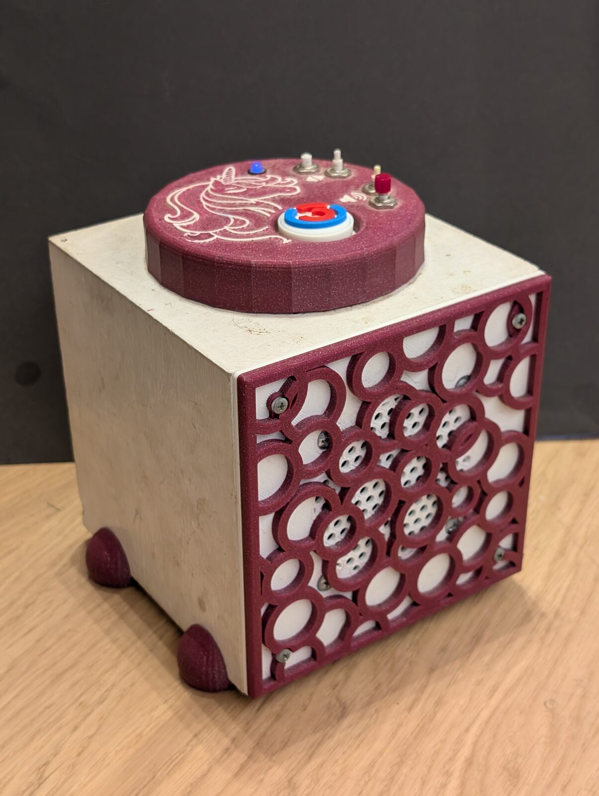
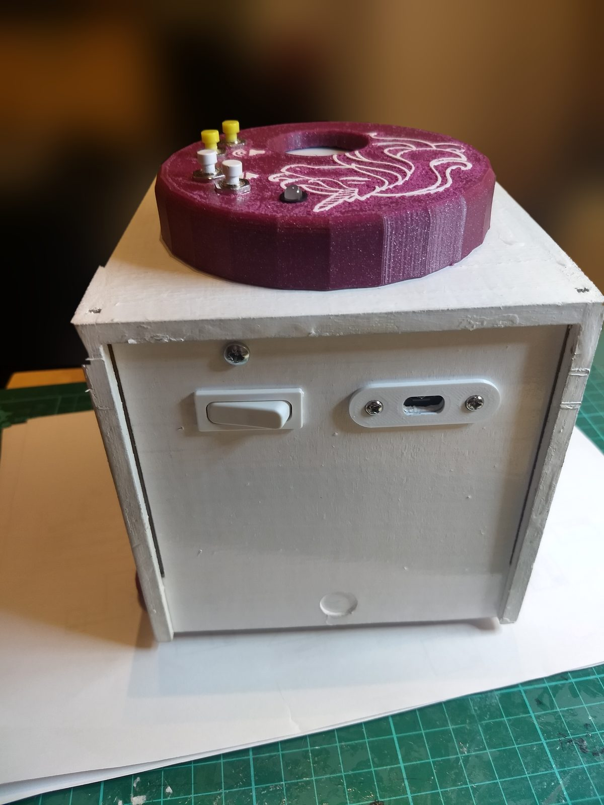
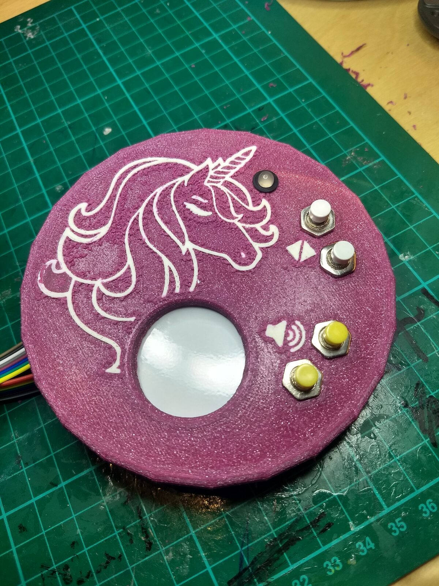

# Tiny Jukebox – user manual

Tiny Jukebox is a music box for children. Place a tag on the box, and the album of the tag continues where it
stopped last time. The box is operated with four buttons; an LED shows its state. Albums, tags and radio stations
are managed on a web page. If there are several boxes or a library in the home network, the boxes share albums,
tags and stations (section 13).

The essentials on one card: [quick guide](quick-guide.md). Setting up and running boxes and the
library: [administration](admin.md).

Contents:

1. [Terms](#1-terms)
2. [Operating the box](#2-operating-the-box)
3. [LED](#3-led)
4. [Pause](#4-pause)
5. [Bluetooth headset](#5-bluetooth-headset)
6. [Web page](#6-web-page)
7. [MP3 albums](#7-mp3-albums)
8. [Radio](#8-radio)
9. [Spotify](#9-spotify)
10. [Limiting the volume](#10-limiting-the-volume)
11. [Users and passwords](#11-users-and-passwords)
12. [If something does not work](#12-if-something-does-not-work)
13. [Library](#13-library)

---

## 1. Terms

| Term | Meaning |
| --- | --- |
| Tag | what is placed on the box: a disc, a figure, a card – anything with an RFID chip. The box recognizes the chip by its unique number (UID), e.g. `04:1A:2B:3C:4D:5E:6F`, not the object. |
| Album | a folder with MP3 files and a list of its tracks (playlist) |
| Radio station | an internet radio stream; needs WLAN |
| Spotify | an album, a playlist, an audiobook or a podcast of Spotify; needs the internet and a Spotify Premium account |
| Linking | assigning an album, a radio station or an entry of Spotify to a tag |
| Cover | the picture of an album, a radio station or an entry of Spotify. A tag shows the cover of what it is linked to. |
| Progress | the saved position of an album, per tag |
| Library | a program in the home network (e.g. on the NAS) that holds albums, tags and stations for all boxes |

---

## 2. Operating the box

### 2.1 Switching on and off

Inside the box a power bank supplies the power. On the back: the switch (left) connects and cuts it, the USB socket
(right) charges the power bank.

- **Switching on:** with the switch. During the start the LED is red, then magenta. When it is green, the box is
  ready.
- **Switching off:** with the switch. This is allowed at any time, also while an album plays. The box saves the
  position every 5 seconds; next time it continues a few seconds earlier at most.
- The box also plays without WLAN. Only the web page and radio stations need it.

### 2.2 Tags

| Action | Effect |
| --- | --- |
| Place a tag on the box | The album continues at the saved position. A radio station starts to play. |
| Take the tag off | Playback stops, the position is saved. |
| Place another tag | Its album plays. |
| Place a new, unknown tag | The LED is yellow. The box remembers the tag; it is linked on the web page (section 7.2). |

Every tag has its own progress. An album that was listened to the end starts from the beginning the next time
its tag is placed.

### 2.3 Buttons

The lid: the four buttons with their symbols, the LED, in the middle the window for the tag.

| Button | Press briefly | Hold |
| --- | --- | --- |
| louder, quieter | one step (5 %) | on in small steps (1 % every 0.2 s) |
| next | next track | – |
| back | to the start of the track; in the first 10 seconds of a track: to the previous track | 1 s: the album starts from the beginning |
| next + back together | – | 5 s: pair a headset (section 5.1) |

- The volume is limited (section 10).
- When the album has ended, "next" has no effect. "back" plays the last track, holding "back" for 1 s the whole
  album from the beginning.
- With a radio station "next" and "back" have no effect. The station is changed with the tag.
- Every press of a button acts at once. When pairing a headset, an album that plays therefore jumps by one track
  at most. To avoid that, take the tag off first.

---

## 3. LED

| LED | Meaning |
| --- | --- |
| red | The box is starting: after red comes magenta, then green. If the LED stays red, the box is stopped. |
| magenta | for a moment while the box starts (after red) or stops (before red) |
| green | ready, no tag on the box |
| green, blinking | no tag for 10 minutes – the box is still switched on |
| aqua | The album is being loaded, Spotify is connecting, or the radio station waits to connect again after the stream broke off. |
| green → aqua → blue, back and forth | The box fetches the album or the next track from the library and plays as soon as it is there (section 13), or a radio station is getting ready: blue as soon as it can be heard. |
| blue | playing |
| blue, blinking | The album has ended. |
| white/blue in turn | pause (section 4) |
| yellow | The tag is not linked to an album or a station. |
| yellow, blinking | A figure of an advent calendar whose day is not open yet (section 9.1). It plays by itself as soon as its day begins. |
| yellow/red in turn | The linked album or the linked station does not exist any more. |
| red, blinking | The album cannot be played (folder, playlist or MP3 files are missing or broken). A tag of Spotify: Spotify cannot play on this box (key, player or login missing, section 9). |
| blue, blinking quickly | The box searches for a headset (60 s at most). |
| white for 2 s | headset paired – then the colour from before again |
| red, blinking quickly for 3 s | no headset found or pairing failed – then the colour from before again |
| red, white, magenta, yellow in turn | The box is out of service because the library is too old for it. Only an administrator can fix that (section 13.4). |

The web page shows the same LED next to the logo.

---

## 4. Pause

During a pause playback halts, the position is saved, and the tag stays on the box. The LED changes between white
and blue.

Pausing and resuming:

- play/pause on the headset
- ⏸ / ▶ on the web page (tab "Now")
- The box itself has no pause button. Taking the tag off and placing it again later has the same effect.

| During the pause | Effect |
| --- | --- |
| Play | continues at the same position |
| "next" | 1st press: continues at the same position. Only the 2nd press jumps to the next track. |
| "back" | jumps at once: to the start of the track, in the first 10 seconds to the previous track |
| hold "back" for 1 s | The album starts from the beginning. |
| take the tag off and place it again | continues at the saved position |
| louder, quieter | changes the volume only |

- With an album that has ended, play/pause changes nothing.
- With the radio, the pause ends the stream. Play, "next" or "back" connect again; the radio goes on live, there is
  no position.
- The box pauses by itself when the connection to the headset breaks (section 5.3).

---

## 5. Bluetooth headset

The box plays through a Bluetooth headset as soon as the paired headset is connected. The speaker is silent then.
Principles:

- **Automatic:** If the headset is connected, it plays. Otherwise the speaker plays. There is no menu.
- **Never surprisingly loud:** If the connection breaks, the box pauses. It never changes to the speaker by itself.
- **Hearing protection:** The headset has a start volume and a maximum volume of its own.
- **Exactly one headset:** At most one headset is paired. A new one replaces the old one.

### 5.1 Pairing

1. Put the headset into pairing mode. How that is done is in its manual (Sony WH-CH530: hold the middle button for
   about 5 s until it says "Pairing").
2. Hold "next" and "back" on the box together for 5 s. After that the buttons can be released.
3. The LED blinks blue quickly while the box searches (60 s at most).
4. Result:
   - white for 2 s: the headset is paired and connected.
   - red, blinking quickly for 3 s: nothing found, or pairing failed. The previous headset stays paired.

Further rules:

- The box searches only for audio devices (headsets, speakers) in pairing mode. If it finds several, it takes the
  one with the strongest signal – as a rule the one right next to the box.
- The box itself is never visible. A foreign phone cannot pair with it.
- The same headset can be paired again, e.g. after a factory reset of the headset.
- The search cannot be cancelled; it ends by itself after 60 s. Playback and buttons go on as usual meanwhile.
- Pairing and unpairing is also possible on the web page: tab "Bluetooth", role `admin`.

### 5.2 Every day

- **Switching the headset on is enough.** It connects itself to the box. After the box is switched on and when the
  headset loses the connection, the box also looks for it itself, for a minute.
- If it connects while an album plays, the album goes on in the headset (about 1 s back), and the speaker goes
  silent.
- The web page shows a headset symbol next to the LED as long as it is connected.
- If a second headset is to be used, it has to be paired anew. The first one does not connect any more after that.

### 5.3 Connection lost

Battery empty, out of range, switched off or unpaired:

| Situation | Behaviour |
| --- | --- |
| The headset is gone while an album plays | Pause, the position is saved. The speaker stays silent. |
| … the headset comes back within 10 minutes | It goes on in the headset. |
| … the headset comes back later | The pause stays. Play on the headset resumes. |
| … "next" or "back" on the box | It goes on through the speaker. The buttons act as during a pause (section 4). |
| … take the tag off and place it again | It goes on through the speaker. |
| The headset is gone, nothing plays | The speaker is active again. |

- If it was paused before the connection broke, it stays paused after reconnecting as well.
- "louder" and "quieter" on the box change only the volume of the speaker during this pause. They do not resume.

### 5.4 Buttons on the headset

| Button on the headset | Effect |
| --- | --- |
| Next, back | like the buttons of the box |
| Play/pause | pause and resume (section 4) |
| Louder, quieter | volume of the headset, limited to its maximum |

### 5.5 Volume of the headset

| | Speaker | Headset |
| --- | --- | --- |
| Start volume | 50 %, when the box is switched on | 40 %, every time it connects |
| Maximum volume | 82 % | 75 % |
| The buttons of the box change | the speaker | the headset, as long as it is connected |

- The headset starts with its start volume every time it connects, never with the volume of last time.
- The values can be changed (section 10).
- The percentages refer to the headset: how loud 75 % is depends on the model. Set the maximum once with the
  headset on the ear.

### 5.6 Notes on headsets

- **A phone nearby:** Many headsets hold two connections at once (multipoint) and play whatever sent sound last. If
  the headset is also connected to a phone, its sounds can drown out the box. Then disconnect the headset on the
  phone.
- **Limit in the app of the headset:** Some headsets limit the volume themselves (Sony: "Max Volume Control" in the
  app "Sound Connect"). That acts in addition to the limit of the box. A factory reset of the headset resets it.
- **LE Audio:** The box uses classic Bluetooth. A setting like "LE Audio Priority" in the app of the headset must be
  switched off.
- **Battery level:** The web page shows it in the tab "Bluetooth" if the headset reports it.

---

## 6. Web page

### 6.1 Opening and logging in

1. Phone, tablet or PC must be in the same WLAN as the box.
2. Open `https://tinyjukebox.local` in the browser (a further box has a name of its own: section 13.2).
3. The first time, the browser warns about the certificate: the box issues it for itself. Confirm the warning
   ("Advanced" → "Proceed to tinyjukebox.local" or similar).
4. Choose the language: the page is English the first time. The choice "Deutsch / English" is below the login,
   after the login at the top right, and in the tab "System".
5. Log in with user name and password.

- Above the login it says where you are: "Library", "Box" or the box with its name, e.g. Box "antonia". Every box
  has colors of its own; they follow from its name (a box without a name has fixed colors as well). So you also see
  after the login which box you are on.
- The browser remembers the language, for this device and this box. On another device and on the page of another
  box or of the library it is chosen once again.
- The login stays. A new login is needed after 7 days without use, and on an open page on which nothing was done
  for 30 minutes (section 11).
- After 5 wrong passwords every further failed attempt blocks the login from this device for 30 seconds.

### 6.2 Roles

| Role | may |
| --- | --- |
| `user` | look at almost everything and operate the box: pause, track, volume, place tags; scan new tags with the phone in the library; change the own password |
| `admin` | in addition change everything: albums, tags, radio stations, covers, pair a headset, volume limits, users |

Only the role `admin` sees the tabs "Upload" and "Log", all buttons that change something, and these parts of the
page: in the tab "System" "Check consistency" and the cards "Hardware", "Backup", "Version" and "Users"; in the tab
"Spotify" the cards "Account" and "Player"; in the library the cards "Add a box", "Add a phone" and "Access for boxes
and scripts" (tab "Boxes"), "Access to the releases" (tab "Versions") and "The app on phones" (tab "Spotify").

### 6.3 Tabs

| Tab | Content |
| --- | --- |
| Now | what is playing: cover, album, track, position, list of tracks. Buttons back, pause/play, next, "Album from the start"; volume with slider and buttons. If an unknown tag is on the box: choose an album and "Link & play". |
| Tags | the tab for everyday use: all tags with the cover of their album or station, as tiles or as a list ("Tiles" / "List"), all of them or only those of albums, of radio stations or of Spotify ("All" / "Albums" / "Radio" / "Spotify"). The page remembers the choice. A click places the tag on the box as if it really stood there; a second click or "Take off tag" takes it off again. |
| Tag management | all tags with cover, name, UID, album or station and progress. Here tags are created, named, linked, unlinked and deleted. |
| Albums | a list of all albums for managing them: cover, title, number of tracks, playing time, tags, the day they were added and the folder. A click on a column heading sorts by it, a second click turns the order round. A click on the title opens the album: title and cover (both can be changed), list of tracks, linked tags, problems. "Look for new folders" takes in albums that were copied to the box directly. |
| Radio | all radio stations: create, rename, change the address, choose a cover, test, delete |
| Spotify | the entries of Spotify: create from a link, rename, change the link, choose a cover, test, delete; on a box also the account and the player (section 9) |
| Bluetooth | the paired headset: name, connected, battery, volume, start value and maximum; "Pair" and "Unpair" |
| Statistics | what was listened to on this box: per tag (a click on a column heading sorts the table by it, a second one turns the order round), per calendar day with the hours between which something was listened to, on speaker or headset, per radio station; skipped tracks; per version of the box software starts, errors and fallbacks, for how many days it was installed and for how many hours the box was switched on with it (total) and played something (active); at the very end the tags that were never placed. The library does the counting: if it cannot be reached, the tab says so. A box without a library counts by itself and reaches as far back as the last 1000 entries of its journal. |
| Upload | create a new album from MP3 files |
| System | state of the box, language of the page, "Check consistency", "Reset progress", hardware (state of buttons, LED and RFID reader, for troubleshooting), backup (section 11.1), library (section 13.2), version (section 13.4), change own password, users, progress per tag |
| Log | the messages of the box, live, with a filter; "Save as file" |

The buttons in the tab "Now" act like the buttons of the box.

**Help:** "Help" at the top opens this manual at the chapter of the tab that is open, in the language of the page;
an admin finds the administration there too. The box brings the help along – it works without the internet and is
that of the version the box runs. After a login a hint points to the quick guide, until "Do not show it again" is
ticked; the browser keeps that.

---

## 7. MP3 albums

An album is a folder of MP3 files on the box; once it is there, it plays without WLAN. It continues where it stopped –
every tag with its own progress (section 7.4). Bringing albums onto the box, linking tags and changing covers needs the
role `admin`; starting an album from the beginning and looking at the progress the role `user` may do as well.

### 7.1 Bringing a new album onto the box

1. Tab "Upload".
2. Enter the title of the album. The folder on the box gets the same name.
3. If you like, choose a cover (JPEG, PNG or WebP). It can also be set later.
4. Drag MP3 files into the field, or "Choose files" or "Choose folder".
5. Check the order. It follows the track number in the files, otherwise the file name (2 before 10), and can be
   changed before the album is created.
6. Optionally choose a tag under "Link to tag".
7. "Create album".

Limits: MP3 files only, at most 500 MB per file and 500 files per album; 200 MB must stay free on the box
afterwards. An upload that was broken off is listed under "Unfinished uploads" and expires after one hour.

Changing title and cover: tab "Albums", open the album. Overwrite the title at the top – it is saved as soon as the
field is left. "Change cover" takes a new image (JPEG, PNG or WebP) and replaces the previous one. An album without a
cover shows the image from its MP3 files, if they contain one.

Deleting an album: tab "Albums", open the album, "Remove album" – with "Delete the files as well" the MP3 files
disappear too. This is possible only if no tag is linked to the album and it is not playing.

If an album shows problems (the LED blinks red): open the album. The problems are listed there, and "Rebuild
playlist from the MP3 files" writes the list of tracks anew.

### 7.2 Linking a tag

A tag plays what it is linked to: an album, a radio station (section 8) or an entry of Spotify (section 9). Linking
works the same for all three.

New tag:

1. Place the tag on the box. The LED is yellow.
2. Tab "Now": under "Unknown tag placed" choose the album, the station or the entry of Spotify.
3. "Link & play". It starts at once.

Known tag:

- Tab "Tag management", column "Album / station": choose another one, or "— not linked —".
- Unlinking is also possible in the tab "Now" ("Unlink" for the tag on the box) and in the album dialog (✕ at
  the tag). The progress is kept.
- Give a tag a name in the tab "Tag management", e.g. "red cat" – that makes it easier to tell the tags apart.
- Deleting a tag: tab "Tag management". Its progress is lost with it.

Several tags can have the same album; each has its own progress.

If there is a library, a new tag can also be created without a box: with the phone (section 13.5).

### 7.3 Covers

A tag shows the cover of its album, station or entry of Spotify, in the tabs "Tags", "Tag management" and "Now". A tag
has no picture of its own: two tags with the same album show the same cover, and a tag that is not linked shows none.

- Cover of an album: tab "Albums", open the album, "Change cover" (section 7.1).
- Cover of a station: tab "Radio", click the image in front of the station (section 8).
- Cover of an entry of Spotify: it comes from Spotify; in the tab "Spotify" click the image in front of the
  entry to choose another one (section 9).

### 7.4 Progress

- Tab "System", "Progress per tag": the saved position of every tag.
- "Reset progress" sets all albums to their beginning.
- A single album starts from the beginning by holding "back" for 1 s on the box or with "Album from the start" in
  the tab "Now".

---

## 8. Radio

A tag can play an internet radio station instead of an album; it needs WLAN. The station plays as long as the tag is on
the box; there is no progress. Creating and changing stations needs the role `admin`; a tag is linked to a station as to
an album (section 7.2).

1. Tab "Radio", "Create a new station": enter name and address.
2. "Test" plays the address for one minute, also before it is saved. This is possible only while no tag is on
   the box; if one is placed, the test ends.
3. "Create".
4. Tab "Tag management": assign the station to the tag.

- **Address:** the stream itself (e.g. `https://…/stream.mp3`) or a playlist that names it (`.m3u`, `.pls`,
  `.m3u8`). It begins with `http://` or `https://`.
- **Interruption:** If the stream cannot be reached or breaks off, the box connects again after 1, 2, 5, 10 and
  then every 30 seconds. The LED is aqua for that time. The tab "Now" shows "connection interrupted – trying again";
  the reason appears when the mouse pointer rests on it.
- **Start:** Until the sound of the station can be heard, the LED flows green → aqua → blue. The box first collects
  two seconds of the stream so that short gaps of the WLAN are not heard.
- If the address of a station that is playing is changed, it starts with the new address.
- **Cover:** In the tab "Radio" click the image in front of the station and choose an image (JPEG, PNG or WebP). It
  replaces the previous one and also appears in the tab "Now" and with the tags of the station.
- A station that is linked to tags or is playing cannot be deleted. Unlink first.

Examples:

| Station | Address |
| --- | --- |
| 88.6 | `http://radio886.at/streams/radio_88.6/mp3` |
| Ö1 | `https://orf-live.ors-shoutcast.at/oe1-q2a` |
| Ö3 | `https://orf-live.ors-shoutcast.at/oe3-q2a` |
| FM4 | `https://orf-live.ors-shoutcast.at/fm4-q2a` |

---

## 9. Spotify

A tag can play an album, a playlist, an audiobook or a podcast of Spotify. It plays like an album: it continues where it
stopped, and "next" and "back" work. It needs the internet, a Spotify Premium account for the key, and a Spotify account
of its own for the box. Setting up the account, the player and the entries needs the role `admin`; a tag is linked to an
entry as to an album (section 7.2).

Once per box, tab "Spotify", cards "Account" and "Player":

1. The key: on developer.spotify.com, Dashboard → "Spotify Soloist API Key", logged in with a Premium account. Paste
   it under "Account" and save it. The box fetches the player of Spotify; "Player" then says "Ready".
2. "Connect", then choose the box within five minutes in the Spotify app of a phone in the same WLAN – logged in to
   the Spotify account of the box. The app lists it under "Devices" (the speaker symbol below a track that is open),
   with its name in the library, otherwise with its host name. After a few seconds the app may say that it cannot
   connect: the box has taken over the login and does not play yet. "Account" shows "Connected since …".

Then for every entry:

3. In the Spotify app: "Share" → "Copy link". Tab "Spotify", "Create a new entry": paste the link. Name and cover
   come from Spotify; a podcast is named by hand.
4. "Test" plays it for one minute – only while no tag is on the box.
5. Tab "Tag management": assign the entry to the tag.

- **An account of its own:** One Spotify account plays in one place at a time. The box has an account of its own (a
  family subscription has six), so that a tag on the box stops nobody's music.
- **The phone has no influence** while a tag plays: what it changes on the box is undone. Music started elsewhere
  with the account of the box pauses the box; "Play" takes it back.
- **Continuing:** Spotify always starts at the first track; the box skips silently to the saved one. With a long
  playlist that takes a few seconds; the LED is aqua meanwhile.
- **Spotify speaker:** With "Spotify speaker while no tag is on the box" switched on (card "Speaker"), the Spotify
  app of the box's account can play on the box while no tag is on it. The buttons of the box steer it, and a tag
  wins. The volume is always the box's.
- **The player** of Spotify stops working 90 days after it was built. The box looks for a new one by itself from 30
  days before that; "Update now" asks Spotify at once.
- Key and login stay on the box: they are not in the library and not in a backup.

### 9.1 Advent calendars

An advent calendar of Spotify with 24 figures: each figure is a tag and belongs to one day. Placed on the box, it
plays its calendar – from 1 December on, day by day. There are two kinds:

| Kind | On Spotify | What a figure plays |
| --- | --- | --- |
| Chapters | an album (or playlist) with all 24 chapters from the start | the chapter of its day, and stops at its end; placed again, it continues where it stopped, and once heard to the end it starts its chapter again |
| Growing | a playlist to which Spotify adds the next chapter every day | where the last figure stopped; a chapter added since plays next, without the old ones. If there is nothing new yet, the newest chapter plays again |

Setting up (role `admin`):

1. In the Spotify app: "Share" → "Copy link" of the album or the playlist.
2. Tab "Spotify", "Create a new advent calendar": paste the link, choose the kind and the year. "Only from its day"
   is on: day 17 plays from 17 December on. Switched off, every figure plays at once – for a calendar of last year.
3. Tab "Tag management": assign each figure its day ("Day 1" to "Day 24" under the name of the calendar). Scanning
   with the phone works as for every tag (section 13.5).
4. Tab "Spotify", "The 24 days": shows the figure of each day, the days still without one, and when each day opens.

- **A figure of a later day** plays nothing, and the LED blinks yellow. Left on the box past midnight, it starts by
  itself when its day begins. A day that is open stays open – also after December, and also when the box was
  without the internet.
- **The buttons** work as for every entry of Spotify. With a chapter, "next" ends it and "back" goes to its
  beginning – they never lead to another day.
- **On the phone** (section 13.7) the figures play with the same rules, by the date of the phone.

---

## 10. Limiting the volume

Speaker and headset each have a start value and a maximum:

| | Start value | Maximum |
| --- | --- | --- |
| Speaker | applies when the box is switched on | applies always |
| Headset | applies every time it connects | applies always, also for the buttons on the headset |

Changing them (role `admin`): tab "Now", "change" below the volume slider – or tab "Bluetooth", "Change start value
and maximum".

- The rule is: 0 ≤ start value ≤ maximum ≤ 100.
- A lowered maximum lowers a higher current volume at once.
- A new start value takes effect the next time the box is switched on or the headset connects.
- The values are kept, also after switching off.
- The role `user` sees the values but cannot change them. So nobody changes the hearing protection in passing.
- The box can limit the buttons on the headset only for headsets that align their volume with the box ("Absolute
  Volume"). The volume that the box itself sets is always limited.

---

## 11. Users and passwords

- **Change own password** (every user): tab "System", "Change own password" – with the current password. A new
  login is needed on all other devices afterwards.
- **Managing users** (role `admin`): tab "System", "Users" – create a user (role `user` or `admin`), set a
  password, delete.
  - A new password logs the user out on every other device.
  - The own user cannot be deleted. So there is always an admin.
  - The role of an existing user cannot be changed on the web page: delete the user and create it again.
- Passwords have at least 8 characters.
- **Logged out by itself:** besides the 7 days without use (section 6.1), an open page on which nothing was done
  for 30 minutes logs out and says so on the login page. Moving the mouse, a tap or a key counts as doing
  something; an upload that runs counts too. The time can be changed or switched off in the config of the box or of
  the library ([configuration.md](../../developer/configuration.md), section 5).
- Password forgotten: an admin sets a new one. If no admin knows the password any more, only access to the box
  itself helps ([operations.md](../../developer/operations.md), section 4).

### 11.1 Backup

A backup is a file with the data of the box: tags, links, progress, volumes and the covers of albums and stations.
Only the role `admin` can make one.

- Tab "System", "Backup": **"Download backup"** saves the file on the device you are sitting at. It is small.
- **"Download backup with MP3s"** takes the albums along as well. The file is then as large as all albums
  together, and the download takes that long.
- Users, passwords and keys are never in a backup.
- A box that works with a library needs no backup of its own: everything is in the library, and the library backs
  itself up (section 13.6).

### 11.2 Back up regularly

A box that works without a library – and the library (section 13.6) – makes backups by itself: tab "System", card
"Backup", "Back up regularly". There are two schedules, independent of each other: one for the backups without MP3s,
one for those with MP3s.

| Setting | Meaning |
| --- | --- |
| regularly | Backups of this kind are made by themselves. |
| every … at … | how often – a number of days, weeks or months – and at what time of day. With months: on the same day of the month as the last backup. |
| … backups are kept | Older backups of this kind are deleted. |
| Folder | where these backups are put. Empty: the given folder, on a box `backups` beside the albums. |

- An example: without MP3s every week, 52 kept – a year of small backups; with MP3s every month, 2 kept – the
  current one and the one before, each as large as all albums.
- "Save" takes over the settings of both schedules. "Back up now" and "Back up now with MP3s" make a backup at once;
  it goes into the folder of its kind and counts for its number.
- The table below shows the backups of both folders with their kind. Each can be downloaded and deleted.
- Under each schedule it says where its backups are, when the last one was made and when the next one is due – or
  why the last one failed.
- If a folder is changed, the previous backups stay in the old folder.
- A box that works with a library does not show this part: the library makes the backups. The settings are kept
  and count again if the box is unlinked from the library.
- On a box the backups lie on its SD card, like the data itself. Against a broken card only a backup helps that was
  downloaded, or a folder on another drive.

### 11.3 Putting a backup back

A backup replaces the data of the box – or of the library – by those of the day it was made. Only the role `admin`
can do it: tab "System", card "Backup", "Put a backup back".

1. **"Choose backup …"** and choose the file on the device you are sitting at. With a backup that was made by a
   schedule: "Put back" next to it in the table.
2. The backup is sent and read to its end; with MP3s this takes as long as a download. A file that is no backup, is
   cut off or belongs to the library and not to a box is refused – nothing is changed then.
3. The page asks once: "This replaces all data by those of …". With MP3s all albums are deleted and replaced.
   Cancel, and nothing is changed.
4. After "OK" the box (or the library) stops, puts the data in place and starts again. The page loads anew; log in
   again.

- No backup is made before. If the data of now may be needed again: cancel and download a backup first.
- Users, passwords, keys and where the backups go stay as they are.
- A backup without MP3s leaves the albums as they are. If the data names an album whose folder is gone, the card
  says so afterwards and names it.
- A box that works with a library gets the state of the library again at its next synchronization. Put a backup back
  on the library instead (section 13.6).

---

## 12. If something does not work

| Observation | Cause and remedy |
| --- | --- |
| LED off | no power: check power bank and cable |
| LED stays red | The box does not start. Switch it off and on again. If it stays that way: administrator. |
| LED green, the tag is not recognized | Place the tag in the middle. Try another tag. If the box recognizes no tag any more: switch it off and on again. |
| LED yellow | The tag is not linked: section 7.2 |
| LED yellow/red in turn | The album of the tag was deleted: link it again (section 7.2) |
| LED red, blinking | The album is broken: tab "Albums", open the album (section 7.1). A tag of Spotify: Spotify cannot play on this box – tab "Spotify", cards "Account" and "Player" (section 9). |
| LED aqua, no sound (radio, Spotify) | The station or Spotify cannot be reached: check the WLAN (sections 8 and 9) |
| LED green → aqua → blue, it takes long | The box fetches the album from the library. The first track takes some seconds, depending on the WLAN. If the LED starts blinking red: the library cannot be reached, and the album has never been on this box. |
| LED red, white, magenta, yellow in turn | section 13.4 |
| LED white/blue, no sound | Pause. Play, "next", or take the tag off and place it again (section 4) |
| LED blue, no sound | Is a headset connected? Then only it plays. Check the volume. |
| The headset does not connect | Switch the headset off and on, wait a few seconds. Connected to a phone? Disconnect it there. Otherwise pair again (section 5.1). |
| Pairing: the LED blinks red | The headset was not in pairing mode or too far away: repeat. |
| The sound in the headset is overlaid by other sounds | The headset is also connected to a phone (section 5.6). |
| The web page does not open | Device in the same WLAN? Box switched on (LED)? `https://` in front? |
| Login refused | Check the password. After several failed attempts wait 30 seconds. |
| The album starts from the beginning instead of the old position | The album had been listened to the end, or the tag was linked to another album, or the playlist was shortened. |

Troubleshooting for administrators: [administration](admin.md), section 9.

---

## 13. Library

The library is a program in the home network, for example on the NAS. It holds all albums, tags, radio stations
and covers. Every box fetches from there what it lacks – and without the library it plays what it has already.
A box without a library works as before.

### 13.1 What changes for the box

- **All boxes know the same tags.** A tag that was linked on a box or in the library plays on every box.
- **Albums come when they are needed.** If a tag is placed on a box that does not have the album yet, the box
  fetches it. The LED changes green → aqua → blue meanwhile, and the box plays as soon as the first track is there.
- **The progress belongs to the box.** The same tag continues at another position in the nursery than in the
  kitchen.
- **Nothing is lost without WLAN.** What is changed on a box applies there at once and reaches the library as soon
  as the box reaches it again. If both change the same tag, the state of the library applies.
- **The space on the SD card takes care of itself.** If it gets short, the box deletes the files of the album that
  was not listened to for the longest time. The library still has it, and the box fetches it again when the tag
  is placed.

### 13.2 Connecting a box to the library

Role `admin`, tab "System", section "Library":

1. Enter the address of the library, e.g. `https://nas:8866`.
2. The first time, enter the bootstrap password. It was set when the library was installed.
3. "Save", then switch the box off and on.

After that the section shows "connected", and the box appears on the page of the library. What the box had before
moves into the library; albums that exist there already are recognized and not created twice.
"Not confirmed yet" counts the changes that the library has not taken over yet. "This box" shows the name
of the box; "Rename" next to it gives it another one, e.g. "Nursery". The library shows it under this name.

**A new box:** the page of the library shows a line for it – tab "Boxes", section "Add a box", "Copy". Write
Raspberry Pi OS Lite (64-bit) to the SD card of the new box with the Raspberry Pi Imager. In the Imager, give the box a
hostname of its own, e.g. `kitchen`; the page of the box is then `https://kitchen.local`. Log in over SSH and run the
line there. It asks for the password of the user `admin` of the page of the new box and for the bootstrap password,
sets everything up and restarts the box once. Afterwards the box is connected and appears in the tab "Boxes" by
itself. A box without a library is set up the same way, but with a different line, from GitHub
(`curl -fsSL https://github.com/tgd1975/tinyjukebox/releases/latest/download/install.sh | sudo bash`).

**Unlinking:** "Unlink from the library" in the same section. The box keeps everything on its SD card – tags,
albums, stations, progress – and works on its own afterwards. The library is not asked; it may be switched off or
not exist any more. Before that the page says what is lost: changes that the library has not taken over yet never
reach it, and albums that are not completely on the SD card cannot be fetched any more. With "Cancel" you wait until
the box has delivered and fetched. The library keeps showing the box until it is removed there (tab "Boxes").
Linking again works like the first time, with the address and the bootstrap password.

### 13.3 The page of the library

The page of the library looks like the one of a box, without "Now" and "Bluetooth". It has users of its own: who
can log in to a box cannot do so there automatically; an admin of the library creates the users in its tab
"System". Albums, tags, stations and covers are managed there as in sections 7 to 9.

In the tab "Albums" an album is marked "broken" if one of its MP3 files is damaged: because the library cannot read
the file or because a box found errors in it while playing. The album dialog names the files. If the file is
replaced, the mark disappears. If the file is fine and the report of a box was wrong, an administrator removes the
report there with "Discard reports".

Only the library has these tabs; its tab "Statistics" covers all boxes:

| Tab | Content |
| --- | --- |
| Boxes | all boxes with version, last contact and address – for a box a link to its page. Rename, remove (e.g. after a lost SD card), take over the progress of an old box to a newly set up one. Albums that are being uploaded from a box. For administrators: change the bootstrap password, create a token for scripts, check the files of albums and covers. |
| Versions | the versions of the box software. Old versions that are not in the archive any more and that no box runs are left out, as long as "hide old versions that are not in the archive" is ticked; the page says how many. `use`: boxes install them by themselves. `manual`: by hand only. `dontuse`: every box leaves it at once. "Runs on" names the boxes a version runs on and the library itself, "Prepared on" the boxes that have fetched it already and try it the next time they are switched on. Below the table it is set how many versions the library keeps at most (5 at first); what a box still needs always stays. "Access to the releases" says where new versions come from; the token with which the library may fetch them is saved there. On GitHub a fine-grained token for this one repository with the right "Contents: Read-only" is enough. |
| Statistics | the same as the tab "Statistics" of a box (section 6.3). With several boxes "All boxes" or one of them is chosen at the top. "All boxes" sums per tag, radio station, skipped track and version and names for every tag on which box it played for how long; a table of the boxes shows listening time and when a tag was placed last, a click on a box chooses it. The days are never summed: every box has its own row with its own hours. |
| Log | the messages of the library, live, also as a file – or what a box delivered of its log: its warnings and errors and how the start of a radio station went, for 30 days. Filters for level, part, version, code, time and text; "Copy" and "Save as file". A box that cannot start is marked in the choice and in the tab "Boxes"; its log shows at the top why. Administrators only. |

### 13.4 Version of the box

A box that is set up for it fetches new versions from the library by itself and tries them the next time it is
switched on. If the new version does not work, the previous one runs again after a few seconds. Tab "System",
section "Version" (role `admin`):

| Button | Effect |
| --- | --- |
| Look for a new version | shows what is installed and what the library offers |
| Update now | fetches the newest version and restarts the box |
| Updates: off, by hand only, automatic | whether the box installs new versions by itself. "Off": it does not even look. On a box without a library "by hand only" is called "ask". |
| Back to the previous version | at once, even if something is playing. No box installs the version that was left by itself any more. |
| Start emergency mode | for the case that no other version runs: the box plays nothing, installs the newest version it has not gone back from and starts it. With updates "off" or "by hand only" it waits for an administrator. |
| Keep as emergency version | the newest proven version of slots A and B becomes the emergency version – also while a new version is on trial, with which the box asks for versions in emergency mode |

**Emergency mode.** If neither version of the box runs, the box switches to emergency mode by itself. It plays
nothing and shows no page; every 10 minutes it looks for a version it can install. An administrator ends it on the
console: `tinyjukebox-slot update --now` installs a version and starts it, `tinyjukebox-slot use a|b` switches to one
of the two versions. `tinyjukebox-slot status` says why the box is in emergency mode.

**Data left out.** If the box finds a damaged entry, or one that a newer version wrote and this version does not
know, it works without it and lists it in the section "Version" under "Data left out". Nothing of it is deleted. In
the library the tab "Boxes" shows such a box with a note.

If the LED changes between red, white, magenta and yellow, the library is too old for the version of the box. The
box plays nothing then. Remedy: update the library, "Back to the previous version" on the box, or unlink the box
from the library (section 13.2).

**A box without a library** fetches new versions itself: once a day it looks at GitHub whether there is a new
release. "Source" in the section "Version" says where the versions come from. As long as a box is linked to a
library, nothing comes from GitHub.

- The box does not install a new release at once, but after a waiting time of three days: if a correction follows
  in that time, it downloads only that one. Under "New" the section shows the version and the day on which it is
  installed by itself. "Install now" does not wait.
- The installation runs in the background; the new version starts the next time the box is switched on.
- With "Updates: ask" the box downloads nothing by itself. It shows administrators "Version … is available" at the
  top of every page until somebody answers: "Install", or "Skip" – then it asks again only for the next release.
  "What is new" shows what has changed. With "off" the box does not ask GitHub at all.
- With its request GitHub learns the address of the household and nothing else: no name, no version, nothing of
  what was listened to.

### 13.5 Scanning new tags with the phone

An Android phone with NFC can read a tag. This is how a new tag gets into the library without being placed on a
box.

1. On the phone, open the page of the library in **Chrome** and log in.
2. Tab "Tag management", at the bottom at "Create a new tag": "Scan tag". The first time Chrome asks whether the page
   may use NFC.
3. Hold the tag to the back of the phone. The page shows the tag with its UID; a new one is marked "new" and
   is added to the library already.
4. As `admin`, enter the name right there, choose the album or the station. This is also
   possible later in the table above, on any device.
5. Simply hold further tags to the phone one after the other. "Stop scanning" ends it.

If the phone or its browser cannot read tags, the page says why when "Scan tag" is tapped. It does not work
on an iPhone.

If the page reports that Chrome does not allow it to use NFC, the question of Chrome was answered with "Block", or
NFC is switched off for websites in Chrome. To allow it: tap the symbol to the left of the address, then
"Permissions" and "NFC devices". If the entry is missing there: Chrome menu, "Settings", "Site settings",
"NFC devices" – the switch must be on, and the page of the library must not be listed under "Blocked".

- The boxes know the new tag shortly afterwards.
- Nothing changes by itself on other open pages; the new tag is in the tab "Tag management" as soon as it is opened.
- Every logged-in user may scan, only the role `admin` may link.
- The tag is only read. Nothing is ever written to a tag.
- Only Chrome on an Android phone and the app (section 13.7) can read tags. The button is missing on the PC. The
  phone must be unlocked and the page in the foreground.

### 13.6 Backups of the library

The library has the same card "Backup" in the tab "System" as a box (section 11.1). Its backup contains the
catalog, the progress and settings of all boxes, the statistics and the covers of albums and stations, and the
albums if wanted.

In addition the library backs itself up, under "Back up regularly" (section 11.2):

- The folders are folders on the NAS, e.g. `/volume1/tinyjukebox/backups`. Empty: the given folder `backups` in the
  shared folder `tinyjukebox`. The library must be allowed to write to the folder.
- Every backup with MP3s takes as much space again as all albums.
- A backup is put back as on a box (section 11.3). The boxes take over the catalog of the backup at their next
  synchronization.

### 13.7 The app: a phone as a box

The app for Android phones and tablets makes a phone a box: hold a tag to its back and the album plays, from where it
stopped – on this phone. It brings the page of the library along as well ("Expert").

**Installing.** On the page of the library, tab "Boxes", section "Add a phone": open the link to the app on the phone,
or point the camera of the phone at its QR code. The browser warns once about the certificate of the library, and
Android asks once whether the browser may install apps. A new version is installed the same way, over the old one.

**Pairing.** The app first shows "Pair with the library". On the page, tab "Boxes", "Add a phone": "Pair" (as
`admin`). A QR code appears, valid once and for 10 minutes. In the app: "Scan QR code" and point the camera at it.
The phone must be in the home network. Afterwards it is in the table of the boxes, as a phone, named after its model –
"Rename" gives it a name ("Anna's phone").

**Listening (simple mode).** The screen is the box:

- Hold a tag to the back of the phone: its album plays, from where it stopped on this phone. Take the tag away: stop.
  Each phone has its own progress, as each box has.
- Below are the tags as tiles: tap one instead of a tag; tap it again to stop.
- The band at the top shows the light of the box (section 3): green ready, blue playing, white/blue pause, green →
  aqua → blue the album is being loaded, yellow tag without an album.
- Buttons: back (hold: album from the beginning), play/pause, next – also on a headset and the lock screen, but
  holding "back" works only in the app itself.
- The screen stays on and goes dark after 30 seconds; a touch brings it back. If the screen goes off anyway, the music
  plays on; switched on again, the app looks for the tag for 2 seconds and stops if it is gone.
- Albums are loaded the first time they are played and stay on the phone (at most 4 GB at first). At the
  grandparents', what was played at home plays without the library.
- Volume: the keys of the phone. On the page of the library, at the phone in the tab "Boxes", "Volume" sets the most
  the app plays with, for speaker and headphones.
- A tag of Spotify plays in the Spotify app of the phone, from where it stopped. This needs the app registered at
  Spotify once and the Spotify app on the phone, logged in with an account entered there; the tab "Spotify" of the
  library says how. Otherwise the app says that the tag plays on a box.

**Expert.** The button "Expert" asks for the login of the page and then shows the page of the library, as in the
browser; "Scan tag" in "Tag management" uses the NFC of the phone. "App settings" shows the name, the albums on the
phone and their limit, the versions, and "Unpair". "Log out" – also after 30 minutes without a touch – and "Simple
mode" lead back to the box, so a child does not stay on the page.

**Tips.** To keep a child in the app, pin it with the screen pinning of Android (settings of the phone, "Security").
A lost phone: remove it on the page, tab "Boxes" – its key is invalid then. Deleting the data of the app or
installing it anew makes a new phone; "Take over an old box" brings back its progress.
