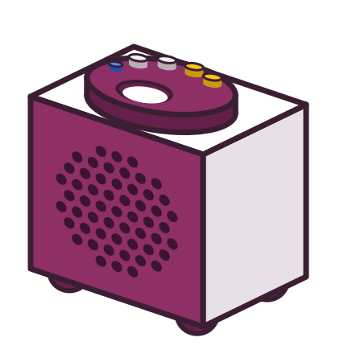

# Tiny Jukebox – quick guide

<!-- Text for a card in the format A6 (like the tag cards), front and back.
     Pictures and layout are added – so the text stays short. In detail: manual.md -->

## Front: listening

### Tag

- put it on: the album continues where it stopped
- take it off: stop

### Buttons

- louder / quieter – hold: fine steps
- next: next track
- back: start of the track – in the first 10 s: previous track
- hold back for 1 s: album from the beginning

### Light

- green: ready
- blue: playing – blinking: the album has ended
- white/blue: pause
- green → turquoise → blue: fetches the album
- yellow: tag without an album
- red, blinking: album broken

### Headset

- pairing: headset into pairing mode, then hold next + back for 5 s – blinks blue, white = done
- afterwards: switching the headset on is enough, sound in the headset only
- headset off: pause – press next: speaker

### Off

- disconnect the power

### Phone (app)

- tag on the back of the phone: plays like on the box – or tap a tile
- the same light as a band at the top of the screen

## Back: web page

### <https://tinyjukebox.local>

- open in the same WLAN, confirm the security warning, log in

### Tabs

- **Now:** what is playing, pause, track, volume
- **Tags:** place a tag with a click
- **Upload:** choose MP3 files → "Create album"
- **New tag:** put it on → "Now" → choose an album → "Link & play"
- **Radio:** create a station, assign it to a tag under "Tag management"
- **Spotify:** paste a link of the Spotify app, assign it to a tag under "Tag management"
- **Bluetooth:** pair a headset, battery, maximum volume
- **System:** password, users, library, version
