# Hardware

The circuit of the box and its printed parts. The key data of the components and the links to their data sheets
are in [`docs/hardware/`](../docs/hardware/README.md).

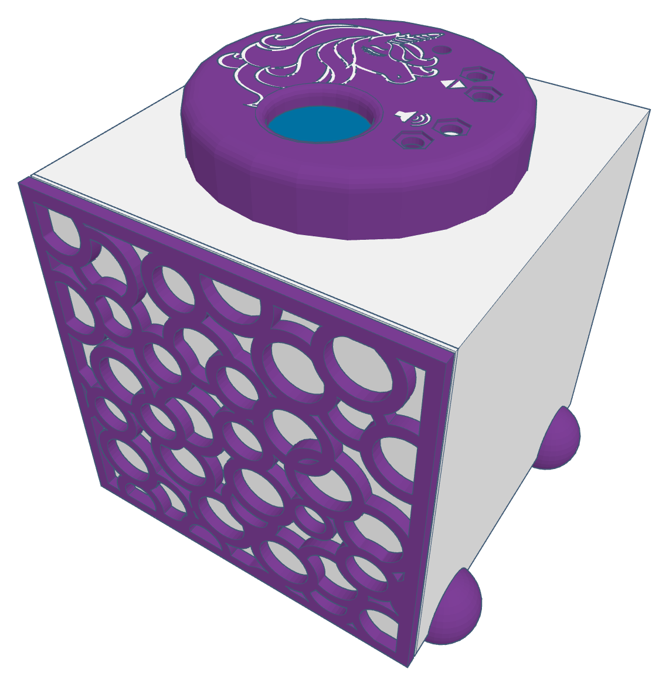

The box put together from its printed parts, as a slightly simplified 3D model.

| Folder | Content |
| --- | --- |
| `circuits/` | the circuit of the box, drawn with [Fritzing](https://fritzing.org): `tinyjukebox.fzz`, its picture `tinyjukebox_circuit.png` and the parts list `tinyjukebox_bom.html` |
| `3d-parts/` | STL files of the printed parts (December 2019), each with a picture of the same name: two views, the size in mm |

## Circuit

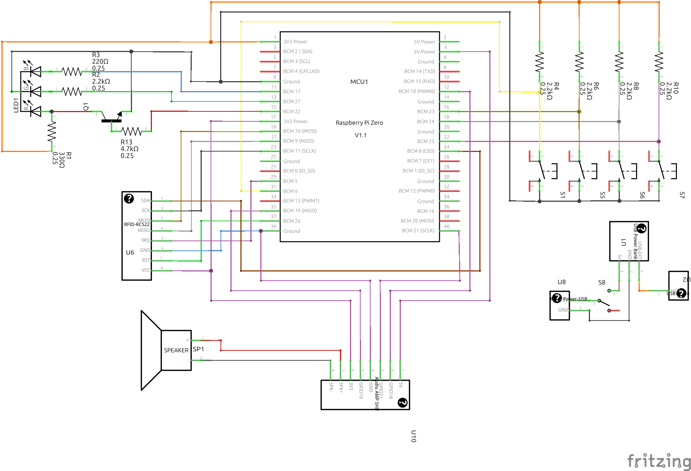

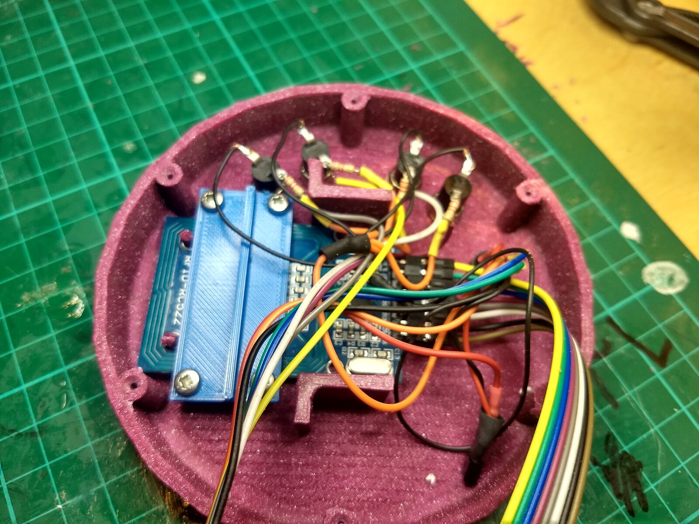

The circuit built, inside the lid of the first box (2019): the RC522 in its holder, the buttons, the LED and
their resistors, the ribbon cable to the Pi.

| Part | In the drawing | Connected to |
| --- | --- | --- |
| RFID reader RC522 | U6 | SPI0 with CE0 (GPIO 8, 9, 10, 11), RST on GPIO 26, IRQ on GPIO 5, 3.3 V |
| Audio Amp SHIM with speaker | U10, SP1 | GPIO 18, 19, 21 (I2S), 5 V and 3.3 V |
| Buttons | S1, S5, S6, S7 | GPIO 6, 23, 24, 25 against GND, each with a pull-up resistor of 2.2 kΩ to 3.3 V (R4, R6, R8, R10) |
| RGB LED, common cathode | LED1 | green on GPIO 27 through 2.2 kΩ (R2), blue on GPIO 17 through 220 Ω (R3), red on 3.3 V through 330 Ω (R1) and switched by the transistor Q1, whose base is on GPIO 22 through 4.7 kΩ (R13) |
| Power | U1, S8, U8, U2 | the power bank (U1) feeds the Pi (U8) through the switch S8; U2 is a USB socket on the power bank |

What to know about the drawing:

- The computer is drawn as a Raspberry Pi Zero. The box has a Raspberry Pi 3 Model B; its header has the same pins.
- The transistor Q1 takes the current away from the red LED while GPIO 22 is high: red is on while the pin is low.
  Green and blue are on while their pin is high.
- The buttons have a pull-up resistor each. The software switches on the internal pull-up of the Pi as well and
  debounces the buttons itself.
- The IRQ pin of the RC522 is connected to GPIO 5. The box does not use it.
- The switch S8 cuts the power between power bank and Pi: that is how the box is switched off.

The pins are those of the table in [box.md](../docs/developer/box.md), section 1, which also says what each button
does.

## Wiring

Keep the wires from the parts in the lid (buttons, LED, RFID reader) to the Pi a few centimetres away from the
magnet ring of the speaker. Too close to it, the box may behave in undefined ways.

## Printed parts

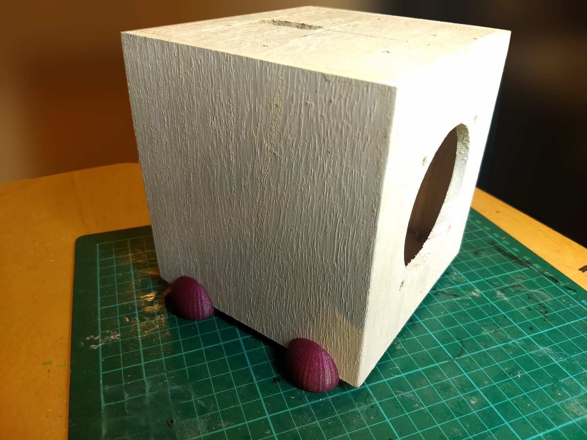

The case is made of wood; the printed parts are fixed to it.

| File in `3d-parts/` | Size in mm | Part | Photo |
| --- | --- | --- | --- |
| `lid.stl` | 110 × 110 × 20 | round lid with a hole in the middle; on the outside the outline of a unicorn and four hexagonal recesses with their symbols, on the inside posts and two brackets | 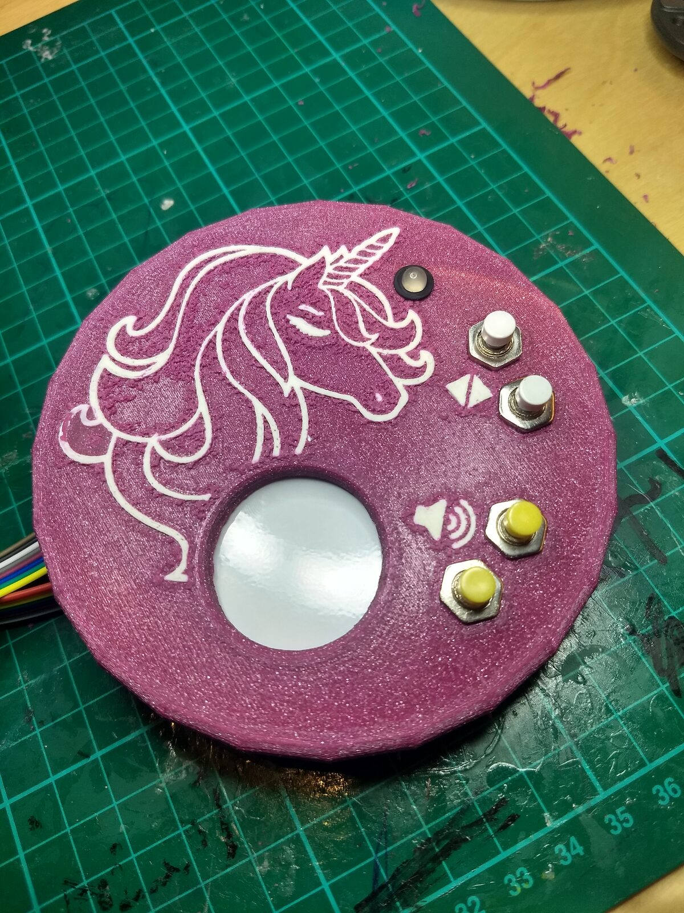 |
| `lid_inlay.stl` | 77.8 × 78.5 × 0.7 | the unicorn and the symbols of the lid as a part of their own, for a second colour | |
| `front_panel.stl` | 139 × 139 × 1 | square panel with a round field of holes for the speaker | |
| `front_grille.stl` | 139 × 139 × 4 | square grille of rings, with four eyes for screws | 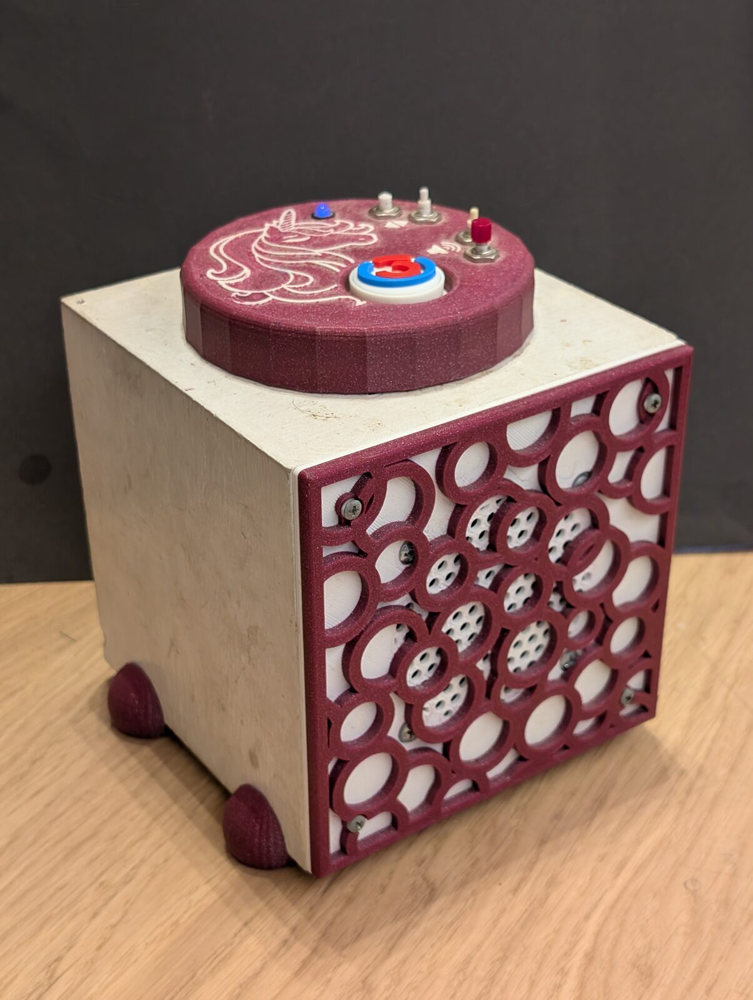 |
| `power_bank_mount.stl` | 123 × 91.5 × 15 | frame for the power bank, with four posts and two rows of slots | 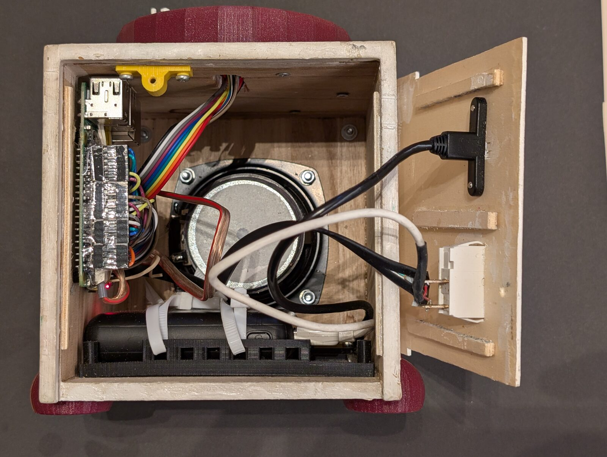 |
| `rfid_reader_holder.stl` | 52 × 23 × 5.8 | plate with a rail and four holes, for the RFID reader | 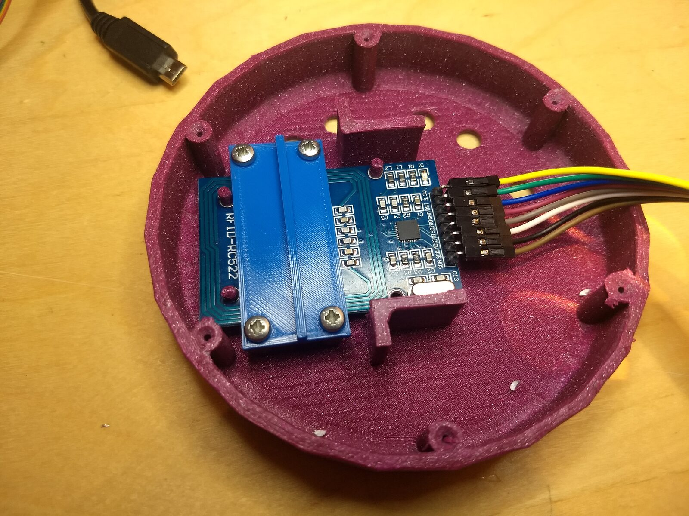 |
| `usb_port_bezel.stl` | 44.5 × 15 × 2 | bezel with an opening for a USB port and two countersunk holes | 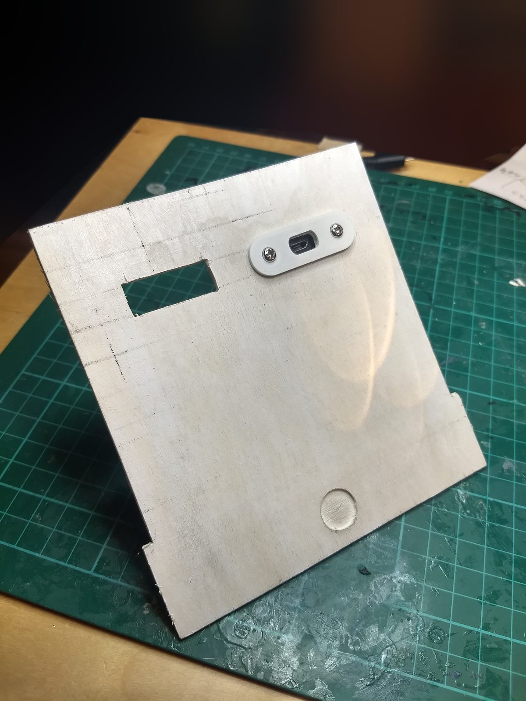 |
| `lock_screw_bracket.stl` | 30 × 10 × 10.5 | bracket with an eye for the screw that closes the case | 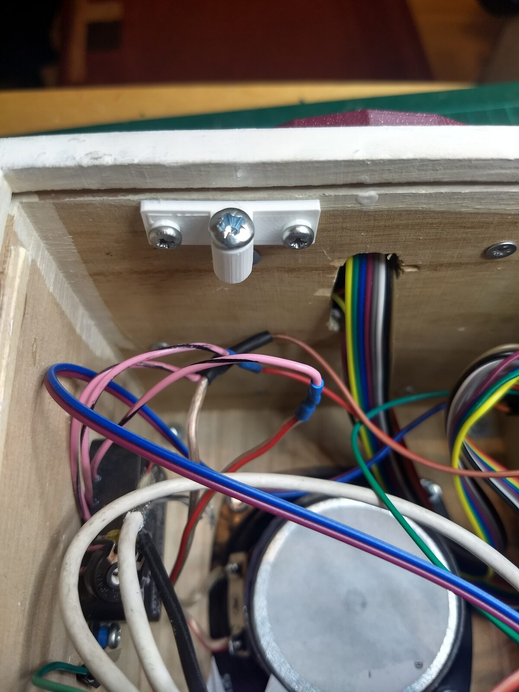 |
| `foot.stl` | 35 × 30 × 21.7 | rounded foot with a hole for its screw | 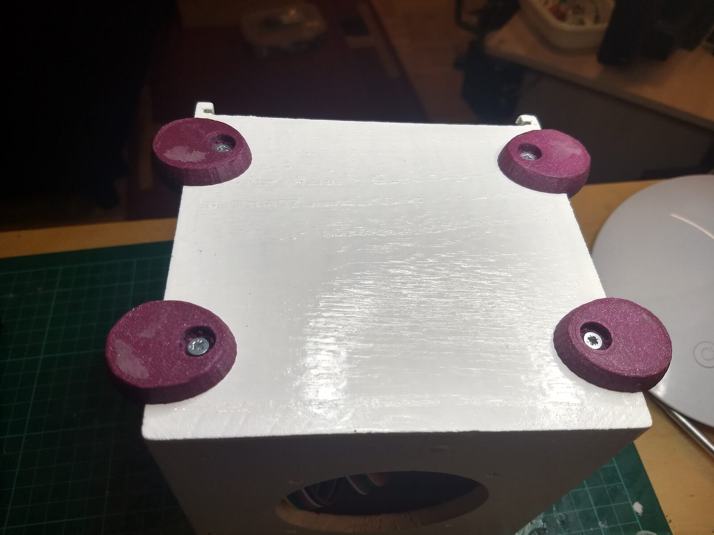 |
| `spacer_3mm.stl` | 5 × 5 × 3 | spacer ring with a hole of 3 mm | |
| `figure_base_cup.stl` | 28 × 28 × 8 | base of a figure, outer part: a cup, 26.2 mm wide and 7 mm deep inside | |
| `figure_base_plug.stl` | 26 × 26 × 7 | base of a figure, inner part: the disc that fills the cup | |
| `figure_base_wide_plug.stl` | 32 × 32 × 8 | inner part with a rim of 32 mm, for a wider base | |
| `figure_base_wide_cup.stl` | 28 × 28 × 8 | the cup of the wider base; the same shape as `figure_base_cup.stl` | |

## Licence

- **Printed parts** (`3d-parts/`): our own designs, under the MIT licence of the repository
  ([`LICENSE.txt`](../LICENSE.txt)).
- **Circuit** (`circuits/`): our own drawing, made with Fritzing. The graphics of the parts in it come from the parts
  library of Fritzing, which is under [CC BY-SA 3.0](https://creativecommons.org/licenses/by-sa/3.0/); the drawing,
  its picture and the parts list are therefore under CC BY-SA 3.0 as well.
